# 倪海厦·地纪（堪舆）逐帧精读库 · nihai-diji-corpus

     

> 把倪海厦先生讲堪舆的四讲课**一帧不漏**地读一遍（423,193 帧），
> 把他口述的方法、黑板上写的字、手指着说「这里 / 这个」指的是哪，整理成康奈尔笔记。
> 每条笔记都标依据（口述 / 板书 / 指代 / 推断），能指回集号、时间码和帧号。

倪师把学问分为天纪、地纪、人纪，堪舆属**地纪**。这四讲出自倪师《天纪》课程（B 站合辑 [BV1KJsLekEfA](https://www.bilibili.com/video/BV1KJsLekEfA/) 分 P 31 / 33 / 35 / 37），本库专门整理这一块。

**四讲公开摘要已发布（87 条要点，每条带时间码）**：见 [`summaries/`](summaries/README.md)。**四讲康奈尔笔记全文**也已公开：见 [`康奈尔笔记/`](康奈尔笔记/)（每条标依据，可指回时间码和帧号）。

姊妹库：[nihai-tianji-corpus](https://github.com/Renhuai123/nihai-tianji-corpus)（天纪十一册 4886 条判语，第 11 册「堪舆」257 条可对照）· [nihai-renji-corpus](https://github.com/Renhuai123/nihai-renji-corpus)（人纪六部 19,294 条判语）· 紫微十七集 160 万帧精读见 [ziwei-doushu/research/nishi-video-reading](https://github.com/Renhuai123/ziwei-doushu/tree/main/research/nishi-video-reading)（同一套方法）。

这是 Ouranic 开源计划「天纪 · 地纪 · 人纪」里的**地纪**部分。

## 目录

| | 章节 | 一句话 |
|---|---|---|
| 一 | [项目理念](#一项目理念) | 一帧不漏、每条有据、只记倪师讲过的、图是我们自己画的 |
| 二 | [项目背景](#二项目背景) | 天纪、地纪、人纪；为什么堪舆要逐帧读 |
| 三 | [图文笔记](#三图文笔记从这里开始读) | 四讲目录，点进去从头到尾图文对照着读 |
| 四 | [12 个图文案例](#四12-个图文案例) | 每讲 3 个：图 + 倪师原话 + 看全文 |
| 五 | [数字总览](#五数字总览) | 帧数、笔记、摘要、示意图 |
| 六 | [四讲](#六四讲) | 每讲时长、帧数、讲了什么 |
| 七 | [怎么做](#七怎么做) | 从逐帧到配图的 8 步 |
| 八 | [现状](#八现状) | 做到哪了 |
| 九 | [未来展望](#九未来展望) | 紫微黑板图、天纪、人纪 |
| 十 | [这里公开什么](#十这里公开什么) | 公开与不公开的边界 |
| 十一 | [许可](#十一许可) | 语料 CC BY-NC-SA 4.0 / 代码 MIT |

## 一、项目理念

我们和紫微斗数开源仓（[ziwei-doushu](https://github.com/Renhuai123/ziwei-doushu)）是同一个想法：**传统学问是公开的智慧，不应该被锁在围墙里。** 具体到这个仓，有六条：

1. **一帧不漏**：四讲 423,193 帧逐帧读，不跳读、不凭印象。倪师边讲边画、边指黑板，只看字幕抓不住。
2. **每条有据**：笔记每条标明依据——〔口述〕〔板书〕〔指代〕〔推断〕——都能回放到集号、时间码和帧号；拿不准的单列「待核」，不混进正文。
3. **只记倪师讲过的**：不加我们的发挥，不编地名和结论；示意图上的每个标注都能在板书或同段字幕里找到原词。
4. **图是我们自己画的**：不放视频截图。黑板上的图按讲课要讲明白的原理重画成示意图，既方便学，也尊重原作。
5. **多家互校**：一家模型写，另一家模型逐条复核，程序再核引文原字和帧号；画图同样是一家画、一家对着原画面核。
6. **全部公开**：方法、脚本、提示词、笔记、摘要和示意图都在这个仓里，任何人都能照着复现、纠错、接着做。

## 二、项目背景

倪海厦先生把学问分为三纪：**天纪**（命理）、**地纪**（堪舆）、**人纪**（中医）。他讲三才时说，命「只有1/3」，「运的时候又占了1/3」「这叫做下看地理」，人事又占三分之一；「人间道还有地理位置」「加起来就会大于天命」（[天纪 P15 00:12:49–00:13:24](https://www.bilibili.com/video/BV1KJsLekEfA/?p=15&t=769)）。地理这一块，就是这个仓整理的堪舆。

我们在 [Ouranic](https://ouranic.cn/?from=gh-diji) 做紫微斗数排盘与解读，先把倪师《天纪》里紫微斗数的 17 集逐帧读完（160 万帧，方法和成果见 [ziwei-doushu/research/nishi-video-reading](https://github.com/Renhuai123/ziwei-doushu/tree/main/research/nishi-video-reading)）。同一套方法接着用到堪舆四讲，就有了这个仓。

堪舆四讲只有约 3.9 小时，但很「密」：倪师大量在黑板上画山形水势，一边说「这里」「这个」一边指。光看字幕，常常不知道他在说哪一笔、指哪一处——所以必须逐帧看，把口述、板书和手指的位置对在一起。

## 三、图文笔记（从这里开始读）

四讲笔记是**图文合一**的：每条〔板书〕后面紧跟一幅我们照讲课重画的示意图（共 **68 幅**，不是视频截图）。点下面任一讲，就能从头到尾图文对照着读。

| 讲 | 内容 | 示意图 | 图文全文 |
|---|---|---|---|
| 堪舆一 | 龙脉、明堂与朝山取穴 | 17 幅 | [P31 康奈尔笔记](康奈尔笔记/P31/P31-堪舆-康奈尔笔记.md) |
| 堪舆二 | 官鬼、真假龙与城局 | 20 幅 | [P33 康奈尔笔记](康奈尔笔记/P33/P33-堪舆-康奈尔笔记.md) |
| 堪舆三 | 水法、龙虎与批断顺序 | 12 幅 | [P35 康奈尔笔记](康奈尔笔记/P35/P35-堪舆-康奈尔笔记.md) |
| 堪舆四 | 六神占断与紫微堪舆 | 19 幅 | [P37 康奈尔笔记](康奈尔笔记/P37/P37-堪舆-康奈尔笔记.md) |

## 四、12 个图文案例

每讲挑 3 个。图是我们重画的示意图，下面引的是笔记原句（倪师原话在「」里），点「看全文」接着往下读。

### 堪舆一（P31）· 龙脉、明堂与朝山取穴

#### 案例 1 · 台北水口砂

**怎样用台北的两条河说明结穴要左右有水？**（堪舆一 00:18:08）

  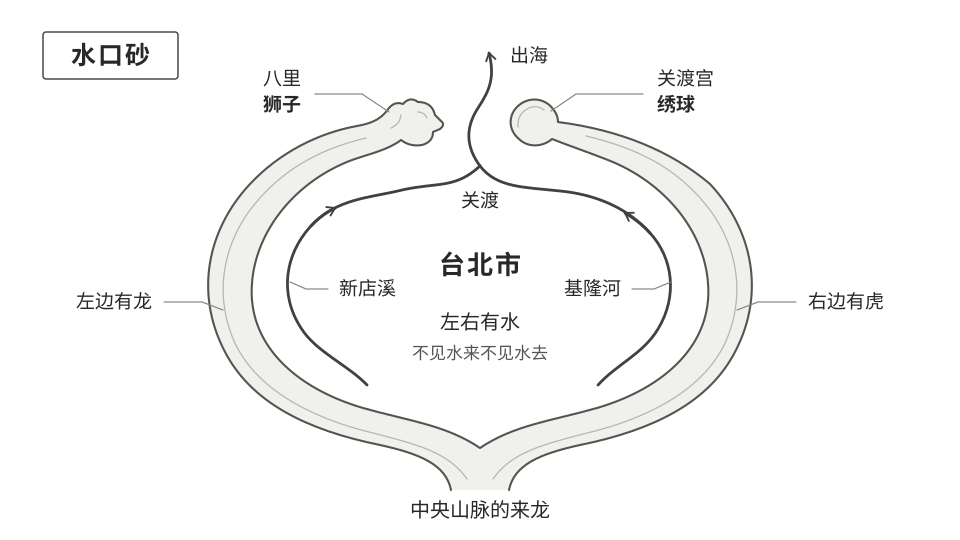 
  我们重画 · 台北水口砂

> 〔口述〕倪师说龙要结穴，有几个先决条件。他先列第一条，左右两边都要有水。  
> 〔口述〕举台北为例，倪师说左边是新店溪下来，另一边是基隆河下来，两路水「会在关渡这边出海」。  
> 〔口述〕他重说「第一个要左右要有水」，再把山势画成简图，说明「这是整个中央山脉的来龙」。

[看堪舆一图文全文 →](康奈尔笔记/P31/P31-堪舆-康奈尔笔记.md)

#### 案例 2 · 水的有情与无情

**同样是水，怎样从走向辨有情、无情？**（堪舆一 00:29:18）

  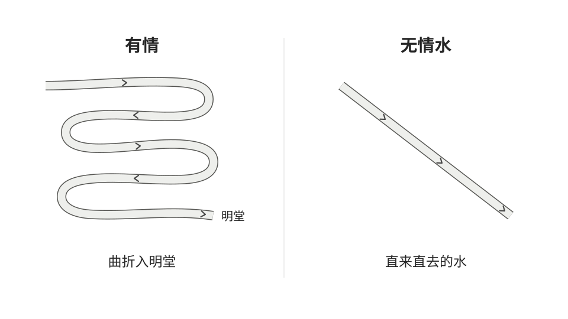 
  我们重画 · 水的有情与无情

> 〔口述〕讲山水有没有情，倪师说「专门讲水啊」。他替学生发问，眼前看见的都是水，凭什么分有情和无情？  
> 〔口述〕倪师说来水要呈回形，曲曲折折地走，「曲折入明堂」就称为有情。他给直行的水下的断语是「直来直去的水都是无情水」。

[看堪舆一图文全文 →](康奈尔笔记/P31/P31-堪舆-康奈尔笔记.md)

#### 案例 3 · 朝山取穴位：上不过眼，下不过心

**山势落到平地，凭什么选取穴位？**（堪舆一 00:49:20）

   
  我们重画 · 朝山取穴位：上不过眼，下不过心

> 〔口述〕倪师顺着山势往下讲，山势下来进入平地，他把图中这一段说成「这是进入明堂」。  
> 〔口述〕倪师连问，穴究竟落在哪一处，要不要「在这个脚上抓」？他给的选法是「我们以朝山取穴位的方法是最好」。

[看堪舆一图文全文 →](康奈尔笔记/P31/P31-堪舆-康奈尔笔记.md)

### 堪舆二（P33）· 官鬼、真假龙与城局

#### 案例 4 · 前面是官，山后是鬼

**图上前面叫什么，山后伸出的脉又叫什么？**（堪舆二 00:12:24）

  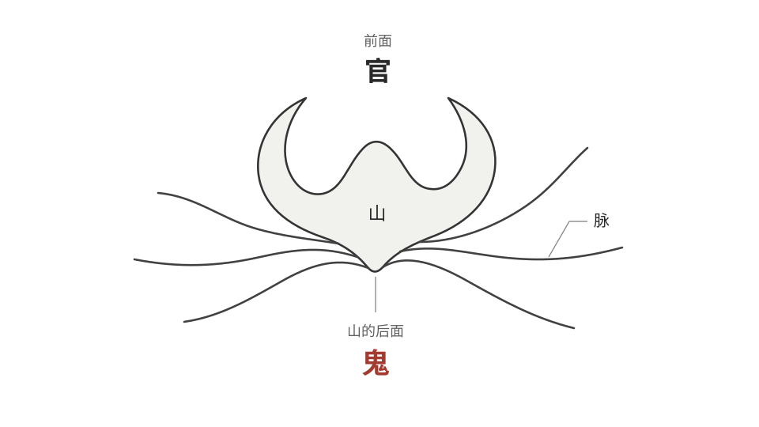 
  我们重画 · 前面是官，山后是鬼

> 〔口述〕倪师回到刚讲过的图，先说「这个前面是官」。山的后面还会延伸出许多条脉，讲到这些脉伸出的部位，他说「这个部位就叫做鬼」。

[看堪舆二图文全文 →](康奈尔笔记/P33/P33-堪舆-康奈尔笔记.md)

#### 案例 5 · 辨真假龙

**地师跑到几处看水，怎样认出真龙？**（堪舆二 00:35:06）

  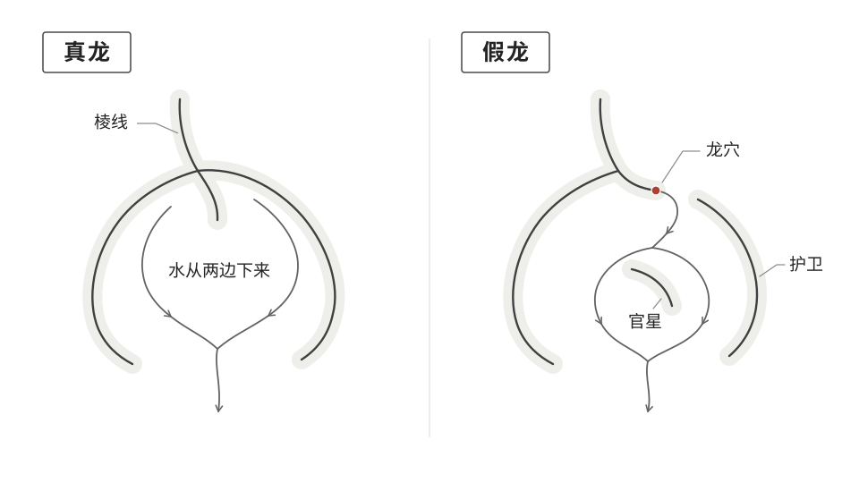 
  我们重画 · 辨真假龙

> 〔口述〕倪师说，礼拜天早上带学生去看时，有一个重点可以当场看。辨龙的真假，「就是用这水去看」。  
> 〔口述〕他举一个山势，让人看水从哪边下来，又从哪边出去。地师要跑到几处察看，见到这些水「都是由山聚集下来的水」，他才说「这叫做真龙」。

[看堪舆二图文全文 →](康奈尔笔记/P33/P33-堪舆-康奈尔笔记.md)

#### 案例 6 · 骑龙葬与金城骨

**城局里的水怎么走，脉上哪一段能葬？**（堪舆二 00:41:04）

  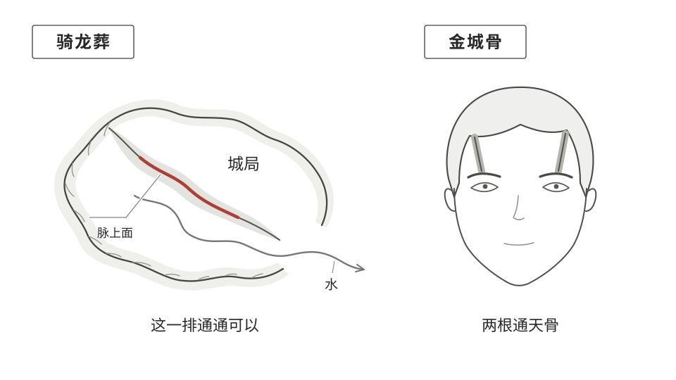 
  我们重画 · 骑龙葬与金城骨

> 〔口述〕他举开车来看城局的例子，说山势造成水，水又会出去，所以看见这样的城局，他说「一定有水」。  
> 〔口述〕讲到在脉上葬，他说「这一排通通可以」，因为这一排「都可以吃到这个城局」。他还说，现在很多人就葬在城局上面。

[看堪舆二图文全文 →](康奈尔笔记/P33/P33-堪舆-康奈尔笔记.md)

### 堪舆三（P35）· 水法、龙虎与批断顺序

#### 案例 7 · 水进明堂

**水进明堂，怎样算好，怎样算凶？**（堪舆三 00:09:16）

  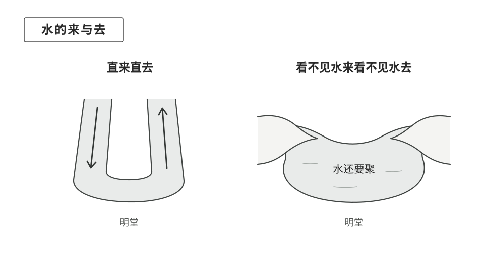 
  我们重画 · 水进明堂

> 〔口述〕问什么位置最好，倪师给的标准是站在那里「看不见水来看不见水去」。  
> 〔口述〕水直冲进明堂，又直着出去，这叫「直来直去」。倪师对这样的水断为「非常的凶非常的不好」。  
> 〔口述〕倪师说「这水要来无影呀去无踪啊」。除了来去看不见，水还要安安静静，而且要能聚。

[看堪舆三图文全文 →](康奈尔笔记/P35/P35-堪舆-康奈尔笔记.md)

#### 案例 8 · 龙虎凹风

**左龙凸出时哪边有凹风，反过来怎样画？**（堪舆三 00:53:09）

  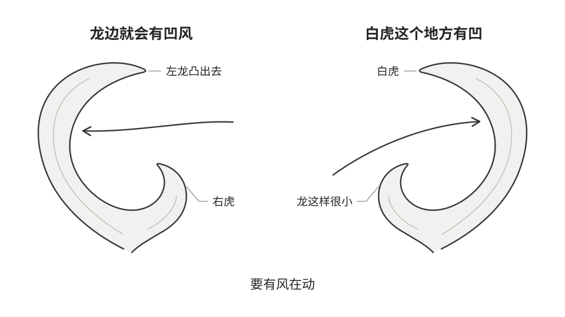 
  我们重画 · 龙虎凹风

> 〔口述〕倪师举一种龙脉结穴的样子，「这个左龙凸出去右虎变一点点」。风会进来，这一种他明确说是「龙边就会有凹风」。  
> 〔口述〕再把两边的大小调过来。倪师说这一次龙很小，白虎从这边过来，接着说「龙脉这样下来」。

[看堪舆三图文全文 →](康奈尔笔记/P35/P35-堪舆-康奈尔笔记.md)

#### 案例 9 · 批外形与喝名

**批断先看什么，到什么时候才能喝名？**（堪舆三 00:59:24）

  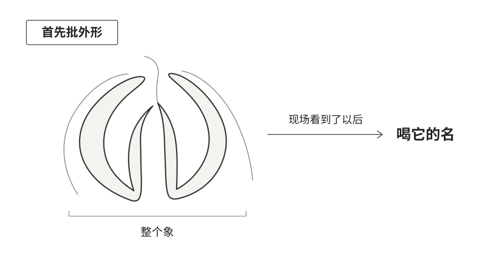 
  我们重画 · 批外形与喝名

> 〔口述〕讲批断的先后，倪师说「首先批外形嘛」，从眼前的外形看它是什么穴。  
> 〔口述〕倪师强调，一定要到现场亲眼看到那个穴，然后拿着罗盘「喝它的名」。  
> 〔口述〕他说「名一叫就立正名了」。喝名依据的是外形，看的时候要把各处合起来，看它整个象。

[看堪舆三图文全文 →](康奈尔笔记/P35/P35-堪舆-康奈尔笔记.md)

### 堪舆四（P37）· 六神占断与紫微堪舆

#### 案例 10 · 六神方位

**画在人脸上，青龙、白虎、朱雀、玄武各在哪个方位？**（堪舆四 00:01:25）

  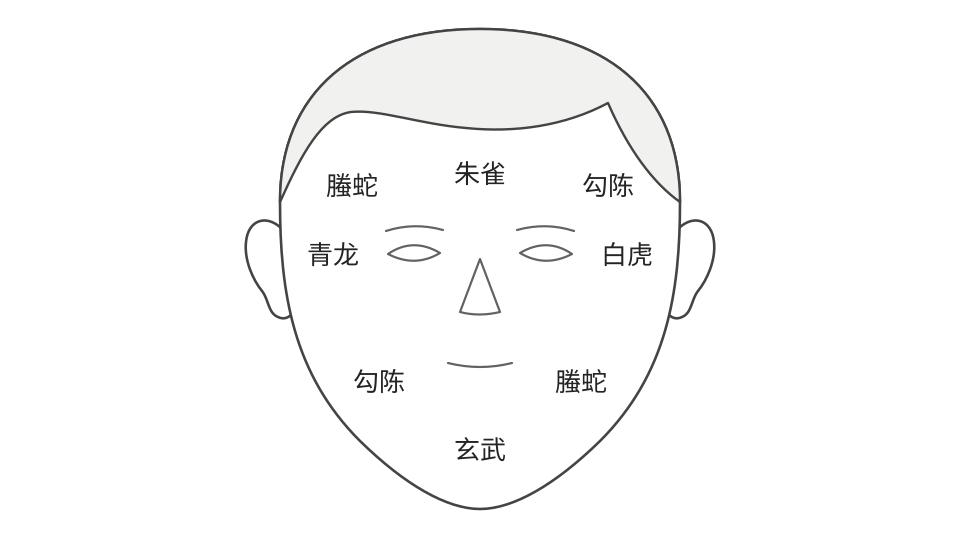 
  我们重画 · 六神方位

> 〔口述〕倪师画了一张人脸图来讲：「那我这里给诸位画了个图」「我们在脸上面也是一样」，一边画一边说「这是耳朵耳朵」，再画头发、两个眼睛、鼻子、嘴巴。  
> 〔口述〕方位对应：「在上面呢我们叫朱雀」，是南方；「北方我们叫玄武」；「东方呢是青龙」；「西边呢是白虎」。

[看堪舆四图文全文 →](康奈尔笔记/P37/P37-堪舆-康奈尔笔记.md)

#### 案例 11 · 螣蛇与三曲鼻

**看风水时，什么样的来龙算螣蛇？**（堪舆四 00:19:06）

  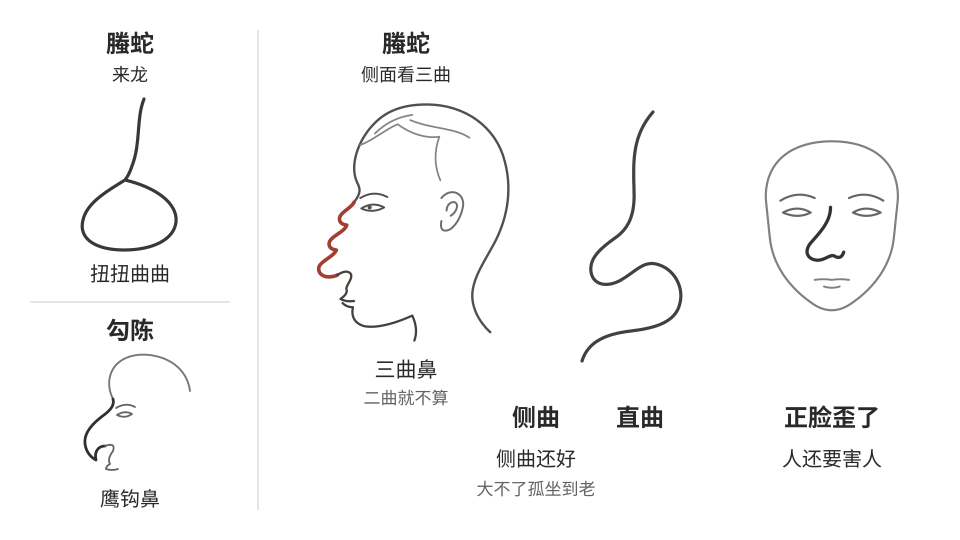 
  我们重画 · 螣蛇与三曲鼻

> 〔口述〕讲螣蛇的灾难：「我如果看风水」「风水来这个来龙这样下来」「本来是很好」，「结果来龙的时候没有在这边」，来龙「变成这样扭扭曲曲有没有」「这就是所谓的螣蛇」。

[看堪舆四图文全文 →](康奈尔笔记/P37/P37-堪舆-康奈尔笔记.md)

#### 案例 12 · 朝向与入穴

**来龙、朝向、入穴怎样对成内外卦？**（堪舆四 00:34:06）

  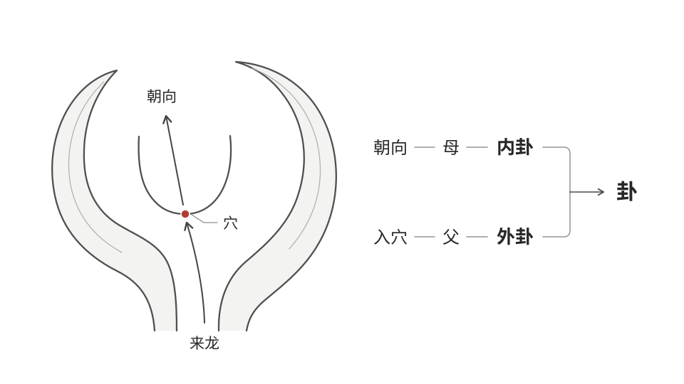 
  我们重画 · 朝向与入穴

> 〔口述〕倪师顺带说，把上几代的阴宅风水「也把它拿到阳宅上面」「也把它拿到卦来看的时候」「就不是这样子了哦」，并提到「诸位都知道八卦怎么布列」。  
> 〔口述〕他画图讲：「这是来龙看龙虎」「这是一个山山龙来这边结穴」，那天站在这边，开车下去「到明堂那来看」。  
> 〔口述〕「这个是朝向」，朝为母、为内；「入入穴为父为外」，「就是内卦和外卦并在一起」「一对上去以后就知道这是什么卦」；阴宅上用易经推，「卦的设定是这样子设定的」。

[看堪舆四图文全文 →](康奈尔笔记/P37/P37-堪舆-康奈尔笔记.md)

## 五、数字总览

| 指标 | 数值 |
|---|---|
| 课程 | 堪舆一至四，共 **4 讲、约 3.9 小时** |
| 逐帧 | **423,193 帧**，每帧有 sha256 清单（画面只存本机，不公开） |
| 逐帧层 | 堪舆一至三新跑 **27,558 窗**（Grok 4.7，每窗 12 帧）；堪舆四在紫微那轮已跑过 |
| 写笔记 | Astra 6.2 分块写，Grok 4.7 逐条复核，再由程序逐条核对引文原字和帧号 |
| 示意图 | **68 幅**（讲清楚原理版，我们照讲课重画），**591 个标注**每个都对得上板书帧号或字幕时间码 |
| 进度 | 四讲笔记均已出稿、图文合一；公开摘要四讲 87 条已发布（[`summaries/`](summaries/README.md)） |

## 六、四讲

| 讲 | 分 P | 时长 | 帧数 | 内容 |
|---|---|---|---|---|
| 堪舆一 | P31 | 59:40 | 107,401 | 龙脉 / 明堂 / 官鬼 / 相上风水 / 罗经使用 / 朝山取穴法 |
| 堪舆二 | P33 | 1:02:03 | 111,693 | 官鬼 / 九星 / 天星四贵 / 内外砂 / 真假龙 / 城局 / 骑龙葬 / 杖法 |
| 堪舆三 | P35 | 1:01:59 | 111,579 | 三吉六秀 / 穿山 72 龙 / 天罡 28 宿 / 罗盘使用 / 分房宫位法 / 透地 60 龙 / 批风水顺序 |
| 堪舆四 | P37 | 51:24 | 92,520 | 六神占断法 / 紫微堪舆应用 / 斗君 / 流月流日 / 六神灵机运用 |

## 七、怎么做

1. **逐帧清单**：四讲视频逐帧算 sha256，帧数与视频自带记录核对一致。
2. **逐帧层**：每窗 12 帧，记下板书、手势、正在写什么、手指指向。
3. **本机预处理**：字幕参照轨、逐字语音、人体姿态。
4. **指代**：倪师说「这里 / 这个」时指的是哪，看原帧标出来。
5. **按句拼接**：每句话挂上逐帧层、语音、板书、指代。
6. **写笔记**：按话题切块，每块照材料写康奈尔笔记，每条标依据。
7. **复核**：另一家模型逐条核对、写手按意见改，程序再核一遍引文原字和帧号；拿不准的单列「待核」，不混进正文。
8. **配图**：照讲课重画示意图（讲清楚原理，不照抄黑板），Astra 画、Grok 对着原画面和字幕核；每个标注都在各讲 `图/图说明.json` 记出处（板书帧号或字幕时间码）。

和紫微十七集的不同：画面左侧的要点栏和配图是上传者后加的，不是倪师的话，不当依据；这四讲也不做电子叠图转写。

## 八、现状

四讲已全部完成：逐帧、笔记、复核、公开摘要、示意图都已出稿并公开。下一步见「未来展望」。

- [x] 四讲下载与逐帧清单
- [x] 逐帧层全量
- [x] 本机预处理、指代、按句拼接
- [x] 堪舆四笔记出稿
- [x] 堪舆一至三复核改稿、出稿
- [x] 四讲公开摘要发布（87 条要点，11-20）
- [x] 四讲 68 幅示意图插进笔记，图文合一（11-20）

## 九、未来展望

- **紫微十七集的黑板示意图**：同一套「讲清楚原理」的画法，11-20 开始画，画完放进 [ziwei-doushu](https://github.com/Renhuai123/ziwei-doushu/tree/main/research/nishi-video-reading) 的笔记里（那边电子叠图里的命盘已逐格重画公开）。
- **天纪、人纪**：天纪里紫微以外的部分（易经六十四卦等）和人纪（中医），之后都套这条流水线：逐帧 → 指代 → 笔记 → 复核 → 配图 → 公开。语料仓已在：[nihai-tianji-corpus](https://github.com/Renhuai123/nihai-tianji-corpus)、[nihai-renji-corpus](https://github.com/Renhuai123/nihai-renji-corpus)。
- **一起纠错**：发现笔记或示意图和视频对不上，请开 issue，写明集号和时间码；核实后改正，并在提交里致谢。

## 十、这里公开什么

- **公开**：方法、脚本（[`scripts/`](scripts/)）、提示词（[`prompts/`](prompts/)）、收尾步骤（[`docs/`](docs/)），以及每讲的公开摘要（[`summaries/`](summaries/README.md)，倪师原话只引短句，带时间码）。脚本里的本机路径写成「<工作目录>」。
- **也公开**：四讲康奈尔笔记全文（[`康奈尔笔记/`](康奈尔笔记/)），倪师原话照字幕原字引在「」里。笔记里的图是我们照讲课重画的示意图，不是视频截图（视频画面和帧仍不公开）。
- **不公开**：视频画面和帧图片、整段逐字转写。

原视频见 B 站合辑 [BV1KJsLekEfA](https://www.bilibili.com/video/BV1KJsLekEfA/)。

## 十一、许可

- 摘要等语料内容：**CC BY-NC-SA 4.0**（署名—非商业性使用—相同方式共享）
- 脚本代码：**MIT License**

原课程内容著作权归倪海厦先生及其权利继承人所有。本仓库为学习研究目的的短引文整理，收到权利方异议将立即下架相应内容。
