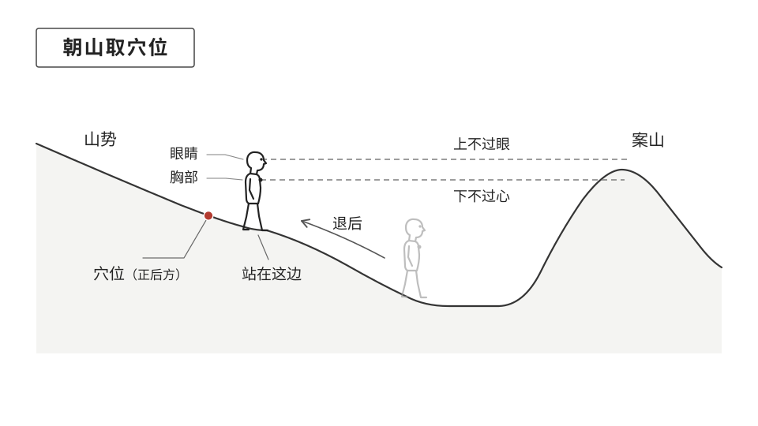

# 倪海厦·地纪（堪舆）逐帧精读库 · nihai-diji-corpus

    

> 把倪海厦先生讲堪舆的四讲课**一帧不漏**地读一遍（423,193 帧），
> 把他口述的方法、黑板上写的字、手指着说「这里 / 这个」指的是哪，整理成康奈尔笔记。
> 每条笔记都标依据（口述 / 板书 / 指代 / 推断），能指回集号、时间码和帧号。

倪师把学问分为天纪、地纪、人纪，堪舆属**地纪**。这四讲出自倪师《天纪》课程（B 站合辑 [BV1KJsLekEfA](https://www.bilibili.com/video/BV1KJsLekEfA/) 分 P 31 / 33 / 35 / 37），本库专门整理这一块。

**四讲公开摘要已发布（87 条要点，每条带时间码）**：见 [`summaries/`](summaries/README.md)。**四讲康奈尔笔记全文**也已公开：见 [`康奈尔笔记/`](康奈尔笔记/)（每条标依据，可指回时间码和帧号）。

姊妹库：[nihai-tianji-corpus](https://github.com/Renhuai123/nihai-tianji-corpus)（天纪十一册 4886 条判语，第 11 册「堪舆」257 条可对照）· [nihai-renji-corpus](https://github.com/Renhuai123/nihai-renji-corpus)（人纪六部 19,294 条判语）· 紫微十七集 160 万帧精读见 [ziwei-doushu/research/nishi-video-reading](https://github.com/Renhuai123/ziwei-doushu/tree/main/research/nishi-video-reading)（同一套方法）。

## 图文笔记（从这里开始读）

四讲笔记是**图文合一**的：每条〔板书〕后面紧跟一幅我们照讲课重画的示意图（共 **68 幅**，不是视频截图）。点下面任一讲，就能从头到尾图文对照着读。

| 讲 | 内容 | 示意图 | 图文全文 |
|---|---|---|---|
| 堪舆一 | 龙脉 / 明堂 / 官鬼 / 朝山取穴法 | 17 幅 | [P31 康奈尔笔记](康奈尔笔记/P31/P31-堪舆-康奈尔笔记.md) |
| 堪舆二 | 官鬼 / 九星 / 真假龙 / 城局 / 骑龙葬 | 20 幅 | [P33 康奈尔笔记](康奈尔笔记/P33/P33-堪舆-康奈尔笔记.md) |
| 堪舆三 | 三吉六秀 / 罗盘使用 / 批风水顺序 | 12 幅 | [P35 康奈尔笔记](康奈尔笔记/P35/P35-堪舆-康奈尔笔记.md) |
| 堪舆四 | 六神占断法 / 紫微堪舆应用 | 19 幅 | [P37 康奈尔笔记](康奈尔笔记/P37/P37-堪舆-康奈尔笔记.md) |

### 示例一 · 山势落到平地，凭什么选取穴位？（堪舆一 00:49:20）

> 〔口述〕倪师顺着山势往下讲，山势下来进入平地，他把图中这一段说成「这是进入明堂」。  
> 〔口述〕倪师连问，穴究竟落在哪一处，要不要「在这个脚上抓」？他给的选法是「我们以朝山取穴位的方法是最好」。

[看堪舆一图文全文 →](康奈尔笔记/P31/P31-堪舆-康奈尔笔记.md)

### 示例二 · 怎样用台北的两条河说明结穴要左右有水？（堪舆一 00:18:08）

> 〔口述〕倪师说龙要结穴，有几个先决条件。他先列第一条，左右两边都要有水。  
> 〔口述〕举台北为例，倪师说左边是新店溪下来，另一边是基隆河下来，两路水「会在关渡这边出海」。  
> 〔口述〕他重说「第一个要左右要有水」，再把山势画成简图，说明「这是整个中央山脉的来龙」。

[看堪舆一图文全文 →](康奈尔笔记/P31/P31-堪舆-康奈尔笔记.md)

### 示例三 · 看风水时，什么样的来龙算螣蛇？（堪舆四 00:19:06）

> 〔口述〕讲螣蛇的灾难：「我如果看风水」「风水来这个来龙这样下来」「本来是很好」，「结果来龙的时候没有在这边」，来龙「变成这样扭扭曲曲有没有」「这就是所谓的螣蛇」。

[看堪舆四图文全文 →](康奈尔笔记/P37/P37-堪舆-康奈尔笔记.md)

## 数字总览

| 指标 | 数值 |
|---|---|
| 课程 | 堪舆一至四，共 **4 讲、约 3.9 小时** |
| 逐帧 | **423,193 帧**，每帧有 sha256 清单（画面只存本机，不公开） |
| 逐帧层 | 堪舆一至三新跑 **27,558 窗**（Grok 4.7，每窗 12 帧）；堪舆四在紫微那轮已跑过 |
| 写笔记 | Astra 6.2 分块写，Grok 4.7 逐条复核，再由程序逐条核对引文原字和帧号 |
| 进度 | 四讲笔记均已出稿；公开摘要四讲 87 条已发布（[`summaries/`](summaries/README.md)） |

## 四讲

| 讲 | 分 P | 时长 | 帧数 | 内容 |
|---|---|---|---|---|
| 堪舆一 | P31 | 59:40 | 107,401 | 龙脉 / 明堂 / 官鬼 / 相上风水 / 罗经使用 / 朝山取穴法 |
| 堪舆二 | P33 | 1:02:03 | 111,693 | 官鬼 / 九星 / 天星四贵 / 内外砂 / 真假龙 / 城局 / 骑龙葬 / 杖法 |
| 堪舆三 | P35 | 1:01:59 | 111,579 | 三吉六秀 / 穿山 72 龙 / 天罡 28 宿 / 罗盘使用 / 分房宫位法 / 透地 60 龙 / 批风水顺序 |
| 堪舆四 | P37 | 51:24 | 92,520 | 六神占断法 / 紫微堪舆应用 / 斗君 / 流月流日 / 六神灵机运用 |

## 怎么做

1. **逐帧清单**：四讲视频逐帧算 sha256，帧数与视频自带记录核对一致。
2. **逐帧层**：每窗 12 帧，记下板书、手势、正在写什么、手指指向。
3. **本机预处理**：字幕参照轨、逐字语音、人体姿态。
4. **指代**：倪师说「这里 / 这个」时指的是哪，看原帧标出来。
5. **按句拼接**：每句话挂上逐帧层、语音、板书、指代。
6. **写笔记**：按话题切块，每块照材料写康奈尔笔记，每条标依据。
7. **复核**：另一家模型逐条核对、写手按意见改，程序再核一遍引文原字和帧号；拿不准的单列「待核」，不混进正文。
8. **配图**：照讲课重画示意图（讲清楚原理，不照抄黑板），Astra 画、Grok 对着原画面和字幕核；每个标注都在各讲 `图/图说明.json` 记出处（板书帧号或字幕时间码）。

和紫微十七集的不同：画面左侧的要点栏和配图是上传者后加的，不是倪师的话，不当依据；这四讲也不做电子叠图转写。

## 这里公开什么

- **公开**：方法、脚本（[`scripts/`](scripts/)）、提示词（[`prompts/`](prompts/)）、收尾步骤（[`docs/`](docs/)），以及每讲的公开摘要（[`summaries/`](summaries/README.md)，倪师原话只引短句，带时间码）。脚本里的本机路径写成「<工作目录>」。
- **也公开**：四讲康奈尔笔记全文（[`康奈尔笔记/`](康奈尔笔记/)），倪师原话照字幕原字引在「」里。笔记里的图是我们照讲课重画的示意图，不是视频截图（视频画面和帧仍不公开）。
- **不公开**：视频画面和帧图片、整段逐字转写。

原视频见 B 站合辑 [BV1KJsLekEfA](https://www.bilibili.com/video/BV1KJsLekEfA/)。

## 进度

- [x] 四讲下载与逐帧清单
- [x] 逐帧层全量
- [x] 本机预处理、指代、按句拼接
- [x] 堪舆四笔记出稿
- [x] 堪舆一至三复核改稿、出稿
- [x] 四讲公开摘要发布（87 条要点，11-20）
- [x] 四讲 68 幅示意图插进笔记，图文合一（11-20）

## 许可

- 摘要等语料内容：**CC BY-NC-SA 4.0**（署名—非商业性使用—相同方式共享）
- 脚本代码：**MIT License**

原课程内容著作权归倪海厦先生及其权利继承人所有。本仓库为学习研究目的的短引文整理，收到权利方异议将立即下架相应内容。
