# P31 · 16 上：堪舆一（龙脉 / 明堂 / 官鬼 / 相上风水 / 罗经使用 / 朝山取穴法）（00:00:00–00:59:40，共 107,401 帧）

> 2026-11-19 整理。依据 Grok 4.7 逐帧记录与现成的四层材料（字幕、语音、板书、指代），由 Astra 6.2 max 分段起草，Grok 4.7 high 逐条核过、Astra 6.2 max 按核稿意见改过，引文由程序逐段对过字幕。流程 2026-11-11 经站长认可。
> 依据标记：〔口述〕字幕与语音两路对得上的话，「」里是字幕原字 ·〔叠图〕后期贴的电子图（视频上传者加的），**不算倪师的话** ·〔板书〕粉笔字（看过那一帧原图才写）·〔指代〕「这里 / 这个」指哪（只收核过、确定的）·〔推断〕笔记作者自己的推断。每条后面的时间码可以点，跳到 B 站那一秒。

## 全集总结

**通用规则**

- 倪师说，穴一出现，地师开口讲时「一定是先所谓一语成谶」（[00:11:57–00:12:08](https://www.bilibili.com/video/BV1KJsLekEfA/?p=31&t=717)，第 21510–21851 帧）
- 倪师列的结穴条件，第一是左右有水，第二是有砂。（[00:18:06–00:18:47](https://www.bilibili.com/video/BV1KJsLekEfA/?p=31&t=1086)，第 32580–33827 帧）
- 阳宅、阴宅同讲藏风纳气，山势两侧环抱、风不容易吹进来，是倪师举的辨法。（[00:25:04–00:25:42](https://www.bilibili.com/video/BV1KJsLekEfA/?p=31&t=1504)，第 45126–46283 帧）
- 来龙一过峡，按倪师的讲法，就可以判断前面要结穴。（[00:31:04–00:31:09](https://www.bilibili.com/video/BV1KJsLekEfA/?p=31&t=1864)，第 55926–56093 帧）
- 明堂有两项要求，第一要平广，第二要水聚。（[00:31:22–00:31:34](https://www.bilibili.com/video/BV1KJsLekEfA/?p=31&t=1882)，第 56466–56825 帧）
- 看龙要沿水往上找源头，分辨水是本山积下来的还是从后面来的，若从后面来便可能是假穴，还要回头再找（[00:39:55–00:40:20](https://www.bilibili.com/video/BV1KJsLekEfA/?p=31&t=2395)，第 71862–72623 帧）
- 把脸相放到山上看，可以从小处的形状类推大处（[00:47:21–00:47:34](https://www.bilibili.com/video/BV1KJsLekEfA/?p=31&t=2841)，第 85254–85631 帧）
- 朝山取穴讲「上不过眼下不过心」，从站处看案山要略低于眼、略高于胸，对好高低后在正后方取穴（[00:49:40–00:50:11](https://www.bilibili.com/video/BV1KJsLekEfA/?p=31&t=2980)，第 89424–90341 帧）
- 阴龙取阴向，阳龙取阳向，来龙与所取的向同属阴或同属阳，倪师称为净龙（[00:50:42–00:50:51](https://www.bilibili.com/video/BV1KJsLekEfA/?p=31&t=3042)，第 91272–91541 帧）
- 倪师说找穴无论阴宅阳宅、人居或国都，都喜鱼、虾、龟，怕蛇、虫、蚂蚁，并把有蛇、有蚂蚁的地方归为斩戮之地（[00:58:17–00:59:00](https://www.bilibili.com/video/BV1KJsLekEfA/?p=31&t=3497)，第 104910–106205 帧）

**只在本例**

- 倪师说公元1048年宋庆历年间黄河改道，切断了原来运行地气的中龙（[00:05:53–00:06:20](https://www.bilibili.com/video/BV1KJsLekEfA/?p=31&t=353)，第 10590–11423 帧）
- 刘地师先断「口出和尚角出相」，后来改说「朱家天子刘家相」，倪师把断语讲到了朱元璋当和尚和刘伯温辅佐他的经历上（[00:12:09–00:12:49](https://www.bilibili.com/video/BV1KJsLekEfA/?p=31&t=729)，第 21876–23087 帧）
- 倪师把台湾山龙结穴的位置落在台北盆地，并以新店溪、基隆河会到关渡出海说明左右有水。（[00:17:51–00:18:20](https://www.bilibili.com/video/BV1KJsLekEfA/?p=31&t=1071)，第 32148–33023 帧）
- 台北水口左侧八里的整座山被比作狮子，右侧关渡宫被比作绣球（[00:20:02–00:20:28](https://www.bilibili.com/video/BV1KJsLekEfA/?p=31&t=1202)，第 36084–36869 帧）
- 倪师把日月潭说成中央山脉龙抬头之处，以光华岛居中、潭水聚集和潭底龙脉的起伏说明这里聚为一个穴（[00:32:02–00:32:31](https://www.bilibili.com/video/BV1KJsLekEfA/?p=31&t=1922)，第 57666–58535 帧）
- 倪师以南北向的龙脉对照坐西朝东的总统府，判它侧对来龙，接着说「所以台湾局势很乱就是这样的」，随即补充「这是风水上来看」（[00:42:28–00:43:02](https://www.bilibili.com/video/BV1KJsLekEfA/?p=31&t=2548)，第 76464–77483 帧）
- 高手见潜山山势太秀丽，断这里出的是在戏里演皇帝的名伶，倪师说他们当不了真命天子，是因为「龙不够壮」（[00:45:08–00:45:41](https://www.bilibili.com/video/BV1KJsLekEfA/?p=31&t=2708)，第 81246–82241 帧）

**不是风水规则，是处世方法**

- 倪师用「答应就做」讲朱元璋祖父的老实，他应下了替地师潜水的事，就下水去办（[00:11:06–00:11:13](https://www.bilibili.com/video/BV1KJsLekEfA/?p=31&t=666)，第 19992–20201 帧）
- 倪师用「贵人讲话言简刚中」提醒人说话简要，免去繁复无用的形式动作。（[00:13:24–00:13:36](https://www.bilibili.com/video/BV1KJsLekEfA/?p=31&t=804)，第 24138–24503 帧）
- 倪师反对让别人花很多钱去做他认为没有用的生基（[00:33:23–00:33:38](https://www.bilibili.com/video/BV1KJsLekEfA/?p=31&t=2003)，第 60090–60557 帧）
- 知道怎样用一种形去制另一种形，也不要拿这套说法去骗人（[00:37:14–00:37:33](https://www.bilibili.com/video/BV1KJsLekEfA/?p=31&t=2234)，第 67026–67595 帧）
- 倪师借官员只笑不决的例子说，该做决策时要开口表态（[00:47:51–00:47:58](https://www.bilibili.com/video/BV1KJsLekEfA/?p=31&t=2871)，第 86142–86369 帧）

## 目录

**堪舆概论、中国龙脉与朱元璋典故**

1. 堪舆选址与中国龙脉（00:00:00–00:06:26）
2. 龙气南移与朱家犀牛穴典故（00:06:26–00:12:49）

**点穴一语成谶、三龙运势与台北结穴**

3. 点穴定名、三龙与台北结穴（00:12:49–00:18:51）
4. 台北水口砂、龙虎抱与龙脉结穴（00:18:51–00:25:04）

**藏风纳气、明堂过峡与生基些子**

5. 藏风纳气、山水的生与情、过峡与明堂（00:25:04–00:31:45）
6. 水聚天心、生基、些子大法与用象（00:31:46–00:38:10）

**官鬼假穴、立向潜山例与人相风水**

7. 官鬼辨形、沿水辨穴与台北立向（00:38:10–00:43:06）
8. 台北择都、潜山断穴与人相风水（00:43:06–00:48:13）

**朝山取穴、罗经阴阳与赤霆经诸地**

9. 朝山取穴、罗经立向与帝王之地（00:48:13–00:53:57）
10. 文武山头、科甲之笔与择穴（00:53:57–00:59:40）

## 堪舆概论、中国龙脉与朱元璋典故

### 1　堪舆选址与中国龙脉（[00:00:00–00:06:26](https://www.bilibili.com/video/BV1KJsLekEfA/?p=31&t=0)，第 0–11591 帧）

| 提示区 | 笔记区 |
|---|---|
| **台湾堪舆有哪些派别，本课怎样取舍？** | 〔口述〕这堂课开始讲堪舆。倪师说台湾的堪舆学派很多，举了三元派和三合派两个名字。（[00:00:05–00:00:19](https://www.bilibili.com/video/BV1KJsLekEfA/?p=31&t=5)，第 162–599 帧） 〔板书〕黑板左边竖写「堪舆学」，旁边有一条长竖线。线的右边并排写着「三元」和「三合」，各占一列。（[00:00:18](https://www.bilibili.com/video/BV1KJsLekEfA/?p=31&t=18)，第 558 帧） 〔口述〕倪师说本课不另立门派，对两派「各取它们的精华」，再把所取的内容放在《易经》的体系里讨论。（[00:00:20–00:00:39](https://www.bilibili.com/video/BV1KJsLekEfA/?p=31&t=20)，第 600–1199 帧） |
| **地师为什么要懂典故，倪师从谁讲起？** | 〔口述〕倪师先问什么叫堪舆、为什么要研究、学了对人有什么帮助，又说会介绍一些有名的典故。（[00:00:41–00:00:53](https://www.bilibili.com/video/BV1KJsLekEfA/?p=31&t=41)，第 1230–1613 帧） 〔口述〕堪舆也叫风水，过去做这门事的人也叫地师。倪师对地师提了一个基本要求，就是要知道一些典故。（[00:00:53–00:01:07](https://www.bilibili.com/video/BV1KJsLekEfA/?p=31&t=53)，第 1614–2033 帧） 〔口述〕堪舆的来历很早，一直追问源头很难说尽。这堂课从汉朝讲起，先举张良，说他很懂堪舆。（[00:01:15–00:01:36](https://www.bilibili.com/video/BV1KJsLekEfA/?p=31&t=75)，第 2268–2903 帧） 〔口述〕倪师说张良写过一部专讲堪舆的书，书名按字幕记为《赤霆经》。他用「雷霆万钧的雷霆」说明书名中的霆字。（[00:01:36–00:01:46](https://www.bilibili.com/video/BV1KJsLekEfA/?p=31&t=96)，第 2904–3185 帧） 〔板书〕黑板左侧可辨一个「地」字，字下有箭头斜指左下。右侧横写的一行字下面划了线，首字「赤」可辨，其余连笔认不全。（[00:01:45](https://www.bilibili.com/video/BV1KJsLekEfA/?p=31&t=105)，第 3168 帧） |
| **选住家或首都，为什么要看周围的山水？** | 〔口述〕倪师把堪舆讲成一个选地方的模式。天地之间有山有水，要从这么大的地方找出哪里适合人居，哪里适合定都，也可以为自家选住处。（[00:01:46–00:02:04](https://www.bilibili.com/video/BV1KJsLekEfA/?p=31&t=106)，第 3186–3743 帧） 〔口述〕他举美国密西西比河的例子，说河道一改，一批房子就被水冲走了。他用这件事说明住家选址为什么要懂堪舆。（[00:02:06–00:02:14](https://www.bilibili.com/video/BV1KJsLekEfA/?p=31&t=126)，第 3804–4043 帧） 〔口述〕倪师说，老祖宗找的地方永远不会有天灾，而且「进可攻退可守」。他说堪舆学本身也是一种「兵法兵书」，所以「什么地方都可以用到」。（[00:02:14–00:02:28](https://www.bilibili.com/video/BV1KJsLekEfA/?p=31&t=134)，第 4044–4457 帧） |
| **巨视和微视各看多大的范围？** | 〔口述〕从大处看，倪师称为巨视。他说「大到我们看整个中国的地理环境」，还可以讨论国与国之间的关系。（[00:02:28–00:02:38](https://www.bilibili.com/video/BV1KJsLekEfA/?p=31&t=148)，第 4458–4769 帧） 〔板书〕黑板中部横写的一行字下面有一道斜线，斜线下方另起一个大字，可辨为「巨」。（[00:02:32](https://www.bilibili.com/video/BV1KJsLekEfA/?p=31&t=152)，第 4584 帧） 〔板书〕「巨」的正下方又写了一个「视」字，两字沿同一列自上而下读作「巨视」。（[00:02:37](https://www.bilibili.com/video/BV1KJsLekEfA/?p=31&t=157)，第 4716 帧） 〔口述〕范围缩小到一个宗族时，倪师用的是微视这个词。他举的具体问题是看这个宗族的兴衰。（[00:02:39–00:02:47](https://www.bilibili.com/video/BV1KJsLekEfA/?p=31&t=159)，第 4770–5033 帧） 〔板书〕「巨视」的右边另起一列，上字可辨为「微」。倪师手中的粉笔在下字旁，露出的笔画认不全。（[00:02:44](https://www.bilibili.com/video/BV1KJsLekEfA/?p=31&t=164)，第 4937 帧） |
| **看阴宅要看什么，罗经又怎样用？** | 〔口述〕讲到阴宅，倪师说过去专门看风水，要看山川河流，留意「水如何来」，这些地方就用得到堪舆。（[00:02:47–00:03:02](https://www.bilibili.com/video/BV1KJsLekEfA/?p=31&t=167)，第 5034–5477 帧） 〔板书〕黑板左上方横写「阴宅」两个大字，字的下方有一条长线，从左往右略向上斜。（[00:02:53](https://www.bilibili.com/video/BV1KJsLekEfA/?p=31&t=173)，第 5196 帧） 〔板书〕「阴宅」两侧可见弧形粉笔线，向下接到字底的长线，两个字被圈在了一起。（[00:03:02](https://www.bilibili.com/video/BV1KJsLekEfA/?p=31&t=182)，第 5472 帧） 〔口述〕倪师说，从风水可以看一个家族将来是否败亡，也可以看后代会发什么贵。他举了武贵、官贵、财贵三种。（[00:03:04–00:03:20](https://www.bilibili.com/video/BV1KJsLekEfA/?p=31&t=184)，第 5520–6023 帧） 〔口述〕倪师说大罗经里有许多资料，拿到现场测时，以罗经作标准，据此判断许多事情。他把这种判断比作算命。（[00:03:20–00:03:37](https://www.bilibili.com/video/BV1KJsLekEfA/?p=31&t=200)，第 6024–6521 帧） |
| **大陆版图在倪师转述的说法里像什么？** | 〔口述〕倪师再次提到张良，把接下来的说法归到《赤霆经》，并说明这里取的是中国人从本国看地理的角度。（[00:03:44–00:03:51](https://www.bilibili.com/video/BV1KJsLekEfA/?p=31&t=224)，第 6726–6941 帧） 〔口述〕他形容整个大陆版图的外形「像个桑叶一样」，随后补了一句「当然现在少了一块了」。（[00:03:51–00:04:05](https://www.bilibili.com/video/BV1KJsLekEfA/?p=31&t=231)，第 6942–7373 帧） |
| **讲到台湾、韩国和日本时，手指向哪里？** | 〔口述〕倪师先说台湾在这边，再说韩国在多出来的那个角上。接着说到日本，又提了四国岛。（[00:04:05–00:04:14](https://www.bilibili.com/video/BV1KJsLekEfA/?p=31&t=245)，第 7374–7631 帧） 〔指代〕说台湾在「这边」时，手指向黑板，手指落在整幅画面中排靠右的第6格。（[00:04:06](https://www.bilibili.com/video/BV1KJsLekEfA/?p=31&t=246)，第 7380 帧） 〔指代〕讲韩国所在的角，说「这个」时，手指向黑板，位置在整幅画面中排靠右的第6格。（[00:04:07](https://www.bilibili.com/video/BV1KJsLekEfA/?p=31&t=247)，第 7435 帧） 〔指代〕说日本在「这里」时，手指向黑板，手指位置也是整幅画面中排靠右的第6格。（[00:04:10](https://www.bilibili.com/video/BV1KJsLekEfA/?p=31&t=250)，第 7502 帧） 〔板书〕大轮廓的上缘横向起伏，右缘向下弯出一个小突角。再往右隔着一段空隙，另有一个细长的弯形。（[00:04:11](https://www.bilibili.com/video/BV1KJsLekEfA/?p=31&t=251)，第 7530 帧） 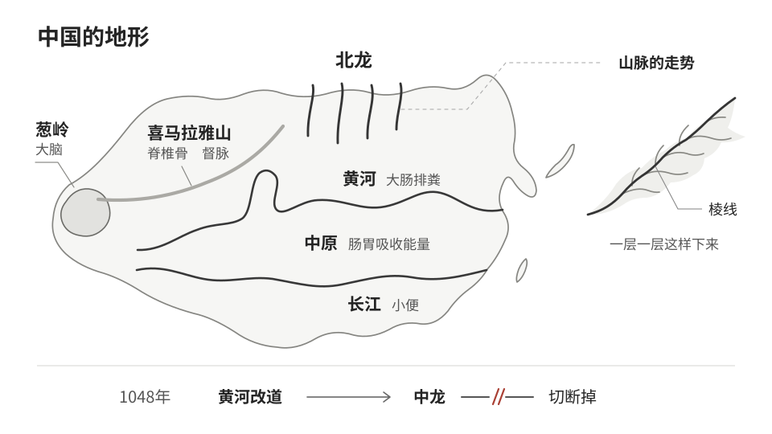 |
| **葱岭和喜马拉雅山各比作人体哪里？** | 〔口述〕按倪师转述的旧时观念，可以把整个版图当作一个人体来看。取最西边的葱岭，比作人的大脑。（[00:04:14–00:04:25](https://www.bilibili.com/video/BV1KJsLekEfA/?p=31&t=254)，第 7632–7979 帧） 〔口述〕说到喜马拉雅山，他让人顺着山势往下看，把这个「世界最高的屋脊」比作人的脊椎骨和督脉。（[00:04:26–00:04:34](https://www.bilibili.com/video/BV1KJsLekEfA/?p=31&t=266)，第 7980–8231 帧） 〔指代〕讲山势，说「沿着这边下来」时，手指向黑板，位置在整幅画面下排中间的第8格。（[00:04:28](https://www.bilibili.com/video/BV1KJsLekEfA/?p=31&t=268)，第 8066 帧） 〔板书〕大轮廓内有一条较淡的长弧，从画面左侧向右延伸，渐渐往右上方弯，靠近轮廓的上缘。（[00:04:30](https://www.bilibili.com/video/BV1KJsLekEfA/?p=31&t=270)，第 8117 帧） |
| **黄河、长江和中原各比作人体的什么作用？** | 〔口述〕倪师说黄河从青藏高原下来，中间经过一道弯，水色发黄，「像泥巴浆一样」。在人体的比喻里，他拿黄河来说大肠排粪。（[00:04:34–00:04:48](https://www.bilibili.com/video/BV1KJsLekEfA/?p=31&t=274)，第 8232–8669 帧） 〔板书〕黑板中部有一条曲线从左下向右延伸，中间向上拐出一个又窄又高的弯，折回后再向右伸。弯旁的小字认不全。（[00:04:42](https://www.bilibili.com/video/BV1KJsLekEfA/?p=31&t=282)，第 8484 帧） 〔口述〕讲到粪字的写法，他用「米田共」三个字来拆说。接着换到另一条河，说「长江呢是小便的」。（[00:04:51–00:04:59](https://www.bilibili.com/video/BV1KJsLekEfA/?p=31&t=291)，第 8742–8993 帧） 〔板书〕带高弯的曲线下方还有一道起伏较缓的长线，从左往右横过黑板，到右侧与弯下来的轮廓相接。（[00:04:58](https://www.bilibili.com/video/BV1KJsLekEfA/?p=31&t=298)，第 8960 帧） 〔口述〕说完两条河，倪师再讲居中的中原地带，把它比作肠胃，取的是肠胃吸收的作用。（[00:04:59–00:05:05](https://www.bilibili.com/video/BV1KJsLekEfA/?p=31&t=299)，第 8994–9155 帧） |
| **北方山脉为何叫北龙，走势像什么？** | 〔口述〕谈宋朝以前的情形，倪师说明这是他转述张良的说法。他在图上分说北、南，说北方的山脉往下都是直行的，「这叫做北龙」。（[00:05:05–00:05:22](https://www.bilibili.com/video/BV1KJsLekEfA/?p=31&t=305)，第 9162–9689 帧） 〔板书〕大轮廓的上缘横着一道起伏的线，有几笔相互分开的长竖线穿过它。竖线略有弯曲，下方仍看得见先前的窄弯。（[00:05:22](https://www.bilibili.com/video/BV1KJsLekEfA/?p=31&t=322)，第 9673 帧） 〔口述〕倪师解释为什么用龙来形容山脉。山势一层一层下来，像龙身，顺着棱线看它一直延伸，又像一条龙「趴在地上面走」。（[00:05:23–00:05:41](https://www.bilibili.com/video/BV1KJsLekEfA/?p=31&t=323)，第 9690–10241 帧） 〔口述〕说完山脉的形状，他把话接回宋朝以前，说那时走的是「北龙的气」。（[00:05:42–00:05:51](https://www.bilibili.com/video/BV1KJsLekEfA/?p=31&t=342)，第 10272–10535 帧） 〔板书〕图的上缘可辨「北」字，下方曲线旁可辨「小便」。黑板右侧还露出几道斜线，有的朝右上伸，有的从中分叉向右下。（[00:05:47](https://www.bilibili.com/video/BV1KJsLekEfA/?p=31&t=347)，第 10437 帧） |
| **庆历黄河改道，倪师说中龙发生了什么？** | 〔口述〕倪师随后报的年份是公元1048年，说约在宋朝庆历年间，黄河发生改道。他也提到黄河历史上不止一次改道。（[00:05:53–00:06:06](https://www.bilibili.com/video/BV1KJsLekEfA/?p=31&t=353)，第 10590–10997 帧） 〔口述〕按倪师的说法，庆历这一次黄河改道把中龙切断了。中龙原本运行龙气，他说地气「都是靠中龙在运的」。（[00:06:06–00:06:20](https://www.bilibili.com/video/BV1KJsLekEfA/?p=31&t=366)，第 10998–11423 帧） 〔口述〕说到谁入主中原，倪师把时间说回宋朝以前。他的说法是，那时由「北方人来入主中原来做国王」。（[00:06:20–00:06:26](https://www.bilibili.com/video/BV1KJsLekEfA/?p=31&t=380)，第 11424–11591 帧） |

**总结区**

- 通用规则：倪师把堪舆选址讲成一个模式，用来从山水之间找出适合人居或定都的地方（[00:01:46–00:02:04](https://www.bilibili.com/video/BV1KJsLekEfA/?p=31&t=106)，第 3186–3743 帧）；在倪师的讲法里，巨视大到可以看整个中国的地理环境，还可以讨论国与国之间的关系，而微视小到可以看一个宗族的兴衰（[00:02:28–00:02:47](https://www.bilibili.com/video/BV1KJsLekEfA/?p=31&t=148)，第 4458–5033 帧）；倪师说看阴宅要看山川河流和水从哪里来，并认为从风水可看家族是否败亡、后代会发什么贵（[00:02:47–00:03:20](https://www.bilibili.com/video/BV1KJsLekEfA/?p=31&t=167)，第 5034–6023 帧）；倪师说现场测量以罗经为标准，借罗经所载的资料作判断（[00:03:20–00:03:33](https://www.bilibili.com/video/BV1KJsLekEfA/?p=31&t=200)，第 6024–6401 帧）
- 只在本例：倪师用美国密西西比河改道冲走房屋的事说明住家选址（[00:02:06–00:02:14](https://www.bilibili.com/video/BV1KJsLekEfA/?p=31&t=126)，第 3804–4043 帧）；在这幅大陆版图的人体比喻里，葱岭比大脑，喜马拉雅山比脊椎骨和督脉，黄河比大肠排粪，长江比小便，中原比肠胃吸收之处（[00:04:14–00:05:05](https://www.bilibili.com/video/BV1KJsLekEfA/?p=31&t=254)，第 7632–9155 帧）；倪师说宋朝以前走北龙的气，当时入主中原做国王的是北方人（[00:05:42–00:06:26](https://www.bilibili.com/video/BV1KJsLekEfA/?p=31&t=342)，第 10272–11591 帧）；倪师说公元1048年宋庆历年间黄河改道，切断了原来运行地气的中龙（[00:05:53–00:06:20](https://www.bilibili.com/video/BV1KJsLekEfA/?p=31&t=353)，第 10590–11423 帧）

**待核**

1. 列举派别时，字幕栏只转出三元派，三合派一名见同段语音，板书也可辨三合二字（[00:00:14](https://www.bilibili.com/video/BV1KJsLekEfA/?p=31&t=14)，第 426 帧、[00:00:18](https://www.bilibili.com/video/BV1KJsLekEfA/?p=31&t=18)，第 558 帧）
2. 张良的名字首次在语音中被转成张扬，后面重提时两路都作张良（[00:01:28](https://www.bilibili.com/video/BV1KJsLekEfA/?p=31&t=88)，第 2664 帧、[00:03:37](https://www.bilibili.com/video/BV1KJsLekEfA/?p=31&t=217)，第 6522 帧）
3. 书名依字幕记为《赤霆经》，语音首次转成「赤庭音」。随后用雷霆说明了霆字，板书的连笔仍难逐字认定（[00:01:36](https://www.bilibili.com/video/BV1KJsLekEfA/?p=31&t=96)，第 2904 帧、[00:01:40](https://www.bilibili.com/video/BV1KJsLekEfA/?p=31&t=100)，第 3018 帧、[00:01:45](https://www.bilibili.com/video/BV1KJsLekEfA/?p=31&t=105)，第 3168 帧）
4. 讲定都和住家时，语音还带出含有国家二字的半句，字幕没有对应文字，接下来的过渡句也有残字（[00:02:00](https://www.bilibili.com/video/BV1KJsLekEfA/?p=31&t=120)，第 3612 帧、[00:02:04](https://www.bilibili.com/video/BV1KJsLekEfA/?p=31&t=124)，第 3744 帧）
5. 右列「微」下方的粉笔字，以及高弯旁边的粉笔小字，都未能逐字认清（[00:02:44](https://www.bilibili.com/video/BV1KJsLekEfA/?p=31&t=164)，第 4937 帧、[00:04:42](https://www.bilibili.com/video/BV1KJsLekEfA/?p=31&t=282)，第 8484 帧）
6. 宗族的兴衰在语音中被转成心酸，结合随后所讲的家族败亡和后代发贵，正文取字幕的兴衰（[00:02:44](https://www.bilibili.com/video/BV1KJsLekEfA/?p=31&t=164)，第 4944 帧）
7. 武贵、官贵、财贵各怎样判别，大罗经中具体取哪项资料，本块没有展开（[00:03:12](https://www.bilibili.com/video/BV1KJsLekEfA/?p=31&t=192)，第 5784 帧、[00:03:23](https://www.bilibili.com/video/BV1KJsLekEfA/?p=31&t=203)，第 6114 帧）
8. 大陆版图「少了一块」具体指哪个地方，倪师没有点名（[00:04:03](https://www.bilibili.com/video/BV1KJsLekEfA/?p=31&t=243)，第 7302 帧）
9. 台湾、韩国、日本和山势这四处指代可确定手指向黑板及其在整幅画面中的格位，指到的具体粉笔线待核（[00:04:06](https://www.bilibili.com/video/BV1KJsLekEfA/?p=31&t=246)，第 7380 帧、[00:04:07](https://www.bilibili.com/video/BV1KJsLekEfA/?p=31&t=247)，第 7435 帧、[00:04:10](https://www.bilibili.com/video/BV1KJsLekEfA/?p=31&t=250)，第 7502 帧、[00:04:28](https://www.bilibili.com/video/BV1KJsLekEfA/?p=31&t=268)，第 8066 帧）
10. 葱岭前的字幕「认沩」按前后句读作认为，地名在语音中转成冲领，正文依字幕记为葱岭（[00:04:16](https://www.bilibili.com/video/BV1KJsLekEfA/?p=31&t=256)，第 7704 帧）
11. 督脉在此只与脊椎骨并提。随后黄河来处的地名，语音只清楚对上高原下来，青藏高原依字幕记录（[00:04:31](https://www.bilibili.com/video/BV1KJsLekEfA/?p=31&t=271)，第 8142 帧、[00:04:34](https://www.bilibili.com/video/BV1KJsLekEfA/?p=31&t=274)，第 8232 帧）
12. 说中原时，两路可对上吸收，能量二字只见字幕。紧接的一行字幕残作「〈久」，没有对应语音（[00:05:01](https://www.bilibili.com/video/BV1KJsLekEfA/?p=31&t=301)，第 9048 帧、[00:05:05](https://www.bilibili.com/video/BV1KJsLekEfA/?p=31&t=305)，第 9156 帧）
13. 分说南北前有一小段书写没有单独抽图，说「这边是北这南」时也没有确定的指代标注（[00:05:14](https://www.bilibili.com/video/BV1KJsLekEfA/?p=31&t=314)，第 9420 帧、[00:05:15](https://www.bilibili.com/video/BV1KJsLekEfA/?p=31&t=315)，第 9474 帧）
14. 年份先说「公元前」，随即两路都报公元1048年，前字是否口误待核。字幕的「来庆历」依语音记作宋庆历（[00:05:51](https://www.bilibili.com/video/BV1KJsLekEfA/?p=31&t=351)，第 10536 帧、[00:05:53](https://www.bilibili.com/video/BV1KJsLekEfA/?p=31&t=353)，第 10590 帧、[00:05:55](https://www.bilibili.com/video/BV1KJsLekEfA/?p=31&t=355)，第 10674 帧）
15. 黄河改道的总次数，字幕作「三次」，语音转写作「30」，具体数目待核（[00:06:03](https://www.bilibili.com/video/BV1KJsLekEfA/?p=31&t=363)，第 10914 帧）
16. 倪师说中龙运行龙气和地气，本块没有说明凭什么认出中龙，也没有解释它与北龙之气的关系（[00:05:45](https://www.bilibili.com/video/BV1KJsLekEfA/?p=31&t=345)，第 10368 帧、[00:06:13](https://www.bilibili.com/video/BV1KJsLekEfA/?p=31&t=373)，第 11214 帧、[00:06:17](https://www.bilibili.com/video/BV1KJsLekEfA/?p=31&t=377)，第 11316 帧）

### 2　龙气南移与朱家犀牛穴典故（[00:06:26–00:12:49](https://www.bilibili.com/video/BV1KJsLekEfA/?p=31&t=386)，第 11592–23087 帧）

| 提示区 | 笔记区 |
|---|---|
| **黄河改道后龙气往哪移，南北两龙怎样称呼？** | 〔口述〕倪师说以前统治中国的是北方人，提到过去有西北出英雄的说法，又用「人高马大」形容北方人。（[00:06:26–00:06:38](https://www.bilibili.com/video/BV1KJsLekEfA/?p=31&t=386)，第 11592–11969 帧） 〔板书〕黑板左半有一个近圆的轮廓，圈旁有线斜向右上方延伸。黑板右上可辨数字「1048」，数字下面的字认不全。（[00:06:29](https://www.bilibili.com/video/BV1KJsLekEfA/?p=31&t=389)，第 11676 帧） 〔口述〕按倪师的讲法，到了宋朝，黄河一改道，中龙的龙气就断了，随后往南移。他把凤阳说在四川，称「凤阳这个地方是南龙啊」。（[00:06:39–00:06:54](https://www.bilibili.com/video/BV1KJsLekEfA/?p=31&t=399)，第 11970–12437 帧） 〔指代〕讲到中龙的龙气，说「这个」时，手指的是黑板，位置在整幅画面正中的第五格。（[00:06:42](https://www.bilibili.com/video/BV1KJsLekEfA/?p=31&t=402)，第 12088 帧） 〔口述〕倪师称北龙为雄，用「雄壮威武」形容它，称南龙为雌。他说完「雌雄两条龙」，接着就讲整个中国的历史大运。（[00:06:59–00:07:10](https://www.bilibili.com/video/BV1KJsLekEfA/?p=31&t=419)，第 12582–12905 帧） |
| **朱家为何迁到凤阳，祖父为何叫下得水？** | 〔口述〕倪师提到朱元璋被记作四川凤阳人，接着说「他的祖先是苏州这边的人」。遇上兵荒马乱，没有东西吃，祖父才迁到他所说的四川凤阳。（[00:07:10–00:07:31](https://www.bilibili.com/video/BV1KJsLekEfA/?p=31&t=430)，第 12906–13547 帧） 〔指代〕讲祖先来自苏州，说「这边」时，手指的是黑板，位置在整幅画面正中的第五格。（[00:07:19](https://www.bilibili.com/video/BV1KJsLekEfA/?p=31&t=439)，第 13199 帧） 〔口述〕祖父的外号叫「下得水」。他很会潜水，能在水下待很久，每次潜下去还能抓到很好的鱼带上来，大家就这样称呼他。（[00:07:31–00:07:49](https://www.bilibili.com/video/BV1KJsLekEfA/?p=31&t=451)，第 13548–14075 帧） |
| **地师怎样沿山寻龙，倪师怎样解释龙穴？** | 〔口述〕故事里来了一个有名的地师。倪师说过去寻龙很辛苦，要「手上拿着拐杖沿着山的棱线走」，见到一条很大的山脉，就顺着山棱继续走，去找龙穴。（[00:07:50–00:08:09](https://www.bilibili.com/video/BV1KJsLekEfA/?p=31&t=470)，第 14100–14675 帧） 〔口述〕倪师说，「以我们的经验去看」，古人记载的龙穴实际上都是从前地壳变动时「地气喷出来的地方」。（[00:08:10–00:08:19](https://www.bilibili.com/video/BV1KJsLekEfA/?p=31&t=490)，第 14724–14975 帧） |
| **为什么要找岩浆旧喷口，又怎样讲到三才？** | 〔口述〕讲地壳挤压时，倪师举喜马拉雅山为例，说山是这样起来的。他又说地壳较薄处会喷出岩浆，喷出来会呈圆形。（[00:08:19–00:08:27](https://www.bilibili.com/video/BV1KJsLekEfA/?p=31&t=499)，第 14976–15215 帧） 〔口述〕按他的说法，要去找原来岩浆喷出的口，因为「那是地气最旺的地方」，也是最能接触到地下的地方。（[00:08:27–00:08:32](https://www.bilibili.com/video/BV1KJsLekEfA/?p=31&t=507)，第 15216–15383 帧） 〔口述〕倪师接着用三才来讲天、地和人的关系。人站在天地中间，他用「生生不息循环的」来形容这层关系。（[00:08:32–00:08:40](https://www.bilibili.com/video/BV1KJsLekEfA/?p=31&t=512)，第 15384–15629 帧） |
| **地师沿路见到什么，最后在哪里结穴？** | 〔口述〕地师找到一条很大的龙脉，见它「紫气围绕」，觉得这条龙气势很好，便一路沿着找过来，发现了龙穴。（[00:08:42–00:08:54](https://www.bilibili.com/video/BV1KJsLekEfA/?p=31&t=522)，第 15678–16025 帧） 〔指代〕讲到发现龙穴，说「这个」时，手指的是黑板，位置在整幅画面中排左边的第四格。（[00:08:51](https://www.bilibili.com/video/BV1KJsLekEfA/?p=31&t=531)，第 15949 帧） 〔口述〕倪师用「这个山脉到这里会结束」解释结穴，说这个位置在上古曾喷出过岩浆。故事里这处穴结在水底，具体在「深潭的底下」。（[00:09:00–00:09:19](https://www.bilibili.com/video/BV1KJsLekEfA/?p=31&t=540)，第 16212–16787 帧） 〔板书〕黑板左下的大圈里还有一个小圈，两道长线从大圈旁向右延伸。靠近倪师头部可辨「深」，旁边的字被挡住一部分。（[00:09:19](https://www.bilibili.com/video/BV1KJsLekEfA/?p=31&t=559)，第 16777 帧） 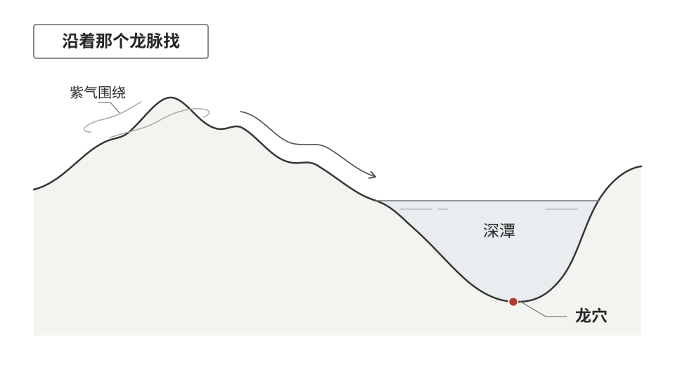 |
| **刘地师为何守在潭边，碰见了谁？** | 〔口述〕地师姓刘。他认定潭底是个很大的帝王穴，龙势很旺，认为把祖先的骨灰葬在里面，「将来可以出帝王」。（[00:09:19–00:09:36](https://www.bilibili.com/video/BV1KJsLekEfA/?p=31&t=559)，第 16788–17303 帧） 〔口述〕刘地师沿着山脉走了好几年，才找到这个地方。如今穴却结在深潭底下，他很苦恼，只好在潭边等。（[00:09:38–00:09:50](https://www.bilibili.com/video/BV1KJsLekEfA/?p=31&t=578)，第 17358–17711 帧） 〔口述〕忽然有人提着鱼从水中冒出来，正是朱元璋的祖父「下得水」。地师见他会潜水，就告诉他，自己想把骨灰埋在水下一个地方。（[00:09:50–00:10:06](https://www.bilibili.com/video/BV1KJsLekEfA/?p=31&t=590)，第 17712–18203 帧） |
| **怎样认出犀牛穴，朱刘两家如何共用？** | 〔口述〕倪师说「只有中国大陆虽然民智不开」，接着说「但是都很了解这个风水的事情」。故事里的地师让祖父潜下去看，说「下面有一个犀牛穴」。（[00:10:06–00:10:17](https://www.bilibili.com/video/BV1KJsLekEfA/?p=31&t=606)，第 18204–18521 帧） 〔板书〕黑板偏左可辨「犀牛」二字，字下有一道横线。左上另有一个「朱」字，右上方长横线之上可辨「水」。（[00:10:16](https://www.bilibili.com/video/BV1KJsLekEfA/?p=31&t=616)，第 18504 帧） 〔口述〕地师说，到水里去看时「一定看到一个牛头」，还有两个角和一个犀牛口。讲到怎么放骨灰，他刚说到挂就改了口，交代要丢进牛口，说「这是龙穴的位置」。（[00:10:17–00:10:30](https://www.bilibili.com/video/BV1KJsLekEfA/?p=31&t=617)，第 18522–18911 帧） 〔口述〕地师请祖父替刘家下水安葬，作为交换，朱家也可以把自家祖先葬进去。两家约定「共用这个龙穴好了」。（[00:10:30–00:10:42](https://www.bilibili.com/video/BV1KJsLekEfA/?p=31&t=630)，第 18912–19265 帧） |
| **两家各用什么包遗骨，祖父在潭底看见什么？** | 〔口述〕约好后，祖父回家从祖坟里取出骨头。地师有钱，用布包自家那一份。朱元璋的祖父穷，路过菜园见菜叶很大，就用菜叶包朱家的遗骨。（[00:10:42–00:11:06](https://www.bilibili.com/video/BV1KJsLekEfA/?p=31&t=642)，第 19266–19991 帧） 〔口述〕倪师说祖父老实，「答应就做」。他潜到潭底，见那里的石头形如一头大牛，看得见牛角，牛口的位置还有一个洞。（[00:11:06–00:11:24](https://www.bilibili.com/video/BV1KJsLekEfA/?p=31&t=666)，第 19992–20537 帧） |
| **朱家的菜叶包和刘家的布包各落在哪里？** | 〔口述〕祖父先丢自家那一包。倪师说牛吃菜，朱家的遗骨又恰好用菜叶包着，牛便张口一咬，「吞到胃里面去就闭口了」。（[00:11:25–00:11:35](https://www.bilibili.com/video/BV1KJsLekEfA/?p=31&t=685)，第 20574–20867 帧） 〔口述〕牛一闭口，祖父就游上来。刘地师很生气，以为祖父有意算计他，叫他把刘家那份挂在牛角上。祖父又潜下去，挂好骨灰才游上来。（[00:11:35–00:11:56](https://www.bilibili.com/video/BV1KJsLekEfA/?p=31&t=695)，第 20868–21509 帧） |
| **刘地师先下了什么断语，为什么又改口？** | 〔口述〕倪师说，穴一出现，地师开口讲时「一定是先所谓一语成谶」。故事里刘地师先说的是「口出和尚角出相」。（[00:11:57–00:12:16](https://www.bilibili.com/video/BV1KJsLekEfA/?p=31&t=717)，第 21510–22109 帧） 〔口述〕朱元璋的祖父听了很生气，催地师换个说法，还说「不然我下去把你那个再拿出来」。（[00:12:17–00:12:24](https://www.bilibili.com/video/BV1KJsLekEfA/?p=31&t=737)，第 22110–22343 帧） 〔口述〕刘地师只得改口，先说「口出天子」，接着把朱、刘两家的断语说成「朱家天子刘家相」。（[00:12:24–00:12:35](https://www.bilibili.com/video/BV1KJsLekEfA/?p=31&t=744)，第 22344–22673 帧） |
| **倪师怎样把断语讲回朱元璋的经历？** | 〔口述〕倪师说，后来是孙子朱元璋「吃到这个龙脉」，接着讲到有人来辅助他，字幕记名为刘伯温。（[00:12:35–00:12:43](https://www.bilibili.com/video/BV1KJsLekEfA/?p=31&t=755)，第 22674–22913 帧） 〔板书〕黑板左上的「朱」字外画了圈，紧靠右下方的「刘」字也单独圈起。两个圈下方仍可辨「犀牛」二字。（[00:12:42](https://www.bilibili.com/video/BV1KJsLekEfA/?p=31&t=762)，第 22887 帧） 〔口述〕倪师说朱元璋起初没有饭吃，便「跑去当和尚了」。他讲完这段和尚经历，用「就一语成谶」收住前面的断语。（[00:12:43–00:12:49](https://www.bilibili.com/video/BV1KJsLekEfA/?p=31&t=763)，第 22914–23087 帧） |

**总结区**

- 通用规则：倪师称北龙为雄、南龙为雌，合称「雌雄两条龙」（[00:06:59–00:07:07](https://www.bilibili.com/video/BV1KJsLekEfA/?p=31&t=419)，第 12582–12821 帧）；按倪师的说法，寻龙要沿山棱走，寻找旧岩浆喷口，因为那里地气最旺，也最能接触到地下（[00:07:59–00:08:32](https://www.bilibili.com/video/BV1KJsLekEfA/?p=31&t=479)，第 14382–15383 帧）；倪师把结穴解释为山脉到这里结束，并说这个地方在上古曾喷出过岩浆（[00:09:00–00:09:11](https://www.bilibili.com/video/BV1KJsLekEfA/?p=31&t=540)，第 16212–16553 帧）；倪师说，穴一出现，地师开口讲时「一定是先所谓一语成谶」（[00:11:57–00:12:08](https://www.bilibili.com/video/BV1KJsLekEfA/?p=31&t=717)，第 21510–21851 帧）
- 只在本例：倪师说宋朝黄河改道使中龙的龙气断掉，龙气往南移，随即讲到他所说的四川凤阳（[00:06:39–00:06:54](https://www.bilibili.com/video/BV1KJsLekEfA/?p=31&t=399)，第 11970–12437 帧）；故事中的刘地师走了好几年才找到穴，认定深潭底下这个穴龙势很旺，可以出帝王（[00:09:11–00:09:50](https://www.bilibili.com/video/BV1KJsLekEfA/?p=31&t=551)，第 16554–17711 帧）；朱家的菜叶包从牛口被吞进去，刘家的遗骨后来挂在牛角上（[00:11:25–00:11:56](https://www.bilibili.com/video/BV1KJsLekEfA/?p=31&t=685)，第 20574–21509 帧）；刘地师先断「口出和尚角出相」，后来改说「朱家天子刘家相」，倪师把断语讲到了朱元璋当和尚和刘伯温辅佐他的经历上（[00:12:09–00:12:49](https://www.bilibili.com/video/BV1KJsLekEfA/?p=31&t=729)，第 21876–23087 帧）
- 不是风水规则，是处世方法：倪师用「答应就做」讲朱元璋祖父的老实，他应下了替地师潜水的事，就下水去办（[00:11:06–00:11:13](https://www.bilibili.com/video/BV1KJsLekEfA/?p=31&t=666)，第 19992–20201 帧）

**待核**

1. 开头板面右上的数字「1048」可辨，周围小字认不全，数字所指待核（[00:06:29](https://www.bilibili.com/video/BV1KJsLekEfA/?p=31&t=389)，第 11676 帧）
2. 三处手势都能定位到黑板，具体指的是哪个字或哪条粉笔线，指代记录只确定到所在格（[00:06:42](https://www.bilibili.com/video/BV1KJsLekEfA/?p=31&t=402)，第 12088 帧、[00:07:19](https://www.bilibili.com/video/BV1KJsLekEfA/?p=31&t=439)，第 13199 帧、[00:08:51](https://www.bilibili.com/video/BV1KJsLekEfA/?p=31&t=531)，第 15949 帧）
3. 凤阳的位置按课堂两路原文记作四川，后面一句字幕停在「南龙南龙的始」，语音末字也不清，是否在说南龙的起点待核（[00:06:48](https://www.bilibili.com/video/BV1KJsLekEfA/?p=31&t=408)，第 12240 帧、[00:06:54](https://www.bilibili.com/video/BV1KJsLekEfA/?p=31&t=414)，第 12438 帧）
4. 祖父的外号在字幕里写作「下得水」，语音转写作「夏德水」，确切用字待核（[00:07:31](https://www.bilibili.com/video/BV1KJsLekEfA/?p=31&t=451)，第 13548 帧）
5. 倪师说地师见到「紫气围绕」，本块没有交代怎样辨认紫气（[00:08:45](https://www.bilibili.com/video/BV1KJsLekEfA/?p=31&t=525)，第 15756 帧）
6. 黑板上靠近倪师头部的粉笔字有遮挡，「深」旁边的字认不全（[00:09:19](https://www.bilibili.com/video/BV1KJsLekEfA/?p=31&t=559)，第 16777 帧）
7. 地师先说「我的骨灰」，后来又说「让我的祖先能葬进去」，前一句所指待核（[00:10:04](https://www.bilibili.com/video/BV1KJsLekEfA/?p=31&t=604)，第 18138 帧、[00:10:30](https://www.bilibili.com/video/BV1KJsLekEfA/?p=31&t=630)，第 18912 帧）
8. 辨认牛头时，字幕作「两个角」，语音转写作「两个脚」，后面交代挂放位置时两路都说牛角（[00:10:20](https://www.bilibili.com/video/BV1KJsLekEfA/?p=31&t=620)，第 18600 帧、[00:11:48](https://www.bilibili.com/video/BV1KJsLekEfA/?p=31&t=708)，第 21252 帧）
9. 菜叶所包之物，字幕说骨灰，语音说骨头，笔记统称遗骨（[00:11:02](https://www.bilibili.com/video/BV1KJsLekEfA/?p=31&t=662)，第 19878 帧）
10. 祖父看到的牛角，字幕多一个「黑」字，语音只转出牛角，颜色待核（[00:11:19](https://www.bilibili.com/video/BV1KJsLekEfA/?p=31&t=679)，第 20394 帧）
11. 牛闭口后，字幕作「姓刘的丢不下去啊」和「我没有丢下去」，语音转写却出现肯定说法，否定词待核（[00:11:36](https://www.bilibili.com/video/BV1KJsLekEfA/?p=31&t=696)，第 20904 帧、[00:11:42](https://www.bilibili.com/video/BV1KJsLekEfA/?p=31&t=702)，第 21066 帧）
12. 改口中间有一句字幕作「刘家叫做朱家天子」，语音也断开，这一句的语序待核（[00:12:28](https://www.bilibili.com/video/BV1KJsLekEfA/?p=31&t=748)，第 22452 帧）
13. 辅佐者的姓名依字幕记作刘伯温，语音把姓名切在相邻两句之间，字音不全（[00:12:38](https://www.bilibili.com/video/BV1KJsLekEfA/?p=31&t=758)，第 22740 帧、[00:12:40](https://www.bilibili.com/video/BV1KJsLekEfA/?p=31&t=760)，第 22818 帧）
14. 字幕作「民智不开」，语音转写作「明智不开」，正文暂依字幕，用字待核（[00:10:06–00:10:08](https://www.bilibili.com/video/BV1KJsLekEfA/?p=31&t=606)，第 18204–18257 帧）
15. 字幕作「一定看到一个牛头」，语音转写在前一句末尾作「已经」，下一句接「看到一个牛头」，正文暂依字幕，牛头前的副词待核（[00:10:17–00:10:19](https://www.bilibili.com/video/BV1KJsLekEfA/?p=31&t=617)，第 18522–18599 帧）

## 点穴一语成谶、三龙运势与台北结穴

### 3　点穴定名、三龙与台北结穴（[00:12:49–00:18:51](https://www.bilibili.com/video/BV1KJsLekEfA/?p=31&t=769)，第 23088–33941 帧）

| 提示区 | 笔记区 |
|---|---|
| **替人点穴，什么要讲究，什么是外饰？** | 〔口述〕先找生龙，「不要找个软趴趴的懒龙或死龙」。倪师问怎样辨出生龙、死龙，又特别看重那一刹那说出的话，称之为「一语成谶」。（[00:12:51–00:13:05](https://www.bilibili.com/video/BV1KJsLekEfA/?p=31&t=771)，第 23130–23579 帧） 〔板书〕黑板左上有一个圈，圈内的字认不清。右上「水」字下方有一条横线，一道向右上扬的曲线与它相交。（[00:12:55](https://www.bilibili.com/video/BV1KJsLekEfA/?p=31&t=775)，第 23268 帧） 〔口述〕倪师提到「山火贲」，说过去台湾有些地师求外饰，下罗经还要念「九天玄女诀」。他认为地师「不需要那些外饰的东西」。（[00:13:06–00:13:21](https://www.bilibili.com/video/BV1KJsLekEfA/?p=31&t=786)，第 23580–24053 帧） 〔口述〕说到找风水师，倪师认为繁多的形式动作都可以省去。他说「贵人讲话言简刚中」，小人才弄出一大堆形式，做得再多也没有用。（[00:13:21–00:13:36](https://www.bilibili.com/video/BV1KJsLekEfA/?p=31&t=801)，第 24054–24503 帧） |
| **穴名怎样从眼前这块地定下来？** | 〔口述〕先看当时那块地和周围的实物，看出它像什么，「然后再定个名下去」。（[00:13:36–00:13:46](https://www.bilibili.com/video/BV1KJsLekEfA/?p=31&t=816)，第 24504–24791 帧） 〔口述〕倪师说，那个名字一念出来，「就收到了」。他接着用「一语成谶」形容这句当场说出的话。（[00:13:46–00:13:53](https://www.bilibili.com/video/BV1KJsLekEfA/?p=31&t=826)，第 24792–25019 帧） |
| **倪师怎么解释「富不过三」？** | 〔口述〕怎样判断一处地利能维持多久，他说后面再介绍。这里举的例子，是子孙能享到这块地的好处，延续好几代。（[00:13:54–00:14:02](https://www.bilibili.com/video/BV1KJsLekEfA/?p=31&t=834)，第 25020–25271 帧） 〔口述〕他说过去有「富不过三」的讲法，意思是很少能找到让人享用超过三代的地利，原话是「超过三代以上的地利都不多」。（[00:14:02–00:14:12](https://www.bilibili.com/video/BV1KJsLekEfA/?p=31&t=842)，第 25272–25571 帧） |
| **中龙被断以后，倪师说龙气走向哪里？** | 〔口述〕倪师先提张良，又提到明朝的朱元璋。说到黄河一切断，他转述张良的话「如果中龙被断了」。（[00:14:12–00:14:27](https://www.bilibili.com/video/BV1KJsLekEfA/?p=31&t=852)，第 25572–26015 帧） 〔口述〕他说断处还有一部分龙，接着提到北龙、中龙，说龙气走到了长白山，并用这个说法解释清廷入主中原。（[00:14:29–00:14:37](https://www.bilibili.com/video/BV1KJsLekEfA/?p=31&t=869)，第 26070–26315 帧） 〔指代〕他说断处「这边」还有一部分龙时，手指向黑板，位置在整幅画面中排中央。（[00:14:29](https://www.bilibili.com/video/BV1KJsLekEfA/?p=31&t=869)，第 26071 帧） 〔口述〕再单说北龙的去向，他说最后走到的是长白山，并特地点出方位在中国东北。（[00:14:40–00:14:46](https://www.bilibili.com/video/BV1KJsLekEfA/?p=31&t=880)，第 26424–26603 帧） |
| **倪师怎样从渤海口的比喻讲到经济竞争？** | 〔口述〕倪师把黄河在渤海的出海口比作「大便出口」，把位于东北这边的韩国比作「痔疮」，并说这个比喻出自张良。（[00:14:46–00:15:00](https://www.bilibili.com/video/BV1KJsLekEfA/?p=31&t=886)，第 26604–27005 帧） 〔指代〕讲黄河口和渤海，两次说「这边」，随后说「这个」。讲韩国又说「这个」，这几次手指都在画面中排中央的黑板上。（[00:14:47–00:14:53](https://www.bilibili.com/video/BV1KJsLekEfA/?p=31&t=887)，第 26611–26795 帧） 〔口述〕他接着拿一堆粪便打比方，说它本身没有营养，需要「外来的营养」，又借这个比喻讲到侵略别人。（[00:15:00–00:15:17](https://www.bilibili.com/video/BV1KJsLekEfA/?p=31&t=900)，第 27006–27539 帧） 〔指代〕说大便丢在「这里」时，倪师指向画面中排中央的黑板。接着说「这个」需要外来的营养时，他也指向这一区域。（[00:15:03–00:15:08](https://www.bilibili.com/video/BV1KJsLekEfA/?p=31&t=903)，第 27102–27264 帧） 〔口述〕他用「两个原子弹下去他就醒过来了」转到另一层，说后来换了条路，改用经济去争，不再用武力。（[00:15:19–00:15:29](https://www.bilibili.com/video/BV1KJsLekEfA/?p=31&t=919)，第 27594–27875 帧） |
| **讲南龙时，怎样从孙中山讲到香港、台湾？** | 〔口述〕倪师转问台湾，把清朝以后的情形和进入南龙连在一起讲，举的例子是孙中山，特地点出他是广东人。（[00:15:34–00:15:46](https://www.bilibili.com/video/BV1KJsLekEfA/?p=31&t=934)，第 28044–28409 帧） 〔口述〕他把南龙入海的地方说成香港，接着说经过台湾海峡又到了台湾。按他讲的先后，香港这一段过后「就是台湾了」。（[00:15:47–00:16:01](https://www.bilibili.com/video/BV1KJsLekEfA/?p=31&t=947)，第 28410–28847 帧） 〔口述〕转到台湾地势时，他特意说明「我是按照风水讲的哦」，接着提到以前讲过的东海、南海。（[00:16:01–00:16:11](https://www.bilibili.com/video/BV1KJsLekEfA/?p=31&t=961)，第 28848–29141 帧） 〔指代〕讲到一个党在什么地方，说「这边」时，手指向黑板，落在整幅画面上排中央。（[00:16:12](https://www.bilibili.com/video/BV1KJsLekEfA/?p=31&t=972)，第 29170 帧） 〔板书〕黑板中部空处有一条单独的细粉笔线，近乎竖直，略向右下斜。它和左边原有的圈线之间隔着一块空白。（[00:16:13](https://www.bilibili.com/video/BV1KJsLekEfA/?p=31&t=973)，第 29218 帧） 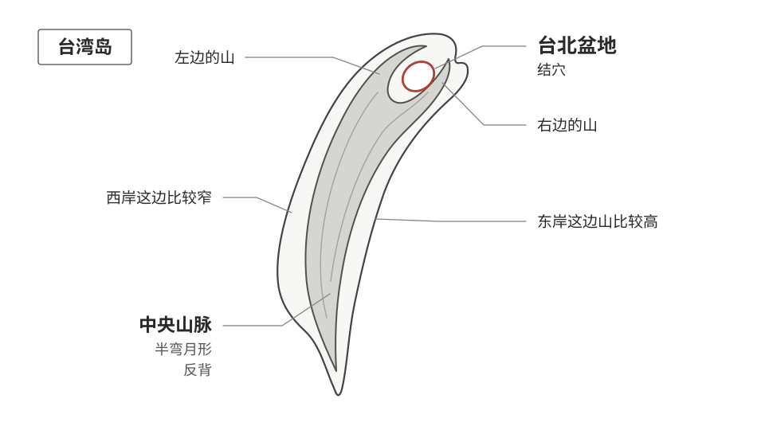 |
| **台湾的山势为什么叫「反背」？** | 〔口述〕倪师以台湾岛为例，按风水堪舆学讲岛上山势，称它为「反背」。他说中央山脉从海里出来，接上大陆的龙，再一路下来。（[00:16:13–00:16:37](https://www.bilibili.com/video/BV1KJsLekEfA/?p=31&t=973)，第 29214–29915 帧） 〔板书〕黑板中部画出一个竖长的封闭轮廓，上宽下尖。左边向外鼓，右上缘有一处凹折，再往下逐渐收窄。（[00:16:24](https://www.bilibili.com/video/BV1KJsLekEfA/?p=31&t=984)，第 29520 帧） 〔口述〕他分两岸来讲，东岸的山比较高，西岸这边比较窄，合起来呈「半弯月形」。（[00:16:37–00:16:42](https://www.bilibili.com/video/BV1KJsLekEfA/?p=31&t=997)，第 29916–30083 帧） 〔指代〕说东岸「这边」山比较高时，手指向黑板，位置在整幅画面上排中央。（[00:16:37](https://www.bilibili.com/video/BV1KJsLekEfA/?p=31&t=997)，第 29925 帧） 〔板书〕长轮廓里有一道用粉笔涂宽的弯带，上宽下窄。轮廓左下方另有一条细弧，弯向白带收窄的位置。（[00:16:41](https://www.bilibili.com/video/BV1KJsLekEfA/?p=31&t=1001)，第 30036 帧） |
| **毛先生为什么把日本地势取名「飞凤朝天」？** | 〔口述〕倪师转举日本这个海岛国家，提到过去有位毛先生，说他是当时很有名的堪舆学家。（[00:16:48–00:17:02](https://www.bilibili.com/video/BV1KJsLekEfA/?p=31&t=1008)，第 30258–30665 帧） 〔板书〕长轮廓的左上方另有一道较窄的粉笔弯带，下端向左拖出尖角，上端一直伸到画面边缘。（[00:16:57](https://www.bilibili.com/video/BV1KJsLekEfA/?p=31&t=1017)，第 30516 帧） 〔口述〕倪师用「以德报怨」解释毛先生的用意。说到日本地势，毛先生把粪便的比喻换成「飞凤朝天」，像一只凤飞起来，正对着大陆。（[00:17:02–00:17:16](https://www.bilibili.com/video/BV1KJsLekEfA/?p=31&t=1022)，第 30666–31085 帧） 〔指代〕讲给日本地势取名，说「这个」时，手指向黑板，位置在整幅画面上排中央。（[00:17:08](https://www.bilibili.com/video/BV1KJsLekEfA/?p=31&t=1028)，第 30857 帧） 〔口述〕顺着毛先生的说法，倪师又提了一个假设，如果能跟日本合作，那就「将来不得了」。（[00:17:16–00:17:20](https://www.bilibili.com/video/BV1KJsLekEfA/?p=31&t=1036)，第 31086–31217 帧） |
| **倪师怎样用东京湾反问「飞凤朝天」的说法？** | 〔口述〕倪师顺着这个比喻反问，假定真是一只飞凤，凤尾恰好在东京湾，那么首都放在那里，岂不成了「把首都种在肛门口」？（[00:17:20–00:17:29](https://www.bilibili.com/video/BV1KJsLekEfA/?p=31&t=1040)，第 31218–31493 帧） 〔指代〕说凤在飞的「这个」，以及说凤尾在「这里」时，手指的都是整幅画面上排中央的黑板。（[00:17:22–00:17:24](https://www.bilibili.com/video/BV1KJsLekEfA/?p=31&t=1042)，第 31274–31328 帧） 〔口述〕他评毛先生的说法「比较附会」，说是为了不得罪日本人。倪师自己仍用先前的粪便比喻。（[00:17:30–00:17:39](https://www.bilibili.com/video/BV1KJsLekEfA/?p=31&t=1050)，第 31518–31781 帧） 〔板书〕老师挡住了黑板中央。头顶左侧露出一段较粗的弯线，下端向左收尖，下方的长轮廓只能看见一部分。（[00:17:31](https://www.bilibili.com/video/BV1KJsLekEfA/?p=31&t=1051)，第 31556 帧） |
| **顺着中央山脉看龙势，倪师把穴落在哪里？** | 〔口述〕倪师顺着中央山脉往下讲，说「经过什么南湖大山我们都不要管」，要看整条龙势和左右两边的山。他把台湾山龙结穴的位置落在台北盆地。（[00:17:39–00:17:58](https://www.bilibili.com/video/BV1KJsLekEfA/?p=31&t=1059)，第 31782–32345 帧） 〔板书〕长轮廓里有一条自上而下收窄的粉笔白带，较宽的上端有几道斜向并排的笔痕，下端靠近外轮廓的尖角。（[00:17:43](https://www.bilibili.com/video/BV1KJsLekEfA/?p=31&t=1063)，第 31915 帧） 〔板书〕长轮廓上端内侧，左右各露出一段弯曲的白痕。老师的手挡在中间，两道白痕之间的笔迹看不清。（[00:17:49](https://www.bilibili.com/video/BV1KJsLekEfA/?p=31&t=1069)，第 32081 帧） 〔指代〕说「整个台北盆地在这里」时，手指向黑板，位置在整幅画面上排中央。（[00:17:56](https://www.bilibili.com/video/BV1KJsLekEfA/?p=31&t=1076)，第 32292 帧） 〔板书〕长轮廓上端靠右有一个小圆圈，圈内留空。圈外两侧各有弧线向下弯，接到下面较长的白带。（[00:17:56](https://www.bilibili.com/video/BV1KJsLekEfA/?p=31&t=1076)，第 32304 帧） |
| **怎样用台北的两条河说明结穴要左右有水？** | 〔口述〕倪师说龙要结穴，有几个先决条件。他先列第一条，左右两边都要有水。（[00:17:58–00:18:13](https://www.bilibili.com/video/BV1KJsLekEfA/?p=31&t=1078)，第 32346–32801 帧） 〔板书〕黑板右半部有圈号①，后面可辨「左」「右」两个字，再往右的笔迹被老师挡住。（[00:18:08](https://www.bilibili.com/video/BV1KJsLekEfA/?p=31&t=1088)，第 32664 帧） 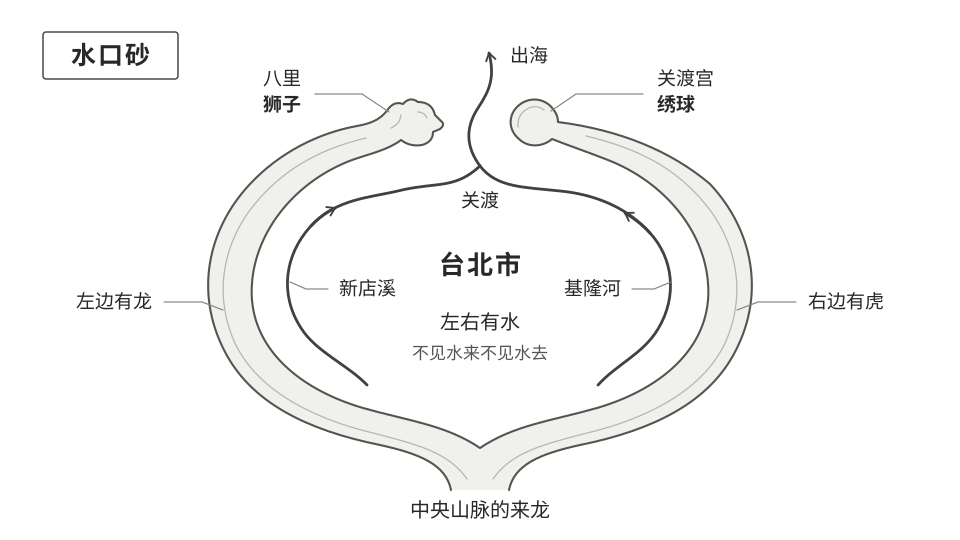 〔口述〕举台北为例，倪师说左边是新店溪下来，另一边是基隆河下来，两路水「会在关渡这边出海」。（[00:18:13–00:18:20](https://www.bilibili.com/video/BV1KJsLekEfA/?p=31&t=1093)，第 32802–33023 帧） 〔口述〕他重说「第一个要左右要有水」，再把山势画成简图，说明「这是整个中央山脉的来龙」。（[00:18:22–00:18:36](https://www.bilibili.com/video/BV1KJsLekEfA/?p=31&t=1102)，第 33066–33491 帧） 〔板书〕黑板右边的简图里，一道大弧线从左上绕过底部，再回到右上，两端之间留有开口。外侧另有两条线向下延伸。（[00:18:34](https://www.bilibili.com/video/BV1KJsLekEfA/?p=31&t=1114)，第 33429 帧） |
| **在两河的简图上，倪师怎样引出「砂」？** | 〔指代〕说「这个」时，手指向画面中排右侧的黑板。接着讲台北市，说「这边」时，手指向中排中央的黑板。（[00:18:36–00:18:38](https://www.bilibili.com/video/BV1KJsLekEfA/?p=31&t=1116)，第 33487–33542 帧） 〔口述〕他先在简图上交代台北市的位置，再分别说到基隆河和新店溪，最后交代两水会到关渡出海。（[00:18:36–00:18:41](https://www.bilibili.com/video/BV1KJsLekEfA/?p=31&t=1116)，第 33492–33659 帧） 〔口述〕接下来列的是第二个条件「要有砂」，随即替学生问「你说老师什么叫砂」。（[00:18:42–00:18:51](https://www.bilibili.com/video/BV1KJsLekEfA/?p=31&t=1122)，第 33660–33941 帧） 〔板书〕内弧的左右两边各多了一道贴着它走的弧线。两端之间留着窄口，一条略有弯折的竖线从上方伸到口前。（[00:18:43](https://www.bilibili.com/video/BV1KJsLekEfA/?p=31&t=1123)，第 33690 帧） 〔板书〕相对的两端各圈出一个小圈。右旁另有圈号②，圈号后面的字只露出一部分，认不全。（[00:18:51](https://www.bilibili.com/video/BV1KJsLekEfA/?p=31&t=1131)，第 33933 帧） |

**总结区**

- 通用规则：按倪师的说法，替人点穴要先辨生龙、死龙，避开懒龙和死龙。（[00:12:51–00:13:00](https://www.bilibili.com/video/BV1KJsLekEfA/?p=31&t=771)，第 23130–23411 帧）；给地取名，先看当时的实物环境像什么，再照所见定名。（[00:13:36–00:13:46](https://www.bilibili.com/video/BV1KJsLekEfA/?p=31&t=816)，第 24504–24791 帧）；倪师用「富不过三」说明，能让子孙享用超过三代的地利少见。（[00:13:59–00:14:12](https://www.bilibili.com/video/BV1KJsLekEfA/?p=31&t=839)，第 25188–25571 帧）；倪师列的结穴条件，第一是左右有水，第二是有砂。（[00:18:06–00:18:47](https://www.bilibili.com/video/BV1KJsLekEfA/?p=31&t=1086)，第 32580–33827 帧）
- 只在本例：倪师把黄河切断、中龙被断、龙气走向东北长白山，与清廷入主中原连在一起讲。（[00:14:20–00:14:46](https://www.bilibili.com/video/BV1KJsLekEfA/?p=31&t=860)，第 25806–26603 帧）；倪师说南龙在香港入海，过台湾海峡又到台湾，次序是香港在先、台湾在后。（[00:15:47–00:16:01](https://www.bilibili.com/video/BV1KJsLekEfA/?p=31&t=947)，第 28410–28847 帧）；倪师称台湾山势为「反背」，说东岸山较高、西岸较窄，形如半弯月。（[00:16:26–00:16:42](https://www.bilibili.com/video/BV1KJsLekEfA/?p=31&t=986)，第 29598–30083 帧）；倪师把台湾山龙结穴的位置落在台北盆地，并以新店溪、基隆河会到关渡出海说明左右有水。（[00:17:51–00:18:20](https://www.bilibili.com/video/BV1KJsLekEfA/?p=31&t=1071)，第 32148–33023 帧）
- 不是风水规则，是处世方法：倪师用「贵人讲话言简刚中」提醒人说话简要，免去繁复无用的形式动作。（[00:13:24–00:13:36](https://www.bilibili.com/video/BV1KJsLekEfA/?p=31&t=804)，第 24138–24503 帧）

**待核**

1. 开场板面还有多处旧字，部分模糊，部分被老师遮住，认不全。（[00:12:55](https://www.bilibili.com/video/BV1KJsLekEfA/?p=31&t=775)，第 23268 帧）
2. 倪师问怎样辨生龙、死龙，本块没有给出辨别的具体办法。（[00:12:58](https://www.bilibili.com/video/BV1KJsLekEfA/?p=31&t=778)，第 23340 帧）
3. 字幕作「入验」，语音作「入电台」，只能对上「一刹那」，具体指什么动作待核。（[00:13:00](https://www.bilibili.com/video/BV1KJsLekEfA/?p=31&t=780)，第 23412 帧）
4. 「山火贲」在语音里记作「山火壁」，此处名称待核（[00:13:07](https://www.bilibili.com/video/BV1KJsLekEfA/?p=31&t=787)，第 23628 帧）。下罗经所念的「九天玄女诀」只提到名字，未见诀文（[00:13:12](https://www.bilibili.com/video/BV1KJsLekEfA/?p=31&t=792)，第 23766 帧）。
5. 「就收到了」没有交代收到的是什么（[00:13:48](https://www.bilibili.com/video/BV1KJsLekEfA/?p=31&t=828)，第 24840 帧）。接着说地利能维持多久，字幕作「地利发利很久」，语音作「地力发力很久」（[00:13:55](https://www.bilibili.com/video/BV1KJsLekEfA/?p=31&t=835)，第 25068 帧）。
6. 中龙被断之后的断语，字幕作「后果就堪厉」，语音作「果就坑立结果」，末两字待核。（[00:14:27](https://www.bilibili.com/video/BV1KJsLekEfA/?p=31&t=867)，第 26016 帧）
7. 前面讲龙气时字幕已作「长白山」（[00:14:32](https://www.bilibili.com/video/BV1KJsLekEfA/?p=31&t=872)，第 26160 帧），随后讲北龙去向，字幕「长自山」按语音改为「长白山」（[00:14:43](https://www.bilibili.com/video/BV1KJsLekEfA/?p=31&t=883)，第 26490 帧）。
8. 说粪便丢在「这里」时，标注只到黑板中央，所指地名没有在这句明说。（[00:15:03](https://www.bilibili.com/video/BV1KJsLekEfA/?p=31&t=903)，第 27102 帧）
9. 字幕作「不见棺材不留泪」，语音记作「不见惯权不流泥两」，原话待核。（[00:15:18](https://www.bilibili.com/video/BV1KJsLekEfA/?p=31&t=918)，第 27540 帧）
10. 字幕提到「秘鲁总统」，语音把国名记成「密度」，句尾的「他」也没有点名。（[00:15:29](https://www.bilibili.com/video/BV1KJsLekEfA/?p=31&t=929)，第 27876 帧）
11. 提东海、南海前，字幕作「易经」，语音作「意义」（[00:16:09](https://www.bilibili.com/video/BV1KJsLekEfA/?p=31&t=969)，第 29070 帧）。接着字幕作「某党」，语音作「国民党」，党名存疑（[00:16:11](https://www.bilibili.com/video/BV1KJsLekEfA/?p=31&t=971)，第 29142 帧）。
12. 谈毛先生的用意，字幕有「不要去得罪」，语音在这里少了否定字（[00:17:02](https://www.bilibili.com/video/BV1KJsLekEfA/?p=31&t=1022)，第 30666 帧）。评语字幕作「比较附会」，语音作「比较富贵」（[00:17:30](https://www.bilibili.com/video/BV1KJsLekEfA/?p=31&t=1050)，第 31518 帧）。
13. 老师挡住板图，单看这张图认不出哪一笔对应口头说的凤尾。（[00:17:31](https://www.bilibili.com/video/BV1KJsLekEfA/?p=31&t=1051)，第 31556 帧）
14. 左右两山与台北盆地之间的动词，字幕作「刚好会为什么」，语音也不清楚（[00:17:49](https://www.bilibili.com/video/BV1KJsLekEfA/?p=31&t=1069)，第 32070 帧）。对应图上两道弧线的中间被手遮住（[00:17:49](https://www.bilibili.com/video/BV1KJsLekEfA/?p=31&t=1069)，第 32081 帧）。
15. 基隆河与新店溪各对应简图上的哪一笔，两句「这边」都没有确定的落点（[00:18:38](https://www.bilibili.com/video/BV1KJsLekEfA/?p=31&t=1118)，第 33546 帧、[00:18:39](https://www.bilibili.com/video/BV1KJsLekEfA/?p=31&t=1119)，第 33582 帧）。
16. 「砂」在本块只提到名称并问是什么意思，语音末尾已连到「水口这两边出水」（[00:18:47](https://www.bilibili.com/video/BV1KJsLekEfA/?p=31&t=1127)，第 33828 帧）。简图圈号②后面的粉笔字也被遮住，认不全（[00:18:51](https://www.bilibili.com/video/BV1KJsLekEfA/?p=31&t=1131)，第 33933 帧）。
17. 黑板左上圈内的字像「朱」，也像「未」，具体是哪个字待核（[00:12:55](https://www.bilibili.com/video/BV1KJsLekEfA/?p=31&t=775)，第 23268 帧）。

### 4　台北水口砂、龙虎抱与龙脉结穴（[00:18:51–00:25:04](https://www.bilibili.com/video/BV1KJsLekEfA/?p=31&t=1131)，第 33942–45125 帧）

| 提示区 | 笔记区 |
|---|---|
| **什么叫水口砂，什么形状为好？** | 〔板书〕黑板中央几道弧线围成近圆形，顶端留着开口，两端各有一个小圈。图上方可辨「左右有水」，右侧可辨圈号②和「砂」字。（[00:18:51](https://www.bilibili.com/video/BV1KJsLekEfA/?p=31&t=1131)，第 33942 帧） 〔口述〕两股水汇在一起流出去，倪师说出水口的两边「一定要有砂」。按他讲的旧时风水观念，砂以形似动物为好，举的是狮、豹、虎、象。（[00:18:51–00:19:15](https://www.bilibili.com/video/BV1KJsLekEfA/?p=31&t=1131)，第 33942–34679 帧） 〔口述〕讲到这种砂的名称，倪师说「特别称这个砂叫做水口砂」。（[00:19:21–00:19:24](https://www.bilibili.com/video/BV1KJsLekEfA/?p=31&t=1161)，第 34830–34931 帧） 〔指代〕给这种砂起名，说「这个」时，手指的是黑板，手在整幅画面中排右侧（第6格）。（[00:19:21](https://www.bilibili.com/video/BV1KJsLekEfA/?p=31&t=1161)，第 34830 帧） 〔指代〕接着谈水口砂的名称，再说「这个」时，手指的仍是黑板，这次手在整幅画面正中（第5格）。（[00:19:26](https://www.bilibili.com/video/BV1KJsLekEfA/?p=31&t=1166)，第 34992 帧） |
| **站在当地看水，来和去各有什么要求？** | 〔板书〕黑板上沿的粉笔字可辨「水口」，后一个字的上部被画面截去。下方弧线的顶端仍可见相对的两个小圈。（[00:19:28](https://www.bilibili.com/video/BV1KJsLekEfA/?p=31&t=1168)，第 35068 帧） 〔口述〕倪师把看水分成来、去两头。先讲「不见水来」，再把两头放在一起说，「看不到水来看不到水走」。（[00:19:33–00:19:46](https://www.bilibili.com/video/BV1KJsLekEfA/?p=31&t=1173)，第 35190–35603 帧） 〔口述〕若站在那里，来水很大，又看得见水口，他就说「这个风水就不好」。他把要求重说了一遍，「这个要不见水来不见水去」。（[00:19:46–00:19:56](https://www.bilibili.com/video/BV1KJsLekEfA/?p=31&t=1186)，第 35604–35891 帧） |
| **台北水口的狮子和绣球各在哪边？** | 〔口述〕提过还要有案山，倪师回头举台北水口砂的例子。他说「左边叫狮子右边是关渡宫」，把右边的关渡宫比作圆球，又说像绣球。（[00:19:56–00:20:11](https://www.bilibili.com/video/BV1KJsLekEfA/?p=31&t=1196)，第 35892–36341 帧） 〔口述〕左边说的是八里。倪师叫学生看整座山的外形，说「它整个像个狮子」。（[00:20:11–00:20:18](https://www.bilibili.com/video/BV1KJsLekEfA/?p=31&t=1211)，第 36342–36563 帧） 〔板书〕大图顶端两个小圈的上方各有短笔，右侧的一笔弯成小弧。图的左上另有连笔字，末字可辨「子」，其余认不全。（[00:20:24](https://www.bilibili.com/video/BV1KJsLekEfA/?p=31&t=1224)，第 36729 帧） 〔口述〕把两边合起来看，倪师说「狮子绣球形刚好两个」。他再提「虎豹狮象最好」，台北的出口就有他所说的狮形。（[00:20:25–00:20:34](https://www.bilibili.com/video/BV1KJsLekEfA/?p=31&t=1225)，第 36774–37031 帧） |
| **八里的观音山为什么引出立庙的说法？** | 〔口述〕讲到关渡左边的八里，倪师点出观音山这个地名，说这座山的「山势像观音」。（[00:20:34–00:20:41](https://www.bilibili.com/video/BV1KJsLekEfA/?p=31&t=1234)，第 37032–37253 帧） 〔板书〕大图左端的小圈上方多了一个较大的圆，两圈上下相接。右端的小圈与它们隔开，图的下沿有一段被手挡住。（[00:20:37](https://www.bilibili.com/video/BV1KJsLekEfA/?p=31&t=1237)，第 37121 帧） 〔口述〕倪师说，过去看山，只要山的外形看起来像佛、像神仙，就认为适合在这座山里盖寺庙。（[00:20:41–00:20:55](https://www.bilibili.com/video/BV1KJsLekEfA/?p=31&t=1241)，第 37254–37661 帧） |
| **案山和朝山怎样按远近区分？** | 〔口述〕倪师先说「这个是近的山」，紧接着说「叫做案山」，用山离得近来说明案山。（[00:20:55–00:20:59](https://www.bilibili.com/video/BV1KJsLekEfA/?p=31&t=1255)，第 37662–37793 帧） 〔指代〕讲近处的山，说「这个」时，手指的是黑板，手在整幅画面正中（第5格）。（[00:20:56](https://www.bilibili.com/video/BV1KJsLekEfA/?p=31&t=1256)，第 37682 帧） 〔口述〕换到远处的山，倪师说「还有那山很远」，接下来给它的名称是「叫做朝山」。（[00:21:00–00:21:09](https://www.bilibili.com/video/BV1KJsLekEfA/?p=31&t=1260)，第 37812–38081 帧） |
| **龙虎抱怎样分左右，李先生的龙气在哪边？** | 〔口述〕除了看来龙，还要看左右两边有没有环抱。倪师列的第五个条件叫龙虎抱，方位是「左边有龙右边有虎」。（[00:21:09–00:21:26](https://www.bilibili.com/video/BV1KJsLekEfA/?p=31&t=1269)，第 38082–38585 帧） 〔口述〕讲两边都有山势下来时，倪师先后提到新店、三芝这一带，随后又说到台北市的位置。（[00:21:26–00:21:36](https://www.bilibili.com/video/BV1KJsLekEfA/?p=31&t=1286)，第 38586–38891 帧） 〔指代〕讲两边下来的山势，说「这边」时，手指的是黑板，手在整幅画面中排左侧（第4格）。（[00:21:28](https://www.bilibili.com/video/BV1KJsLekEfA/?p=31&t=1288)，第 38645 帧） 〔板书〕大图左右各有沿着外缘向下延伸的弧线。右方「砂」字的下面，椭圆里圈着「动物」两字，再往下可辨「案山」。（[00:21:31](https://www.bilibili.com/video/BV1KJsLekEfA/?p=31&t=1291)，第 38736 帧） 〔口述〕说到李先生，倪师把他的龙气放在其中一侧，原话是「就在右边的虎上面」。（[00:21:36–00:21:42](https://www.bilibili.com/video/BV1KJsLekEfA/?p=31&t=1296)，第 38892–39077 帧） |
| **南龙怎样到台湾，倪师又怎样对照日本？** | 〔口述〕按倪师的讲法，南龙从喜马拉雅山下来，一路穿山过海，到台湾结成龙穴。他形容「台湾的龙脉有一点偏」。（[00:21:42–00:21:51](https://www.bilibili.com/video/BV1KJsLekEfA/?p=31&t=1302)，第 39078–39347 帧） 〔口述〕接着讲日本，倪师说「日本是朝在里面的」。他把这个朝向讲成日本岛朝着大陆，用想吃大陆来作比方。（[00:21:55–00:22:01](https://www.bilibili.com/video/BV1KJsLekEfA/?p=31&t=1315)，第 39468–39635 帧） 〔口述〕他又转述别人的比方，说中国大陆产桑叶，「日本像蚕」，想来蚕食大陆。说到两边的想法不同，他接着说「那张良早就预测下来了」。（[00:22:01–00:22:16](https://www.bilibili.com/video/BV1KJsLekEfA/?p=31&t=1321)，第 39636–40097 帧） |
| **南龙到香港和过台湾海峡，倪师各怎样说？** | 〔口述〕顺着南龙的气讲到香港，倪师提到一个时限，用的是「就在九七大限嘛」这句话。（[00:22:16–00:22:22](https://www.bilibili.com/video/BV1KJsLekEfA/?p=31&t=1336)，第 40098–40265 帧） 〔口述〕再讲漂洋过海，他说过海的情形有别，提到「因为中间隔了个台湾海峡」，又形容「然后这又是反背的」。（[00:22:22–00:22:29](https://www.bilibili.com/video/BV1KJsLekEfA/?p=31&t=1342)，第 40266–40493 帧） 〔指代〕比较南龙过海的情形，说「这个」时，手指的是黑板，手在整幅画面下排中央（第8格）。（[00:22:24](https://www.bilibili.com/video/BV1KJsLekEfA/?p=31&t=1344)，第 40322 帧） 〔口述〕再往下，倪师说「后面是天机道」，提到「除非你老李来问我」，又说还有一件事不能讲。（[00:22:29–00:22:40](https://www.bilibili.com/video/BV1KJsLekEfA/?p=31&t=1349)，第 40494–40817 帧） |
| **天官看什么，钦天监里外各做什么？** | 〔口述〕按倪师课上的说法，过去历代王朝由国家设天官。他把天官所学联系到堪舆，说要「看天上的星象二十八宿」。（[00:22:40–00:22:51](https://www.bilibili.com/video/BV1KJsLekEfA/?p=31&t=1360)，第 40818–41159 帧） 〔口述〕二十八宿这部分，倪师说会把笔记写出来给学生，学生拿着罗经就可以照着看。（[00:22:52–00:22:58](https://www.bilibili.com/video/BV1KJsLekEfA/?p=31&t=1372)，第 41160–41345 帧） 〔口述〕他用皇帝交代差事的口吻讲钦天监。主事的人下面有许多跟学的学生，程度各不相同，在里面制作历法。（[00:22:58–00:23:13](https://www.bilibili.com/video/BV1KJsLekEfA/?p=31&t=1378)，第 41346–41813 帧） 〔口述〕主事的人则被派到各地察看。按倪师所讲，遇见有天子相的人就抓起来，见到龙脉就破坏。他用皇帝的口气说「不要让他抢我们家风水」。（[00:23:13–00:23:28](https://www.bilibili.com/video/BV1KJsLekEfA/?p=31&t=1393)，第 41814–42263 帧） |
| **讲完大内高手，为何不说李先生龙脉的地点？** | 〔口述〕倪师说，皇朝交替时，皇帝会暗中派出「大内高手」。他把武功好的人说成外面的高手，又说里面的人去斩断龙脉。（[00:23:28–00:23:45](https://www.bilibili.com/video/BV1KJsLekEfA/?p=31&t=1408)，第 42264–42755 帧） 〔口述〕回到李先生的例子，倪师说他的龙脉在这里，随即对学生说「地点不能给你们讲」。（[00:23:45–00:23:50](https://www.bilibili.com/video/BV1KJsLekEfA/?p=31&t=1425)，第 42756–42929 帧） 〔指代〕说李先生的龙脉在「这里」时，手指的是黑板，手在整幅画面正中（第5格）。（[00:23:48](https://www.bilibili.com/video/BV1KJsLekEfA/?p=31&t=1428)，第 42847 帧） 〔口述〕倪师担心地点传出去，有人会在深更半夜开推土机上去。他说「这个不可以的」，又提到有些事是天命。（[00:23:51–00:24:06](https://www.bilibili.com/video/BV1KJsLekEfA/?p=31&t=1431)，第 42930–43391 帧） |
| **地龙指什么，大龙和小龙有什么关系？** | 〔口述〕倪师把这里讲的龙称为大龙，给出的断语是「大龙结到的地方可以成立首都」。（[00:24:06–00:24:12](https://www.bilibili.com/video/BV1KJsLekEfA/?p=31&t=1446)，第 43392–43589 帧） 〔口述〕小龙则很多。倪师举山上细脉的例子，讲龙脉怎样从大龙一条条分出去。（[00:24:13–00:24:21](https://www.bilibili.com/video/BV1KJsLekEfA/?p=31&t=1453)，第 43590–43841 帧） 〔指代〕说到山的细脉，说「这个」时，手指的是黑板，手在整幅画面上排中央（第2格）。（[00:24:15](https://www.bilibili.com/video/BV1KJsLekEfA/?p=31&t=1455)，第 43671 帧） 〔口述〕倪师所说的地龙指的是山脉。他叫人看整个山势，整个山势在这里就称为龙。（[00:24:21–00:24:26](https://www.bilibili.com/video/BV1KJsLekEfA/?p=31&t=1461)，第 43842–44003 帧） |
| **到了结穴的地方，怎样辨形、称穴？** | 〔口述〕结穴结成什么样子，要看当地的地形、地物。倪师举的例子是「有的整个地看起来像个老鹰」。（[00:24:28–00:24:40](https://www.bilibili.com/video/BV1KJsLekEfA/?p=31&t=1468)，第 44058–44423 帧） 〔口述〕风水师到了现场，便「就以当地的位置来称这个穴」。倪师把这样依当地情形称穴，列为最基本的做法。（[00:24:40–00:24:52](https://www.bilibili.com/video/BV1KJsLekEfA/?p=31&t=1480)，第 44424–44789 帧） |

**总结区**

- 通用规则：按倪师所述，两水汇出的水口两旁一定要有砂，形似狮、豹、虎、象为佳（[00:18:51–00:19:15](https://www.bilibili.com/video/BV1KJsLekEfA/?p=31&t=1131)，第 33942–34679 帧）；看水分来、去两头，倪师的要求是「不见水来不见水去」（[00:19:33–00:19:56](https://www.bilibili.com/video/BV1KJsLekEfA/?p=31&t=1173)，第 35190–35891 帧）；按远近分，近山称案山、远山称朝山，按两边的环抱分，则是左龙右虎（[00:20:55–00:21:28](https://www.bilibili.com/video/BV1KJsLekEfA/?p=31&t=1255)，第 37662–38645 帧）；辨结穴的形状要看当地地形、地物，称穴则依据当地的位置（[00:24:28–00:24:47](https://www.bilibili.com/video/BV1KJsLekEfA/?p=31&t=1468)，第 44058–44621 帧）
- 只在本例：台北水口左侧八里的整座山被比作狮子，右侧关渡宫被比作绣球（[00:20:02–00:20:28](https://www.bilibili.com/video/BV1KJsLekEfA/?p=31&t=1202)，第 36084–36869 帧）；倪师把李先生的龙气放在右边的虎上（[00:21:36–00:21:42](https://www.bilibili.com/video/BV1KJsLekEfA/?p=31&t=1296)，第 38892–39077 帧）；倪师说南龙过海到台湾结穴，台湾龙脉略偏，又把日本岛讲成朝向大陆（[00:21:42–00:22:01](https://www.bilibili.com/video/BV1KJsLekEfA/?p=31&t=1302)，第 39078–39635 帧）；倪师讲南龙到香港时提到「九七大限」，讲过台湾海峡时又提到反背（[00:22:16–00:22:29](https://www.bilibili.com/video/BV1KJsLekEfA/?p=31&t=1336)，第 40098–40493 帧）
- 不是风水规则，是处世方法：担心地点传出去会引人前去破坏，倪师在课堂上保留了李先生龙脉的具体地点（[00:23:45–00:24:02](https://www.bilibili.com/video/BV1KJsLekEfA/?p=31&t=1425)，第 42756–43265 帧）

**待核**

1. 字幕的「会流」与语音的「汇流」同音，笔记按两股水汇在一起转述（[00:19:04](https://www.bilibili.com/video/BV1KJsLekEfA/?p=31&t=1144)，第 34326 帧）
2. 桂林一例的字幕有「桂林山水甲天下」和「站的那个叫做水口」，语音在这两处不清，象形的具体名称也未说清（[00:19:17–00:19:20](https://www.bilibili.com/video/BV1KJsLekEfA/?p=31&t=1157)，第 34722–34829 帧）
3. 黑板上沿「水口」后的一字笔画不全，单看板面认不准末字（[00:19:28](https://www.bilibili.com/video/BV1KJsLekEfA/?p=31&t=1168)，第 35068 帧）
4. 字幕为「你看到水口走」，语音转为「你看到水口之后」，句末待核（[00:19:48](https://www.bilibili.com/video/BV1KJsLekEfA/?p=31&t=1188)，第 35646 帧）
5. 台北水口砂前的修饰语，字幕作「所有」，语音作「左右」，下一句才明确分说左边和右边（[00:20:02](https://www.bilibili.com/video/BV1KJsLekEfA/?p=31&t=1202)，第 36084 帧）
6. 讲狮字写法时，字幕作「狮怎么写错了」，语音末尾近于「怎么写对」，板上左上方的连笔字也认不全（[00:20:18–00:20:24](https://www.bilibili.com/video/BV1KJsLekEfA/?p=31&t=1218)，第 36564–36729 帧）
7. 两次案山之间夹着一行异常字幕，语音为空，末两字是否另有所指待核（[00:20:59](https://www.bilibili.com/video/BV1KJsLekEfA/?p=31&t=1259)，第 37794 帧）
8. 新店后半句转写不清。能辨出新店、三芝两个地名，各自对应哪一侧山势仍待核（[00:21:28–00:21:32](https://www.bilibili.com/video/BV1KJsLekEfA/?p=31&t=1288)，第 38646–38777 帧）
9. 字幕的「反反背的」在语音里近于「反三倍的」，随后转到日本前又有一行乱码，语音为空（[00:21:51–00:21:55](https://www.bilibili.com/video/BV1KJsLekEfA/?p=31&t=1311)，第 39348–39467 帧）
10. 倪师说张良早已预测，所指是哪一段预测没有交代（[00:22:09–00:22:16](https://www.bilibili.com/video/BV1KJsLekEfA/?p=31&t=1329)，第 39894–40097 帧）
11. 香港的「九七大限」在这里没有展开，具体所指待核（[00:22:19](https://www.bilibili.com/video/BV1KJsLekEfA/?p=31&t=1339)，第 40176 帧）
12. 字幕作「南龙收回」，语音近于「南龙车会」，动词听不清，手势只确定指向黑板（[00:22:23–00:22:25](https://www.bilibili.com/video/BV1KJsLekEfA/?p=31&t=1343)，第 40314–40373 帧）
13. 倪师再提反背，接着说「后面是天机道」，这两处各指怎样的形势没有展开（[00:22:27–00:22:33](https://www.bilibili.com/video/BV1KJsLekEfA/?p=31&t=1347)，第 40428–40613 帧）
14. 二十八宿和罗经按字幕记，语音分别转为二十八度和逻辑，具体怎样拿罗经看也留待笔记说明（[00:22:49–00:22:58](https://www.bilibili.com/video/BV1KJsLekEfA/?p=31&t=1369)，第 41094–41345 帧）
15. 说到当地县官，字幕作「给你杀掉了」，语音作「被你杀掉了」，句中谁动手待核（[00:23:22](https://www.bilibili.com/video/BV1KJsLekEfA/?p=31&t=1402)，第 42078 帧）
16. 字幕两次把前面的「大内高手」写成「大肉高手」，语音均作大内高手，笔记按前文和语音统一（[00:23:38–00:23:40](https://www.bilibili.com/video/BV1KJsLekEfA/?p=31&t=1418)，第 42540–42623 帧）
17. 推土机一例中，字幕作「然后上面戴个必死」，语音也辨不清，这个细节待核（[00:23:55](https://www.bilibili.com/video/BV1KJsLekEfA/?p=31&t=1435)，第 43050 帧）
18. 大龙与小龙之间的动词，字幕作「吃到」，语音近于「赤道」，原词待核（[00:24:18](https://www.bilibili.com/video/BV1KJsLekEfA/?p=31&t=1458)，第 43746 帧）
19. 讲整个山势之后，字幕作「那个四做龙」，语音只辨出「叫做龙」，前几个字待核（[00:24:26](https://www.bilibili.com/video/BV1KJsLekEfA/?p=31&t=1466)，第 44004 帧）
20. 举结穴形状时，语音在老鹰之前还提到乌龟，字幕只见老鹰，乌龟一例待核（[00:24:33](https://www.bilibili.com/video/BV1KJsLekEfA/?p=31&t=1473)，第 44202 帧）

## 藏风纳气、明堂过峡与生基些子

### 5　藏风纳气、山水的生与情、过峡与明堂（[00:25:04–00:31:45](https://www.bilibili.com/video/BV1KJsLekEfA/?p=31&t=1504)，第 45126–57179 帧）

| 提示区 | 笔记区 |
|---|---|
| **给阴宅、阳宅找位置，都讲究哪四个字？** | 〔口述〕给人找位置，倪师先提出「藏风纳气」四个字。他说这个原则用在阳宅、阴宅都一样。（[00:25:04–00:25:23](https://www.bilibili.com/video/BV1KJsLekEfA/?p=31&t=1504)，第 45126–45695 帧） 〔板书〕开头的板面上，一道大弧围成近圆形，上沿挨着一个小圈。两者相接处叠着几道短弧，还有一笔向下伸进大弧里。（[00:25:04](https://www.bilibili.com/video/BV1KJsLekEfA/?p=31&t=1504)，第 45139 帧） 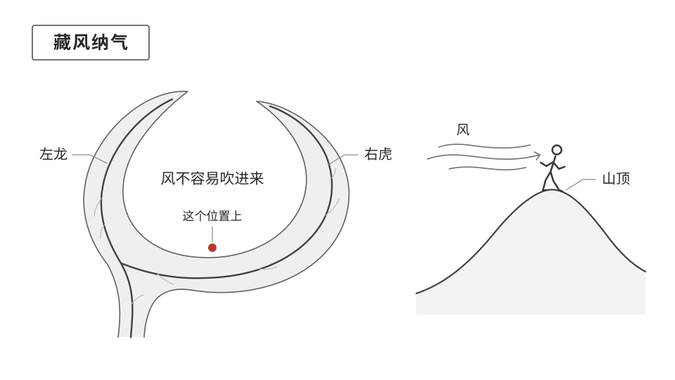 〔板书〕大弧右边有几道并排的弧线，右上方另有一个圈，圈里有一笔弯线。图上方的粉笔字认不全。（[00:25:16](https://www.bilibili.com/video/BV1KJsLekEfA/?p=31&t=1516)，第 45486 帧） |
| **两侧山势环抱，和站在山顶有何分别？** | 〔口述〕龙势往下走，旁边的山也这样下来。倪师用「左龙右虎这样抱起来」形容两侧的山势。（[00:25:23–00:25:36](https://www.bilibili.com/video/BV1KJsLekEfA/?p=31&t=1523)，第 45696–46091 帧） 〔指代〕说「旁边这个山」里的「这个」时，手指的是黑板，位置在整幅画面正中（第5格）。（[00:25:26](https://www.bilibili.com/video/BV1KJsLekEfA/?p=31&t=1526)，第 45808 帧） 〔口述〕人在所选的位置上，「风不容易吹进来」，这叫藏风纳气。他拿山顶作反例，人站在那里，风都能把人吹倒。（[00:25:37–00:25:51](https://www.bilibili.com/video/BV1KJsLekEfA/?p=31&t=1537)，第 46116–46535 帧） 〔指代〕说「那你在这个位置上」时，手指的还是黑板，落在整幅画面正中（第5格）。（[00:25:37](https://www.bilibili.com/video/BV1KJsLekEfA/?p=31&t=1537)，第 46119 帧） 〔板书〕黑板左边，两侧弧线向内弯，上方留口，中间有一个圆贴着底弧。图的左下方伸出几条长线，线间有短斜笔。（[00:25:44](https://www.bilibili.com/video/BV1KJsLekEfA/?p=31&t=1544)，第 46344 帧） |
| **倪师想带学生实地看的那处龙，有什么可讲？** | 〔口述〕风水有几种忌讳，倪师说后面会逐一介绍。这里先让学生有个基本观念，碰到特殊情况，再举案例讲。（[00:25:51–00:26:12](https://www.bilibili.com/video/BV1KJsLekEfA/?p=31&t=1551)，第 46536–47189 帧） 〔口述〕讲到如何判龙，他说课堂上先讲原则。以后有机会，想带大家去看一个地方，「那地方是标准的一个龙」，做的人却不懂。（[00:26:20–00:26:37](https://www.bilibili.com/video/BV1KJsLekEfA/?p=31&t=1580)，第 47424–47915 帧） 〔口述〕倪师认为，那地方请的风水师可能只懂风水的一部分。接着他说，看风水「一定要配合我们身上的医学」。（[00:26:38–00:26:54](https://www.bilibili.com/video/BV1KJsLekEfA/?p=31&t=1598)，第 47946–48431 帧） |
| **画出龙和穴后，倪师怎样用人体作比？** | 〔口述〕他画出龙的形状，说「我们的穴在这个位置上」，再讲山水怎样流下来，用「然后小便出去」比水往外走。（[00:26:58–00:27:10](https://www.bilibili.com/video/BV1KJsLekEfA/?p=31&t=1618)，第 48552–48917 帧） 〔板书〕左右两侧各有长弧，上端向内弯，两端之间留着开口。里面一道弧线从左边往下兜，再沿右边弯上去。（[00:27:02](https://www.bilibili.com/video/BV1KJsLekEfA/?p=31&t=1622)，第 48689 帧） 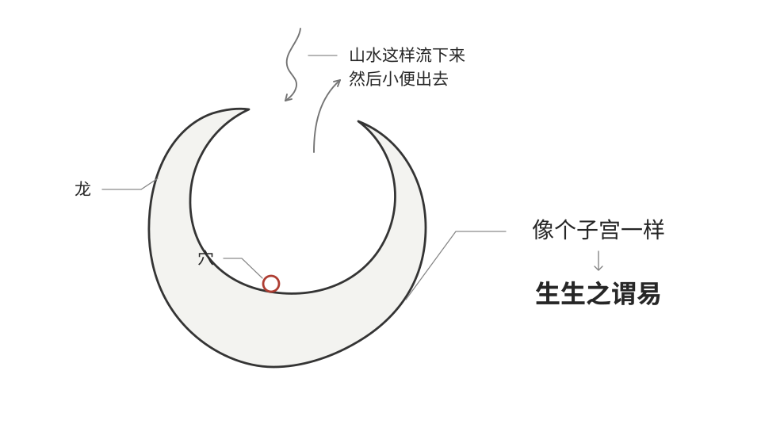 〔指代〕说穴在「这个位置上」时，手指的是黑板。两处指代标注都落在整幅画面正中（第5格）。（[00:27:05–00:27:06](https://www.bilibili.com/video/BV1KJsLekEfA/?p=31&t=1625)，第 48758–48787 帧） 〔口述〕讲到妇科，他说画出的形状「像个子宫一样」。这个比方取的是生生的意思，他引「生生之谓易」，接着说「取它的相生」。（[00:27:12–00:27:29](https://www.bilibili.com/video/BV1KJsLekEfA/?p=31&t=1632)，第 48960–49493 帧） 〔板书〕开口上方多了一条竖着的弯线，内侧弧线的底边添了一个小圈。倪师手里的粉笔尖停在小圈右边。（[00:27:12](https://www.bilibili.com/video/BV1KJsLekEfA/?p=31&t=1632)，第 48977 帧） |
| **倪师说的「生」，怎样从山上的草木看？** | 〔口述〕看风水时，「你要看它的生」。三元派、三合派讲的禁忌很多，倪师说这些禁忌「其实都脱离不了生和情的」。（[00:27:29–00:27:47](https://www.bilibili.com/video/BV1KJsLekEfA/?p=31&t=1649)，第 49494–50021 帧） 〔板书〕图的右上方可辨一个「情」字，左邻的板面被倪师挡住。下方仍能看见贴着内弧底边的小圈。（[00:27:46](https://www.bilibili.com/video/BV1KJsLekEfA/?p=31&t=1666)，第 49996 帧） 〔口述〕讲什么叫生，倪师拿秃头打比方，顺口提到生发丸。山若光秃秃，连草和树都没有，他就说这山无神、没有生气。（[00:27:47–00:28:03](https://www.bilibili.com/video/BV1KJsLekEfA/?p=31&t=1667)，第 50022–50501 帧） 〔口述〕山上尽是短草，草长得细，他称这种山为秀丽。山上若长了很多高大的树，他用的形容是「雄壮威武」。（[00:28:03–00:28:13](https://www.bilibili.com/video/BV1KJsLekEfA/?p=31&t=1683)，第 50502–50813 帧） |
| **草、树、沙石分别让倪师怎样判断山形？** | 〔口述〕倪师拿人作比，说文人、女人比较秀，男人比较雄壮威武。按他的讲法，雄壮威武的可能代表武官，秀气的代表文官。（[00:28:13–00:28:29](https://www.bilibili.com/video/BV1KJsLekEfA/?p=31&t=1693)，第 50814–51299 帧） 〔口述〕看同一座山，草长得秀气，山上的树也长得很好。这两样都具备，倪师称为「文武双全」。（[00:28:32–00:28:41](https://www.bilibili.com/video/BV1KJsLekEfA/?p=31&t=1712)，第 51372–51641 帧） 〔口述〕他又让学生看山的形状，举了后面是石头山、整座山都是沙石的情形。说到沙山，他举敦煌鸣沙山为例，称这样的山「没有生气」。（[00:28:41–00:28:55](https://www.bilibili.com/video/BV1KJsLekEfA/?p=31&t=1721)，第 51642–52067 帧） |
| **同样是水，怎样从走向辨有情、无情？** | 〔口述〕讲山水有没有情，倪师说「专门讲水啊」。他替学生发问，眼前看见的都是水，凭什么分有情和无情？（[00:28:55–00:29:05](https://www.bilibili.com/video/BV1KJsLekEfA/?p=31&t=1735)，第 52068–52367 帧） 〔口述〕倪师说来水要呈回形，曲曲折折地走，「曲折入明堂」就称为有情。他给直行的水下的断语是「直来直去的水都是无情水」。（[00:29:08–00:29:33](https://www.bilibili.com/video/BV1KJsLekEfA/?p=31&t=1748)，第 52458–53213 帧） 〔板书〕黑板上几段长线横向往返，上下排开，左端能看见两处圆弯。右侧一部分被倪师挡住，线怎样接过去看不全。（[00:29:18](https://www.bilibili.com/video/BV1KJsLekEfA/?p=31&t=1758)，第 52764 帧） 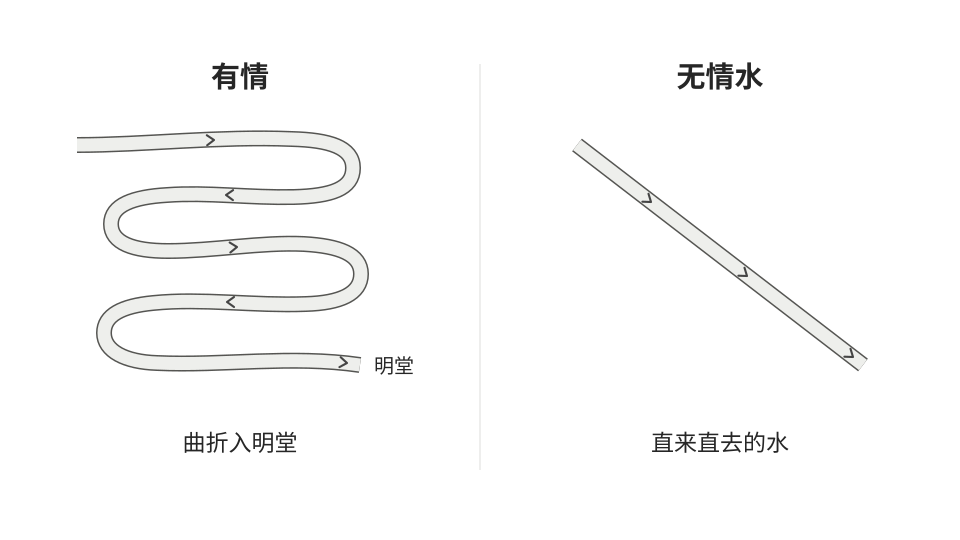 |
| **讲山势弯下、中间成平地，倪师举了哪里？** | 〔口述〕倪师画山形弯下来，说有的龙这样结穴。山下来，中间到了平地，整片是平原。他举台北平地为例，接着说龙一般在「这边」结穴。（[00:29:39–00:29:55](https://www.bilibili.com/video/BV1KJsLekEfA/?p=31&t=1779)，第 53394–53861 帧） 〔板书〕左右各有一道长弧，上端朝内。里面的线在左、右各凹下去一次，两处圆底之间有一段向上凸起的圆拱。（[00:29:45](https://www.bilibili.com/video/BV1KJsLekEfA/?p=31&t=1785)，第 53565 帧） 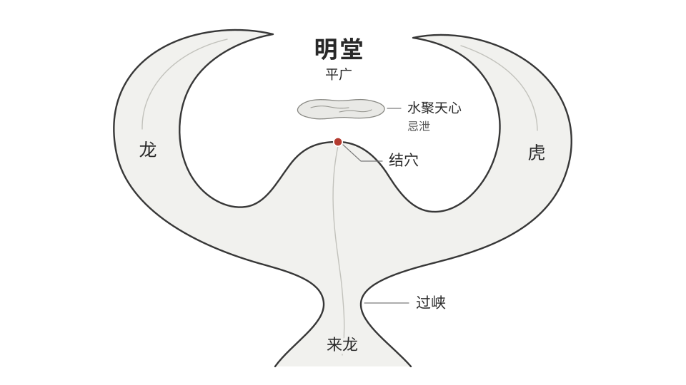 〔指代〕说龙一般在「这边」结穴时，手指的是黑板，位置在整幅画面正中（第5格）。（[00:29:53](https://www.bilibili.com/video/BV1KJsLekEfA/?p=31&t=1793)，第 53819 帧） |
| **明堂是哪一片地，在穴的哪一边？** | 〔口述〕倪师说到结穴，特意点出「前面这个平地」。穴前这一块平地有个专门的名称，「叫做明堂」。（[00:29:55–00:30:06](https://www.bilibili.com/video/BV1KJsLekEfA/?p=31&t=1795)，第 53862–54197 帧） 〔指代〕这次说「这个」时，手指的是黑板，落在整幅画面中排靠右的位置（第6格）。（[00:29:56](https://www.bilibili.com/video/BV1KJsLekEfA/?p=31&t=1796)，第 53903 帧） 〔板书〕中央圆拱的顶端添了一个小圈，有一道长线从小圈下方向下延伸。小圈上方还横着几道挨得很近的弧线。（[00:30:03](https://www.bilibili.com/video/BV1KJsLekEfA/?p=31&t=1803)，第 54102 帧） |
| **龙、虎和来龙各在穴的哪一面？** | 〔口述〕倪师从两侧讲到后方，左边是龙，右边是虎。说到背后，他用的是「后面呢这个整个叫来龙」。（[00:30:06–00:30:13](https://www.bilibili.com/video/BV1KJsLekEfA/?p=31&t=1806)，第 54198–54419 帧） 〔指代〕讲到虎，说「这个」时，手指的是黑板，落在整幅画面中排右侧（第6格）。（[00:30:08](https://www.bilibili.com/video/BV1KJsLekEfA/?p=31&t=1808)，第 54268 帧） 〔指代〕讲后面的来龙，说「这个」时，手指的也是黑板，位置在整幅画面右下（第9格）。（[00:30:11](https://www.bilibili.com/video/BV1KJsLekEfA/?p=31&t=1811)，第 54338 帧） |
| **什么叫过峡，地师凭什么说结穴快到了？** | 〔口述〕来龙行到一段很窄的地方，得从这里经过。倪师把来龙经过窄处的情形称为「过峡」。（[00:30:14–00:30:20](https://www.bilibili.com/video/BV1KJsLekEfA/?p=31&t=1814)，第 54420–54605 帧） 〔口述〕倪师用上古时地壳挤起来、山脉拉成一条线作解释。两旁原有两座大山，中间被挤起来，本来很宽的来龙经过两山就变窄，好比脖子被挤住。（[00:30:20–00:30:36](https://www.bilibili.com/video/BV1KJsLekEfA/?p=31&t=1820)，第 54606–55097 帧） 〔口述〕地师沿山脉走，忽然看见山脉被两边的山夹窄，就认作到了「龙的脖子」。倪师说，看到这里「就知道结穴就在前面」，已经快到了。（[00:30:40–00:30:51](https://www.bilibili.com/video/BV1KJsLekEfA/?p=31&t=1840)，第 55212–55559 帧） 〔口述〕他把这样看山比作读地质学，又提到兵书、立国都。回到图上，他把来龙经过的窄处称作「峡」，说龙一过峡就知道前面要结穴。（[00:30:52–00:31:09](https://www.bilibili.com/video/BV1KJsLekEfA/?p=31&t=1852)，第 55560–56093 帧） |
| **明堂要看哪两项条件，什么样的地面不好？** | 〔口述〕明堂先看地面是否平而宽，再看水能否聚在这里。倪师按次序说的是「第一个要平广」「第二个要水聚」。（[00:31:22–00:31:34](https://www.bilibili.com/video/BV1KJsLekEfA/?p=31&t=1882)，第 56466–56825 帧） 〔口述〕倪师又讲明堂要平，举了堆着破烂东西、有碎石、地面高低不平几种反例。石头参差，样子峥嵘，他形容看起来很可怕。（[00:31:34–00:31:45](https://www.bilibili.com/video/BV1KJsLekEfA/?p=31&t=1894)，第 56826–57179 帧） |

**总结区**

- 通用规则：阳宅、阴宅同讲藏风纳气，山势两侧环抱、风不容易吹进来，是倪师举的辨法。（[00:25:04–00:25:42](https://www.bilibili.com/video/BV1KJsLekEfA/?p=31&t=1504)，第 45126–46283 帧）；山上光秃无草木，倪师称为没有生气，水曲折入明堂称为有情，直来直去称为无情。（[00:27:47–00:29:33](https://www.bilibili.com/video/BV1KJsLekEfA/?p=31&t=1667)，第 50022–53213 帧）；来龙一过峡，按倪师的讲法，就可以判断前面要结穴。（[00:31:04–00:31:09](https://www.bilibili.com/video/BV1KJsLekEfA/?p=31&t=1864)，第 55926–56093 帧）；明堂有两项要求，第一要平广，第二要水聚。（[00:31:22–00:31:34](https://www.bilibili.com/video/BV1KJsLekEfA/?p=31&t=1882)，第 56466–56825 帧）
- 只在本例：倪师想带学生去看的地方，在他看来是标准的龙，但他认为那里请的风水师可能只懂风水的一部分。（[00:26:27–00:26:47](https://www.bilibili.com/video/BV1KJsLekEfA/?p=31&t=1587)，第 47622–48239 帧）；倪师举敦煌鸣沙山为例，说明他所说的沙石山没有生气。（[00:28:46–00:28:55](https://www.bilibili.com/video/BV1KJsLekEfA/?p=31&t=1726)，第 51780–52067 帧）；讲山势弯下、中间成为一片平地时，倪师举的地方是台北平地。（[00:29:39–00:29:52](https://www.bilibili.com/video/BV1KJsLekEfA/?p=31&t=1779)，第 53394–53783 帧）

**待核**

1. 大弧上方的粉笔字认不全，右上圈里的弯笔也读不出确切的字。（[00:25:16](https://www.bilibili.com/video/BV1KJsLekEfA/?p=31&t=1516)，第 45486 帧）
2. 字幕作「好了一票down」，语音作「一条旁那」，这几个字的原话听不清。（[00:25:36](https://www.bilibili.com/video/BV1KJsLekEfA/?p=31&t=1536)，第 46092 帧）
3. 所选位置的风势，字幕作「风不容易吹进来」，语音把「吹进来」转成「吹起来」，此处按字幕记。（[00:25:38](https://www.bilibili.com/video/BV1KJsLekEfA/?p=31&t=1538)，第 46152 帧）
4. 讲如何判龙时，字幕末尾作「判定官」，语音作「判定它」，末字待核。（[00:26:20](https://www.bilibili.com/video/BV1KJsLekEfA/?p=31&t=1580)，第 47424 帧）
5. 风水要配合什么，字幕作「我们身上的医学」，语音把句尾转成「一群」，此处按字幕记。（[00:26:50](https://www.bilibili.com/video/BV1KJsLekEfA/?p=31&t=1610)，第 48312 帧）
6. 山水流出后的比方，字幕作「那好像在挤水一样」，语音作「好像在汽水一样」，具体比的是什么待核。（[00:27:10](https://www.bilibili.com/video/BV1KJsLekEfA/?p=31&t=1630)，第 48918 帧）
7. 倪师并提三元派、三合派，本块没有展开两派各有哪些禁忌。（[00:27:36](https://www.bilibili.com/video/BV1KJsLekEfA/?p=31&t=1656)，第 49686 帧）
8. 形容秃山时，字幕在「无神」前还有「无情」，语音只对得上无神、没有生气。（[00:27:59](https://www.bilibili.com/video/BV1KJsLekEfA/?p=31&t=1679)，第 50376 帧）
9. 敦煌、鸣沙山按字幕记，语音把两处地名转成了近音字。（[00:28:49](https://www.bilibili.com/video/BV1KJsLekEfA/?p=31&t=1729)，第 51882 帧）
10. 两段书写共用同一张截图，右侧线条又被挡住，两次各画了哪一笔分不清。（[00:29:18](https://www.bilibili.com/video/BV1KJsLekEfA/?p=31&t=1758)，第 52764 帧）
11. 举台北平地时，字幕末尾有「一个盆」，语音只对得上「就是这样子」，末尾用词待核。（[00:29:50](https://www.bilibili.com/video/BV1KJsLekEfA/?p=31&t=1790)，第 53718 帧）
12. 讲虎的方位时，字幕作「有边」，上一句末尾的语音已说「右边」，笔记按「右边」记。（[00:30:08](https://www.bilibili.com/video/BV1KJsLekEfA/?p=31&t=1808)，第 54264 帧）
13. 过峡前的几个字，字幕作「这个四做过峡」，紧接的一句字幕作「这个叫做过峡」，按后一句记。（[00:30:17](https://www.bilibili.com/video/BV1KJsLekEfA/?p=31&t=1817)，第 54528 帧）
14. 讲山脉挤起时，字幕作「地壳」，语音作「地区」，此处按字幕记。（[00:30:22](https://www.bilibili.com/video/BV1KJsLekEfA/?p=31&t=1822)，第 54678 帧）
15. 字幕作「过去哦封地师啊」，语音也不清楚。下一句能辨出地师，前面的称呼待核。（[00:30:38](https://www.bilibili.com/video/BV1KJsLekEfA/?p=31&t=1838)，第 55152 帧）
16. 讲完地质学后，字幕作「你说官都可以啊」，语音作「它都可以啊」，原话待核。（[00:30:58](https://www.bilibili.com/video/BV1KJsLekEfA/?p=31&t=1858)，第 55752 帧）
17. 字幕作「这是山脊山的棱线棱线」，识别可信度为0.4。语音作「三级三的零线零线然后旁」，「山脊」和「棱线」的原话待核。（[00:25:31–00:25:35](https://www.bilibili.com/video/BV1KJsLekEfA/?p=31&t=1531)，第 45954–46055 帧）

### 6　水聚天心、生基、些子大法与用象（[00:31:46–00:38:10](https://www.bilibili.com/video/BV1KJsLekEfA/?p=31&t=1906)，第 57180–68711 帧）

| 提示区 | 笔记区 |
|---|---|
| **明堂的水怎样才算聚得好？** | 〔板书〕两侧弧线向内弯，中间的小圈下接一条长线，小圈上方有一排锯齿状折线。右侧两道弧线之间可辨「虎」字，旁边有一支向右的箭头。（[00:31:46](https://www.bilibili.com/video/BV1KJsLekEfA/?p=31&t=1906)，第 57180 帧） 〔口述〕倪师要求明堂的水能聚住，说「绝对忌讳泄」。讲到水聚得最好的情形，他称之为「水聚天心」。（[00:31:48–00:32:02](https://www.bilibili.com/video/BV1KJsLekEfA/?p=31&t=1908)，第 57252–57665 帧） 〔板书〕板上的两项从上往下排列，①旁可辨「平广」，②旁写「水聚」，再下一行是「忌泄」。（[00:31:54](https://www.bilibili.com/video/BV1KJsLekEfA/?p=31&t=1914)，第 57427 帧） |
| **倪师为什么用日月潭说明水聚天心？** | 〔口述〕倪师说，整个中央山脉只有日月潭这一处龙抬头。他接着说「所以日月潭过去一定都是火山口的湖」。（[00:32:02–00:32:12](https://www.bilibili.com/video/BV1KJsLekEfA/?p=31&t=1922)，第 57666–57989 帧） 〔口述〕他说潭中央有光华岛，讲岛旁的水时说「旁边这个水聚在中间」，用水聚明堂来形容这个例子。（[00:32:13–00:32:19](https://www.bilibili.com/video/BV1KJsLekEfA/?p=31&t=1933)，第 57990–58193 帧） 〔口述〕在他的讲法里，潭底连着龙脉，龙脉到这里抬头，又向下去，所以「这就是聚为一个穴」。他还说这里是当初喷岩浆的地方。（[00:32:24–00:32:36](https://www.bilibili.com/video/BV1KJsLekEfA/?p=31&t=1944)，第 58320–58691 帧） |
| **什么是生基，墓碑上的红字表示什么？** | 〔口述〕倪师谈到做生基的风气。做生基的人先为自己备好身后要葬的坟墓，坟墓做好时「那个人还没死哦」。（[00:32:40–00:32:51](https://www.bilibili.com/video/BV1KJsLekEfA/?p=31&t=1960)，第 58824–59153 帧） 〔板书〕黑板上部横写「生基」，两字下面画了一道长线。线下还圈着一个「生」字，圈的右边被挡住。（[00:32:44](https://www.bilibili.com/video/BV1KJsLekEfA/?p=31&t=1964)，第 58944 帧） 〔口述〕先刻姓名，再把红油漆填进刻痕里。按倪师的解释，看到墓碑上这样写的红字，就知道本人还在世，打算身后葬在这里。（[00:32:51–00:33:06](https://www.bilibili.com/video/BV1KJsLekEfA/?p=31&t=1971)，第 59154–59597 帧） 〔口述〕倪师说，过去有人相信做生基「可以延年益寿」，让自己身体很好，当时外面也常用这种办法。（[00:33:08–00:33:18](https://www.bilibili.com/video/BV1KJsLekEfA/?p=31&t=1988)，第 59658–59963 帧） |
| **倪师为何不赞成做生基，又怎样举纸箱为例？** | 〔口述〕第二种叫「些子大法」。倪师把它和生基并提，说「这两派都不是很好」。他反对让人乱花钱，举生基来说，花费很大，他判断没有用。（[00:33:18–00:33:38](https://www.bilibili.com/video/BV1KJsLekEfA/?p=31&t=1998)，第 59964–60557 帧） 〔口述〕倪师说，做生基有个简单的办法。在自家客厅摆个纸箱，里面放自己的衣服，留一个晚上，点两支白蜡烛，第二天早晨收掉。他说「象出现一次就好了」。（[00:33:40–00:33:51](https://www.bilibili.com/video/BV1KJsLekEfA/?p=31&t=2020)，第 60612–60935 帧） |
| **讲些子大法时，倪师举了哪两种挡路冲的做法？** | 〔口述〕遇到马路冲，有人摆八卦镜来照，有人放石敢当对着来路。倪师用这两个例子说明找一件东西来挡路冲的做法。（[00:33:51–00:34:11](https://www.bilibili.com/video/BV1KJsLekEfA/?p=31&t=2031)，第 60936–61553 帧） 〔指代〕第二次讲马路冲，说「这个」时，手指的是整幅画面下排中格里的黑板，具体指到哪一笔没有标明。（[00:34:02](https://www.bilibili.com/video/BV1KJsLekEfA/?p=31&t=2042)，第 61262 帧） |
| **台北市仁爱路圆环图上提到了哪些地方？** | 〔口述〕倪师举台北市仁爱路圆环为例，讲图时先说「第一信托在这里」，接着说「这个是远东」。（[00:34:18–00:34:27](https://www.bilibili.com/video/BV1KJsLekEfA/?p=31&t=2058)，第 61746–62015 帧） 〔指代〕提到第一信托，说「这里」时，手指的是整幅画面上排中格里的黑板。（[00:34:23](https://www.bilibili.com/video/BV1KJsLekEfA/?p=31&t=2063)，第 61911 帧） 〔口述〕他打趣说，脚底板肉较平、较嫩的人爱逛街，对这个地方一定很熟。他接着提到一处商号，名称待核，随后才说到「以前的财神酒店」。（[00:34:27–00:34:38](https://www.bilibili.com/video/BV1KJsLekEfA/?p=31&t=2067)，第 62016–62363 帧） 〔板书〕板上有两排弧形轮廓，下面两个都两头尖、中间宽，左边那个旁边可辨「远东」。图下另有圈出的②和带下划线的「些子大法」。（[00:34:36](https://www.bilibili.com/video/BV1KJsLekEfA/?p=31&t=2076)，第 62304 帧） 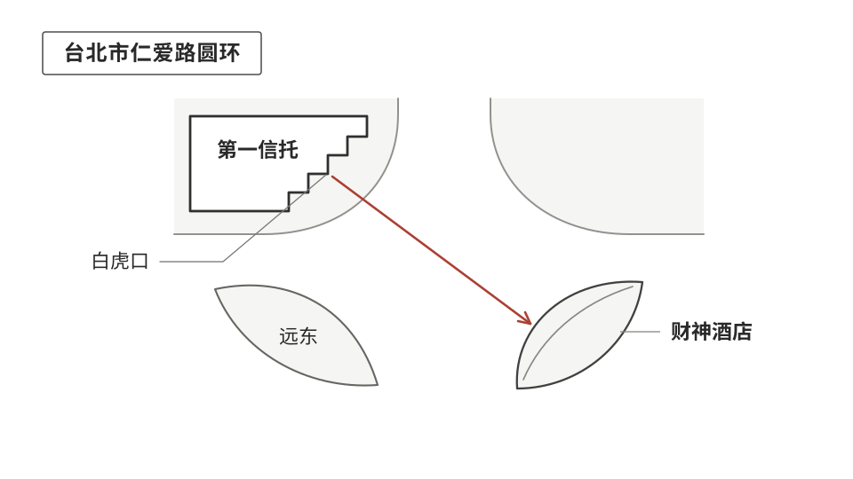 〔板书〕右下那个两头尖的轮廓里，多了一道从左下向右上弯的线。轮廓右侧的题字被倪师挡住一部分。（[00:34:40](https://www.bilibili.com/video/BV1KJsLekEfA/?p=31&t=2080)，第 62412 帧） |
| **财神酒店的白虎口指什么，倪师怎样讲鸿源？** | 〔口述〕倪师说，财神酒店地点很好，却有「谁买来谁就倒霉」的说法。因为说谁买谁出事，房子就一直搁着，没人买。（[00:34:40–00:34:47](https://www.bilibili.com/video/BV1KJsLekEfA/?p=31&t=2080)，第 62406–62627 帧） 〔口述〕他讲到酒店对面的第一信托，说整栋房子做成白色，把那种房形比作「白虎的口」。按他转述的说法，虎口朝着酒店，「谁上来谁就倒霉」。（[00:34:47–00:35:14](https://www.bilibili.com/video/BV1KJsLekEfA/?p=31&t=2087)，第 62628–63425 帧） 〔板书〕黑板左侧的轮廓上边平伸，左边近乎竖直，右边从高处一级一级向左下收进，形成阶梯状折线。（[00:35:00](https://www.bilibili.com/video/BV1KJsLekEfA/?p=31&t=2100)，第 63000 帧） 〔板书〕黑板左侧有一列大字，从上往下可辨「白」「虎」「口」。一条长斜线从上排左边的弧形，连到下排右边「财神」字旁的叶形。（[00:35:13](https://www.bilibili.com/video/BV1KJsLekEfA/?p=31&t=2113)，第 63391 帧） 〔口述〕他点名鸿源，说原先没出事，「买下来就出事了」，还说人走倒霉运时就会去买。他交代这是外面一些风水派系的说法。（[00:35:16–00:35:24](https://www.bilibili.com/video/BV1KJsLekEfA/?p=31&t=2116)，第 63480–63731 帧） |
| **石罗汉怎样制虎，倪师为何反对这样斗法？** | 〔指代〕讲对面的白老虎之前，说「这个」时，手指的是黑板上能看见「白」字的位置。（[00:35:28](https://www.bilibili.com/video/BV1KJsLekEfA/?p=31&t=2128)，第 63851 帧） 〔口述〕他假设对面有白老虎，照些子大法的说法，会做一尊石罗汉，抬高一只脚，做出踢虎的样子。选罗汉取的是「空手制虎」之意。（[00:35:30–00:36:06](https://www.bilibili.com/video/BV1KJsLekEfA/?p=31&t=2130)，第 63918–64985 帧） 〔口述〕找一样东西来制虎，两边这样相制，就「开始斗法了」。倪师说这叫些子大法，随即表明自己不赞成。（[00:36:06–00:36:21](https://www.bilibili.com/video/BV1KJsLekEfA/?p=31&t=2166)，第 64986–65435 帧） 〔指代〕表明自己不赞成时，他说「这个」，手指的是黑板上写着「些子大法」的位置。（[00:36:14](https://www.bilibili.com/video/BV1KJsLekEfA/?p=31&t=2174)，第 65230 帧） 〔口述〕倪师说，风水地理本来就容易让人迷信，「我们千万不要再去把它玄化」。讲得像怪谈，只会让听的人更难相信。（[00:36:21–00:36:35](https://www.bilibili.com/video/BV1KJsLekEfA/?p=31&t=2181)，第 65436–65855 帧） |
| **面对平原上的树丛，两种看法各看什么？** | 〔口述〕他举平原上几处树丛为例。生物学家、植物学家走进树丛，研究树和草各分几类、树本身怎么样。倪师说看风水时「我们看整个地形」。（[00:36:39–00:36:53](https://www.bilibili.com/video/BV1KJsLekEfA/?p=31&t=2199)，第 65988–66401 帧） 〔板书〕黑板上部从左到右分开画了三个圈，左边和中间的圈较大，右端的圈较小，位置也稍低。（[00:36:45](https://www.bilibili.com/video/BV1KJsLekEfA/?p=31&t=2205)，第 66161 帧） 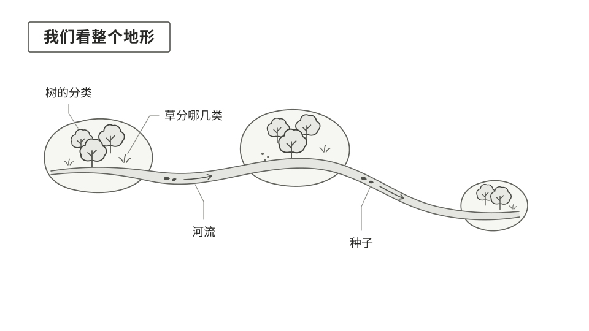 |
| **怎样顺着河流把几处树丛连起来看？** | 〔口述〕河流通下来，把原有树丛的种子带到别处，后来又有一处长出树来。倪师把水路和这几处树丛放在一起讲，说「我们看是整体」。（[00:36:53–00:37:04](https://www.bilibili.com/video/BV1KJsLekEfA/?p=31&t=2213)，第 66402–66743 帧） 〔板书〕一条细曲线从左圈经过中圈，往右下弯到较小的圈。中圈里面还有几个点和几道短笔画。（[00:36:55](https://www.bilibili.com/video/BV1KJsLekEfA/?p=31&t=2215)，第 66456 帧） 〔指代〕说种子被带到「这边」时，手指的是整幅画面上排中格里的黑板，标注没有指明是哪个圈。（[00:36:58](https://www.bilibili.com/video/BV1KJsLekEfA/?p=31&t=2218)，第 66542 帧） 〔板书〕左圈和中圈之间能看见两道细线，其中一道向下弯，两线之间留出窄缝。右端的小圈被手遮住一部分。（[00:37:03](https://www.bilibili.com/video/BV1KJsLekEfA/?p=31&t=2223)，第 66696 帧） |
| **微视、巨视和在形上相争有什么分别？** | 〔口述〕倪师谈到两种看法，说「现在的所有的科学家都在微视」，把看风水的眼光称为「巨视」。说回用摆设相制的做法，他认为这也比较微视，只是「在形上面互相争」。（[00:37:04–00:37:19](https://www.bilibili.com/video/BV1KJsLekEfA/?p=31&t=2224)，第 66744–67193 帧） 〔口述〕他说「万物生生相克」，懂了这个道理，就知道些子大法是怎么做的。他也告诫学生，学会了不要拿去骗人。（[00:37:19–00:37:33](https://www.bilibili.com/video/BV1KJsLekEfA/?p=31&t=2239)，第 67194–67595 帧） |
| **火地晋卦的例子怎样说明用象只有一次？** | 〔口述〕倪师把用象求解的要领归成「象一次」三个字。他说「用象只有一次」，认为这个办法可以用来解很多事情。（[00:37:33–00:37:42](https://www.bilibili.com/video/BV1KJsLekEfA/?p=31&t=2253)，第 67596–67883 帧） 〔板书〕黑板左上可辨一个「象」字，邻近的字迹与线条重叠，认不全。中下部有两条长线交叉，穿过圈号②右边的一行字。（[00:37:40](https://www.bilibili.com/video/BV1KJsLekEfA/?p=31&t=2260)，第 67821 帧） 〔口述〕他回举火地晋卦，说「让它象出现就可以解掉」。又假设卜到此卦，提到「你大限第二天」，接着举摆白老虎、买一块玉放进去的做法，说这些都于事无补，是「在形上面做文章」。（[00:37:42–00:38:01](https://www.bilibili.com/video/BV1KJsLekEfA/?p=31&t=2262)，第 67884–68441 帧） 〔口述〕他主张「我们用象解最好」，又说用《易经》上的解法最好。收尾时他嘱咐「不要去用它」。（[00:38:01–00:38:10](https://www.bilibili.com/video/BV1KJsLekEfA/?p=31&t=2281)，第 68442–68711 帧） 〔指代〕说「这个」时，手指的是整幅画面下排中格里的黑板，这一处没有标出可辨认的字。（[00:38:06](https://www.bilibili.com/video/BV1KJsLekEfA/?p=31&t=2286)，第 68590 帧） |

**总结区**

- 通用规则：倪师说明堂的水要能聚，忌泄，水聚得最好的情形称为水聚天心（[00:31:48–00:32:02](https://www.bilibili.com/video/BV1KJsLekEfA/?p=31&t=1908)，第 57252–57665 帧）；按倪师所讲的墓碑用字，碑上姓名填红，表示本人还在世，已预备身后葬在这里（[00:32:51–00:33:08](https://www.bilibili.com/video/BV1KJsLekEfA/?p=31&t=1971)，第 59154–59657 帧）；倪师说看风水要看整个地形，把河流与几处树丛连起来看，称这种眼光为巨视（[00:36:51–00:37:14](https://www.bilibili.com/video/BV1KJsLekEfA/?p=31&t=2211)，第 66342–67025 帧）；倪师说用象求解，只要让象出现一次（[00:37:33–00:37:48](https://www.bilibili.com/video/BV1KJsLekEfA/?p=31&t=2253)，第 67596–68051 帧）
- 只在本例：倪师把日月潭说成中央山脉龙抬头之处，以光华岛居中、潭水聚集和潭底龙脉的起伏说明这里聚为一个穴（[00:32:02–00:32:31](https://www.bilibili.com/video/BV1KJsLekEfA/?p=31&t=1922)，第 57666–58535 帧）；说到财神酒店，他转述对面第一信托的白色房形如虎口的说法，并举鸿源买下后出事为例（[00:34:34–00:35:24](https://www.bilibili.com/video/BV1KJsLekEfA/?p=31&t=2074)，第 62232–63731 帧）；在卜到火地晋卦的假设中，他提到大限第二天，说摆白老虎、买一块玉都于事无补（[00:37:50–00:37:59](https://www.bilibili.com/video/BV1KJsLekEfA/?p=31&t=2270)，第 68106–68399 帧）
- 不是风水规则，是处世方法：倪师反对让别人花很多钱去做他认为没有用的生基（[00:33:23–00:33:38](https://www.bilibili.com/video/BV1KJsLekEfA/?p=31&t=2003)，第 60090–60557 帧）；讲风水地理容易引人迷信，倪师劝人别再把它玄化，讲得像怪谈（[00:36:21–00:36:35](https://www.bilibili.com/video/BV1KJsLekEfA/?p=31&t=2181)，第 65436–65855 帧）；知道怎样用一种形去制另一种形，也不要拿这套说法去骗人（[00:37:14–00:37:33](https://www.bilibili.com/video/BV1KJsLekEfA/?p=31&t=2234)，第 67026–67595 帧）

**待核**

1. 字幕「一个水聚名堂」的「名堂」据语音「水聚明堂」改作明堂（[00:32:17](https://www.bilibili.com/video/BV1KJsLekEfA/?p=31&t=1937)，第 58128 帧）
2. 形容光华岛的一句，前句语音有「一根车」，这句字幕有「一根散」，用什么作比听不清（[00:32:22](https://www.bilibili.com/video/BV1KJsLekEfA/?p=31&t=1942)，第 58260 帧）
3. 字幕作「有钱人流行在做生基」，语音连前句近「有些人」，是否特指有钱人待核（[00:32:40](https://www.bilibili.com/video/BV1KJsLekEfA/?p=31&t=1960)，第 58824 帧）
4. 刻名字之后，字幕作「八字在」，语音作「八十块」，是否还说要刻八字待核（[00:32:51](https://www.bilibili.com/video/BV1KJsLekEfA/?p=31&t=1971)，第 59154 帧）
5. 说明填红漆的用意时，字幕作「免得给风吹目晒给官跑掉了」，后半句两路都不清楚（[00:32:57](https://www.bilibili.com/video/BV1KJsLekEfA/?p=31&t=1977)，第 59316 帧）
6. 「两个自蜡烛」据语音的「两个白蜡」记作两支白蜡烛。摆放位置字幕作「前后」，语音对不上（[00:33:44](https://www.bilibili.com/video/BV1KJsLekEfA/?p=31&t=2024)，第 60744 帧）
7. 镜名取字幕「八卦镜」，语音能对上拿镜子照路冲，镜名前两个字听不清（[00:33:58](https://www.bilibili.com/video/BV1KJsLekEfA/?p=31&t=2038)，第 61152 帧）
8. 圆环上另一个商号，字幕作「这个是（芝麻百货？）」，语音作「这个是斯文森三一」，名称待核（[00:34:32](https://www.bilibili.com/video/BV1KJsLekEfA/?p=31&t=2072)，第 62184 帧）
9. 图形旁的题字有遮挡，圆环上各处的名称与位置无法从这一帧逐一核全（[00:34:40](https://www.bilibili.com/video/BV1KJsLekEfA/?p=31&t=2080)，第 62412 帧）
10. 字幕识别为「自色」，按语音及随后画面底部可读的字幕记作白色（[00:34:59](https://www.bilibili.com/video/BV1KJsLekEfA/?p=31&t=2099)，第 62982 帧）
11. 「自虎自虎的口」和稍后的「自虎口」据语音及同段字幕「白虎的口」记作白虎口（[00:35:01](https://www.bilibili.com/video/BV1KJsLekEfA/?p=31&t=2101)，第 63048 帧）
12. 字幕另有「白虎的回」，这一句没有可辨的语音，末字待核（[00:35:09](https://www.bilibili.com/video/BV1KJsLekEfA/?p=31&t=2109)，第 63288 帧）
13. 「鸿源」取字幕用字，语音在前一句末尾近「红颜」。本段只说买下后出事，未交代是什么事（[00:35:16](https://www.bilibili.com/video/BV1KJsLekEfA/?p=31&t=2116)，第 63480 帧）
14. 表态时字幕作「我不信这个」，语音作「我不赞成」，结合下一句能确认的是不赞成（[00:36:14](https://www.bilibili.com/video/BV1KJsLekEfA/?p=31&t=2174)，第 65226 帧）
15. 种子被带到一处之后，字幕作「一直没有生出来」，语音作「边有生存」，这一处究竟有没有长出来待核（[00:36:58](https://www.bilibili.com/video/BV1KJsLekEfA/?p=31&t=2218)，第 66552 帧）
16. 「万物生生相克」按字幕保留，语音也是「生生相克」，课上没有展开讲「生生」二字（[00:37:19](https://www.bilibili.com/video/BV1KJsLekEfA/?p=31&t=2239)，第 67194 帧）
17. 口述说「象一次」三个字，在写完后的板面上无法把这三个字逐字认全（[00:37:40](https://www.bilibili.com/video/BV1KJsLekEfA/?p=31&t=2260)，第 67821 帧）
18. 火地晋卦回指上次讲的例子，这一段没有重讲当时具体让什么象出现（[00:37:42](https://www.bilibili.com/video/BV1KJsLekEfA/?p=31&t=2262)，第 67884 帧）
19. 「你大限第二天」的具体所指，本段没有交代（[00:37:51](https://www.bilibili.com/video/BV1KJsLekEfA/?p=31&t=2271)，第 68154 帧）
20. 卦例里的「自老虎」据语音记作白老虎（[00:37:53](https://www.bilibili.com/video/BV1KJsLekEfA/?p=31&t=2273)，第 68190 帧）
21. 收尾说「这个」时只确定手指黑板。下一句字幕的「用官」与语音不合，末句明确说「不要去用它」，具体指哪种做法待核（[00:38:06](https://www.bilibili.com/video/BV1KJsLekEfA/?p=31&t=2286)，第 68590 帧）

## 官鬼假穴、立向潜山例与人相风水

### 7　官鬼辨形、沿水辨穴与台北立向（[00:38:10–00:43:06](https://www.bilibili.com/video/BV1KJsLekEfA/?p=31&t=2290)，第 68712–77597 帧）

| 提示区 | 笔记区 |
|---|---|
| **山从两边包起，前伸和后扫各叫什么？** | 〔板书〕开头板面右侧可见一道大弧线，旁边还有几个小圈。粉笔字很淡，认不出。（[00:38:10](https://www.bilibili.com/video/BV1KJsLekEfA/?p=31&t=2290)，第 68712 帧） 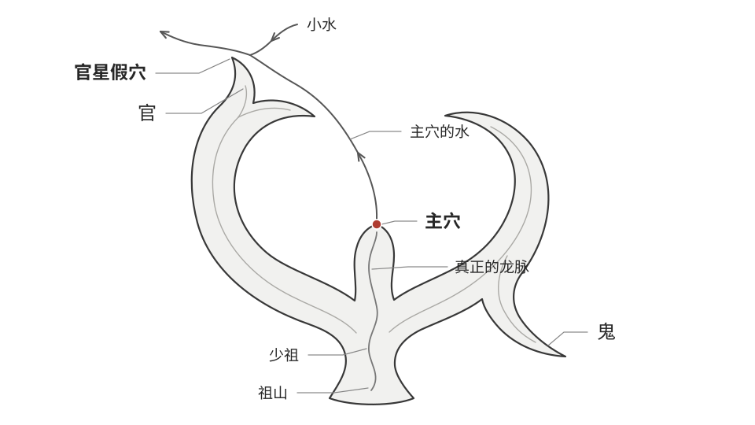 〔口述〕山从两边包起来以后，前面有时还会突出一截。倪师把前面突出的一截叫作「官」。（[00:38:16–00:38:24](https://www.bilibili.com/video/BV1KJsLekEfA/?p=31&t=2296)，第 68892–69143 帧） 〔板书〕大弧线的右上方有一道窄长的竖圈，圈旁的横线向右伸，尽头可辨一个「官」字。（[00:38:22](https://www.bilibili.com/video/BV1KJsLekEfA/?p=31&t=2302)，第 69060 帧） 〔口述〕再看环抱左右的山势，后面也有像尾巴一样扫出去的地方。倪师把「尾巴扫出去的部分」叫作鬼。（[00:38:24–00:38:33](https://www.bilibili.com/video/BV1KJsLekEfA/?p=31&t=2304)，第 69144–69413 帧） 〔指代〕讲左右环抱，说「这个」时，手指的是黑板，位置在整幅画面的下排中格（第8格）。（[00:38:27](https://www.bilibili.com/video/BV1KJsLekEfA/?p=31&t=2307)，第 69217 帧） |
| **官和鬼好到什么程度，要看什么？** | 〔口述〕官和鬼，倪师说「这两个都是非常好的」。至于好到什么程度，还要看它的形状「像什么样东西」，再据形判断好坏。（[00:38:33–00:38:49](https://www.bilibili.com/video/BV1KJsLekEfA/?p=31&t=2313)，第 69414–69899 帧） 〔板书〕板面右边上下各圈一字，上面是官，下面是鬼。两道斜线向右相接，接点旁写着一个吉字。（[00:38:38](https://www.bilibili.com/video/BV1KJsLekEfA/?p=31&t=2318)，第 69540 帧） |
| **倪师怎样讲真龙从祖山一路下来？** | 〔口述〕看龙时常会看到假穴。讲真正的龙，倪师从祖山说到少祖，也提到始祖山，特意说是「祖先的祖」。一路山脉怎样接下来，他用的是「相生的下来」。（[00:38:52–00:39:15](https://www.bilibili.com/video/BV1KJsLekEfA/?p=31&t=2332)，第 69972–70661 帧） 〔板书〕两侧长弧向中间围拢，上缘有一排锯齿状折线。折线下方可见一个小圈，一道长线从小圈往下伸。（[00:39:15](https://www.bilibili.com/video/BV1KJsLekEfA/?p=31&t=2355)，第 70674 帧） 〔指代〕说真正的龙脉在「这里」时，手指的是黑板，落在整幅画面的正中格（第5格）。（[00:39:16](https://www.bilibili.com/video/BV1KJsLekEfA/?p=31&t=2356)，第 70698 帧） |
| **官伸出的地方有水，为什么还会是假穴？** | 〔口述〕倪师接着讲旁边伸出的一小块。这个小地方有时会伸出来，他称它为「这个部分的官」。（[00:39:19–00:39:26](https://www.bilibili.com/video/BV1KJsLekEfA/?p=31&t=2359)，第 70788–70985 帧） 〔口述〕眼前也看得见水。这股水是主穴的水流出去，又在这里会上一股小水。人看到水在这里会合，以为这里结穴，倪师判作假穴。（[00:39:28–00:39:41](https://www.bilibili.com/video/BV1KJsLekEfA/?p=31&t=2368)，第 71052–71453 帧） 〔板书〕大弧线左上方多了一团回环的粉笔线，里面又绕出一个小圈。两侧的大弧上也可见几道相挨的笔痕。（[00:39:34](https://www.bilibili.com/video/BV1KJsLekEfA/?p=31&t=2374)，第 71243 帧） 〔指代〕说人会以为「这里」有结穴时，手指的是黑板，落在整幅画面的上排中格（第2格）。（[00:39:35](https://www.bilibili.com/video/BV1KJsLekEfA/?p=31&t=2375)，第 71274 帧） 〔口述〕说人站在官星，是说人站在官的位置，倪师解释「星就是它的位置」。把这个位置误看作结穴，就是他讲的「官星假穴」。（[00:39:43–00:39:54](https://www.bilibili.com/video/BV1KJsLekEfA/?p=31&t=2383)，第 71508–71837 帧） |
| **沿水回头找，怎样分辨水的来处？** | 〔口述〕回去看龙，要从眼前的水往上走。倪师说「一定要顺着水回头」，顺着水走上来看看。（[00:39:55–00:39:59](https://www.bilibili.com/video/BV1KJsLekEfA/?p=31&t=2395)，第 71862–71981 帧） 〔口述〕先看水是从山上积下来的，还是从后面来的。若从后面来，他只说「那就可能就是假穴」，还要「沿着水再回头找」。（[00:40:01–00:40:08](https://www.bilibili.com/video/BV1KJsLekEfA/?p=31&t=2401)，第 72042–72263 帧） 〔口述〕山的两边顺着连在一起，雨一下，水就集中到两边。倪师把山本身的水聚起来再往下流的地方叫作「水的源头」。（[00:40:10–00:40:20](https://www.bilibili.com/video/BV1KJsLekEfA/?p=31&t=2410)，第 72300–72623 帧） 〔指代〕说山本身的水聚在「这边」下去时，手指的是黑板，落在整幅画面的中排右格（第6格）。（[00:40:19](https://www.bilibili.com/video/BV1KJsLekEfA/?p=31&t=2419)，第 72574 帧） |
| **从上游讲到台北明堂，倪师举了哪些河？** | 〔口述〕他先举淡水河、新店溪，请大家看一路两旁的大龙。接着讲中央山脉下来，水沿途积起来，从上游山川讲到下游的新店溪。（[00:40:24–00:40:38](https://www.bilibili.com/video/BV1KJsLekEfA/?p=31&t=2424)，第 72726–73151 帧） 〔口述〕他又点到淡水河和右边的基隆河，说两边的水会合流出。讲到水会在明堂，他举的平地是「整个台北市」。（[00:40:38–00:40:45](https://www.bilibili.com/video/BV1KJsLekEfA/?p=31&t=2438)，第 73152–73367 帧） |
| **南龙为什么说旺，入海前后怎样走？** | 〔口述〕讲台湾的来龙，倪师说当时「正在走南龙的气运」，因此判断南龙的位置比较旺。（[00:40:51–00:40:58](https://www.bilibili.com/video/BV1KJsLekEfA/?p=31&t=2451)，第 73542–73763 帧） 〔板书〕黑板中间画出一个竖长的轮廓，左边是一道长弧，上端向右鼓出，右边又向内收了一折。（[00:40:56](https://www.bilibili.com/video/BV1KJsLekEfA/?p=31&t=2456)，第 73704 帧） 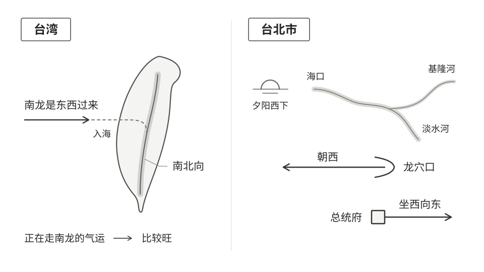 〔口述〕他让大家看台湾的走向，说这一段是南北向。再讲它的来路，「南龙是东西过来」，入海以后再出来，就变成南北向。（[00:41:01–00:41:17](https://www.bilibili.com/video/BV1KJsLekEfA/?p=31&t=2461)，第 73842–74315 帧） 〔板书〕竖长轮廓的上端里面多了一个小圈，圈的下方接着一条长线，沿轮廓内部往下延伸。（[00:41:06](https://www.bilibili.com/video/BV1KJsLekEfA/?p=31&t=2466)，第 73992 帧） |
| **说到台湾的雌性和东西两岸，他怎样讲？** | 〔口述〕倪师说台湾有「南龙的雌性」，接着说许多人聚到了这里，什么样的人都有。（[00:41:17–00:41:25](https://www.bilibili.com/video/BV1KJsLekEfA/?p=31&t=2477)，第 74316–74573 帧） 〔口述〕他让大家分别看东岸和西岸，点明西岸是平原。紧接着，他用的说法是「它一直想往太平洋里面走」。（[00:41:25–00:41:33](https://www.bilibili.com/video/BV1KJsLekEfA/?p=31&t=2485)，第 74574–74801 帧） |
| **台北总统府为何朝东，当地穴口又朝哪里？** | 〔口述〕话题转回台北市。倪师拿总统府作例子，先交代这栋房子盖起来时的坐向，「总统府是坐西向东」。（[00:41:33–00:41:43](https://www.bilibili.com/video/BV1KJsLekEfA/?p=31&t=2493)，第 74802–75119 帧） 〔板书〕纵长轮廓内有一带较宽的竖向粉笔痕，中段另有一条横线穿过右侧轮廓，末端画着朝右的箭头。（[00:41:39](https://www.bilibili.com/video/BV1KJsLekEfA/?p=31&t=2499)，第 74975 帧） 〔口述〕倪师用建造者来解释这个朝向。他说总统府是日本人盖的，建造的人崇拜太阳神，所以把房子朝东盖。（[00:41:52–00:42:00](https://www.bilibili.com/video/BV1KJsLekEfA/?p=31&t=2512)，第 75360–75611 帧） 〔口述〕按倪师的说法，总统府的位置应当选在整个台北市的龙穴上。他随即对照两个朝向，房子朝东，这个龙穴的口却朝西。（[00:42:00–00:42:10](https://www.bilibili.com/video/BV1KJsLekEfA/?p=31&t=2520)，第 75612–75905 帧） 〔指代〕讲龙穴口朝西，说「这个」时，手指的是黑板，落在整幅画面的正中格（第5格）。（[00:42:08](https://www.bilibili.com/video/BV1KJsLekEfA/?p=31&t=2528)，第 75859 帧） |
| **在淡水看夕阳，怎样认海口的方向？** | 〔口述〕倪师让大家想想在淡水看夕阳的情景。他问，夕阳往西落时，是不是就从海口那边落下去。（[00:42:10–00:42:15](https://www.bilibili.com/video/BV1KJsLekEfA/?p=31&t=2530)，第 75906–76061 帧） 〔板书〕板面上方可辨坐西向东四字。下方长轮廓的上端有个小方框，附近有一条斜向右上方伸出的线。（[00:42:12](https://www.bilibili.com/video/BV1KJsLekEfA/?p=31&t=2532)，第 75960 帧） 〔口述〕讲回淡水河，倪师说自己的图画得不好，说到出口时用了「可能」。接着他又讲基隆河和淡水河，说明转出来略朝西边，用「夕阳西下在这边」来认方向。（[00:42:15–00:42:28](https://www.bilibili.com/video/BV1KJsLekEfA/?p=31&t=2535)，第 76062–76463 帧） 〔板书〕竖长轮廓上端有几道相挨的弯线，一段被手臂挡住。下方那条朝画面右边伸出的横箭头仍看得清。（[00:42:25](https://www.bilibili.com/video/BV1KJsLekEfA/?p=31&t=2545)，第 76363 帧） |
| **阳宅、阴宅应该怎样对着来龙立向？** | 〔口述〕倪师把台北这一例的两个方向放在一起看，龙脉是南北向，总统府这栋房子是「坐西朝东」。（[00:42:28–00:42:34](https://www.bilibili.com/video/BV1KJsLekEfA/?p=31&t=2548)，第 76464–76637 帧） 〔口述〕从盖房的方向讲到「穴位的立向」，倪师先说明这条取向的方法适用于两者，「不管阳宅阴宅都一样」。（[00:42:35–00:42:42](https://www.bilibili.com/video/BV1KJsLekEfA/?p=31&t=2555)，第 76668–76871 帧） 〔口述〕取向要背对来龙，侧对来龙、面对来龙这两种方向都不取。按倪师的说法，背对来龙才会「吃到整个山脉的风水」。（[00:42:42–00:42:52](https://www.bilibili.com/video/BV1KJsLekEfA/?p=31&t=2562)，第 76872–77171 帧） |
| **倪师怎样解释台湾局势，又怎样说台北盆地？** | 〔口述〕他把总统府判作「侧对着来龙」，用这一点解释他所说的「台湾局势很乱」，随后限定了这句判断的角度，「这是风水上来看」。（[00:42:52–00:43:02](https://www.bilibili.com/video/BV1KJsLekEfA/?p=31&t=2572)，第 77172–77483 帧） 〔口述〕末了再看整个台湾，他让大家顺着中央山脉往下看，问「是不是结了一个台北盆地啊」。（[00:43:02–00:43:06](https://www.bilibili.com/video/BV1KJsLekEfA/?p=31&t=2582)，第 77484–77597 帧） |

**总结区**

- 通用规则：山从两边包起，前面突出的一截叫官，后尾扫出的一截叫鬼，二者都看作好，具体好到什么程度还要看形状像什么（[00:38:16–00:38:49](https://www.bilibili.com/video/BV1KJsLekEfA/?p=31&t=2296)，第 68892–69899 帧）；官伸出的小处也能见到水，主穴的水流出后又会上一股小水，就容易把官的位置误认成结穴（[00:39:19–00:39:54](https://www.bilibili.com/video/BV1KJsLekEfA/?p=31&t=2359)，第 70788–71837 帧）；看龙要沿水往上找源头，分辨水是本山积下来的还是从后面来的，若从后面来便可能是假穴，还要回头再找（[00:39:55–00:40:20](https://www.bilibili.com/video/BV1KJsLekEfA/?p=31&t=2395)，第 71862–72623 帧）；阳宅、阴宅立向都取背对来龙，侧对和面对都不合倪师所说的取向（[00:42:39–00:42:52](https://www.bilibili.com/video/BV1KJsLekEfA/?p=31&t=2559)，第 76782–77171 帧）
- 只在本例：倪师用新店溪、淡水河和右边的基隆河讲两边来水会合流出，说到明堂时举的是台北市这块平地（[00:40:24–00:40:45](https://www.bilibili.com/video/BV1KJsLekEfA/?p=31&t=2424)，第 72726–73367 帧）；讲台湾时，倪师判断当时南龙较旺，又说南龙原是东西向，入海后到了台湾这一段是南北向（[00:40:51–00:41:17](https://www.bilibili.com/video/BV1KJsLekEfA/?p=31&t=2451)，第 73542–74315 帧）；倪师用建造者崇拜太阳神解释台北总统府朝东，又以淡水海口的落日说明当地龙穴口朝西（[00:41:52–00:42:15](https://www.bilibili.com/video/BV1KJsLekEfA/?p=31&t=2512)，第 75360–76061 帧）；倪师以南北向的龙脉对照坐西朝东的总统府，判它侧对来龙，接着说「所以台湾局势很乱就是这样的」，随即补充「这是风水上来看」（[00:42:28–00:43:02](https://www.bilibili.com/video/BV1KJsLekEfA/?p=31&t=2548)，第 76464–77483 帧）

**待核**

1. 开头板面的圈线还能看见，圈内的粉笔字无法辨认（[00:38:10](https://www.bilibili.com/video/BV1KJsLekEfA/?p=31&t=2290)，第 68712 帧）
2. 字幕作「都是非常吉的」，语音栏作「比较紧」，两路能对上的是前一句说官、鬼都非常好，这一句的原字待核（[00:38:38](https://www.bilibili.com/video/BV1KJsLekEfA/?p=31&t=2318)，第 69540 帧）
3. 倪师提到始祖山和少祖，本块没有说明怎样从山形区分两者（[00:39:05](https://www.bilibili.com/video/BV1KJsLekEfA/?p=31&t=2345)，第 70368 帧）
4. 「相生的下来」具体要看山脉怎样衔接才算相生，本块没有展开（[00:39:13](https://www.bilibili.com/video/BV1KJsLekEfA/?p=31&t=2353)，第 70614 帧）
5. 说小块从哪里伸出时，字幕有「龙虎的地方和龙的地方」，语音栏只辨出「虎的地方」，究竟专指哪一边待核（[00:39:17](https://www.bilibili.com/video/BV1KJsLekEfA/?p=31&t=2357)，第 70716 帧）
6. 字幕作「以沩这个哎两边老师」，语音也未成句，看穴的人当时怎样形容两边的地形待核（[00:39:27](https://www.bilibili.com/video/BV1KJsLekEfA/?p=31&t=2367)，第 71022 帧）
7. 讲水从源头往外走，字幕作「进进出出」，语音栏作「继续出去」，具体动词待核（[00:40:22](https://www.bilibili.com/video/BV1KJsLekEfA/?p=31&t=2422)，第 72666 帧）
8. 基隆河前的方位，字幕作「有边」，语音栏作「右边」，正文据语音记为右边（[00:40:38](https://www.bilibili.com/video/BV1KJsLekEfA/?p=31&t=2438)，第 73152 帧）
9. 字幕到「是南龙的雌性也有」为止，只有语音栏接着说「北龙的雄性也有」，后半句待核，本块也没有解释雌雄的判法（[00:41:18](https://www.bilibili.com/video/BV1KJsLekEfA/?p=31&t=2478)，第 74352 帧）
10. 「它一直想往太平洋里面走」紧接东西两岸的比较，这个「它」具体指什么没有说清（[00:41:30](https://www.bilibili.com/video/BV1KJsLekEfA/?p=31&t=2490)，第 74706 帧）
11. 看落日一句，字幕中的「带泥的淡水」与语音栏的「你在淡水」对不上，两路能对上的是地点淡水和夕阳西下（[00:42:10](https://www.bilibili.com/video/BV1KJsLekEfA/?p=31&t=2530)，第 75906 帧）
12. 讲出口时，两路在「淡水河这边有点出口」前的几个字对不上，河口具体怎样转出待核（[00:42:17](https://www.bilibili.com/video/BV1KJsLekEfA/?p=31&t=2537)，第 76116 帧）
13. 「转向有一点朝这边」没有对应的确定指代标注，不能细定到黑板上的哪一条线（[00:42:24](https://www.bilibili.com/video/BV1KJsLekEfA/?p=31&t=2544)，第 76326 帧）
14. 字幕作「盖的方向有问题」，语音栏在此处作「向是这样所以」，这一句的原话待核（[00:42:34](https://www.bilibili.com/video/BV1KJsLekEfA/?p=31&t=2554)，第 76638 帧）

### 8　台北择都、潜山断穴与人相风水（[00:43:06–00:48:13](https://www.bilibili.com/video/BV1KJsLekEfA/?p=31&t=2586)，第 77598–86813 帧）

| 提示区 | 笔记区 |
|---|---|
| **倪师为什么说台北适合做首都？** | 〔口述〕倪师说只有台北盆地「结到」。按风水地理来看，他断「台北是最适合做首都的地方」。（[00:43:06–00:43:12](https://www.bilibili.com/video/BV1KJsLekEfA/?p=31&t=2586)，第 77598–77777 帧） 〔板书〕黑板上方两条弧线收成尖端，中间有一道斜线穿过，右端另有长线斜向右下。左边可辨一个「东」字，下方还有一组弧线。（[00:43:12](https://www.bilibili.com/video/BV1KJsLekEfA/?p=31&t=2592)，第 77763 帧） 〔口述〕讲到以往怎样选首都，他举日本人来的时候为例，说当时也把台北选作首都。（[00:43:12–00:43:18](https://www.bilibili.com/video/BV1KJsLekEfA/?p=31&t=2592)，第 77778–77969 帧） 〔口述〕他从淡水河讲到出海口，说这里出入方便，交通繁忙。提到旧时的「Monga」，他说从外面可以直接进来。（[00:43:19–00:43:25](https://www.bilibili.com/video/BV1KJsLekEfA/?p=31&t=2599)，第 77970–78167 帧） 〔口述〕讲到河口的防守，他举关渡为例，说那里可以放炮台，抵御外来的侵扰。（[00:43:29–00:43:34](https://www.bilibili.com/video/BV1KJsLekEfA/?p=31&t=2609)，第 78288–78431 帧） |
| **从台北的稻田讲到小处，择地要看什么？** | 〔口述〕他说平原上冲积下来的东西多，以前的台北市「整个是个稻田一样」，随即问学生，这样的地方适不适合人住。（[00:43:37–00:43:45](https://www.bilibili.com/video/BV1KJsLekEfA/?p=31&t=2617)，第 78522–78761 帧） 〔指代〕问到适不适合人住，说「这个」时，手指的是黑板，手在画面中排左侧的第4格。（[00:43:44](https://www.bilibili.com/video/BV1KJsLekEfA/?p=31&t=2624)，第 78730 帧） 〔口述〕他假设有人嫌这里不好，提议干脆盖到大雪山上去。借这个例子，他说择地要顺着自然环境，找适合人住的地方。（[00:43:46–00:44:00](https://www.bilibili.com/video/BV1KJsLekEfA/?p=31&t=2626)，第 78786–79211 帧） 〔口述〕大处讲完，他转到小处怎么摆。龙要怎样、虎要怎样，案山和朝山又要怎样，他说这里「就很有技巧了」。（[00:44:00–00:44:14](https://www.bilibili.com/video/BV1KJsLekEfA/?p=31&t=2640)，第 79212–79643 帧） |
| **地理师循来龙看到潜山县，先断了什么？** | 〔口述〕倪师接着讲一个旧典故，先交代地点在安徽，县名是潜山。（[00:44:14–00:44:29](https://www.bilibili.com/video/BV1KJsLekEfA/?p=31&t=2654)，第 79644–80075 帧） 〔板书〕黑板中部偏左可辨竖写的「潜」「山」，字列右边有一道斜向右下的长线。再往下的字被字幕和画面下沿截住，认不全。（[00:44:29](https://www.bilibili.com/video/BV1KJsLekEfA/?p=31&t=2669)，第 80070 帧） 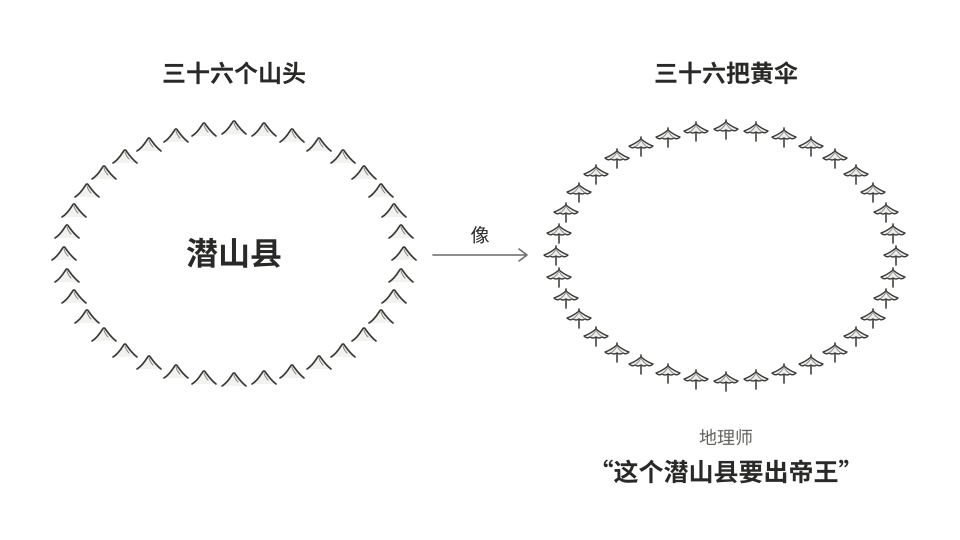 〔口述〕当时许多地理师跟着来龙一看，就说「这个潜山县要出帝王」，又说「一定会出帝王」。（[00:44:29–00:44:39](https://www.bilibili.com/video/BV1KJsLekEfA/?p=31&t=2669)，第 80076–80387 帧） 〔指代〕讲到「一定会出帝王」这一句，说「这个」时手指的是黑板，手落在画面正中的第5格。（[00:44:36](https://www.bilibili.com/video/BV1KJsLekEfA/?p=31&t=2676)，第 80306 帧） 〔板书〕黑板中部上下可辨「帝」「皇」两字。上面的「帝」有一笔拖得很长，斜向右下，和旁边的图线相交。（[00:44:41](https://www.bilibili.com/video/BV1KJsLekEfA/?p=31&t=2681)，第 80448 帧） |
| **为什么把潜山周围的山头比作三十六把黄伞？** | 〔口述〕倪师让大家看潜山县周围的山势，说「看起来刚好三十六个山头」，这些山头像三十六把黄伞。（[00:44:42–00:44:53](https://www.bilibili.com/video/BV1KJsLekEfA/?p=31&t=2682)，第 80472–80801 帧） 〔板书〕黑板左侧画着一个下方留口的近圆形，弧线外有几道短划。圆的右上方可辨「三十六」，再往右下是「黄伞」。（[00:44:53](https://www.bilibili.com/video/BV1KJsLekEfA/?p=31&t=2693)，第 80800 帧） 〔指代〕说「这个」时，手指的是黑板，手在画面正中的第5格。当时正讲到潜山县，具体指哪一笔看不清。（[00:44:54](https://www.bilibili.com/video/BV1KJsLekEfA/?p=31&t=2694)，第 80824 帧） 〔口述〕说起这三十六把黄伞，倪师讲到皇帝出来时身旁都是伞，皇帝坐在那里，「后面一票」。他接着说「潜山县风水太好了」。（[00:44:55–00:45:05](https://www.bilibili.com/video/BV1KJsLekEfA/?p=31&t=2695)，第 80874–81161 帧） |
| **同说出皇帝，高手为什么断为名伶？** | 〔口述〕普通风水师断到出皇帝，高手也说「出皇帝没错」。高手还看到山势太秀丽，便断所出的是名伶，「就是演电视上的皇帝」。（[00:45:05–00:45:22](https://www.bilibili.com/video/BV1KJsLekEfA/?p=31&t=2705)，第 81162–81665 帧） 〔口述〕倪师说，潜山人出来演皇帝，看起来就很像皇帝。他用这个例子说明，所说的皇帝是在戏剧里当的。（[00:45:25–00:45:33](https://www.bilibili.com/video/BV1KJsLekEfA/?p=31&t=2725)，第 81768–82013 帧） 〔口述〕至于为什么当不了真命天子，倪师给的理由是「因为龙不够壮」。（[00:45:33–00:45:41](https://www.bilibili.com/video/BV1KJsLekEfA/?p=31&t=2733)，第 82014–82241 帧） |
| **能出天子的穴是什么样，后面的峡路断了又怎样？** | 〔口述〕倪师说，能出帝王的穴「一定是文武双全」，还要有帝座，整个山势看起来就像一个帝座。（[00:45:41–00:45:49](https://www.bilibili.com/video/BV1KJsLekEfA/?p=31&t=2741)，第 82242–82493 帧） 〔口述〕来朝的案山、朝山都像是朝着这个座位，「有文也有武全部面对它」。整个形势看起来，就像坐在龙椅上。（[00:45:49–00:45:59](https://www.bilibili.com/video/BV1KJsLekEfA/?p=31&t=2749)，第 82494–82793 帧） 〔口述〕他说祖先若「踩到这个地方」，就会出天子。若从后面把峡路截断，地脉便过不去，地气也就淡没了。（[00:45:59–00:46:13](https://www.bilibili.com/video/BV1KJsLekEfA/?p=31&t=2759)，第 82794–83219 帧） |
| **倪师怎样从手和额头看有没有吃到祖上风水？** | 〔口述〕倪师问，葬下去以后，到第几代能看出有没有吃到风水？他提到下一代，也提到这一代就可能看到，接着问「如何知道他马上有没有吃到风水」。（[00:46:15–00:46:27](https://www.bilibili.com/video/BV1KJsLekEfA/?p=31&t=2775)，第 83256–83615 帧） 〔口述〕倪师先让大家伸出手看，说「乾卦的位置就是祖山祖业」。接着他问起吃到风水时手上这处的情形，字幕记作「乾卦是不是很膨」。（[00:46:28–00:46:36](https://www.bilibili.com/video/BV1KJsLekEfA/?p=31&t=2788)，第 83652–83903 帧） 〔指代〕讲手上的乾卦，说「这边」时，手指的是自己身上，手在画面中排右侧的第6格。具体部位看不清。（[00:46:35](https://www.bilibili.com/video/BV1KJsLekEfA/?p=31&t=2795)，第 83850 帧） 〔口述〕再看额头的两边。倪师把「额头这两边挺起来的」说成吃到祖上风水的迹象。（[00:46:39–00:46:47](https://www.bilibili.com/video/BV1KJsLekEfA/?p=31&t=2799)，第 83970–84221 帧） 〔口述〕他又说中间最挺，讲到一个他认为吃到了祖上风水的人，形容那个人的整个天庭都向上挺。（[00:46:47–00:46:56](https://www.bilibili.com/video/BV1KJsLekEfA/?p=31&t=2807)，第 84222–84509 帧） |
| **把来龙比到人身，在哪里过峡、结穴？** | 〔口述〕倪师拿脊椎骨来比来龙，说整个龙脉一路下来。讲到人的相，他也从来龙往下讲。（[00:46:57–00:47:05](https://www.bilibili.com/video/BV1KJsLekEfA/?p=31&t=2817)，第 84510–84767 帧） 〔口述〕讲到两眼太大时，他说峡在两眼中间。龙势过峡以后结穴，他点出「开始到人中这边结穴」，接着又说「明堂在这边」。（[00:47:05–00:47:16](https://www.bilibili.com/video/BV1KJsLekEfA/?p=31&t=2825)，第 84768–85109 帧） 〔指代〕说「明堂在这边」时，手指的是自己身上，手在画面正中的第5格。明堂具体指哪个部位，只凭这个手势看不清。（[00:47:14](https://www.bilibili.com/video/BV1KJsLekEfA/?p=31&t=2834)，第 85033 帧） |
| **怎样从脸相看山形，吹火嘴怎么断？** | 〔口述〕讲脸的两边，他提到左龙、右虎。把整个脸相放到山上去看，就像他说的，「看小一样可以看大」。（[00:47:17–00:47:27](https://www.bilibili.com/video/BV1KJsLekEfA/?p=31&t=2837)，第 85110–85439 帧） 〔口述〕举到嘴形，他说「龙穴结成吹火嘴就不太好」，让学生从脸上的形状比到山上的穴，照这样「依此类推」。（[00:47:28–00:47:34](https://www.bilibili.com/video/BV1KJsLekEfA/?p=31&t=2848)，第 85440–85631 帧） |
| **没有法令纹的例子，怎样把人和地连起来？** | 〔口述〕倪师从一个人没有法令纹讲起，接着把这个样子比到坟上，说起坟葬下去以后，每一代会出怎样的人。（[00:47:34–00:47:41](https://www.bilibili.com/video/BV1KJsLekEfA/?p=31&t=2854)，第 85632–85847 帧） 〔口述〕倪师拿台北市教育局长、教育部长作比，说这座坟葬下去以后，每一代出的人都像他们。他批评说「都是废物啊」，说他们在那里笑，「笑了半天也没有办法做决定呐」。（[00:47:39–00:47:52](https://www.bilibili.com/video/BV1KJsLekEfA/?p=31&t=2859)，第 85770–86189 帧） 〔口述〕倪师说，这样笑代表阴险，「不代表你刚直啊」。他接下来的话，字幕记作「你要做个决策要讲句话」。（[00:47:53–00:47:58](https://www.bilibili.com/video/BV1KJsLekEfA/?p=31&t=2873)，第 86190–86369 帧） 〔口述〕他用「这个我们叫来龙」把话接回风水。把风水放在人身上看，和放到地上看，在他看来「通通是相等的相等的」。（[00:48:03–00:48:13](https://www.bilibili.com/video/BV1KJsLekEfA/?p=31&t=2883)，第 86502–86813 帧） |

**总结区**

- 通用规则：择地要顺着自然环境，找适合人住的地方（[00:43:50–00:44:00](https://www.bilibili.com/video/BV1KJsLekEfA/?p=31&t=2630)，第 78918–79211 帧）；倪师说，能出帝王的穴要文武双全，山势像帝座，来朝的案山、朝山都面向它（[00:45:41–00:45:59](https://www.bilibili.com/video/BV1KJsLekEfA/?p=31&t=2741)，第 82242–82793 帧）；倪师讲怎样知道一个人马上有没有吃到风水，先让人看手上的乾卦（字幕问「乾卦是不是很膨」），又说额头两边挺起来的人吃到了祖上的风水（[00:46:24–00:46:47](https://www.bilibili.com/video/BV1KJsLekEfA/?p=31&t=2784)，第 83532–84221 帧）；把脸相放到山上看，可以从小处的形状类推大处（[00:47:21–00:47:34](https://www.bilibili.com/video/BV1KJsLekEfA/?p=31&t=2841)，第 85254–85631 帧）
- 只在本例：倪师认为只有台北盆地「结到」，台北最适合做首都，讲到淡水河时说出海口方便、交通繁忙，讲到平原时又形容以前的台北市「整个是个稻田一样」（[00:43:06–00:43:43](https://www.bilibili.com/video/BV1KJsLekEfA/?p=31&t=2586)，第 77598–78719 帧）；典故里的地理师见潜山县周围三十六个山头像黄伞，便断这里要出帝王（[00:44:29–00:45:05](https://www.bilibili.com/video/BV1KJsLekEfA/?p=31&t=2669)，第 80076–81161 帧）；高手见潜山山势太秀丽，断这里出的是在戏里演皇帝的名伶，倪师说他们当不了真命天子，是因为「龙不够壮」（[00:45:08–00:45:41](https://www.bilibili.com/video/BV1KJsLekEfA/?p=31&t=2708)，第 81246–82241 帧）
- 不是风水规则，是处世方法：倪师借官员只笑不决的例子说，该做决策时要开口表态（[00:47:51–00:47:58](https://www.bilibili.com/video/BV1KJsLekEfA/?p=31&t=2871)，第 86142–86369 帧）

**待核**

1. 台北盆地「结到」是按什么认出来的，本块只给了判断（[00:43:06](https://www.bilibili.com/video/BV1KJsLekEfA/?p=31&t=2586)，第 77598 帧）
2. 第一张板书图中，弧线旁还有几处粉笔字，笔画模糊，认不全（[00:43:12](https://www.bilibili.com/video/BV1KJsLekEfA/?p=31&t=2592)，第 77763 帧）
3. 回顾过去的选址时，字幕作「某党」，语音转写作国民党，具体称呼待核（[00:43:12](https://www.bilibili.com/video/BV1KJsLekEfA/?p=31&t=2592)，第 77778 帧）
4. 地名在字幕中写作「Monga」，语音转写作曼尬，汉字写法待核（[00:43:22](https://www.bilibili.com/video/BV1KJsLekEfA/?p=31&t=2602)，第 78066 帧）
5. 说从哪里上来，字幕作「在外外环那边上来」，语音作外游那边上来，路线所指待核（[00:43:25](https://www.bilibili.com/video/BV1KJsLekEfA/?p=31&t=2605)，第 78168 帧）
6. 攻守一句字幕作「外可攻肉可守」，语音后半作内渴守，疑为外可攻、内可守（[00:43:34](https://www.bilibili.com/video/BV1KJsLekEfA/?p=31&t=2614)，第 78432 帧）
7. 「山」下面还有一个字，画面只留下部分笔画，完整字形待核（[00:44:29](https://www.bilibili.com/video/BV1KJsLekEfA/?p=31&t=2669)，第 80070 帧）
8. 字幕提到「尊龙」，语音在人名处只转出近似村的音，所举演员待核（[00:45:23](https://www.bilibili.com/video/BV1KJsLekEfA/?p=31&t=2723)，第 81702 帧）
9. 「有文也有武」中的文、武各指怎样的山形，本块没有分别说明（[00:45:55](https://www.bilibili.com/video/BV1KJsLekEfA/?p=31&t=2755)，第 82656 帧）
10. 讲哪一代能见到时，字幕作「这个看农历发的时候」，语音作看龙历发的时候，判断时机的用词待核（[00:46:22](https://www.bilibili.com/video/BV1KJsLekEfA/?p=31&t=2782)，第 83484 帧）
11. 手上乾卦处的形态，字幕作「很膨」，语音转写作很通，确切用字待核（[00:46:34](https://www.bilibili.com/video/BV1KJsLekEfA/?p=31&t=2794)，第 83826 帧）
12. 说天庭挺起时提到「你知道这个是谁了」，没有点名，所指人物待核（[00:46:51](https://www.bilibili.com/video/BV1KJsLekEfA/?p=31&t=2811)，第 84336 帧）
13. 讲两眼之间的峡时，字幕作「一抵峡在中间」，一抵所指的动作待核（[00:47:07](https://www.bilibili.com/video/BV1KJsLekEfA/?p=31&t=2827)，第 84816 帧）
14. 明堂一处的指代只能定位到自己身上，确切部位待核（[00:47:14](https://www.bilibili.com/video/BV1KJsLekEfA/?p=31&t=2834)，第 85033 帧）
15. 字幕作「左龙有虎」，语音作左龙右虎，笔记据语音将有改作右（[00:47:17](https://www.bilibili.com/video/BV1KJsLekEfA/?p=31&t=2837)，第 85110 帧）
16. 「吹火嘴」只讲了判断，具体是什么形状，本块没有细说（[00:47:28](https://www.bilibili.com/video/BV1KJsLekEfA/?p=31&t=2848)，第 85440 帧）
17. 讲没有法令纹时，「那这个人根本就没有没有」一句没有说完，省去的内容待核（[00:47:37](https://www.bilibili.com/video/BV1KJsLekEfA/?p=31&t=2857)，第 85716 帧）
18. 语音转写在地上之后还多出放在一个国家上面，字幕只提地上，是否另举国家待核（[00:48:07](https://www.bilibili.com/video/BV1KJsLekEfA/?p=31&t=2887)，第 86622 帧）
19. 字幕作「帝帝皇会出帝皇穴」，语音作「帝王会出帝王去为什么」，是否说了「帝皇穴」待核（[00:44:39](https://www.bilibili.com/video/BV1KJsLekEfA/?p=31&t=2679)，第 80388 帧）
20. 字幕作「使节很多」，同句语音开头作「结很多」，是否说了「使节」待核（[00:44:58](https://www.bilibili.com/video/BV1KJsLekEfA/?p=31&t=2698)，第 80964 帧）
21. 字幕作「你笑只代表你阴险」，语音作「笑死代表你阴险不」，是否说了「只」待核（[00:47:53](https://www.bilibili.com/video/BV1KJsLekEfA/?p=31&t=2873)，第 86190 帧）
22. 字幕作「做个决策」，语音作「做个角色」，两路都有「要讲句话」，前面的「决策」一词待核（[00:47:56](https://www.bilibili.com/video/BV1KJsLekEfA/?p=31&t=2876)，第 86286 帧）

## 朝山取穴、罗经阴阳与赤霆经诸地

### 9　朝山取穴、罗经立向与帝王之地（[00:48:13–00:53:57](https://www.bilibili.com/video/BV1KJsLekEfA/?p=31&t=2893)，第 86814–97127 帧）

| 提示区 | 笔记区 |
|---|---|
| **倪师怎样借意大利的外形讲「象」？** | 〔口述〕倪师举意大利为例，先说它的形状像马靴，接着说「所以意大利皮鞋很有名啊」。他从外形联想到皮鞋，以此说明「用象」。（[00:48:30–00:48:47](https://www.bilibili.com/video/BV1KJsLekEfA/?p=31&t=2910)，第 87324–87815 帧） 〔板书〕黑板上画着一个向右下倾斜的长轮廓。上端收成一条斜边，下端有两个圆钝的突起，左边的伸得更低。（[00:48:38](https://www.bilibili.com/video/BV1KJsLekEfA/?p=31&t=2918)，第 87565 帧） 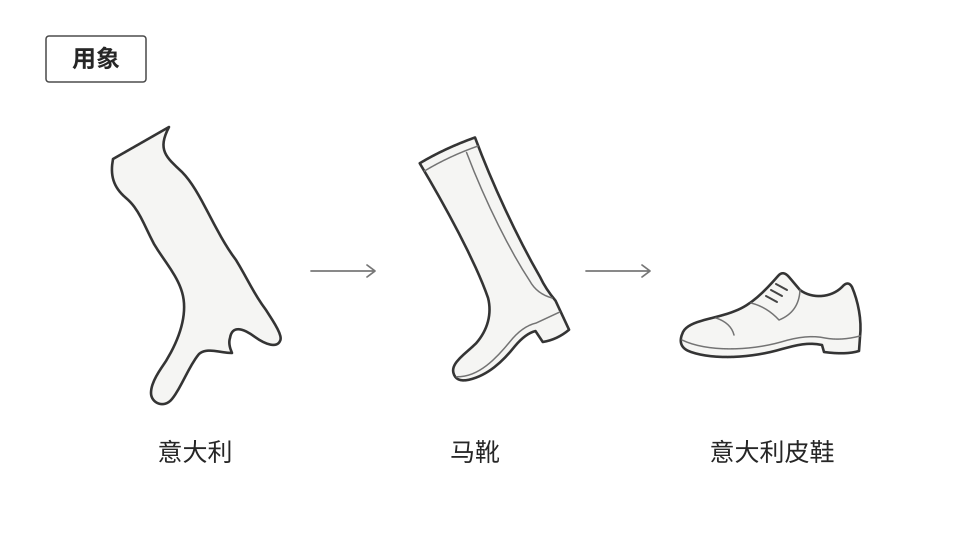 |
| **山势落到平地，凭什么选取穴位？** | 〔口述〕倪师顺着山势往下讲，山势下来进入平地，他把图中这一段说成「这是进入明堂」。（[00:49:16–00:49:24](https://www.bilibili.com/video/BV1KJsLekEfA/?p=31&t=2956)，第 88686–88943 帧） 〔指代〕讲到进入平地，说「这个」时，手指的是整幅画面右上格的黑板，具体落在哪一笔上看不清。（[00:49:18](https://www.bilibili.com/video/BV1KJsLekEfA/?p=31&t=2958)，第 88760 帧） 〔板书〕黑板上从上到下可辨「朝山取穴位」「阴龙取阴向」「阳龙取阳向」。右上方一条线先走平，再向右下斜落，末端接一段短横线。（[00:49:20](https://www.bilibili.com/video/BV1KJsLekEfA/?p=31&t=2960)，第 88801 帧） 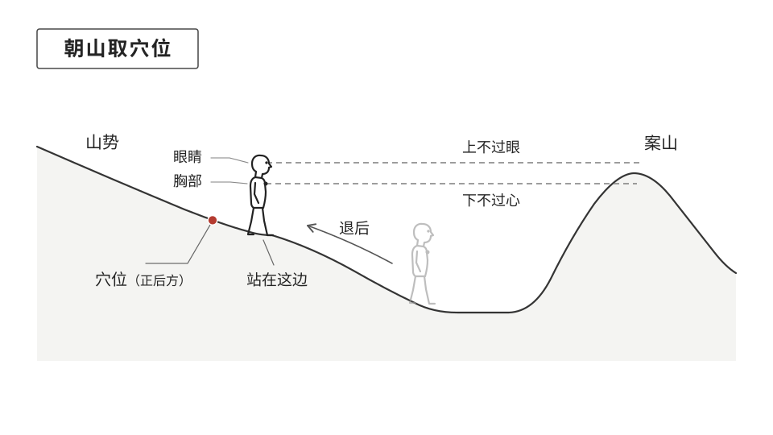 〔口述〕倪师连问，穴究竟落在哪一处，要不要「在这个脚上抓」？他给的选法是「我们以朝山取穴位的方法是最好」。（[00:49:24–00:49:36](https://www.bilibili.com/video/BV1KJsLekEfA/?p=31&t=2964)，第 88944–89297 帧） 〔板书〕斜线快要落到底部横线时，左侧可见两道短划，一高一低。横线往右延伸的部分被人挡住。（[00:49:30](https://www.bilibili.com/video/BV1KJsLekEfA/?p=31&t=2970)，第 89124 帧） |
| **「上不过眼下不过心」怎样用来定穴？** | 〔口述〕倪师给的口诀是「上不过眼下不过心」。他让地师站在山势这一面，从站处向远处的案山看。（[00:49:40–00:49:59](https://www.bilibili.com/video/BV1KJsLekEfA/?p=31&t=2980)，第 89424–89981 帧） 〔板书〕写「朝山取穴位」的一行外面有长框。框右侧另有两笔斜线，从一点分开，一笔向右上，一笔向右下。（[00:49:42](https://www.bilibili.com/video/BV1KJsLekEfA/?p=31&t=2982)，第 89480 帧） 〔板书〕两笔斜线分开处，上方可辨「上不过眼」，下方可辨「下不过」，再往右的字被挡住。（[00:49:46](https://www.bilibili.com/video/BV1KJsLekEfA/?p=31&t=2986)，第 89580 帧） 〔指代〕说地师站在「这里」时，手指的是画面下排中格的黑板。讲案山和用胸部对山时又说「这个」，这两次都指向右下格的黑板。（[00:49:53–00:50:04](https://www.bilibili.com/video/BV1KJsLekEfA/?p=31&t=2993)，第 89816–90123 帧） 〔口述〕对着案山，由眼睛看过去要「比眼睛低一点」，由胸部对过去则要比胸部略高。照这样对好高低，倪师说正后方就是穴位。（[00:49:59–00:50:11](https://www.bilibili.com/video/BV1KJsLekEfA/?p=31&t=2999)，第 89982–90341 帧） |
| **人站在低处，看到朝山很高怎么办？** | 〔口述〕倪师举人站在底下、对面朝山很高的情形。他连说「你要退后退后退后」，让人先把看山的位置往后移。（[00:50:13–00:50:29](https://www.bilibili.com/video/BV1KJsLekEfA/?p=31&t=3013)，第 90390–90881 帧） 〔指代〕说站在「这个」底下时，手指的是画面下排中格的黑板。后来让人站在「这边」、说穴位在「这里」时，手指的都是中排右格的黑板。（[00:50:14–00:50:34](https://www.bilibili.com/video/BV1KJsLekEfA/?p=31&t=3014)，第 90427–91031 帧） 〔板书〕上图下方可辨「下不过心」。下图有一条斜线落到长横线上，靠近两线交会处画着一个小人，右侧另有一条向上弯起的线。（[00:50:23](https://www.bilibili.com/video/BV1KJsLekEfA/?p=31&t=3023)，第 90696 帧） 〔口述〕退后站定，仍要「眼睛看过去胸部对过去」。两处刚好对上，倪师才说穴位在这里，用这一例说明怎样看朝山取山坡上的穴。（[00:50:29–00:50:42](https://www.bilibili.com/video/BV1KJsLekEfA/?p=31&t=3029)，第 90882–91271 帧） |
| **照净龙的口诀取向，要看罗经哪一环？** | 〔口述〕倪师说「阴龙取阴向阳龙取阳向」。来龙属阴就取阴向，属阳就取阳向，这样配向，他称为「净龙」。（[00:50:42–00:50:51](https://www.bilibili.com/video/BV1KJsLekEfA/?p=31&t=3042)，第 91272–91541 帧） 〔口述〕拿出大罗经，倪师从一数到五，让大家看第五环。接着提到中间的一针，针名在字幕里写作「天池针」。（[00:50:51–00:51:20](https://www.bilibili.com/video/BV1KJsLekEfA/?p=31&t=3051)，第 91542–92411 帧） 〔口述〕重新从第一环点数，第一环是先天卦，第二环是九星。第三、第四环只报环数，数到第五环，再请大家认这一圈。（[00:51:20–00:51:28](https://www.bilibili.com/video/BV1KJsLekEfA/?p=31&t=3080)，第 92412–92651 帧） |
| **第五环的二十四个坐山怎样分阴阳？** | 〔口述〕倪师说「第五环有二十四个坐山」，把这一圈称为「地针」，说它「专门管地纪」，随后又说「二十四个地针」。（[00:51:28–00:51:44](https://www.bilibili.com/video/BV1KJsLekEfA/?p=31&t=3088)，第 92652–93125 帧） 〔口述〕他让大家看坐山之间的颜色差别，先认出其中没有红色的十二个，把这十二个叫作阴龙。（[00:51:44–00:52:02](https://www.bilibili.com/video/BV1KJsLekEfA/?p=31&t=3104)，第 93126–93665 帧） 〔推断〕从总数推断，二十四个坐山扣掉无红色的十二个，有红色的也是十二个。语音转写把有红色的一组称为阳龙，这半句在此处字幕里没有写全。（[00:51:28–00:52:02](https://www.bilibili.com/video/BV1KJsLekEfA/?p=31&t=3088)，第 92652–93665 帧） |
| **在山上测来龙，要把哪两个点连成线？** | 〔口述〕倪师说在山上测「来龙过峡」这条线，人站在龙首这边。要认出两处，一处是过峡，他比作脖子，另一处是来龙结穴的地方。（[00:52:02–00:52:15](https://www.bilibili.com/video/BV1KJsLekEfA/?p=31&t=3122)，第 93666–94073 帧） 〔口述〕站在这里测，把前面认出的两个点连成一条直线，再顺着这条线看来龙是从哪个方向来的。（[00:52:15–00:52:25](https://www.bilibili.com/video/BV1KJsLekEfA/?p=31&t=3135)，第 94074–94361 帧） |
| **以乾方来龙为例，找穴和立向各看什么？** | 〔口述〕假定测出来龙在乾的方向，倪师称它为「乾龙」。再看罗经上乾的位置，那里带红线，他说「就叫做阳龙嘛」。（[00:52:23–00:52:42](https://www.bilibili.com/video/BV1KJsLekEfA/?p=31&t=3143)，第 94314–94871 帧） 〔口述〕认出阳龙，还要找穴。倪师接连问穴位到底在哪一处，又回到刚讲过的取穴方法，说「要看案山」。（[00:52:42–00:52:47](https://www.bilibili.com/video/BV1KJsLekEfA/?p=31&t=3162)，第 94872–95039 帧） 〔指代〕找穴时前后几次说「这边」，手指的都是画面右上格的黑板。各次在这一格里具体指到哪一点，标注没有细分。（[00:52:45–00:52:50](https://www.bilibili.com/video/BV1KJsLekEfA/?p=31&t=3165)，第 94957–95101 帧） 〔口述〕到了立向这一步，因为来龙属阳，倪师说「立向的时候一定要立阳向」，要朝有红点的地方取向，最后让大家看「第五格的红的地方」。（[00:52:50–00:53:03](https://www.bilibili.com/video/BV1KJsLekEfA/?p=31&t=3170)，第 95124–95507 帧） |
| **「帝王之地」的口诀怎么念，摘自哪里？** | 〔口述〕倪师念到帝王之地，先念「左八右八」「阁道高悬」，再接「乃张华盖」「四辅屹然」「帝座居前」。（[00:53:03–00:53:10](https://www.bilibili.com/video/BV1KJsLekEfA/?p=31&t=3183)，第 95508–95729 帧） 〔口述〕末句前后能对上的两截是「前宫后宫」和「相公将帅」。两截之间字幕还有一个「将」字，怎样连读待核。（[00:53:11–00:53:15](https://www.bilibili.com/video/BV1KJsLekEfA/?p=31&t=3191)，第 95730–95861 帧） 〔口述〕倪师说明刚才念的这些话是从书里摘录出来的。这一句的字幕把书名记作《赤霆经》。（[00:53:15–00:53:24](https://www.bilibili.com/video/BV1KJsLekEfA/?p=31&t=3195)，第 95862–96131 帧） |
| **从拟建祖坟的位置看，明堂和朝山是什么样？** | 〔口述〕倪师让人设想站在一个点上，面对整片山势看。他形容对面的山「像个太师椅这样坐在那边」，旁边还有许多小山。（[00:53:30–00:53:47](https://www.bilibili.com/video/BV1KJsLekEfA/?p=31&t=3210)，第 96318–96833 帧） 〔板书〕中央轮廓的最高处是一个尖顶，往左右各降到一小段近平的线，再向下斜。两侧另有较低的弧线，中央轮廓下方画着一个横椭圆。（[00:53:46](https://www.bilibili.com/video/BV1KJsLekEfA/?p=31&t=3226)，第 96801 帧） 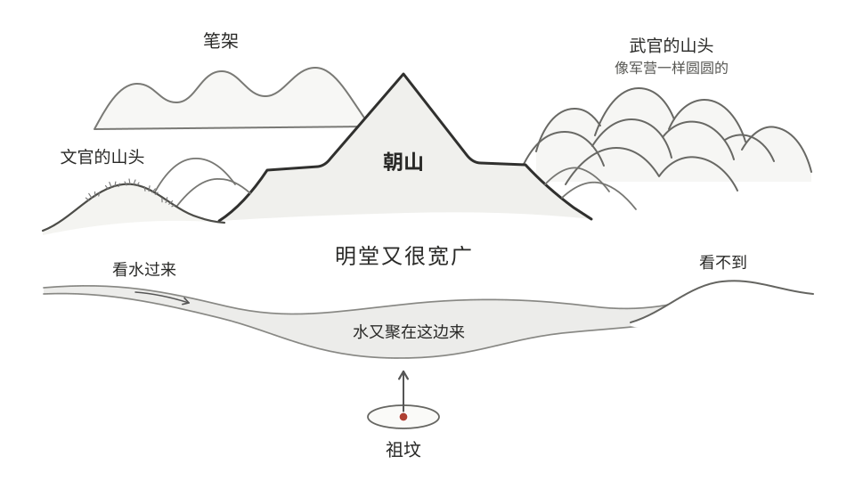 〔口述〕他接着设想把祖坟盖在面对这座山的位置。站在这边看出去，「前面明堂又很宽广」，刚才形容的那片山势就是对面的朝山。（[00:53:47–00:53:57](https://www.bilibili.com/video/BV1KJsLekEfA/?p=31&t=3227)，第 96834–97127 帧） 〔指代〕说把祖坟盖到「这边」时，手指的是整幅画面中排右格的黑板，标注只确认到这一格。（[00:53:51](https://www.bilibili.com/video/BV1KJsLekEfA/?p=31&t=3231)，第 96933 帧） 〔板书〕中央尖峰的轮廓内可辨一个「朝」字。下方横着一道浅弧，弧下有重叠的椭圆，一支箭头从圈内向上指向浅弧。（[00:53:56](https://www.bilibili.com/video/BV1KJsLekEfA/?p=31&t=3236)，第 97091 帧） |

**总结区**

- 通用规则：朝山取穴讲「上不过眼下不过心」，从站处看案山要略低于眼、略高于胸，对好高低后在正后方取穴（[00:49:40–00:50:11](https://www.bilibili.com/video/BV1KJsLekEfA/?p=31&t=2980)，第 89424–90341 帧）；阴龙取阴向，阳龙取阳向，来龙与所取的向同属阴或同属阳，倪师称为净龙（[00:50:42–00:50:51](https://www.bilibili.com/video/BV1KJsLekEfA/?p=31&t=3042)，第 91272–91541 帧）；罗经第五环有二十四个坐山，倪师称为地针，其中没有红色的十二个归为阴龙（[00:51:28–00:52:02](https://www.bilibili.com/video/BV1KJsLekEfA/?p=31&t=3088)，第 92652–93665 帧）；在山上把过峡的脖子处与来龙结穴处连成一条直线，用这条线测来龙的方向（[00:52:02–00:52:25](https://www.bilibili.com/video/BV1KJsLekEfA/?p=31&t=3122)，第 93666–94361 帧）
- 只在本例：倪师以意大利像马靴为例，从这个形状联想到意大利皮鞋有名（[00:48:30–00:48:47](https://www.bilibili.com/video/BV1KJsLekEfA/?p=31&t=2910)，第 87324–87815 帧）；人站在低处觉得朝山很高的例子里，先往后退，再用眼和胸对山，找山坡上的穴位（[00:50:13–00:50:42](https://www.bilibili.com/video/BV1KJsLekEfA/?p=31&t=3013)，第 90390–91271 帧）；乾方来龙一例中，乾位带红线，倪师据此判为阳龙，找穴仍看案山，立向则朝有红点的方向（[00:52:23–00:53:03](https://www.bilibili.com/video/BV1KJsLekEfA/?p=31&t=3143)，第 94314–95507 帧）；设想中的祖坟前面明堂宽广，对面的朝山形似太师椅，朝山两旁还有许多小山（[00:53:30–00:53:57](https://www.bilibili.com/video/BV1KJsLekEfA/?p=31&t=3210)，第 96318–97127 帧）

**待核**

1. 开场板面上有交叉的线、圈号和零散粉笔字，中部被挡，原有的字认不全（[00:48:13](https://www.bilibili.com/video/BV1KJsLekEfA/?p=31&t=2893)，第 86814 帧）
2. 意大利一例收尾时，字幕写「用象来批」，语音转写只能对上「用象」的近音，末字待核（[00:48:39](https://www.bilibili.com/video/BV1KJsLekEfA/?p=31&t=2919)，第 87576 帧）
3. 三句取穴、立向的话最早连写在一条字幕里，语音转写只有「好三四」。随后两张板书图的字仍被挡，三行全文依较晚的清楚板面记录（[00:48:47](https://www.bilibili.com/video/BV1KJsLekEfA/?p=31&t=2927)，第 87816 帧、[00:48:57](https://www.bilibili.com/video/BV1KJsLekEfA/?p=31&t=2937)，第 88128 帧、[00:49:06](https://www.bilibili.com/video/BV1KJsLekEfA/?p=31&t=2946)，第 88404 帧、[00:49:20](https://www.bilibili.com/video/BV1KJsLekEfA/?p=31&t=2960)，第 88801 帧）
4. 连问穴在「这里」还是「这个脚上」时，各处究竟对应图上哪一笔，没有确定的指代标注（[00:49:24](https://www.bilibili.com/video/BV1KJsLekEfA/?p=31&t=2964)，第 88944 帧、[00:49:27](https://www.bilibili.com/video/BV1KJsLekEfA/?p=31&t=2967)，第 89016 帧、[00:49:29](https://www.bilibili.com/video/BV1KJsLekEfA/?p=31&t=2969)，第 89070 帧）
5. 讲取穴方法用「朝山」，比眼、胸高低时用「案山」，两种称呼的关系在本块没有解释（[00:49:32](https://www.bilibili.com/video/BV1KJsLekEfA/?p=31&t=2972)，第 89172 帧、[00:49:55](https://www.bilibili.com/video/BV1KJsLekEfA/?p=31&t=2995)，第 89862 帧）
6. 「净龙」依字幕记录，字幕后面还接「纯净的龙」，语音转写只留下同音的「静龙」（[00:50:44](https://www.bilibili.com/video/BV1KJsLekEfA/?p=31&t=3044)，第 91326 帧）
7. 中间的针名，字幕写「天池针」，语音转写不清。说「这个」时只标到画面下排中格的「其他」，具体指哪个部件待核（[00:51:14](https://www.bilibili.com/video/BV1KJsLekEfA/?p=31&t=3074)，第 92244 帧、[00:51:16](https://www.bilibili.com/video/BV1KJsLekEfA/?p=31&t=3076)，第 92287 帧）
8. 倪师说地针「专门管地纪」，这里的「管地纪」没有进一步解释（[00:51:39](https://www.bilibili.com/video/BV1KJsLekEfA/?p=31&t=3099)，第 92976 帧）
9. 有红色的十二个叫阳龙，这半句在语音转写里跨了两行，字幕只写清无红色的十二个叫阴龙，完整原话待核（[00:51:51](https://www.bilibili.com/video/BV1KJsLekEfA/?p=31&t=3111)，第 93342 帧、[00:51:55](https://www.bilibili.com/video/BV1KJsLekEfA/?p=31&t=3115)，第 93456 帧）
10. 字幕写「这两个点连沩一直线」，结合下一句的「两点可以一直线」，正文转述为把两点连成一条直线（[00:52:17](https://www.bilibili.com/video/BV1KJsLekEfA/?p=31&t=3137)，第 94128 帧、[00:52:20](https://www.bilibili.com/video/BV1KJsLekEfA/?p=31&t=3140)，第 94206 帧）
11. 重说找穴时，字幕接连出现「礼生上下要看察山」「不生下要看案山」，句首难辨，正文取前一句清楚的「要看案山」（[00:52:46](https://www.bilibili.com/video/BV1KJsLekEfA/?p=31&t=3166)，第 94992 帧、[00:52:48](https://www.bilibili.com/video/BV1KJsLekEfA/?p=31&t=3168)，第 95064 帧、[00:52:49](https://www.bilibili.com/video/BV1KJsLekEfA/?p=31&t=3169)，第 95088 帧）
12. 立向时字幕写「第五格」，此前数罗经用的是「第五环」，两种说法是否同指一圈待核（[00:51:11](https://www.bilibili.com/video/BV1KJsLekEfA/?p=31&t=3071)，第 92130 帧、[00:53:01](https://www.bilibili.com/video/BV1KJsLekEfA/?p=31&t=3181)，第 95436 帧）
13. 口诀中「左八右八」各在数什么，本块没有解释。「四辅屹然」依字幕录，语音转写作「四伏其然」（[00:53:05](https://www.bilibili.com/video/BV1KJsLekEfA/?p=31&t=3185)，第 95550 帧、[00:53:07](https://www.bilibili.com/video/BV1KJsLekEfA/?p=31&t=3187)，第 95616 帧）
14. 口诀末句字幕连写为「前宫后宫将相公将帅」，两路在中间的「将」字前后对不齐，断句待核（[00:53:11](https://www.bilibili.com/video/BV1KJsLekEfA/?p=31&t=3191)，第 95730 帧）
15. 摘录的书名依字幕记作《赤霆经》，语音转写没有辨清书名（[00:53:17](https://www.bilibili.com/video/BV1KJsLekEfA/?p=31&t=3197)，第 95922 帧）
16. 字幕有一句「这是来龙位置」，这一句的语音转写只有「一」，具体所指待核（[00:53:33](https://www.bilibili.com/video/BV1KJsLekEfA/?p=31&t=3213)，第 96390 帧）

### 10　文武山头、科甲之笔与择穴（[00:53:57–00:59:40](https://www.bilibili.com/video/BV1KJsLekEfA/?p=31&t=3237)，第 97128–107400 帧）

| 提示区 | 笔记区 |
|---|---|
| **从设想的坟位看，明堂和水是什么样子？** | 〔推断〕起句字幕写的是「明堂又很宽广」，这句语音栏为空。下一句先说「那水又出去」，再说「这个水这样来的」，据此推断，话题从明堂转到水的来去。（[00:53:57–00:54:02](https://www.bilibili.com/video/BV1KJsLekEfA/?p=31&t=3237)，第 97128–97271 帧） 〔板书〕黑板上的尖峰两肩较平，峰内可辨「朝」，两侧各有较低的弧线。峰下横着一道宽弧，再下方的圈里有向上的箭头。（[00:53:57](https://www.bilibili.com/video/BV1KJsLekEfA/?p=31&t=3237)，第 97128 帧） 〔口述〕倪师感叹这样的地方难找，说「就大陆上有台湾没有啊」，随后又问哪里有这么好的地方。（[00:54:02–00:54:10](https://www.bilibili.com/video/BV1KJsLekEfA/?p=31&t=3242)，第 97272–97523 帧） 〔口述〕水过来时看得见，流走时又看不到去处。倪师接着补了一句「然后水又聚在这边来」。（[00:54:12–00:54:16](https://www.bilibili.com/video/BV1KJsLekEfA/?p=31&t=3252)，第 97566–97691 帧） 〔板书〕尖峰下方有几道横向的长弧，左端有一条线向下弯，再向右下方延伸。弧线下方仍可见圈和向上的箭头。（[00:54:20](https://www.bilibili.com/video/BV1KJsLekEfA/?p=31&t=3260)，第 97800 帧） |
| **文官山和武官山怎么分，哪种山头说是出武贵？** | 〔口述〕说到后面的山头，倪师分文官、武官来看。文官的山头比较秀丽，草是「短短细细的很漂亮」。（[00:54:16–00:54:23](https://www.bilibili.com/video/BV1KJsLekEfA/?p=31&t=3256)，第 97692–97907 帧） 〔口述〕武官的山头，倪师先说树木比较高大，又举另一种看得出来的形状，说是「像军营一样圆圆的」。（[00:54:23–00:54:31](https://www.bilibili.com/video/BV1KJsLekEfA/?p=31&t=3263)，第 97908–98141 帧） 〔口述〕他举自己看过的一座祖坟为例，坟旁的山头「有的像军营部队营帐一样」，对这种形状，他的断语是「这种都是出武贵」。（[00:54:31–00:54:41](https://www.bilibili.com/video/BV1KJsLekEfA/?p=31&t=3271)，第 98142–98459 帧） 〔板书〕黑板右侧画着多排高低错落的拱形线，有的前后搭接。最下方的两道圆拱在中间相接。（[00:54:35](https://www.bilibili.com/video/BV1KJsLekEfA/?p=31&t=3275)，第 98278 帧） |
| **为什么把这段起伏的山势叫作笔架？** | 〔口述〕倪师让学生看山势像什么，又让人想写完毛笔后把笔搁在哪里。他拿放筷子打趣，随后点明「这叫笔架」。（[00:54:43–00:54:58](https://www.bilibili.com/video/BV1KJsLekEfA/?p=31&t=3283)，第 98514–98969 帧） 〔板书〕黑板上方有一条近水平的长线，线上连着三处圆起，中间两处下凹，右端与原有尖峰的斜线相接。（[00:54:49](https://www.bilibili.com/video/BV1KJsLekEfA/?p=31&t=3289)，第 98690 帧） 〔指代〕说「这个」时，手指的是黑板，手在整幅画面上排最右的一格。（[00:54:56](https://www.bilibili.com/video/BV1KJsLekEfA/?p=31&t=3296)，第 98894 帧） |
| **哪些实物可以当作笔，窗口见笔怎么断？** | 〔口述〕转到实地看，电力公司把电线牵进去，随着电线立进去的一排栏杆，倪师说「这个通通称为笔」。（[00:55:02–00:55:13](https://www.bilibili.com/video/BV1KJsLekEfA/?p=31&t=3302)，第 99078–99395 帧） 〔口述〕他举过去在山头立庙的做法，把山头上立起来的形象当作一根笔。说到从窗口那边见笔，他的断语是「出科甲出状元」。（[00:55:13–00:55:25](https://www.bilibili.com/video/BV1KJsLekEfA/?p=31&t=3313)，第 99396–99779 帧） 〔口述〕又有人在山头盖塔。倪师把先说的塔名收回，改拿大雁塔、小雁塔那种塔来比，又举老总统盖的慈恩塔为例。（[00:55:26–00:55:37](https://www.bilibili.com/video/BV1KJsLekEfA/?p=31&t=3326)，第 99780–100139 帧） |
| **电信局立塔后应了什么事，科甲方位讲了吗？** | 〔口述〕倪师举例说，起初下葬时没觉得有什么，后来电信局在旁边立了塔，随后就有人「金榜题名」。他把这件事归在科甲。（[00:55:42–00:55:53](https://www.bilibili.com/video/BV1KJsLekEfA/?p=31&t=3342)，第 100272–100613 帧） 〔口述〕至于塔立在哪个方位才应科甲，倪师把「哪些位置出科甲」留到后面讲罗经时再说。（[00:55:53–00:55:59](https://www.bilibili.com/video/BV1KJsLekEfA/?p=31&t=3353)，第 100614–100799 帧） 〔口述〕他把问题放回阴宅来看，要看在哪个位置、面对什么样的形势，才说得上「出大富大贵的地」。（[00:56:00–00:56:10](https://www.bilibili.com/video/BV1KJsLekEfA/?p=31&t=3360)，第 100800–101105 帧） |
| **「左八右八」怎么讲，接着的「七」又怎么说？** | 〔口述〕倪师用「龙虎排过来有八层呐」解释「左八右八」。他说这样的地方很难找，讲到这里称它是传说。（[00:56:10–00:56:22](https://www.bilibili.com/video/BV1KJsLekEfA/?p=31&t=3370)，第 101106–101471 帧） 〔口述〕接着讲圣地，他只说「七就比较低了」，随后依次提到公侯之地、富贵之地和斩戮之地。（[00:56:22–00:56:29](https://www.bilibili.com/video/BV1KJsLekEfA/?p=31&t=3382)，第 101472–101693 帧） |
| **富贵之地的「不缺不欠」用什么形象来认？** | 〔口述〕富贵之地的口诀讲饲马得槽、饮龙得水，落在「不缺不欠」四个字上。倪师解释，两句都在说「有一个吃东西的象」。（[00:56:29–00:56:37](https://www.bilibili.com/video/BV1KJsLekEfA/?p=31&t=3389)，第 101694–101939 帧） 〔口述〕他举桂林山水为例，说那里的象在喝水。再看马，是马在吃草，或吃马槽里的食物，都能看出饮食的形象。（[00:56:38–00:56:46](https://www.bilibili.com/video/BV1KJsLekEfA/?p=31&t=3398)，第 101940–102209 帧） |
| **看水口砂，怎样才算「肥肥圆圆」？** | 〔口述〕倪师讲另一种砂，先称它大富星，要人看水口砂的外形。「如果是肥肥圆圆滚滚的」，意思就是「很饱满非常的饱满」。（[00:56:47–00:57:13](https://www.bilibili.com/video/BV1KJsLekEfA/?p=31&t=3407)，第 102210–103001 帧） 〔板书〕黑板左侧有一条大弧线，从左下方往上拱，顶部宽圆，右半边被倪师的身体挡住。（[00:56:57](https://www.bilibili.com/video/BV1KJsLekEfA/?p=31&t=3417)，第 102516 帧） 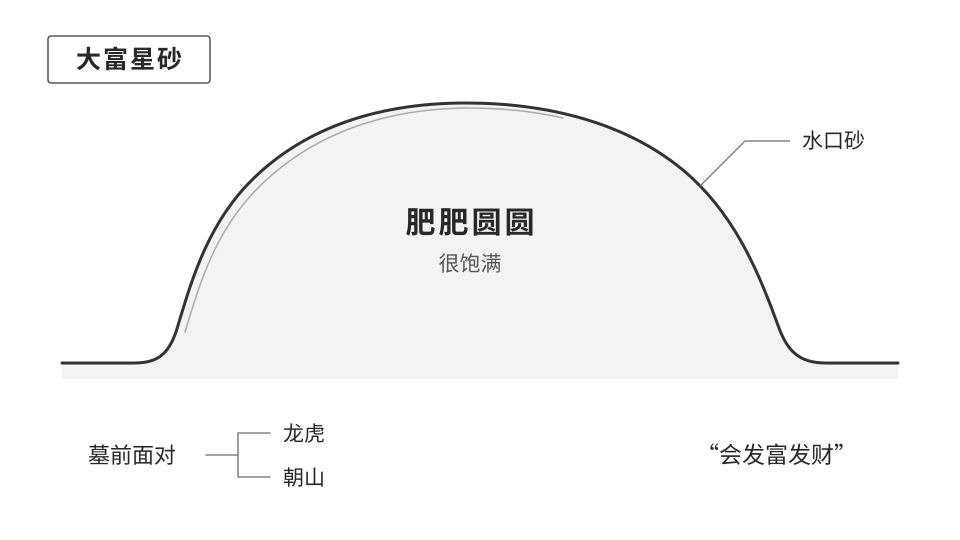 〔指代〕重复说砂形肥圆时，说「这个」时手指的是黑板，手在整幅画面正中一格。（[00:57:03](https://www.bilibili.com/video/BV1KJsLekEfA/?p=31&t=3423)，第 102718 帧） 〔板书〕大弧的左侧到顶部可见两道靠得很近的粉笔线。弧内可辨「肥」，右边的字只露出一部分，认不全。（[00:57:10](https://www.bilibili.com/video/BV1KJsLekEfA/?p=31&t=3430)，第 102924 帧） 〔指代〕说完饱满，又说「这个」时，手指的仍是黑板，手在整幅画面正中一格。（[00:57:12](https://www.bilibili.com/video/BV1KJsLekEfA/?p=31&t=3432)，第 102987 帧） |
| **大富星砂在墓前怎样用，倪师给了什么断语？** | 〔口述〕讲完肥圆饱满的样子，倪师给这种砂定名，先说「富星砂」，紧接着又称它为「大富星砂」。（[00:57:13–00:57:20](https://www.bilibili.com/video/BV1KJsLekEfA/?p=31&t=3433)，第 103002–103223 帧） 〔板书〕大弧内仍可辨「肥」。它的左下方多了一列竖写的粉笔字，开头可辨「大」，下部被字幕遮住，整列认不全。（[00:57:20](https://www.bilibili.com/video/BV1KJsLekEfA/?p=31&t=3440)，第 103200 帧） 〔口述〕在墓前面对这种砂，可以当龙虎，也可以当朝山。讲立向时，他提醒别立得跟总统府一样，又说「这天下都换人了」。究竟对这边还是那边，要看当时的情况。（[00:57:24–00:57:44](https://www.bilibili.com/video/BV1KJsLekEfA/?p=31&t=3444)，第 103326–103931 帧） 〔指代〕说「这个」时，手指的是黑板上可见「肥」字的地方，手在整幅画面中排靠右的一格。（[00:57:44](https://www.bilibili.com/video/BV1KJsLekEfA/?p=31&t=3464)，第 103924 帧） 〔口述〕说过墓前可以怎样取向，倪师对刚讲的这种砂下断语，说它「会发富发财」。（[00:57:44–00:57:49](https://www.bilibili.com/video/BV1KJsLekEfA/?p=31&t=3464)，第 103932–104081 帧） |
| **斩戮之地的旗在哪里，怎样才叫破旗？** | 〔口述〕讲斩戮之地，倪师先举「破树起家」，再举「碎旗出世」，随即说明这个旗要往后面看。（[00:57:49–00:57:57](https://www.bilibili.com/video/BV1KJsLekEfA/?p=31&t=3469)，第 104082–104327 帧） 〔口述〕说到龙脉、龙虎，他用「前面是官后面是鬼」交代前后。旗说的是后面的鬼部，讲到鬼的后面又提「兵旗兵战」。（[00:57:55–00:58:04](https://www.bilibili.com/video/BV1KJsLekEfA/?p=31&t=3475)，第 104262–104549 帧） 〔口述〕鬼部后面原有连续的小山脉。若这一连串小山看起来破破烂烂，倪师便称作破旗，接着念「棕茅散乱蛇兔惊起」。（[00:58:05–00:58:16](https://www.bilibili.com/video/BV1KJsLekEfA/?p=31&t=3485)，第 104550–104909 帧） |
| **找穴时喜见哪些动物，又怕见哪些？** | 〔口述〕找穴无论是给人居住还是立国都，无论阴宅还是阳宅，倪师说取法相同，喜欢当地有鱼、有虾，也有龟。（[00:58:17–00:58:31](https://www.bilibili.com/video/BV1KJsLekEfA/?p=31&t=3497)，第 104910–105335 帧） 〔口述〕倪师把最怕见的动物也列出来，原话是「最怕的是有蛇有虫有蚂蚁」，见到这些便说这种地方不好。（[00:58:31–00:58:36](https://www.bilibili.com/video/BV1KJsLekEfA/?p=31&t=3511)，第 105336–105509 帧） 〔口述〕他设想有人替人找穴，自称找到了龙穴，一挖却是蛇穴。倪师打趣说，这样「只能说你是找蛇穴的高手」。（[00:58:37–00:58:46](https://www.bilibili.com/video/BV1KJsLekEfA/?p=31&t=3517)，第 105522–105797 帧） 〔口述〕回到择地的判断，他特别点出有蛇的地方和有蚂蚁的地方，说这些地方「都是属于斩戮之地」。（[00:58:51–00:59:00](https://www.bilibili.com/video/BV1KJsLekEfA/?p=31&t=3531)，第 105930–106205 帧） |
| **贫困之地怎么讲到狐臭，倪师亲自做过这类案例吗？** | 〔口述〕说到贫困之地，倪师先提「狐狸居」，接着用「腥膻臭秽」形容气味，由此说到狐臭。（[00:59:00–00:59:06](https://www.bilibili.com/video/BV1KJsLekEfA/?p=31&t=3540)，第 106206–106409 帧） 〔口述〕他用「搞不好」的口气，说也许祖坟葬进了狐狸穴，又提到形状像狐狸、葬在「腋下这边」的说法，拿来讲生下来就有狐臭的情形。（[00:59:07–00:59:17](https://www.bilibili.com/video/BV1KJsLekEfA/?p=31&t=3547)，第 106410–106739 帧） 〔口述〕倪师提到医学和风水两种处理办法。说到风水案例，他先说「曾经有过这种案例」，随即交代「只是我个人没有做过」，自己用的是医学上的办法。（[00:59:18–00:59:27](https://www.bilibili.com/video/BV1KJsLekEfA/?p=31&t=3558)，第 106740–107021 帧） 〔口述〕说到进山寻找，他说年代久了已经很难找，再次提到用医学治疗。这一段最后收在「这都是传说传说」。（[00:59:27–00:59:40](https://www.bilibili.com/video/BV1KJsLekEfA/?p=31&t=3567)，第 107022–107400 帧） |

**总结区**

- 通用规则：倪师说文官山秀丽、草短而细，武官山的树木较高大，其中山头圆如营帐的，他断为出武贵（[00:54:17–00:54:41](https://www.bilibili.com/video/BV1KJsLekEfA/?p=31&t=3257)，第 97728–98459 帧）；倪师把窗口那边可见的一根笔与「出科甲出状元」连在一起讲（[00:55:18–00:55:25](https://www.bilibili.com/video/BV1KJsLekEfA/?p=31&t=3318)，第 99558–99779 帧）；倪师把肥圆饱满的水口砂称为大富星砂，说在墓前面对这种砂时可以当成龙虎，也可以当成朝山，立向时朝哪一边要看当时的情况，他对这种砂的断语是「会发富发财」（[00:56:52–00:57:49](https://www.bilibili.com/video/BV1KJsLekEfA/?p=31&t=3412)，第 102366–104081 帧）；倪师说找穴无论阴宅阳宅、人居或国都，都喜鱼、虾、龟，怕蛇、虫、蚂蚁，并把有蛇、有蚂蚁的地方归为斩戮之地（[00:58:17–00:59:00](https://www.bilibili.com/video/BV1KJsLekEfA/?p=31&t=3497)，第 104910–106205 帧）
- 只在本例：倪师举自己看过的一座祖坟为例，坟旁的山头像部队的营帐（[00:54:31–00:54:38](https://www.bilibili.com/video/BV1KJsLekEfA/?p=31&t=3271)，第 98142–98369 帧）；倪师举例说，某处下葬后电信局来立塔，随后有人金榜题名（[00:55:42–00:55:53](https://www.bilibili.com/video/BV1KJsLekEfA/?p=31&t=3342)，第 100272–100613 帧）；讲饮食的形象时，倪师举桂林山水为例，说那里的象在喝水（[00:56:38–00:56:44](https://www.bilibili.com/video/BV1KJsLekEfA/?p=31&t=3398)，第 101940–102137 帧）；谈用风水处理狐臭的案例时，倪师明说自己没有做过，个人用的是医学上的办法（[00:59:20–00:59:27](https://www.bilibili.com/video/BV1KJsLekEfA/?p=31&t=3560)，第 106806–107021 帧）

**待核**

1. 开头字幕为「明堂又很宽广」，本句语音栏为空，与前文的关系按推断记（[00:53:57](https://www.bilibili.com/video/BV1KJsLekEfA/?p=31&t=3237)，第 97128 帧）
2. 讲水怎样来去时，具体从哪边来、往哪边走，材料里的手势没有确认到哪一条线（[00:53:59](https://www.bilibili.com/video/BV1KJsLekEfA/?p=31&t=3239)，第 97188 帧）
3. 举祖坟例子时，人名字幕作「郝伯村」，语音只清楚对上看祖坟这一层，姓名用字待核（[00:54:31](https://www.bilibili.com/video/BV1KJsLekEfA/?p=31&t=3271)，第 98142 帧）
4. 山头建塔一例，字幕先作「宁古塔」，倪师随即改口说「不是灵古塔」，最初说的塔名待核（[00:55:26](https://www.bilibili.com/video/BV1KJsLekEfA/?p=31&t=3326)，第 99780 帧）
5. 字幕作「那也是大雁了小雁塔那种塔」，中间的连接词不清，笔记按并举大雁塔、小雁塔暂读（[00:55:29](https://www.bilibili.com/video/BV1KJsLekEfA/?p=31&t=3329)，第 99894 帧）
6. 立塔后的应期，字幕为「一立塔以后第二年就科甲中」，语音转写成第二天，应期单位待核（[00:55:48](https://www.bilibili.com/video/BV1KJsLekEfA/?p=31&t=3348)，第 100458 帧）
7. 圣地一句只说「七就比较低了」，这个七具体数什么、怎样排，倪师没有展开（[00:56:22](https://www.bilibili.com/video/BV1KJsLekEfA/?p=31&t=3382)，第 101472 帧）
8. 字幕作「饲马得糟得」，语音这一句也含混。据后面「吃那个马槽里面的食物一样」，笔记把糟暂改为槽（[00:56:29](https://www.bilibili.com/video/BV1KJsLekEfA/?p=31&t=3389)，第 101694 帧）
9. 大弧内「肥」字旁的字被倪师挡去一部分，完整字形待核（[00:57:10](https://www.bilibili.com/video/BV1KJsLekEfA/?p=31&t=3430)，第 102924 帧）
10. 「肥」字左下方新写的竖行，下部与画面字幕相叠，整行认不全（[00:57:20](https://www.bilibili.com/video/BV1KJsLekEfA/?p=31&t=3440)，第 103200 帧）
11. 提到总统府后，字幕作「逢木子冰霜涣了对不对」，语音没有完整对上，字句和所指待核（[00:57:37](https://www.bilibili.com/video/BV1KJsLekEfA/?p=31&t=3457)，第 103722 帧）
12. 说立向可以「对这边或对这边」时，具体是哪两个方向，材料中没有确定的指向（[00:57:40](https://www.bilibili.com/video/BV1KJsLekEfA/?p=31&t=3460)，第 103812 帧）
13. 「破树起家」之后，倪师转去解释碎旗，破树具体指什么没有展开（[00:57:51](https://www.bilibili.com/video/BV1KJsLekEfA/?p=31&t=3471)，第 104154 帧）
14. 字幕作「兵旗兵战」，语音转写作兵骑兵战，旗、骑的用字待核（[00:58:03](https://www.bilibili.com/video/BV1KJsLekEfA/?p=31&t=3483)，第 104490 帧）
15. 「棕茅散乱蛇兔惊起」的语音跨到相邻句，末尾转写成惊醒，口诀字面按字幕暂记（[00:58:14](https://www.bilibili.com/video/BV1KJsLekEfA/?p=31&t=3494)，第 104838 帧）
16. 动物名字幕作「龟鸟龟」，语音转写为龟乌龟，两路能对上的是龟（[00:58:28](https://www.bilibili.com/video/BV1KJsLekEfA/?p=31&t=3508)，第 105240 帧）
17. 讲狐狸穴时提到「腋下这边」，两路对葬、长的转写不一，具体对应哪一处地形也未讲清（[00:59:13](https://www.bilibili.com/video/BV1KJsLekEfA/?p=31&t=3553)，第 106596 帧）

