# P33 · 17 上：堪舆二（官鬼 / 九星 / 天星四贵 / 内外砂 / 真假龙 / 城局 / 骑龙葬 / 杖法）（00:00:00–01:02:03，共 111,693 帧）

> 2026-11-19 整理。依据 Grok 4.7 逐帧记录与现成的四层材料（字幕、语音、板书、指代），由 Astra 6.2 max 分段起草，Grok 4.7 high 逐条核过、Astra 6.2 max 按核稿意见改过，引文由程序逐段对过字幕。流程 2026-11-11 经站长认可。
> 依据标记：〔口述〕字幕与语音两路对得上的话，「」里是字幕原字 ·〔叠图〕后期贴的电子图（视频上传者加的），**不算倪师的话** ·〔板书〕粉笔字（看过那一帧原图才写）·〔指代〕「这里 / 这个」指哪（只收核过、确定的）·〔推断〕笔记作者自己的推断。每条后面的时间码可以点，跳到 B 站那一秒。

## 全集总结

**通用规则**

- 倪师把龙前伸出去的一段余脉称为官星。（[00:02:59–00:03:10](https://www.bilibili.com/video/BV1KJsLekEfA/?p=33&t=179)，第 5382–5729 帧）
- 倪师列贪狼、巨门、武曲、左辅为吉，列破军、禄存、文曲、廉贞为凶（[00:11:55–00:12:00](https://www.bilibili.com/video/BV1KJsLekEfA/?p=33&t=715)，第 21462–21611 帧）
- 外砂以形似动物为好，内砂方而头角峥嵘取中流砥柱之象，肥圆则主财旺、能聚大财（[00:16:55–00:17:52](https://www.bilibili.com/video/BV1KJsLekEfA/?p=33&t=1015)，第 30462–32189 帧）
- 倪师把细长而来、结穴处壮的山势比作悬胆鼻，把厚大壮阔的来势比作狮鼻。（[00:19:51–00:20:07](https://www.bilibili.com/video/BV1KJsLekEfA/?p=33&t=1191)，第 35742–36227 帧）
- 倪师称天星四贵到齐为大贵之地，若再有九曲来水入明堂，他断为出天子。（[00:25:14–00:25:45](https://www.bilibili.com/video/BV1KJsLekEfA/?p=33&t=1514)，第 45420–46361 帧）
- 真龙的两条山脉从本身的棱线伸出，水从两边下来而山脉相连，水把山脉隔断时就判为假龙（[00:36:13–00:36:48](https://www.bilibili.com/video/BV1KJsLekEfA/?p=33&t=2173)，第 65214–66257 帧）
- 地气太过要泄掉，不及要设法补足（[00:47:31–00:47:35](https://www.bilibili.com/video/BV1KJsLekEfA/?p=33&t=2851)，第 85542–85667 帧）
- 骑龙葬虽是骑在龙脉上，所选之处一定要能藏风纳气（[00:49:04–00:49:12](https://www.bilibili.com/video/BV1KJsLekEfA/?p=33&t=2944)，第 88332–88589 帧）
- 顺来龙走向画第一条线，自水口画第二条线，两线交点定出平面穴位，再到现场看前方朝山、案山定上下（[00:49:58–00:51:00](https://www.bilibili.com/video/BV1KJsLekEfA/?p=33&t=2998)，第 89964–91811 帧）
- 现场认穴以动物象为主，辨作什么形状，要依当地的地物、地势来定。（[01:01:26–01:02:03](https://www.bilibili.com/video/BV1KJsLekEfA/?p=33&t=3686)，第 110604–111692 帧）

**只在本例**

- 单说台湾，倪师以玉山这边为太祖山，连同大陆山脉一起论时，他以喜马拉雅山为太祖、台湾的山脉为少祖（[00:07:05–00:07:15](https://www.bilibili.com/video/BV1KJsLekEfA/?p=33&t=425)，第 12762–13073 帧）
- 在武官星、山后鬼旗俱备且聚水中间有小山般大砂的例子里，倪师断这一家会出能把乱世变成治世的名将（[00:15:45–00:16:24](https://www.bilibili.com/video/BV1KJsLekEfA/?p=33&t=945)，第 28368–29537 帧）
- 南京虽有天星四贵，倪师认为它的风水太秀丽，不宜作首都。（[00:23:26–00:23:45](https://www.bilibili.com/video/BV1KJsLekEfA/?p=33&t=1406)，第 42180–42755 帧）
- 台北这例中，淡水河与基隆河会在关渡，两边水口砂称狮子、绣球，观音山称朝山。（[00:27:35–00:28:00](https://www.bilibili.com/video/BV1KJsLekEfA/?p=33&t=1655)，第 49650–50417 帧）
- 倪师把关渡红土解作当地地气太热太旺，说要从红土变黄土，得先泄热气（[00:46:30–00:46:55](https://www.bilibili.com/video/BV1KJsLekEfA/?p=33&t=2790)，第 83724–84455 帧）
- 倪师让人从剑潭的路上回看圆山饭店，认为选地很好，房子却盖得太高，挡住了后山（[00:53:47–00:54:11](https://www.bilibili.com/video/BV1KJsLekEfA/?p=33&t=3227)，第 96828–97559 帧）
- 倪师称文化学院所在处是龙穴，校舍盖到山头这边的龙眼上，因而提出给眼睛开光。（[00:57:16–00:58:05](https://www.bilibili.com/video/BV1KJsLekEfA/?p=33&t=3436)，第 103104–104579 帧）

**不是风水规则，是处世方法**

- 现场遇到记不清的山形，先照眼前的样子画下来，回家再对讲义辨认（[00:12:00–00:12:08](https://www.bilibili.com/video/BV1KJsLekEfA/?p=33&t=720)，第 21612–21851 帧）
- 碰到别人已经安葬的地方，倪师告诫不能未经人家同意就去挖人家的坟（[00:38:16–00:38:35](https://www.bilibili.com/video/BV1KJsLekEfA/?p=33&t=2296)，第 68886–69455 帧）
- 先看出是哪一房，暂且不说，再亲自到那一房看小孩的相，和自己的判断核对（[00:45:08–00:45:19](https://www.bilibili.com/video/BV1KJsLekEfA/?p=33&t=2708)，第 81258–81581 帧）
- 替人定下葬的位置，风水师心态要正，不能存心把穴位移到分金上（[00:51:13–00:51:26](https://www.bilibili.com/video/BV1KJsLekEfA/?p=33&t=3073)，第 92202–92585 帧）
- 谈师生相处，倪师把学道的心看得至高无上，提醒人别把老师放在这个位置。（[00:58:43–00:58:55](https://www.bilibili.com/video/BV1KJsLekEfA/?p=33&t=3523)，第 105696–106073 帧）

## 目录

**寻龙总图、官星与九星吉凶**

1. 阴阳宅布局与官星、带、笏（00:00:00–00:06:02）
2. 官星、太祖山与九星吉凶（00:06:02–00:12:22）

**鬼星、内外砂与砂形吉凶**

3. 山后鬼星与内外砂的断法（00:12:22–00:18:56）

**来龙鼻形、天星四贵与水法辨龙**

4. 来龙鼻形与天星四贵（00:18:56–00:25:13）
5. 九曲入明堂与来水的四个要点（00:25:14–00:31:21）
6. 看宅水、分泉水、辨真假龙（00:31:22–00:37:34）

**城局骑龙葬、土色泄补与葬忌**

7. 城局骑龙葬、面相与拨砂（00:37:35–00:43:34）
8. 金城骑龙葬的选位、辨土与泄补（00:43:34–00:49:23）

**杖法定穴、阳宅案例与现场认穴**

9. 杖法定穴与圆山饭店选址（00:49:23–00:55:44）
10. 圆山饭店、文化学院与现场认穴（00:55:44–01:02:03）

## 寻龙总图、官星与九星吉凶

### 1　阴阳宅布局与官星、带、笏（[00:00:00–00:06:02](https://www.bilibili.com/video/BV1KJsLekEfA/?p=33&t=0)，第 0–10871 帧）

| 提示区 | 笔记区 |
|---|---|
| **讲布局时，怎样看三合、三元？** | 〔口述〕倪师开讲便从一个正式的局说起，提到阳宅有布局，接着说「阴宅也有所谓的布局」。（[00:00:01–00:00:14](https://www.bilibili.com/video/BV1KJsLekEfA/?p=33&t=1)，第 48–425 帧） 〔口述〕提到三合、三元，倪师说「他们都有他们的长处」，也提醒学生不必把布局弄得那么复杂。（[00:00:16–00:00:23](https://www.bilibili.com/video/BV1KJsLekEfA/?p=33&t=16)，第 492–701 帧） 〔板书〕黑板左边竖写「布局」。右边并排写着两列字，左列是「三元」，右列是「三合」，两列下面有一道横线。（[00:00:19](https://www.bilibili.com/video/BV1KJsLekEfA/?p=33&t=19)，第 570 帧） |
| **为什么说能简化才算懂了？** | 〔口述〕倪师说「被简化了才是真理嘛」。在他看来，把一件事越弄越复杂，说明自己还没有懂。（[00:00:30–00:00:40](https://www.bilibili.com/video/BV1KJsLekEfA/?p=33&t=30)，第 906–1211 帧） 〔板书〕「三元」「三合」下方另有一组字，中间用一道竖线隔开。线右可辨「易」，左侧两字认不全。（[00:00:34](https://www.bilibili.com/video/BV1KJsLekEfA/?p=33&t=34)，第 1032 帧） 〔口述〕他举汉唐以来有名的地师为例，称他们为「天官」。他们把风水写成几句歌诀，倪师提到传下来的口诀有七言绝句、五言绝句的写法。（[00:00:40–00:00:58](https://www.bilibili.com/video/BV1KJsLekEfA/?p=33&t=40)，第 1212–1751 帧） |
| **倪师怎样区分风水的形和神？** | 〔口述〕要让学生记住的内容，倪师说会用笔记的方式来记，书本上也会写一些。（[00:01:02–00:01:09](https://www.bilibili.com/video/BV1KJsLekEfA/?p=33&t=62)，第 1860–2075 帧） 〔口述〕倪师说，复杂的部分几乎都在讨论形。他举的例子是「几度几度」，量到几度就属于这一类问题。（[00:01:11–00:01:19](https://www.bilibili.com/video/BV1KJsLekEfA/?p=33&t=71)，第 2136–2393 帧） 〔口述〕这堂课想讲的是「风水上的神」。倪师说，要从中挑出真正有必要的东西来讲。（[00:01:19–00:01:26](https://www.bilibili.com/video/BV1KJsLekEfA/?p=33&t=79)，第 2394–2597 帧） |
| **看一家的原则怎样推到一国？** | 〔口述〕从小处看，倪师先讲一个家，提到「慎终追远」、祭祀祖先，也提到让家运亨通。（[00:01:26–00:01:35](https://www.bilibili.com/video/BV1KJsLekEfA/?p=33&t=86)，第 2598–2855 帧） 〔板书〕黑板上有两个相邻的粉笔圈，一个圈着「神」，另一个圈着「家」。「家」圈在「神」圈的右上方。（[00:01:31](https://www.bilibili.com/video/BV1KJsLekEfA/?p=33&t=91)，第 2748 帧） 〔口述〕说到为什么能看一国，他用的是「家的组合就是国家」这个说法。一个个家累积起来，规模变大，就成了国家。（[00:01:35–00:01:48](https://www.bilibili.com/video/BV1KJsLekEfA/?p=33&t=95)，第 2856–3257 帧） 〔板书〕「家」圈的右上方是「国」圈，两圈之间有一支斜向上的箭头。「家」的右下方还有一个小圈，圈内的字认不全。（[00:01:48](https://www.bilibili.com/video/BV1KJsLekEfA/?p=33&t=108)，第 3262 帧） 〔口述〕倪师说，把看阴宅的同一套原则用到整体上，可以看一个国家的局势、未来的前途，以及「民心的向背」。（[00:01:50–00:02:03](https://www.bilibili.com/video/BV1KJsLekEfA/?p=33&t=110)，第 3312–3719 帧） |
| **龙脉图要从哪儿看，棱线在哪里？** | 〔口述〕倪师从一座坟墓讲起，说等他带学生到现场，就能看到图里画的山势。图上画的都是山，说到中间那条线，他说「那中间这个就是棱线」。（[00:02:04–00:02:30](https://www.bilibili.com/video/BV1KJsLekEfA/?p=33&t=124)，第 3720–4523 帧） 〔板书〕粉笔轮廓左右各有一个朝上的尖端，两端之间敞开。沿内侧的线看，两处向下凹的弧线之间，又有一小段向上拱起。（[00:02:11](https://www.bilibili.com/video/BV1KJsLekEfA/?p=33&t=131)，第 3954 帧） 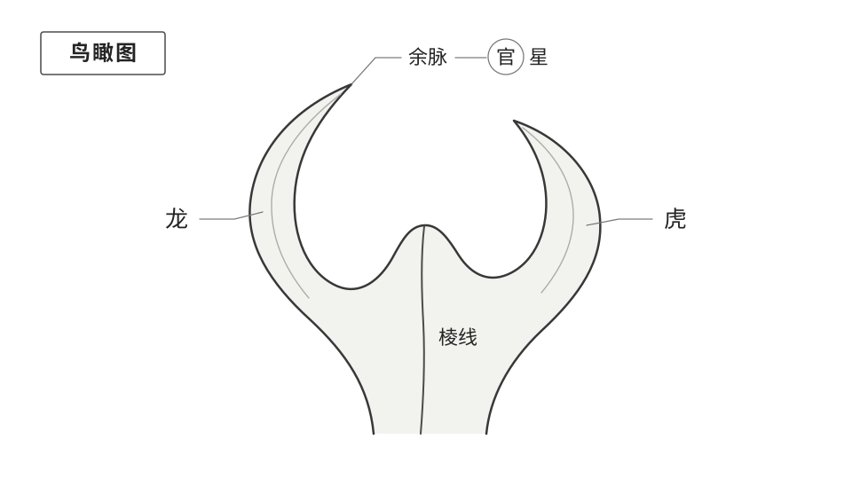 〔板书〕内侧轮廓中央拱起的位置，有一道细线向画面下方延伸。右侧两道弧线在上端相合，收成一个尖角。（[00:02:28](https://www.bilibili.com/video/BV1KJsLekEfA/?p=33&t=148)，第 4453 帧） 〔口述〕倪师让学生想象从空中往下看这幅图，说「这叫鸟瞰图」，又重复了一次读图的方向，「从上往下看」。（[00:02:33–00:02:47](https://www.bilibili.com/video/BV1KJsLekEfA/?p=33&t=153)，第 4602–5015 帧） 〔板书〕图形的右上方单写一字，笔画认不全。右侧两道轮廓之间还有一条细弧，弯的方向和外侧轮廓一致。（[00:02:33](https://www.bilibili.com/video/BV1KJsLekEfA/?p=33&t=153)，第 4609 帧） |
| **图上怎样分龙、虎，官星又在哪里？** | 〔口述〕说到图的两边，他先说「我们这边就叫做龙」，接着给另一边起名，说「这边呢称为虎」。（[00:02:52–00:02:59](https://www.bilibili.com/video/BV1KJsLekEfA/?p=33&t=172)，第 5166–5381 帧） 〔指代〕说「这边」给龙命名时，手指向黑板。按整幅画面的九格位置看，手指在左侧中部的第4格。（[00:02:54](https://www.bilibili.com/video/BV1KJsLekEfA/?p=33&t=174)，第 5237 帧） 〔口述〕倪师说，龙的前面还有一段伸出去的余脉。他把这段余脉称为官星。（[00:02:59–00:03:10](https://www.bilibili.com/video/BV1KJsLekEfA/?p=33&t=179)，第 5382–5729 帧） 〔指代〕说「这个」时手指向黑板。按整幅画面分成的九格定位，手指在正中央的第5格。（[00:03:05](https://www.bilibili.com/video/BV1KJsLekEfA/?p=33&t=185)，第 5552 帧） 〔板书〕按图面看，左边标「龙」，右边标「虎」。图上方的「余脉」用一笔连到圈起的「官」字，「星」字写在圈外。（[00:03:09](https://www.bilibili.com/video/BV1KJsLekEfA/?p=33&t=189)，第 5688 帧） |
| **官星主掌什么，怎样才称为正官？** | 〔口述〕倪师把官星所掌的事分作官和带来讲。说到过去当官的人，他说「要有官要有带」，两样都有就叫正官。（[00:03:15–00:03:34](https://www.bilibili.com/video/BV1KJsLekEfA/?p=33&t=195)，第 5862–6449 帧） 〔板书〕黑板上方横写「官星」，后面可辨「掌官」两字，下方划了一道线。再往右的板面被倪师挡住。（[00:03:28](https://www.bilibili.com/video/BV1KJsLekEfA/?p=33&t=208)，第 6257 帧） 〔指代〕说「这个」时手指向黑板，手指在整幅画面的右上方，也就是九格中的第3格。（[00:03:31](https://www.bilibili.com/video/BV1KJsLekEfA/?p=33&t=211)，第 6337 帧） |
| **怎样认出官帽形，倪师据此怎样断？** | 〔口述〕解释风水上什么叫官时，他举「天山遯卦里面的幞头上树」，说它看起来像官帽，还提到官帽有两个尾巴。（[00:03:35–00:04:00](https://www.bilibili.com/video/BV1KJsLekEfA/?p=33&t=215)，第 6450–7205 帧） 〔口述〕纱帽山是他举的实地例子。他把山名和形状连起来讲，让学生有机会去看，说它看起来真像一顶乌纱帽。（[00:04:00–00:04:10](https://www.bilibili.com/video/BV1KJsLekEfA/?p=33&t=240)，第 7206–7517 帧） 〔板书〕黑板右上写「形如帽」，下方画了两层凸起，上层窄、下层宽。两层下面有一条向左右伸出的长弧线。（[00:04:00](https://www.bilibili.com/video/BV1KJsLekEfA/?p=33&t=240)，第 7212 帧） 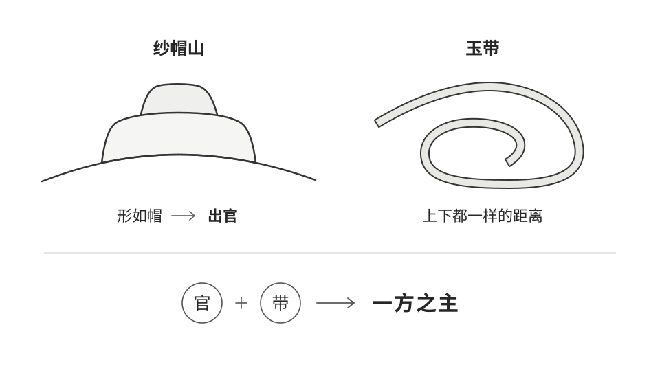 〔口述〕学生若看不出来，倪师说可以带他们去，提醒他们「专心用眼睛去看」。回到官帽这个形，他给的断语是「我们知道出官」。（[00:04:10–00:04:26](https://www.bilibili.com/video/BV1KJsLekEfA/?p=33&t=250)，第 7518–8009 帧） |
| **带是什么样子，有官又有带能断什么？** | 〔口述〕说到为什么要有带，他先讲「带是腰带」，再用玉带的样子作比，说有时候看起来像一圈。（[00:04:27–00:04:37](https://www.bilibili.com/video/BV1KJsLekEfA/?p=33&t=267)，第 8010–8333 帧） 〔口述〕他形容带像很薄的一片，绕得整齐，「上下都一样的距离」。这样环成一圈，他就称为带。（[00:04:39–00:04:46](https://www.bilibili.com/video/BV1KJsLekEfA/?p=33&t=279)，第 8376–8591 帧） 〔板书〕黑板上「官」和「带」各自圈起，圈下可辨「正官」。帽形图的下方另有一道粗弯线，外圈较宽，线头向里卷。（[00:04:40](https://www.bilibili.com/video/BV1KJsLekEfA/?p=33&t=280)，第 8406 帧） 〔口述〕官和带都有，倪师说这样最好，可以称为「一方之主」。他用在地方上当县长、郡长来说明这个说法。（[00:04:46–00:04:58](https://www.bilibili.com/video/BV1KJsLekEfA/?p=33&t=286)，第 8592–8957 帧） |
| **官上再见笏，倪师怎样讲官位？** | 〔口述〕他又讲到官的上面再有笏。为了解释什么是笏，他让学生想上朝面见天子时，手里拿着、放在身前的那件东西。（[00:05:00–00:05:12](https://www.bilibili.com/video/BV1KJsLekEfA/?p=33&t=300)，第 9012–9377 帧） 〔口述〕他拿考试用的小抄打比方。大臣年纪大，记不得今天要报告什么，便把事情写下来，面见皇帝时可以照着念。（[00:05:13–00:05:28](https://www.bilibili.com/video/BV1KJsLekEfA/?p=33&t=313)，第 9414–9845 帧） 〔口述〕由照念说到上台演讲看稿，倪师反问「你真的是真心真意需要看什么稿」，理由是自己知道心里想做什么。（[00:05:39–00:05:47](https://www.bilibili.com/video/BV1KJsLekEfA/?p=33&t=339)，第 10176–10433 帧） 〔口述〕讲回有笏的情形，倪师说「就要近天子了」，意思是官位会做得很大。他还打趣说，能到李某某面前翻桌子了。（[00:05:51–00:05:59](https://www.bilibili.com/video/BV1KJsLekEfA/?p=33&t=351)，第 10530–10793 帧） |

**总结区**

- 通用规则：倪师把龙前伸出去的一段余脉称为官星。（[00:02:59–00:03:10](https://www.bilibili.com/video/BV1KJsLekEfA/?p=33&t=179)，第 5382–5729 帧）；在倪师的判断里，官帽形有出官的意思。（[00:04:24–00:04:26](https://www.bilibili.com/video/BV1KJsLekEfA/?p=33&t=264)，第 7920–8009 帧）；倪师说，有官有带称为正官，可以做一方之主，如地方上的县长、郡长。（[00:03:29–00:04:58](https://www.bilibili.com/video/BV1KJsLekEfA/?p=33&t=209)，第 6288–8957 帧）；倪师说，有笏出现就要近天子，意思是官位会做得很大。（[00:05:51–00:05:57](https://www.bilibili.com/video/BV1KJsLekEfA/?p=33&t=351)，第 10530–10727 帧）
- 只在本例：倪师举纱帽山为例，说这座山看起来像一顶乌纱帽。（[00:04:00–00:04:10](https://www.bilibili.com/video/BV1KJsLekEfA/?p=33&t=240)，第 7206–7517 帧）
- 不是风水规则，是处世方法：说到上台演讲看稿，倪师反问「你真的是真心真意需要看什么稿」，理由是上台的人知道自己心里想做成什么事。（[00:05:39–00:05:47](https://www.bilibili.com/video/BV1KJsLekEfA/?p=33&t=339)，第 10176–10433 帧）

**待核**

1. 字幕作「三合三元」，语音作「三河三圆」，两者各自怎样布局，本块没有展开（[00:00:16](https://www.bilibili.com/video/BV1KJsLekEfA/?p=33&t=16)，第 492 帧）
2. 黑板下方的字由竖线隔开，竖线左侧两字笔画认不全（[00:00:34](https://www.bilibili.com/video/BV1KJsLekEfA/?p=33&t=34)，第 1032 帧）
3. 倪师说到有名的地师时用了「天官」这个称呼，未再解释这个称呼的来由（[00:00:44](https://www.bilibili.com/video/BV1KJsLekEfA/?p=33&t=44)，第 1320 帧）
4. 字幕作「一个制式的那种度量」，语音作「智识的那种度量」，具体用词待核（[00:01:00](https://www.bilibili.com/video/BV1KJsLekEfA/?p=33&t=60)，第 1812 帧）
5. 「家」圈右下方的小圈里有字，具体是哪一个字还认不全（[00:01:48](https://www.bilibili.com/video/BV1KJsLekEfA/?p=33&t=108)，第 3262 帧）
6. 前一句字幕用「棱线」，这一句写作「稜线」，正文统一记作棱线（[00:02:30](https://www.bilibili.com/video/BV1KJsLekEfA/?p=33&t=150)，第 4524 帧）
7. 图形右上方单写的一字笔画相连，单凭这张板书图难以定字（[00:02:33](https://www.bilibili.com/video/BV1KJsLekEfA/?p=33&t=153)，第 4609 帧）
8. 「这边呢称为虎」这一句没有可确定的手指落点记录（[00:02:57](https://www.bilibili.com/video/BV1KJsLekEfA/?p=33&t=177)，第 5310 帧）
9. 字幕的「掌官掌管带」在语音中作「长官官代」，中间的动词和断句待核（[00:03:19](https://www.bilibili.com/video/BV1KJsLekEfA/?p=33&t=199)，第 5976 帧）
10. 「天山遯卦里面的幞头上树」照字幕保留，语音记作「天山屯挂里面的图头上树」，卦名和幞头的用字待核（[00:03:44](https://www.bilibili.com/video/BV1KJsLekEfA/?p=33&t=224)，第 6738 帧）
11. 字幕一处作「鸟纱帽」，依语音和前后两句，正文记作乌纱帽（[00:04:07](https://www.bilibili.com/video/BV1KJsLekEfA/?p=33&t=247)，第 7416 帧）
12. 字幕说带有时「回转」，这句语音只记到「到这一圈」，回转二字待核（[00:04:37](https://www.bilibili.com/video/BV1KJsLekEfA/?p=33&t=277)，第 8334 帧）
13. 有官再有笏的这一段有写板记录，没有配到写完后的板书图，笏在图上的画法待核（[00:05:00](https://www.bilibili.com/video/BV1KJsLekEfA/?p=33&t=300)，第 9024 帧）
14. 大臣把事情写在哪里，字幕作「写在那文章里」，语音作「写在那吻上面」，具体所指待核（[00:05:23](https://www.bilibili.com/video/BV1KJsLekEfA/?p=33&t=323)，第 9690 帧）
15. 举上台看稿的例子时，字幕和语音都不足以确认所举人物的姓名（[00:05:39](https://www.bilibili.com/video/BV1KJsLekEfA/?p=33&t=339)，第 10176 帧）

### 2　官星、太祖山与九星吉凶（[00:06:02–00:12:22](https://www.bilibili.com/video/BV1KJsLekEfA/?p=33&t=362)，第 10872–22271 帧）

| 提示区 | 笔记区 |
|---|---|
| **祖坟前的官星，怎样辨笏、断偏官？** | 〔板书〕黑板左上一个圈里可辨「官」字。右上有两个相邻的圈，圈下画了一道向右延伸的弧线，末端带箭头。（[00:06:05](https://www.bilibili.com/video/BV1KJsLekEfA/?p=33&t=365)，第 10975 帧） 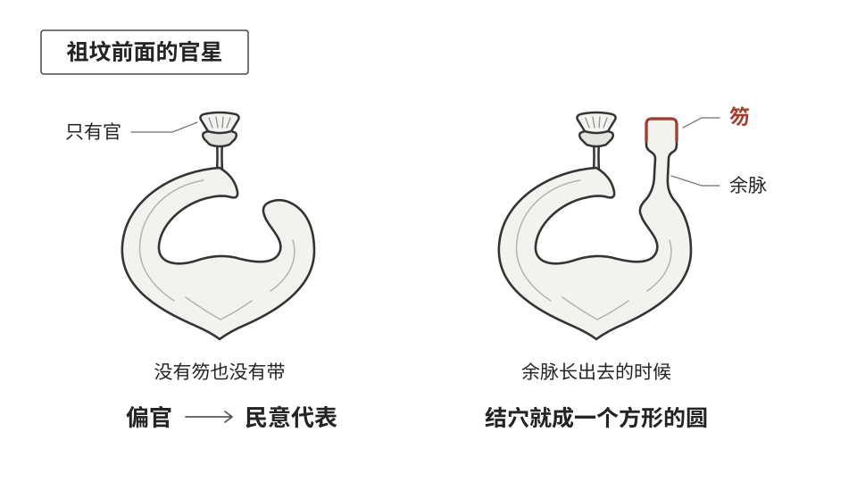 〔口述〕倪师举例，去看一个人的祖坟，前面的官星只有官，没有笏也没有带，他断「那一定出民意代表」。他称这种为偏官，因为「偏官就是老百姓选出来的」，又说「这不是正官」。（[00:06:06–00:06:23](https://www.bilibili.com/video/BV1KJsLekEfA/?p=33&t=366)，第 10992–11507 帧） 〔口述〕说到官带，倪师让学生留意余脉向外长成什么形状。他举了长出去呈方形的一种，说「这就是笏」。（[00:06:23–00:06:32](https://www.bilibili.com/video/BV1KJsLekEfA/?p=33&t=383)，第 11508–11783 帧） 〔指代〕讲余脉向外长，说「这个」时，手指的是黑板，落点在整幅画面的正中。（[00:06:28](https://www.bilibili.com/video/BV1KJsLekEfA/?p=33&t=388)，第 11662 帧） 〔板书〕黑板中部偏左有一个窄长的小框，下方有向下弯的粉笔线。右上两个相邻的圈中，靠右的圈上多了两笔交叉的斜线。（[00:06:32](https://www.bilibili.com/video/BV1KJsLekEfA/?p=33&t=392)，第 11766 帧） |
| **余脉怎样说到龙，太祖山和少祖又怎么分？** | 〔口述〕倪师说，上古地在变动，岩浆喷出，自然形成山势。讲到许多山脉的余脉也长成这样的形状，他说「那这个就叫做龙啊」。（[00:06:43–00:06:58](https://www.bilibili.com/video/BV1KJsLekEfA/?p=33&t=403)，第 12108–12563 帧） 〔口述〕沿一条山脉往上看，他把「最早最高峰的那地方」叫作太祖山，用最早的祖师来比这个起头。（[00:06:58–00:07:05](https://www.bilibili.com/video/BV1KJsLekEfA/?p=33&t=418)，第 12564–12761 帧） 〔口述〕单看台湾，倪师说太祖山在玉山这边。整个山脉从这里过来，再由少祖接到小脉上。（[00:07:05–00:07:10](https://www.bilibili.com/video/BV1KJsLekEfA/?p=33&t=425)，第 12762–12923 帧） 〔口述〕把台湾和大陆的山脉放在一起看，他说「喜马拉雅山就是太祖」，台湾的山脉就算少祖，还可以照这个关系往上推。（[00:07:10–00:07:21](https://www.bilibili.com/video/BV1KJsLekEfA/?p=33&t=430)，第 12924–13253 帧） |
| **看官带要看哪里，完全无官又怎么断？** | 〔指代〕谈到官星的部位，说「这个」时，手指的是黑板，位置在整幅画面的上排中间。（[00:07:25](https://www.bilibili.com/video/BV1KJsLekEfA/?p=33&t=445)，第 13351 帧） 〔口述〕倪师说「官星专门讲官」。要看官带如何，他让学生去看官星的情形。（[00:07:27–00:07:33](https://www.bilibili.com/video/BV1KJsLekEfA/?p=33&t=447)，第 13434–13619 帧） 〔口述〕如果「通通没有官」，倪师据此断这家的后代不会从官，又用「不会当官」说了一遍。（[00:07:34–00:07:43](https://www.bilibili.com/video/BV1KJsLekEfA/?p=33&t=454)，第 13620–13919 帧） 〔指代〕说完后代会不会当官，再说「这个」时，手指的是黑板上写着「官星」的地方。（[00:07:41](https://www.bilibili.com/video/BV1KJsLekEfA/?p=33&t=461)，第 13858 帧） |
| **九星分的是什么，讲义从哪一行读？** | 〔口述〕倪师讲看山势时，举了官星、鬼星和后面的砂，说这些都受九星的影响。（[00:07:45–00:07:59](https://www.bilibili.com/video/BV1KJsLekEfA/?p=33&t=465)，第 13962–14381 帧） 〔板书〕黑板中部偏左有一个大椭圆，圈内可辨「九星」二字。它的左上方另有一个较小的圈，里面可辨「官」。（[00:07:59](https://www.bilibili.com/video/BV1KJsLekEfA/?p=33&t=479)，第 14376 帧） 〔口述〕找讲义时，倪师先说第七页，随即改口，让学生看「第六页的尾巴第一行」，从贪狼星开始讲九星的吉凶。（[00:08:10–00:08:39](https://www.bilibili.com/video/BV1KJsLekEfA/?p=33&t=490)，第 14700–15587 帧） 〔口述〕他解释九星的来历，说过去的地师、风水师积累了几百年、几千年的经验，把天下的山脉「归成九类」。（[00:08:39–00:08:53](https://www.bilibili.com/video/BV1KJsLekEfA/?p=33&t=519)，第 15588–16013 帧） |
| **贪狼势的山怎样排，在天叫什么、主什么？** | 〔口述〕第一个讲贪狼星的砂。倪师让学生看画在下面的山势，中间有一座山，后面还有一群山，他称这种形势为贪狼势。（[00:08:53–00:09:09](https://www.bilibili.com/video/BV1KJsLekEfA/?p=33&t=533)，第 16014–16487 帧） 〔口述〕讲到贪狼在天上的对应，倪师说「在天上是天枢」，又说天枢在北斗星君里面。（[00:09:09–00:09:12](https://www.bilibili.com/video/BV1KJsLekEfA/?p=33&t=549)，第 16488–16577 帧） 〔指代〕讲完天枢，说「这个」时，手指的是讲义，落点在整幅画面的中排左侧。（[00:09:12](https://www.bilibili.com/video/BV1KJsLekEfA/?p=33&t=552)，第 16561 帧） 〔口述〕倪师讲贪狼星的断语，念到「设节度四方」，接着说「这个贪狼星非常好」。（[00:09:15–00:09:19](https://www.bilibili.com/video/BV1KJsLekEfA/?p=33&t=555)，第 16674–16787 帧） |
| **讲山的位置时，为什么也称它为星？** | 〔指代〕说到「这个地方」时，手指的是讲义，位置仍在整幅画面的中排左侧。（[00:09:19](https://www.bilibili.com/video/BV1KJsLekEfA/?p=33&t=559)，第 16796 帧） 〔指代〕接着说「这个」位置时，手指的是黑板，落点在整幅画面的上排中间。（[00:09:25](https://www.bilibili.com/video/BV1KJsLekEfA/?p=33&t=565)，第 16952 帧） 〔口述〕倪师说到砂、说到那个位置的山，解释这里对山还有一个叫法，「这个山又叫做星呐」。（[00:09:27–00:09:32](https://www.bilibili.com/video/BV1KJsLekEfA/?p=33&t=567)，第 17010–17171 帧） |
| **巨门的双峰怎样认，倪师怎样断贵？** | 〔口述〕认巨门要看两个峰是否相等，也要看两峰是否相连。倪师说的是「相等的两个峰而且连在一起」，两峰不等就不能叫巨门。（[00:09:38–00:09:53](https://www.bilibili.com/video/BV1KJsLekEfA/?p=33&t=578)，第 17364–17819 帧） 〔口述〕倪师把巨门也看作贵吉之象，说能「居到九卿之职」，用九卿说明所居的职务很高。（[00:09:56–00:10:02](https://www.bilibili.com/video/BV1KJsLekEfA/?p=33&t=596)，第 17892–18065 帧） 〔口述〕他拿中国从前的门来比这两个峰，说像「两个大的门」。一般人家开一个门就够，天子的宫殿前面则有好几个门。（[00:10:02–00:10:19](https://www.bilibili.com/video/BV1KJsLekEfA/?p=33&t=602)，第 18066–18593 帧） |
| **禄存的山怎样排列，主什么职权？** | 〔口述〕认禄存要看山的大小和前后位置。前面「两个山势比较小」，后面还有一座大山。（[00:10:21–00:10:25](https://www.bilibili.com/video/BV1KJsLekEfA/?p=33&t=621)，第 18642–18779 帧） 〔口述〕倪师讲禄存主杀伐，接连提到兵职、武权和重臣，随后明说「出武官重臣的」。（[00:10:29–00:10:36](https://www.bilibili.com/video/BV1KJsLekEfA/?p=33&t=629)，第 18876–19103 帧） |
| **文曲可能应在谁身上，倪师举了什么例子？** | 〔口述〕第四个是文曲星。倪师让学生看山势，指出这种样子叫文曲，接着说「文曲星音律俊雅」。（[00:10:45–00:10:52](https://www.bilibili.com/video/BV1KJsLekEfA/?p=33&t=645)，第 19362–19583 帧） 〔口述〕讲祖坟上有文曲，倪师提到官星、鬼星，也包括某一部分有文曲的情形。至于应在哪一代，他说后面会讲如何计算。（[00:10:54–00:11:01](https://www.bilibili.com/video/BV1KJsLekEfA/?p=33&t=654)，第 19632–19841 帧） 〔口述〕他说这样的人可以出在下一代，也可以出在旁系。举例时他提到贝多芬，又说「毕加索啊画个太阳花」。（[00:11:01–00:11:09](https://www.bilibili.com/video/BV1KJsLekEfA/?p=33&t=661)，第 19842–20087 帧） |
| **廉贞、武曲和破军各有什么断语？** | 〔口述〕讲廉贞，倪师先说「主杀伐无道」。讲到好的用法时，字幕记作「震山」，他说可出武将，掌兵权，威震边疆。（[00:11:14–00:11:23](https://www.bilibili.com/video/BV1KJsLekEfA/?p=33&t=674)，第 20220–20507 帧） 〔口述〕讲到武曲所主的贵，倪师举的是将、相这样的高位，断语落在「出将相」。（[00:11:23–00:11:26](https://www.bilibili.com/video/BV1KJsLekEfA/?p=33&t=683)，第 20508–20591 帧） 〔口述〕倪师念破军星的断语，前半句字幕记作「子凶伤残」，后半句字幕记作「天伤横死」。两处的确切用字都待核。（[00:11:26–00:11:31](https://www.bilibili.com/video/BV1KJsLekEfA/?p=33&t=686)，第 20592–20741 帧） 〔指代〕念破军的断语，说「这个」时，手指的是讲义，落点在整幅画面的中排右侧。（[00:11:28](https://www.bilibili.com/video/BV1KJsLekEfA/?p=33&t=688)，第 20653 帧） |
| **破军跟禄存很像，山形怎么分？** | 〔口述〕倪师先提醒破军和禄存长得很像，再给禄存一个容易记的比方，「禄存星呢好像一个笔架一样」。（[00:11:31–00:11:38](https://www.bilibili.com/video/BV1KJsLekEfA/?p=33&t=691)，第 20742–20945 帧） 〔口述〕转讲破军的样子时，倪师特别交代「要连在一起的」，让学生留意山形相连这一点。（[00:11:40–00:11:46](https://www.bilibili.com/video/BV1KJsLekEfA/?p=33&t=700)，第 21018–21203 帧） 〔指代〕讲到相连，说「这个」时，手指的是黑板，落点在整幅画面的中排右侧。（[00:11:46](https://www.bilibili.com/video/BV1KJsLekEfA/?p=33&t=706)，第 21190 帧） 〔口述〕回到禄存，倪师把辨形的位置说得更具体，「这个禄存星中间凹下去的」。（[00:11:46–00:11:50](https://www.bilibili.com/video/BV1KJsLekEfA/?p=33&t=706)，第 21204–21323 帧） 〔板书〕黑板右上一个大拱内画了两个小拱，两小拱在底线上相接。右下另有一个大拱，里面的线两边隆起，中间下凹。（[00:11:48](https://www.bilibili.com/video/BV1KJsLekEfA/?p=33&t=708)，第 21248 帧） 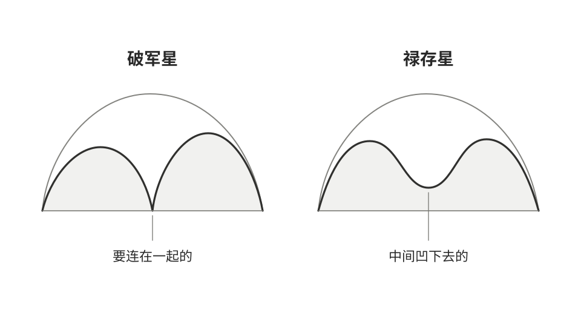 |
| **吉凶各列哪几星，现场记不住怎么办？** | 〔口述〕倪师说左辅、右弼在讲义上都有介绍，随后提醒学生留意最下面一行。（[00:11:50–00:11:55](https://www.bilibili.com/video/BV1KJsLekEfA/?p=33&t=710)，第 21324–21461 帧） 〔指代〕说左辅、右弼「这边都有介绍」时，手指的是讲义，位置在整幅画面的中排右侧。（[00:11:51](https://www.bilibili.com/video/BV1KJsLekEfA/?p=33&t=711)，第 21359 帧） 〔口述〕倪师按讲义读出吉凶各四星，「贪狼巨门武曲左辅为吉」，接下来是「破军禄存文曲廉贞为凶」。（[00:11:55–00:12:00](https://www.bilibili.com/video/BV1KJsLekEfA/?p=33&t=715)，第 21462–21611 帧） 〔口述〕在现场一时记不起九星，倪师教学生「你看完以后把那个山势画下来」，回家再对照讲义，把对应的山形找出来。（[00:12:00–00:12:08](https://www.bilibili.com/video/BV1KJsLekEfA/?p=33&t=720)，第 21612–21851 帧） |

**总结区**

- 通用规则：祖坟前的官星只有官，无笏无带，倪师断为出百姓选出来的民意代表，称作偏官（[00:06:09–00:06:21](https://www.bilibili.com/video/BV1KJsLekEfA/?p=33&t=369)，第 11070–11459 帧）；看官带如何要看官星，若通通没有官，倪师断其后代不会当官（[00:07:27–00:07:43](https://www.bilibili.com/video/BV1KJsLekEfA/?p=33&t=447)，第 13434–13919 帧）；辨禄存与破军，倪师以笔架比禄存，点出中间下凹，讲破军则强调山形要连在一起（[00:11:31–00:11:50](https://www.bilibili.com/video/BV1KJsLekEfA/?p=33&t=691)，第 20742–21323 帧）；倪师列贪狼、巨门、武曲、左辅为吉，列破军、禄存、文曲、廉贞为凶（[00:11:55–00:12:00](https://www.bilibili.com/video/BV1KJsLekEfA/?p=33&t=715)，第 21462–21611 帧）
- 只在本例：单说台湾，倪师以玉山这边为太祖山，连同大陆山脉一起论时，他以喜马拉雅山为太祖、台湾的山脉为少祖（[00:07:05–00:07:15](https://www.bilibili.com/video/BV1KJsLekEfA/?p=33&t=425)，第 12762–13073 帧）
- 不是风水规则，是处世方法：现场遇到记不清的山形，先照眼前的样子画下来，回家再对讲义辨认（[00:12:00–00:12:08](https://www.bilibili.com/video/BV1KJsLekEfA/?p=33&t=720)，第 21612–21851 帧）

**待核**

1. 开头板面右上两个圈中，靠右圈内的粉笔字认不清（[00:06:05](https://www.bilibili.com/video/BV1KJsLekEfA/?p=33&t=365)，第 10975 帧）
2. 讲官带出去后的余脉，字幕停在「余脉是」，语音里还有近似「薄片」的词，具体怎样形容待核（[00:06:23](https://www.bilibili.com/video/BV1KJsLekEfA/?p=33&t=383)，第 11508 帧）
3. 字幕作「一个方形的圆」，语音只转出「一个方形」。名称按字幕记「笏」，语音转作「吻」，完整原话待核（[00:06:30](https://www.bilibili.com/video/BV1KJsLekEfA/?p=33&t=390)，第 11718 帧）
4. 字幕有「雪脉」，相邻语音转作「山脉」，原词待核（[00:06:33](https://www.bilibili.com/video/BV1KJsLekEfA/?p=33&t=393)，第 11814 帧）
5. 字幕作「你自己去看首尾」，语音作「你自己去看收吻」，究竟让学生看什么待核（[00:06:37](https://www.bilibili.com/video/BV1KJsLekEfA/?p=33&t=397)，第 11928 帧）
6. 讲岩浆喷出后形成山势，字幕句首作「结穴良然师然」，语音作「自然而来」，句首原话待核（[00:06:50](https://www.bilibili.com/video/BV1KJsLekEfA/?p=33&t=410)，第 12318 帧）
7. 列举官星、鬼星和砂之前，字幕作「龙奔部」，语音也难辨。这里的「砂」具体指什么，本句未展开（[00:07:48](https://www.bilibili.com/video/BV1KJsLekEfA/?p=33&t=468)，第 14040 帧）
8. 贪狼断语里有「出时啊设节度四方」，「出时」的用字及「设节度」的具体意思待核（[00:09:15](https://www.bilibili.com/video/BV1KJsLekEfA/?p=33&t=555)，第 16674 帧）
9. 字幕作「我们讲的星就是峦」，语音把末字转成「来」，术语「峦」的用字待核（[00:09:21](https://www.bilibili.com/video/BV1KJsLekEfA/?p=33&t=561)，第 16854 帧）
10. 这处「这个」只标出画面上排中间，所指对象一栏为「—」，具体指什么待核（[00:09:24](https://www.bilibili.com/video/BV1KJsLekEfA/?p=33&t=564)，第 16945 帧）
11. 禄存的代数一句，字幕停在「一二代后男」，语音随即转到下一句，关于男子的断语不完整（[00:10:36](https://www.bilibili.com/video/BV1KJsLekEfA/?p=33&t=636)，第 19104 帧）
12. 讲下一代女子，字幕末尾作「会貌美」，语音转作「会报名」，断语末词待核（[00:10:42](https://www.bilibili.com/video/BV1KJsLekEfA/?p=33&t=642)，第 19260 帧）
13. 讲廉贞好的用法，字幕作「震山」，语音作「镇山」，用字和适用条件待核（[00:11:18](https://www.bilibili.com/video/BV1KJsLekEfA/?p=33&t=678)，第 20346 帧）
14. 武曲一句字幕作「贵极人出将相」，语音在「出将相」之前作「贵吉真的」，前半句原词待核（[00:11:25](https://www.bilibili.com/video/BV1KJsLekEfA/?p=33&t=685)，第 20556 帧）
15. 破军的后半句，字幕作「天伤横死」，语音作「腰伤很死」，「横死」前两个字待核（[00:11:26](https://www.bilibili.com/video/BV1KJsLekEfA/?p=33&t=686)，第 20592 帧）
16. 倪师提过右弼，随后读的吉、凶两组各有四星。右弼在这份分组中的归属待核（[00:11:57](https://www.bilibili.com/video/BV1KJsLekEfA/?p=33&t=717)，第 21516 帧）
17. 贪狼断语的字幕作「主贵极之象」，语音相应处转作「主贵籍之下」，原话待核（[00:09:12](https://www.bilibili.com/video/BV1KJsLekEfA/?p=33&t=552)，第 16578 帧）
18. 字幕作「这可以出外做大使」，语音相应处转作「这些出来都大」，是否以出外做大使为例待核（[00:09:17](https://www.bilibili.com/video/BV1KJsLekEfA/?p=33&t=557)，第 16722 帧）
19. 破军断语前半句字幕作「子凶伤残」，语音转作「子兄伤长」。后半句字幕作「天伤横死」，语音转作「腰伤很死」，前后两处用字一并待核（[00:11:26](https://www.bilibili.com/video/BV1KJsLekEfA/?p=33&t=686)，第 20592 帧）

## 鬼星、内外砂与砂形吉凶

### 3　山后鬼星与内外砂的断法（[00:12:22–00:18:56](https://www.bilibili.com/video/BV1KJsLekEfA/?p=33&t=742)，第 22272–34103 帧）

| 提示区 | 笔记区 |
|---|---|
| **图上前面叫什么，山后伸出的脉又叫什么？** | 〔口述〕倪师回到刚讲过的图，先说「这个前面是官」。山的后面还会延伸出许多条脉，讲到这些脉伸出的部位，他说「这个部位就叫做鬼」。（[00:12:22–00:12:43](https://www.bilibili.com/video/BV1KJsLekEfA/?p=33&t=742)，第 22272–22907 帧） 〔板书〕黑板左侧有一条长线向下弯折，下方的弧线里有一个小圈。板面中部被倪师挡住，旁边的字认不全。（[00:12:24](https://www.bilibili.com/video/BV1KJsLekEfA/?p=33&t=744)，第 22344 帧） 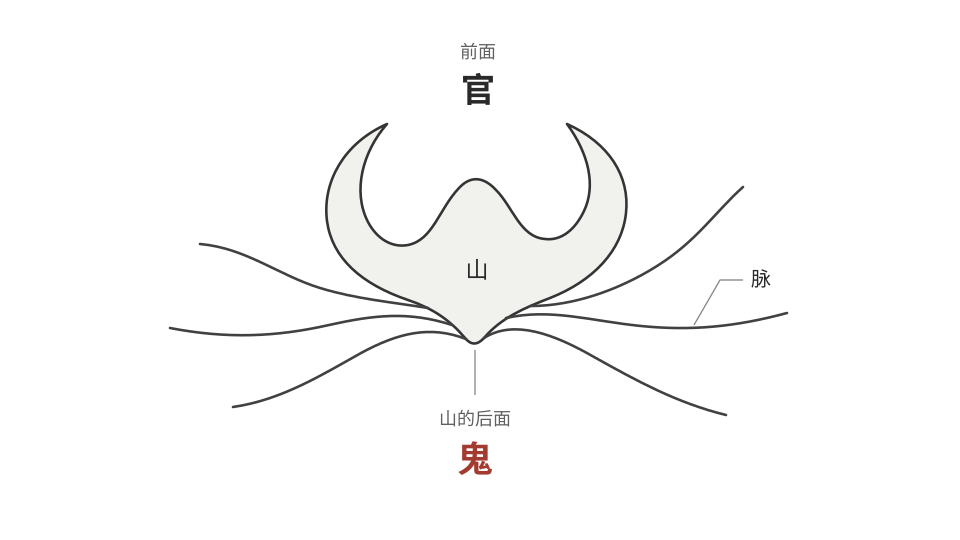 〔板书〕黑板下半部的轮廓两侧向内弯，里面的曲线有两个低弯，中间拱起。轮廓下部向两旁分出长线，右边能数出三条，分别伸向右上、右方和右下。（[00:12:41](https://www.bilibili.com/video/BV1KJsLekEfA/?p=33&t=761)，第 22843 帧） 〔指代〕说龙在「这边」时，手指向黑板，指尖落在整幅画面下排正中的第八格。（[00:12:44](https://www.bilibili.com/video/BV1KJsLekEfA/?p=33&t=764)，第 22940 帧） |
| **国剧的旗子和老虎的背毛怎样比喻鬼星？** | 〔口述〕倪师拿国剧里的人物作比，头上是官帽，「后面插很多旗子」。他借这个扮相说明，鬼讲的是「兵旗的旗」。（[00:12:48–00:13:01](https://www.bilibili.com/video/BV1KJsLekEfA/?p=33&t=768)，第 23052–23435 帧） 〔口述〕过去武官用刀枪剑戟面对面打仗，盔甲做得吓人，有震慑力。他又举老虎作比，老虎一凶起来，背上的毛就全竖起来。（[00:13:03–00:13:15](https://www.bilibili.com/video/BV1KJsLekEfA/?p=33&t=783)，第 23514–23879 帧） 〔指代〕从老虎的比方转回图上，说「这个」时，手指的是黑板，位置在整幅画面的下排中格。（[00:13:15](https://www.bilibili.com/video/BV1KJsLekEfA/?p=33&t=795)，第 23878 帧） 〔口述〕讲回鬼星，倪师先说它主兵家，接着说「主的是杀伐主的是兵旗」。（[00:13:16–00:13:21](https://www.bilibili.com/video/BV1KJsLekEfA/?p=33&t=796)，第 23880–24035 帧） |
| **哪些山形本身就凶，还用看罗经吗？** | 〔口述〕无论看的是官、鬼，还是山本身，山势都忌凶、破碎。他把凶讲成山形破烂、不整齐，也包括有塌方、塌陷、陷落。（[00:13:21–00:13:48](https://www.bilibili.com/video/BV1KJsLekEfA/?p=33&t=801)，第 24036–24845 帧） 〔口述〕还有一种是满山沙石，沙或石头光秃秃的。这样的山势「不管是落在哪一个位置上都主不利」，山本身已经是凶，就不用再拿罗经去看。（[00:13:48–00:14:07](https://www.bilibili.com/video/BV1KJsLekEfA/?p=33&t=828)，第 24846–25439 帧） 〔指代〕说「这个」时，手指向黑板，在整幅画面右上方的第三格，那一处看得见「碎」字。（[00:13:56](https://www.bilibili.com/video/BV1KJsLekEfA/?p=33&t=836)，第 25087 帧） |
| **鬼星主出什么人，数目以几个为好？** | 〔指代〕转回山后鬼星，说「这个」时，手指向黑板，指尖在整幅画面的下排中格。（[00:14:09](https://www.bilibili.com/video/BV1KJsLekEfA/?p=33&t=849)，第 25484 帧） 〔口述〕图的后面是鬼星。倪师说「鬼星专门管征伐讲兵旗」，问这样出什么人，他给的回答是「武」。（[00:14:09–00:14:18](https://www.bilibili.com/video/BV1KJsLekEfA/?p=33&t=849)，第 25488–25769 帧） 〔板书〕黑板中部可辨「兵旗」，两个字下面划了一条长横线。再往下有一个大圈，圈里写着「武」。（[00:14:16](https://www.bilibili.com/video/BV1KJsLekEfA/?p=33&t=856)，第 25680 帧） 〔口述〕谈山后鬼星的数目，他说「三的数是大贵」，这也是他「画个三」的缘故。七八个或一个、两个都不及三个，他把三称为「最好的位置」。（[00:14:19–00:14:44](https://www.bilibili.com/video/BV1KJsLekEfA/?p=33&t=859)，第 25770–26537 帧） 〔口述〕倪师说，如果对方是武将，就看他的后代有没有武将。他举杨家将为例，两次说「历代都是武官」，中间一句字幕作「你会看到后面」。（[00:14:44–00:15:01](https://www.bilibili.com/video/BV1KJsLekEfA/?p=33&t=884)，第 26538–27035 帧） |
| **图上水往哪里走，明堂里的砂怎么认？** | 〔口述〕倪师先讲水势，说「这边有个水这边有个水」，接着说水往外流，随后才讲图中的内砂和外砂。（[00:15:01–00:15:14](https://www.bilibili.com/video/BV1KJsLekEfA/?p=33&t=901)，第 27036–27449 帧） 〔指代〕讲有水的地方，说「这边」时，手指的是黑板，指尖在整幅画面正中的第五格。（[00:15:04](https://www.bilibili.com/video/BV1KJsLekEfA/?p=33&t=904)，第 27139 帧） 〔板书〕黑板图上有一条红色曲线，从上方弯下来，下端向左右分开，两侧各有白色弧线。图右的粉笔字分两列，上方可辨「内」「外」。（[00:15:14](https://www.bilibili.com/video/BV1KJsLekEfA/?p=33&t=914)，第 27420 帧） 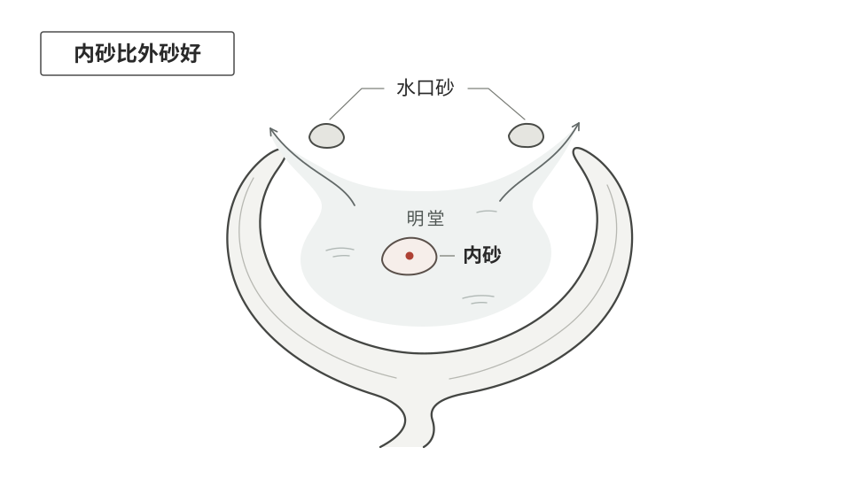 〔口述〕倪师说内砂「就是砂聚在明堂里面」。如果明堂里有水聚着，砂也被包在这个范围里面，就称为内砂。（[00:15:15–00:15:23](https://www.bilibili.com/video/BV1KJsLekEfA/?p=33&t=915)，第 27450–27713 帧） 〔指代〕说砂包在「这个」里面时，手指向黑板，指尖落在整幅画面正中的第五格。（[00:15:20](https://www.bilibili.com/video/BV1KJsLekEfA/?p=33&t=920)，第 27626 帧） |
| **水口砂在什么地方，和明堂里的砂怎么比？** | 〔板书〕红色弯线里面有两个上下相接的白圈，上圈较大，圈中还有一点，下圈较小。倪师的手在上圈右边。（[00:15:22](https://www.bilibili.com/video/BV1KJsLekEfA/?p=33&t=922)，第 27665 帧） 〔指代〕讲包在里面的砂，说「这个」时，手仍指向黑板，位置在整幅画面正中的第五格。（[00:15:22](https://www.bilibili.com/video/BV1KJsLekEfA/?p=33&t=922)，第 27666 帧） 〔口述〕他讲到两个水口，穴外快到门口的两处砂叫外砂，门口的砂也叫水口砂。比较内外，他说「内砂比外砂好」。（[00:15:23–00:15:45](https://www.bilibili.com/video/BV1KJsLekEfA/?p=33&t=923)，第 27714–28367 帧） 〔指代〕说到两个水口的「这个」时，手指向黑板，指尖在整幅画面正中的第五格。（[00:15:25](https://www.bilibili.com/video/BV1KJsLekEfA/?p=33&t=925)，第 27773 帧） 〔板书〕黑板上「内砂」「外砂」分两列写，中间的符号尖端向右。一条长弧线从上面绕下来，箭头朝着图上沿靠右的小圈。（[00:15:39](https://www.bilibili.com/video/BV1KJsLekEfA/?p=33&t=939)，第 28188 帧） |
| **武官星一例，怎样从水中的砂讲到名将？** | 〔口述〕倪师以武官星为例，先说「这个后面的旗都有了」，又说「鬼旗都有了」，接着说「一对到这个砂」。（[00:15:45–00:15:56](https://www.bilibili.com/video/BV1KJsLekEfA/?p=33&t=945)，第 28368–28697 帧） 〔指代〕说「一对到这个砂」时，手指的是黑板，指尖在整幅画面中排靠左的第四格。（[00:15:55](https://www.bilibili.com/video/BV1KJsLekEfA/?p=33&t=955)，第 28677 帧） 〔口述〕水聚的时候，正中间能看到很大的砂。倪师把它比作大石头，又说像一座黑黑的小山，因此说「有中流砥柱的象」。（[00:15:56–00:16:14](https://www.bilibili.com/video/BV1KJsLekEfA/?p=33&t=956)，第 28698–29249 帧） 〔口述〕对着这个例子，倪师断「你这一家后面一定出名将」。他讲的名将，是能「把乱世变成治世」的人。（[00:16:15–00:16:24](https://www.bilibili.com/video/BV1KJsLekEfA/?p=33&t=975)，第 29274–29537 帧） |
| **同一例若来龙太低，对武将的断语怎样变？** | 〔口述〕倪师给这个例子换了一个条件。若来龙太低，他把断语改为出忠将，也称忠臣，并特意重说了「忠将」。（[00:16:26–00:16:33](https://www.bilibili.com/video/BV1KJsLekEfA/?p=33&t=986)，第 29580–29819 帧） 〔口述〕倪师说，这位忠将为国家尽忠，随后改朝换代。他接着说，如果你觉得儿子这样也好，就可以给他刻个「精忠报国」。（[00:16:35–00:16:44](https://www.bilibili.com/video/BV1KJsLekEfA/?p=33&t=995)，第 29862–30143 帧） 〔板书〕黑板中部偏下可辨「忠将」，两字从上往下写。「忠」的左边另外写着一个「武」字。（[00:16:35](https://www.bilibili.com/video/BV1KJsLekEfA/?p=33&t=995)，第 29868 帧） 〔口述〕倪师用这两种断法说明，看砂也看龙，就已经可以从中判断会遇到什么状况。（[00:16:44–00:16:53](https://www.bilibili.com/video/BV1KJsLekEfA/?p=33&t=1004)，第 30144–30413 帧） |
| **外砂以什么形状为好，为什么？** | 〔口述〕先说内砂最好，再看外砂取什么形。倪师说「一定是动物砂」，随即解释为「就是看起来像动物最好」。（[00:16:53–00:17:04](https://www.bilibili.com/video/BV1KJsLekEfA/?p=33&t=1013)，第 30414–30725 帧） 〔板书〕黑板上「外砂」下方可辨「水口」，两个字上下错开。右侧还斜着往下写了「动物砂」三个字。（[00:17:01](https://www.bilibili.com/video/BV1KJsLekEfA/?p=33&t=1021)，第 30653 帧） 〔口述〕倪师解释为什么取动物的形，先说动物能生，接着用「生生之谓易」说明取的是相生之象。（[00:17:04–00:17:09](https://www.bilibili.com/video/BV1KJsLekEfA/?p=33&t=1024)，第 30726–30875 帧） |
| **内砂方而有角、肥而圆，各取什么象？** | 〔口述〕一种内砂是方方的石头，有「头角峥嵘」的样子。倪师说，这样的石头取的是「中流砥柱」。（[00:17:09–00:17:34](https://www.bilibili.com/video/BV1KJsLekEfA/?p=33&t=1029)，第 30876–31649 帧） 〔板书〕黑板中下部有两条长竖线，顶端由一段横线连着，左上方的箭头朝下。顶边旁有两个连笔字，认不全。（[00:17:24](https://www.bilibili.com/video/BV1KJsLekEfA/?p=33&t=1044)，第 31337 帧） 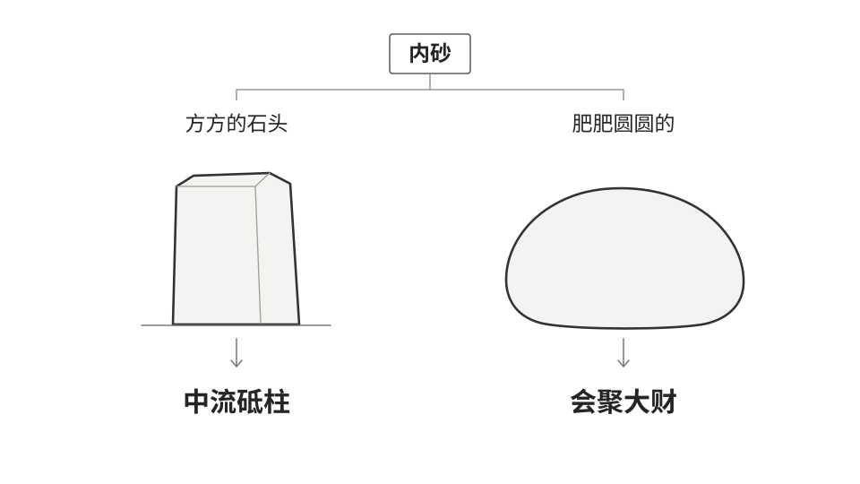 〔板书〕竖长的方形轮廓下有一条横线。轮廓右侧另有一列竖写的字，可辨开头的「中流」，下方被字幕挡住。（[00:17:31](https://www.bilibili.com/video/BV1KJsLekEfA/?p=33&t=1051)，第 31536 帧） 〔口述〕另一种内砂「是肥肥圆圆的」。倪师说这主发财，财旺而且「会聚大财」。说到位置，水中间、明堂里面都可以，又提了一个「这里」。（[00:17:35–00:17:57](https://www.bilibili.com/video/BV1KJsLekEfA/?p=33&t=1055)，第 31650–32327 帧） 〔板书〕黑板下半部画了一道宽圆弧，「肥圆」两个粉笔字并排写在弧线里面。（[00:17:49](https://www.bilibili.com/video/BV1KJsLekEfA/?p=33&t=1069)，第 32076 帧） |
| **水中的石头要拿掉吗，多大才值得看？** | 〔口述〕倪师举有些地师的做法为例。原本水里有砂，地师以为拿掉那块石头会更好，倪师说拿掉「反而不好了」。（[00:17:57–00:18:09](https://www.bilibili.com/video/BV1KJsLekEfA/?p=33&t=1077)，第 32328–32699 帧） 〔口述〕砂若七零八落，像一堆小碎石，他说并不好。「我讲的砂要很大」，大到让人特意去看，想问这样特别的石头为什么会在这里。（[00:18:10–00:18:26](https://www.bilibili.com/video/BV1KJsLekEfA/?p=33&t=1090)，第 32700–33185 帧） |
| **看国运时，淡水河若出现贪狼砂怎么断？** | 〔口述〕说到怎样看砂形，倪师以大河为例，讲地势很大、要判国运的情形。他提到淡水河，后一条河名依据语音暂记作基隆河。（[00:18:26–00:18:39](https://www.bilibili.com/video/BV1KJsLekEfA/?p=33&t=1106)，第 33186–33587 帧） 〔口述〕他设想，假如哪天淡水河里突然出现一处砂，可以接着看这处砂呈什么形状。（[00:18:39–00:18:45](https://www.bilibili.com/video/BV1KJsLekEfA/?p=33&t=1119)，第 33588–33773 帧） 〔指代〕说河里的砂呈「这个」形状时，手指的是黑板，指尖在整幅画面正中的第五格。（[00:18:44](https://www.bilibili.com/video/BV1KJsLekEfA/?p=33&t=1124)，第 33736 帧） 〔口述〕倪师接着设想有人说淡水河出了贪狼砂。对于这种砂，他给的断法是「也是用九星来论断」。（[00:18:45–00:18:56](https://www.bilibili.com/video/BV1KJsLekEfA/?p=33&t=1125)，第 33774–34103 帧） |

**总结区**

- 通用规则：官、鬼和山本身，若见山势破碎不整、塌陷或沙石光秃，落在哪个位置都主不利，不必再看罗经（[00:13:21–00:14:07](https://www.bilibili.com/video/BV1KJsLekEfA/?p=33&t=801)，第 24036–25439 帧）；山后鬼星主征伐、兵旗，论数以三为大贵，一个、两个或七八个都不及三个（[00:14:09–00:14:44](https://www.bilibili.com/video/BV1KJsLekEfA/?p=33&t=849)，第 25488–26537 帧）；砂聚在明堂里面叫内砂，穴外近门口的水口砂叫外砂，内砂比外砂好（[00:15:15–00:15:45](https://www.bilibili.com/video/BV1KJsLekEfA/?p=33&t=915)，第 27450–28367 帧）；外砂以形似动物为好，内砂方而头角峥嵘取中流砥柱之象，肥圆则主财旺、能聚大财（[00:16:55–00:17:52](https://www.bilibili.com/video/BV1KJsLekEfA/?p=33&t=1015)，第 30462–32189 帧）
- 只在本例：在武官星、山后鬼旗俱备且聚水中间有小山般大砂的例子里，倪师断这一家会出能把乱世变成治世的名将（[00:15:45–00:16:24](https://www.bilibili.com/video/BV1KJsLekEfA/?p=33&t=945)，第 28368–29537 帧）；同一例若来龙太低，倪师改断出忠将，为国尽忠后仍改朝换代（[00:16:26–00:16:38](https://www.bilibili.com/video/BV1KJsLekEfA/?p=33&t=986)，第 29580–29957 帧）；倪师假设淡水河里出现一处贪狼砂，仍用九星来论断它（[00:18:39–00:18:56](https://www.bilibili.com/video/BV1KJsLekEfA/?p=33&t=1119)，第 33588–34103 帧）

**待核**

1. 开头板面的中部被倪师挡住，左侧弧线和小圈旁的字认不全（[00:12:24](https://www.bilibili.com/video/BV1KJsLekEfA/?p=33&t=744)，第 22344 帧）
2. 倪师说山形本身已凶就不用看罗经，本块未讲罗经的具体用法（[00:14:02](https://www.bilibili.com/video/BV1KJsLekEfA/?p=33&t=842)，第 25278 帧）
3. 转折句字幕是「那所以有利的山是鬼」，语音是「有立了山的鬼」，句意待核（[00:14:08](https://www.bilibili.com/video/BV1KJsLekEfA/?p=33&t=848)，第 25440 帧）
4. 字幕作「结着水出去」，语音在相邻两句间接成「截着水出去」，开头一字待核（[00:15:05](https://www.bilibili.com/video/BV1KJsLekEfA/?p=33&t=905)，第 27168 帧）
5. 倪师用明堂界定内砂，图上明堂的确切边界未讲清（[00:15:16](https://www.bilibili.com/video/BV1KJsLekEfA/?p=33&t=916)，第 27492 帧）
6. 字幕识别为「那肉外砂呢不如内砂」，句首多出的字待核，比较关系依后一句「内砂比外砂好」（[00:15:37](https://www.bilibili.com/video/BV1KJsLekEfA/?p=33&t=937)，第 28122 帧）
7. 举例时字幕作「武官星」，语音近于「五官金」，后文能对上武将之意，星形在此未交代（[00:15:45](https://www.bilibili.com/video/BV1KJsLekEfA/?p=33&t=945)，第 28368 帧）
8. 说黑色小山时，字幕作「挡在那个那个石头中间」，语音作「长在那个石头中间」，动词待核（[00:16:11](https://www.bilibili.com/video/BV1KJsLekEfA/?p=33&t=971)，第 29136 帧）
9. 来龙怎样才算「太低」，这句只给了断语，没给判断高低的标准（[00:16:26](https://www.bilibili.com/video/BV1KJsLekEfA/?p=33&t=986)，第 29580 帧）
10. 两路都记成「国家复生没力」，这句话的原意不清（[00:16:34](https://www.bilibili.com/video/BV1KJsLekEfA/?p=33&t=994)，第 29820 帧）
11. 给儿子刻的字，字幕作「精忠报国」，语音作「尽忠报国」，首字待核（[00:16:40](https://www.bilibili.com/video/BV1KJsLekEfA/?p=33&t=1000)，第 30012 帧）
12. 方形顶边的两个连笔字认不全（[00:17:24](https://www.bilibili.com/video/BV1KJsLekEfA/?p=33&t=1044)，第 31337 帧）
13. 方形右侧的竖行只能辨出开头的「中流」，下部被字幕遮挡（[00:17:31](https://www.bilibili.com/video/BV1KJsLekEfA/?p=33&t=1051)，第 31536 帧）
14. 字幕识别把内砂写成「肉砂」，语音作「内沙」，画面底部字幕可辨「在内砂」，笔记据此记作内砂（[00:17:49](https://www.bilibili.com/video/BV1KJsLekEfA/?p=33&t=1069)，第 32076 帧）
15. 说内砂可以在明堂里，又说「或者在这里通通可以」，后一个位置没有确定的指代（[00:17:55](https://www.bilibili.com/video/BV1KJsLekEfA/?p=33&t=1075)，第 32250 帧）
16. 第二条河的名字，字幕识为「甚隆河」，语音为「基隆河」，笔记暂依语音记作基隆河（[00:18:36](https://www.bilibili.com/video/BV1KJsLekEfA/?p=33&t=1116)，第 33504 帧）
17. 说「这个」形状时只确定手指向黑板，具体轮廓看不出，怎样凭形认出后面所说的贪狼砂仍待核（[00:18:44](https://www.bilibili.com/video/BV1KJsLekEfA/?p=33&t=1124)，第 33736 帧）
18. 字幕作「你会看到后面」，语音识别作「你看到风历代都是」，「后面」的具体所指待核（[00:14:56](https://www.bilibili.com/video/BV1KJsLekEfA/?p=33&t=896)，第 26880 帧）。

## 来龙鼻形、天星四贵与水法辨龙

### 4　来龙鼻形与天星四贵（[00:18:56–00:25:13](https://www.bilibili.com/video/BV1KJsLekEfA/?p=33&t=1136)，第 34104–45419 帧）

| 提示区 | 笔记区 |
|---|---|
| **哪两种鼻主富，这个断语能说到哪一步？** | 〔口述〕倪师讲来龙，先借人相作比。他说「有两种鼻最好」，一种叫狮鼻，一种叫悬胆鼻。（[00:18:56–00:19:21](https://www.bilibili.com/video/BV1KJsLekEfA/?p=33&t=1136)，第 34104–34859 帧） 〔板书〕黑板上竖写着「人相」，右边上方并排圈出一、二两个数，第一个圈号下竖写「狮鼻」。（[00:19:12](https://www.bilibili.com/video/BV1KJsLekEfA/?p=33&t=1152)，第 34571 帧） 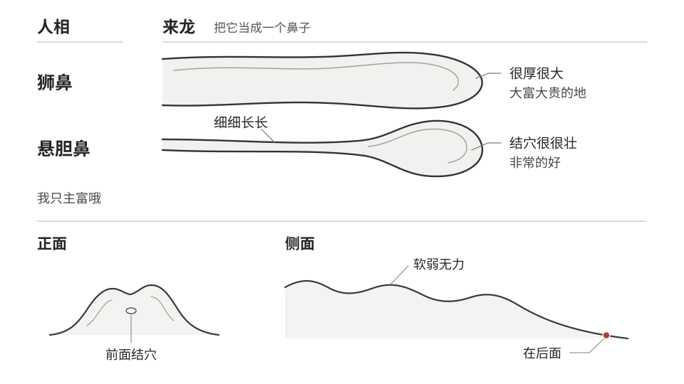 〔口述〕这两种鼻都主富，倪师说到「大富」。他把断语限在钱财上，又特意说「但是绝对没有说有钱人就是对的哦」。（[00:19:22–00:19:44](https://www.bilibili.com/video/BV1KJsLekEfA/?p=33&t=1162)，第 34860–35537 帧） 〔板书〕第二个圈号下也有一列竖字，下部可辨「胆」「鼻」。两列字的下方有一道向中间凹下的弯线。（[00:19:26](https://www.bilibili.com/video/BV1KJsLekEfA/?p=33&t=1166)，第 34992 帧） |
| **怎样的来龙像悬胆鼻，怎样的像狮鼻？** | 〔口述〕把整个山龙下来的势头「当成一个鼻子」。山势细细长长地过来，到后面结穴的地方却很壮，倪师把这种形叫悬胆，说「非常的好」。（[00:19:46–00:20:00](https://www.bilibili.com/video/BV1KJsLekEfA/?p=33&t=1186)，第 35586–36005 帧） 〔口述〕如果龙脉来得很厚、很大，整个山势很壮大地过来，就「像狮鼻一样」。倪师接着断「这种都是大富大贵的地呀」。（[00:20:01–00:20:10](https://www.bilibili.com/video/BV1KJsLekEfA/?p=33&t=1201)，第 36042–36323 帧） 〔板书〕黑板中部的轮廓上端宽圆，里面还有一道向内回弯的线。外缘往下收窄，接成两道细长的线。（[00:20:06](https://www.bilibili.com/video/BV1KJsLekEfA/?p=33&t=1206)，第 36180 帧） |
| **前面看见结穴，换到侧面还看什么？** | 〔口述〕这个例子前面看得见结穴，可是来龙「很软弱无力」。倪师让人从正面、侧面都看，讲到侧面时，说山势这样下来，又说在后面结穴。（[00:20:13–00:20:32](https://www.bilibili.com/video/BV1KJsLekEfA/?p=33&t=1213)，第 36396–36989 帧） 〔板书〕黑板上「鼻」字的两旁有向外鼓出的弧线，里面还有较短的弯线，右边的外缘往下弯回来。（[00:20:25](https://www.bilibili.com/video/BV1KJsLekEfA/?p=33&t=1225)，第 36768 帧） 〔指代〕讲到后面结穴，说「这边」时，手指的是整幅画面右侧中部的黑板。（[00:20:32](https://www.bilibili.com/video/BV1KJsLekEfA/?p=33&t=1232)，第 36962 帧） 〔板书〕黑板上方有一道长弧。下方左边露出一段起伏线，右边露出一段斜向右下的曲线，末端有个小圈，中间被身体挡住。（[00:20:34](https://www.bilibili.com/video/BV1KJsLekEfA/?p=33&t=1234)，第 37034 帧） |
| **三曲鼻与哪一种嘴同断，断语是什么？** | 〔口述〕倪师把刚才讲的形放回人相来比，叫「三曲鼻」，鼻有三曲。他说「这种跟吹火嘴一样」，断语是「孤坐啊孤坐到老」。（[00:20:36–00:20:57](https://www.bilibili.com/video/BV1KJsLekEfA/?p=33&t=1236)，第 37092–37727 帧） 〔板书〕黑板上方横写着「孤坐到老」。右边的起伏线下可辨竖排的「三」「曲」，再往下被衣袖挡住。（[00:20:54](https://www.bilibili.com/video/BV1KJsLekEfA/?p=33&t=1254)，第 37626 帧） 〔口述〕讲完三曲鼻，倪师把话收回来龙。看一条来龙是什么形，就看它的山势，他说「来龙的形就是看它的这个山势很重要」。（[00:20:57–00:21:07](https://www.bilibili.com/video/BV1KJsLekEfA/?p=33&t=1257)，第 37728–38027 帧） |
| **什么时候用天星四贵，北京一例从哪里看？** | 〔口述〕倪师说，过去帝师替皇帝找建立国都的地方，要看天星四贵。他举北京和西安为例，说「这两个地方就有天星四贵」。（[00:21:07–00:21:31](https://www.bilibili.com/video/BV1KJsLekEfA/?p=33&t=1267)，第 38028–38759 帧） 〔口述〕先看龙聚集在哪里，明堂也在这里。倪师拿北京来讲，把观察点放在北京中心，人站在紫禁城里面，看「周围的山势是什么」。（[00:21:33–00:21:47](https://www.bilibili.com/video/BV1KJsLekEfA/?p=33&t=1293)，第 38808–39221 帧） 〔指代〕讲明堂的位置，说「这边」时，手指的是整幅画面上方中央的黑板。（[00:21:37](https://www.bilibili.com/video/BV1KJsLekEfA/?p=33&t=1297)，第 38934 帧） 〔板书〕黑板左上方的长方框里写着「天星四贵」。往右下另有一个小方框，里面写「北京」，框外有一道大弧线向左下弯。（[00:21:46](https://www.bilibili.com/video/BV1KJsLekEfA/?p=33&t=1306)，第 39192 帧） 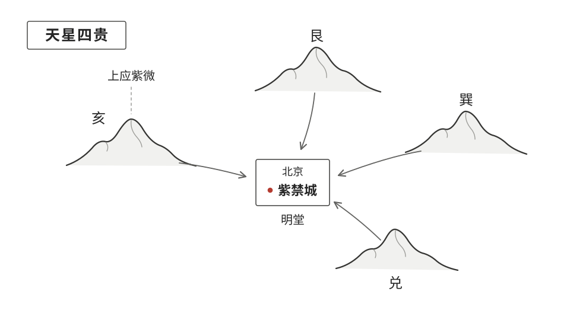 |
| **看国运时，贵砂要有多大、落在哪里？** | 〔口述〕看周围山势时，倪师特别限定贵砂的位置，说「一定要在它有特定的几个位置上」，这些位置要有贵砂。（[00:21:47–00:21:55](https://www.bilibili.com/video/BV1KJsLekEfA/?p=33&t=1307)，第 39222–39455 帧） 〔口述〕讲到国运，倪师说「这个砂都很大是个山头」，这样的山峦叫峦头。特定的几个位置上有这几座山，他称为天星四贵。（[00:21:55–00:22:14](https://www.bilibili.com/video/BV1KJsLekEfA/?p=33&t=1315)，第 39456–40025 帧） |
| **罗经上哪四方要各有来龙，山势往哪里聚？** | 〔口述〕倪师让学生拿出笔记「看第八页」，念出「亥艮巽兑卦」。再把罗经打开看，上面「有二十四个坐山」。（[00:22:14–00:23:00](https://www.bilibili.com/video/BV1KJsLekEfA/?p=33&t=1334)，第 40026–41411 帧） 〔口述〕看亥、艮、巽、兑四方，各方各有一个山龙。他解释来龙就是「山势往这边来」，四方的山势聚到同一个地方。（[00:23:00–00:23:12](https://www.bilibili.com/video/BV1KJsLekEfA/?p=33&t=1380)，第 41412–41771 帧） 〔指代〕讲山势往这里聚，说「这边」时，手指的是整幅画面上方中央的黑板，那里可见「艮」字。（[00:23:11](https://www.bilibili.com/video/BV1KJsLekEfA/?p=33&t=1391)，第 41733 帧） 〔指代〕紧接着说「这个」地方时，手指的是整幅画面右侧中部的黑板。（[00:23:11](https://www.bilibili.com/video/BV1KJsLekEfA/?p=33&t=1391)，第 41748 帧） 〔口述〕一块地占有刚才讲的这四个角，倪师据此判断，说它「适合做国都」。（[00:23:12–00:23:21](https://www.bilibili.com/video/BV1KJsLekEfA/?p=33&t=1392)，第 41772–42053 帧） |
| **南京也有天星四贵，为什么仍不宜作首都？** | 〔口述〕倪师说南京也有天星四贵，风水很好，只是「太秀丽」。他判断南京不宜作首都，理由是「因为秀的不能持久」。（[00:23:26–00:23:45](https://www.bilibili.com/video/BV1KJsLekEfA/?p=33&t=1406)，第 42180–42755 帧） 〔口述〕他用年龄来比这个「秀」字。说一个女孩子十八岁时「秀色可餐」，他让人到「四十八岁再去看」，借两次所见来讲持久。（[00:23:45–00:23:56](https://www.bilibili.com/video/BV1KJsLekEfA/?p=33&t=1425)，第 42756–43091 帧） 〔口述〕倪师接着引《易经》说「柔呢不足以持久」，又说「一定要刚柔并济比较好」，太刚也不好。（[00:23:56–00:24:05](https://www.bilibili.com/video/BV1KJsLekEfA/?p=33&t=1436)，第 43092–43379 帧） 〔板书〕黑板上写着「24」，下方竖写「坐山」。数字右边另画了一个圈，圈里可辨「秀」字。（[00:23:59](https://www.bilibili.com/video/BV1KJsLekEfA/?p=33&t=1439)，第 43180 帧） |
| **西安、北平的来龙与南京差在哪里？** | 〔口述〕讲国都为什么常在北方，倪师点出西安、北平。他说那里的山龙来得「非常的雄伟壮观」，这样的地方适合做国都。（[00:24:06–00:24:16](https://www.bilibili.com/video/BV1KJsLekEfA/?p=33&t=1446)，第 43380–43709 帧） 〔指代〕从山龙雄伟讲到适合做国都，说「这个」时，手指的是整幅画面左侧中部的黑板。（[00:24:13](https://www.bilibili.com/video/BV1KJsLekEfA/?p=33&t=1453)，第 43596 帧） 〔板书〕「北京」的小方框外有一道大弧线，沿弧圈着几个字。方框上方的圈里可辨「艮」，右下方的圈里可辨「兑」。（[00:24:14](https://www.bilibili.com/video/BV1KJsLekEfA/?p=33&t=1454)，第 43630 帧） 〔口述〕倪师再拿南京来比。同样是四个峦头都很好的地方，他要分辨的还有一层，就是「这个山势不一样」。（[00:24:17–00:24:27](https://www.bilibili.com/video/BV1KJsLekEfA/?p=33&t=1457)，第 43710–44021 帧） |
| **亥坐山上应什么，倪师随后还念了哪些名称？** | 〔口述〕讲四贵中的亥，倪师让人设想站在北京正中心的紫禁城，往亥坐山的方向看。他说亥在北方，天上有二十八宿，讲到亥的正顶时说「上面应紫微」。（[00:24:27–00:24:46](https://www.bilibili.com/video/BV1KJsLekEfA/?p=33&t=1467)，第 44022–44597 帧） 〔板书〕黑板中间偏右的小方框里写着「北京」，框内字上又套了一圈粉笔线。方框上方另有一个圈，里面可辨「艮」。（[00:24:38](https://www.bilibili.com/video/BV1KJsLekEfA/?p=33&t=1478)，第 44340 帧） 〔指代〕讲亥上应的天星，说「这个」时，手指的是整幅画面中央的黑板。（[00:24:46](https://www.bilibili.com/video/BV1KJsLekEfA/?p=33&t=1486)，第 44602 帧） 〔口述〕倪师说会把天上的二十八宿写给学生。随后提到紫微、天市垣、太微垣和少微，又说太微垣还有一个叫法，接着收回到天星四贵。（[00:24:48–00:25:03](https://www.bilibili.com/video/BV1KJsLekEfA/?p=33&t=1488)，第 44658–45113 帧） 〔指代〕收回到天星四贵，说「这个」时，手指的是整幅画面中央的黑板。（[00:25:03](https://www.bilibili.com/video/BV1KJsLekEfA/?p=33&t=1503)，第 45111 帧） |
| **换成自家祖坟的例子，到坟地要看什么？** | 〔口述〕倪师先说「有这个四个贵的话那不得了」，接着让学生设想，自己刚好到了自家的祖坟，在坟地实地测一测。（[00:25:03–00:25:09](https://www.bilibili.com/video/BV1KJsLekEfA/?p=33&t=1503)，第 45114–45293 帧） 〔口述〕到了坟地打开一看，他举的情形是刚才讲的四个方位都见山头，原话是「这四个方向居然都有峦头」。（[00:25:09–00:25:13](https://www.bilibili.com/video/BV1KJsLekEfA/?p=33&t=1509)，第 45294–45419 帧） |

**总结区**

- 通用规则：倪师把细长而来、结穴处壮的山势比作悬胆鼻，把厚大壮阔的来势比作狮鼻。（[00:19:51–00:20:07](https://www.bilibili.com/video/BV1KJsLekEfA/?p=33&t=1191)，第 35742–36227 帧）；在倪师的人相比喻里，三曲鼻与吹火嘴同断「孤坐到老」。（[00:20:36–00:20:57](https://www.bilibili.com/video/BV1KJsLekEfA/?p=33&t=1236)，第 37092–37727 帧）；亥、艮、巽、兑四方各有山龙向同一处聚，是倪师判断一地适合建都的条件。（[00:22:37–00:23:21](https://www.bilibili.com/video/BV1KJsLekEfA/?p=33&t=1357)，第 40722–42053 帧）；倪师论建都山势时，引《易经》说「柔呢不足以持久」，又说「一定要刚柔并济比较好」，太刚也不好。（[00:23:56–00:24:05](https://www.bilibili.com/video/BV1KJsLekEfA/?p=33&t=1436)，第 43092–43379 帧）
- 只在本例：倪师举北京、西安为有天星四贵的两处地方。（[00:21:26–00:21:31](https://www.bilibili.com/video/BV1KJsLekEfA/?p=33&t=1286)，第 38598–38759 帧）；南京虽有天星四贵，倪师认为它的风水太秀丽，不宜作首都。（[00:23:26–00:23:45](https://www.bilibili.com/video/BV1KJsLekEfA/?p=33&t=1406)，第 42180–42755 帧）；倪师认为西安、北平的山龙来得雄伟壮观，适合做国都。（[00:24:06–00:24:16](https://www.bilibili.com/video/BV1KJsLekEfA/?p=33&t=1446)，第 43380–43709 帧）；祖坟一段举的是假例，设想在自家坟地测到四个方向都有峦头。（[00:25:06–00:25:13](https://www.bilibili.com/video/BV1KJsLekEfA/?p=33&t=1506)，第 45186–45419 帧）
- 不是风水规则，是处世方法：谈一个人会有钱，倪师把话限在钱财上，把这个人做得对不对留作另一个问题。（[00:19:30–00:19:44](https://www.bilibili.com/video/BV1KJsLekEfA/?p=33&t=1170)，第 35112–35537 帧）

**待核**

1. 开头板面左下有弧线和几个小圈，圈内的笔画辨不清。（[00:18:56](https://www.bilibili.com/video/BV1KJsLekEfA/?p=33&t=1136)，第 34104 帧）
2. 字幕写「你如果认为有钱人都是对的」，语音转写作「认为有钱人不是对的」，这句的肯否待核。（[00:19:33](https://www.bilibili.com/video/BV1KJsLekEfA/?p=33&t=1173)，第 35202 帧）
3. 字幕作「过狭」，语音转写作「过辖」，这个词的写法和所指待核。（[00:19:44](https://www.bilibili.com/video/BV1KJsLekEfA/?p=33&t=1184)，第 35538 帧）
4. 字幕在这里作「玄胆」，语音转写作「悬胆」，笔记沿用前面「悬胆鼻」的写法。（[00:19:56](https://www.bilibili.com/video/BV1KJsLekEfA/?p=33&t=1196)，第 35892 帧）
5. 字幕开头的「称称沩」不成句，语音转写只接上「富大贵」，前几个字待核。（[00:20:10](https://www.bilibili.com/video/BV1KJsLekEfA/?p=33&t=1210)，第 36324 帧）
6. 转讲天星四贵时，新写的一行被身体挡去大半，只露出右端和下方横线。（[00:21:14](https://www.bilibili.com/video/BV1KJsLekEfA/?p=33&t=1274)，第 38220 帧）
7. 讲明堂时，指代能定位到黑板上方中央，具体哪一段线标出明堂的范围仍看不出。（[00:21:37](https://www.bilibili.com/video/BV1KJsLekEfA/?p=33&t=1297)，第 38934 帧）
8. 讲贵砂后，黑板右上方刚写的位置被头和手遮住，字迹认不全。（[00:21:55](https://www.bilibili.com/video/BV1KJsLekEfA/?p=33&t=1315)，第 39462 帧）
9. 字幕列四方时写作「交方」，依前面念的「亥艮巽兑卦」和本句语音「嗨方」，记作亥方。（[00:23:00](https://www.bilibili.com/video/BV1KJsLekEfA/?p=33&t=1380)，第 41412 帧）
10. 字幕到「四十八岁再去看」为止，语音另有「五十八岁在这看」，后一个年龄待核。（[00:23:50](https://www.bilibili.com/video/BV1KJsLekEfA/?p=33&t=1430)，第 42912 帧）
11. 字幕写「亥宫」，语音转写作「亥座」，随后接到亥坐山的方向，这一句的末字待核。（[00:24:32](https://www.bilibili.com/video/BV1KJsLekEfA/?p=33&t=1472)，第 44160 帧）
12. 倪师用「星头」讲亥上应紫微，本块未解释「星头」具体指什么。（[00:24:44](https://www.bilibili.com/video/BV1KJsLekEfA/?p=33&t=1484)，第 44532 帧）
13. 字幕写「紫微垣」，语音转写作「紫围星」，名称的末字待核。（[00:24:52](https://www.bilibili.com/video/BV1KJsLekEfA/?p=33&t=1492)，第 44784 帧）
14. 字幕和语音都重复念到少微，这几句没有逐一交代艮、巽、兑与所举星名的对应。（[00:24:56](https://www.bilibili.com/video/BV1KJsLekEfA/?p=33&t=1496)，第 44904 帧）
15. 太微垣的别称，字幕写作「太乙」，语音转写作「太好」，末字待核。（[00:24:59](https://www.bilibili.com/video/BV1KJsLekEfA/?p=33&t=1499)，第 44982 帧）

### 5　九曲入明堂与来水的四个要点（[00:25:14–00:31:21](https://www.bilibili.com/video/BV1KJsLekEfA/?p=33&t=1514)，第 45420–56459 帧）

| 提示区 | 笔记区 |
|---|---|
| **天星四贵到齐，再见九曲来水怎么断？** | 〔口述〕倪师称天星四贵到齐为「大贵之地」。就四周的地脉来说，这是他认为最好的情形。（[00:25:14–00:25:24](https://www.bilibili.com/video/BV1KJsLekEfA/?p=33&t=1514)，第 45420–45749 帧） 〔板书〕黑板右上可辨「贵砂」。一条大弧线穿过几个小圈，上方圈内可辨「艮」，右侧圈内可辨「巽」。弧线内还有一个方框，框里的字认不全。（[00:25:14](https://www.bilibili.com/video/BV1KJsLekEfA/?p=33&t=1514)，第 45449 帧） 〔口述〕在这样的大贵之地，再看来水怎么进明堂。倪师把水路的弯从一数到九，叫作「九曲入明堂」。他对此的断语是「就要出天子了」，也就是出帝王。（[00:25:25–00:25:45](https://www.bilibili.com/video/BV1KJsLekEfA/?p=33&t=1525)，第 45750–46361 帧） |
| **谈到北京和西安，黄河改道有什么关系？** | 〔口述〕倪师说以前的帝王喜欢待在北京。至于以后会不会迁到西安，他说要「慢慢看它的局势的改变」。（[00:25:45–00:25:54](https://www.bilibili.com/video/BV1KJsLekEfA/?p=33&t=1545)，第 46362–46643 帧） 〔口述〕倪师说「最好是黄河改一道」，接着说「可能就会迁到西安去了」。他又说黄河从前有一次改错了道，改完「走南龙」，才会出那么多事。（[00:25:54–00:26:07](https://www.bilibili.com/video/BV1KJsLekEfA/?p=33&t=1554)，第 46644–47039 帧） |
| **溪南山的行馆，要站在哪里看九曲？** | 〔口述〕倪师举台湾的溪南山为例，说从宜兰往梨山去，中间有个地方叫苗圃。（[00:26:08–00:26:21](https://www.bilibili.com/video/BV1KJsLekEfA/?p=33&t=1568)，第 47040–47453 帧） 〔指代〕说苗圃「这个」地方时，手指的是黑板，落在整幅画面上排中间的第2格。（[00:26:21](https://www.bilibili.com/video/BV1KJsLekEfA/?p=33&t=1581)，第 47434 帧） 〔口述〕溪南山一带有以前老总统的行馆。站在别墅的院子里，能看见水弯过来，倪师说「一看就是九曲入明堂」，也说那个地方很漂亮。（[00:26:21–00:26:49](https://www.bilibili.com/video/BV1KJsLekEfA/?p=33&t=1581)，第 47454–48299 帧） |
| **选阴宅、定国都、找住处，共同要看什么？** | 〔口述〕倪师先点出六秀、三吉、四垣，说等到介绍罗经的时候，再给大家讲这几个名目。（[00:26:50–00:27:00](https://www.bilibili.com/video/BV1KJsLekEfA/?p=33&t=1610)，第 48300–48605 帧） 〔板书〕黑板上方可辨「来」，右边只露出几笔，其余部分被倪师的头挡住，字认不全。（[00:26:58](https://www.bilibili.com/video/BV1KJsLekEfA/?p=33&t=1618)，第 48548 帧） 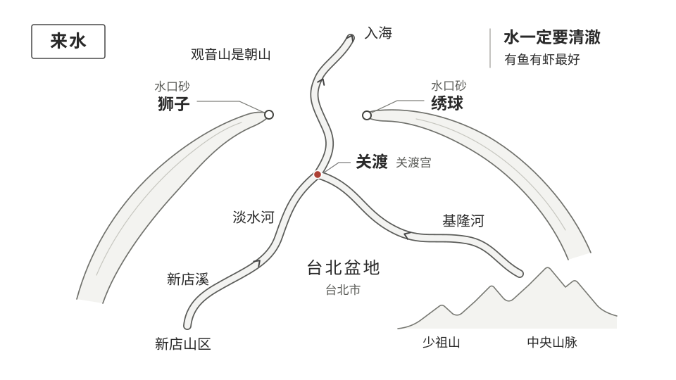 〔口述〕接着转讲水。看阴宅、定国都、给人找住处，倪师说这些地方「一定要有水嘛」，理由是人离开水就无法生存。（[00:27:00–00:27:20](https://www.bilibili.com/video/BV1KJsLekEfA/?p=33&t=1620)，第 48606–49211 帧） 〔板书〕黑板左上可辨「来水」，其中「水」字单独圈了起来。下面有两笔弧线，往上收成一个尖。（[00:27:16](https://www.bilibili.com/video/BV1KJsLekEfA/?p=33&t=1636)，第 49104 帧） |
| **台北盆地的山脉和两路来水怎么走？** | 〔口述〕倪师从中央山脉讲起，一路下来到了少祖山，再到台北盆地，随即就着图说「台北市在这里」。（[00:27:20–00:27:34](https://www.bilibili.com/video/BV1KJsLekEfA/?p=33&t=1640)，第 49212–49649 帧） 〔指代〕说「这个」时手指的是黑板，在画面下排中间的第8格。当时口里说的是中央山脉。（[00:27:20](https://www.bilibili.com/video/BV1KJsLekEfA/?p=33&t=1640)，第 49219 帧） 〔板书〕黑板上左右各有一组弧线，往上各收成一个尖，两尖相对，中间留着空隙。下方有一部分被遮住。（[00:27:32](https://www.bilibili.com/video/BV1KJsLekEfA/?p=33&t=1652)，第 49584 帧） 〔口述〕新店山区的水流下来，从新店溪出来，倪师称为淡水河。另一边来的是基隆河，两路水会在关渡。（[00:27:35–00:27:46](https://www.bilibili.com/video/BV1KJsLekEfA/?p=33&t=1655)，第 49650–49997 帧） 〔指代〕说「这个」时手指的是黑板，落在画面下排中间的第8格。当时讲的是从另一边来的基隆河。（[00:27:42](https://www.bilibili.com/video/BV1KJsLekEfA/?p=33&t=1662)，第 49870 帧） |
| **关渡两边的水口砂各叫什么？** | 〔口述〕倪师说关渡两边有水口砂，先讲一处，说「这个水口砂就叫做狮子」，接着把另一处叫作绣球。（[00:27:44–00:27:54](https://www.bilibili.com/video/BV1KJsLekEfA/?p=33&t=1664)，第 49926–50237 帧） 〔板书〕左边弧线的上端画了一个小圈，圈的上方有几笔粉笔字。倪师的手遮住了一部分，字认不全。（[00:27:47](https://www.bilibili.com/video/BV1KJsLekEfA/?p=33&t=1667)，第 50033 帧） 〔指代〕说「这个」时手指的是黑板，在画面正中的第5格。当时他正把这一处水口砂叫作狮子。（[00:27:49](https://www.bilibili.com/video/BV1KJsLekEfA/?p=33&t=1669)，第 50086 帧） |
| **说到关渡宫和观音山，水接下来怎样走？** | 〔口述〕倪师先在图前说关渡宫就在这里，接着说「观音山是朝山」。再顺着刚才讲的水路往外，水最后流入海。（[00:27:54–00:28:04](https://www.bilibili.com/video/BV1KJsLekEfA/?p=33&t=1674)，第 50238–50549 帧） 〔指代〕说关渡宫在「这里」时，手指的是黑板，落在整幅画面正中的第5格。（[00:27:55](https://www.bilibili.com/video/BV1KJsLekEfA/?p=33&t=1675)，第 50264 帧） 〔板书〕左右两侧弧线的上端各有一个小圈，两圈之间另有弯线。两处小圈上方各有粉笔字，字迹认不全。（[00:27:55](https://www.bilibili.com/video/BV1KJsLekEfA/?p=33&t=1675)，第 50267 帧） 〔指代〕由讲观音山转到讲水，说「这个」时，手指的也是黑板，在画面正中的第5格。具体指到哪条线，标注没有写明。（[00:28:00](https://www.bilibili.com/video/BV1KJsLekEfA/?p=33&t=1680)，第 50407 帧） |
| **台北两条河怎样说明来水的第一条要求？** | 〔口述〕看来水，倪师把清澈列在第一位，说「水一定要清澈」。水里如果还有鱼、有虾，他认为最好。（[00:28:05–00:28:20](https://www.bilibili.com/video/BV1KJsLekEfA/?p=33&t=1685)，第 50550–51017 帧） 〔板书〕黑板左边弧线旁可辨「朝山」。右上方有圈起的序号，行末可辨「有鱼」，中间有字被倪师的头遮住。（[00:28:18](https://www.bilibili.com/video/BV1KJsLekEfA/?p=33&t=1698)，第 50940 帧） 〔口述〕他以当时台北的基隆河、淡水河为例，说想抓条鱼、抓条虾却抓不到，水已经被污染了。他把这样的水叫作「浊水」。（[00:28:24–00:28:39](https://www.bilibili.com/video/BV1KJsLekEfA/?p=33&t=1704)，第 51120–51593 帧） |
| **倪师说的「浊富」指怎样的人？** | 〔口述〕由河水的清浊讲到财，倪师说「这个水是管财」，用水太浊来解释他所说的台北市有许多「浊富之人」。（[00:28:39–00:28:49](https://www.bilibili.com/video/BV1KJsLekEfA/?p=33&t=1719)，第 51594–51887 帧） 〔口述〕他用「浊富」说的是这样的人，书念得少，粗鲁、土气，却很有钱，连利息都用不完。自己不求进步，玩了一天，回家还在想第二天玩什么。（[00:28:49–00:29:09](https://www.bilibili.com/video/BV1KJsLekEfA/?p=33&t=1729)，第 51888–52487 帧） 〔口述〕他让学生想一想，要是全台湾人人都这样过日子会怎样。他自己的回答是「马上就完蛋了」。（[00:29:09–00:29:16](https://www.bilibili.com/video/BV1KJsLekEfA/?p=33&t=1749)，第 52488–52709 帧） |
| **河水被人弄浊，又怎样用人力改变？** | 〔口述〕倪师说台北明堂的水被人弄坏了。假如市政府整治基隆河、淡水河，让河水重新变清，在风水上「就是用人力去改变它」。（[00:29:21–00:29:33](https://www.bilibili.com/video/BV1KJsLekEfA/?p=33&t=1761)，第 52842–53219 帧） 〔口述〕他回忆以前的水很清，他们到淡水河去能抓到鱼，鱼还很多。讲到从前的生活，他也提到那时很节约。（[00:29:34–00:29:42](https://www.bilibili.com/video/BV1KJsLekEfA/?p=33&t=1774)，第 53220–53483 帧） 〔口述〕随后他提到梅花山，说梅花山已经成了历史，又说「你还在讲梅花山你活在历史里面」。（[00:29:42–00:29:50](https://www.bilibili.com/video/BV1KJsLekEfA/?p=33&t=1782)，第 53484–53717 帧） |
| **什么样的河道叫「有情」？** | 〔口述〕看来水的第二条，是河道要有弯。倪师引风水地师的说法，「只要河有曲道就代表有情」。（[00:29:53–00:30:11](https://www.bilibili.com/video/BV1KJsLekEfA/?p=33&t=1793)，第 53808–54335 帧） 〔板书〕黑板上钉着的纸右边，圈着一个「2」。它下面竖写两个字，从上往下可辨为「曲」「道」。（[00:29:59](https://www.bilibili.com/video/BV1KJsLekEfA/?p=33&t=1799)，第 53993 帧） 〔口述〕他拿爱情作比，说爱情也会歪歪扭扭、迂回曲折，走得很辛苦，借这个比方再说河道要曲。（[00:30:11–00:30:20](https://www.bilibili.com/video/BV1KJsLekEfA/?p=33&t=1811)，第 54336–54617 帧） |
| **门前看水，水声和水的来去各怎样才好？** | 〔口述〕水要无声。家门口若有一条河，晚上睡觉听得到河水唰唰地流，这就叫有声。倪师把这种有声的水称为「悲吟水」。（[00:30:20–00:30:43](https://www.bilibili.com/video/BV1KJsLekEfA/?p=33&t=1820)，第 54618–55295 帧） 〔口述〕他说到第四条，看的是水的来去。「不见水来不见水去」，是他评为最佳的情形。（[00:30:50–00:31:03](https://www.bilibili.com/video/BV1KJsLekEfA/?p=33&t=1850)，第 55512–55913 帧） 〔口述〕他重申无声就是听不到水声。他去过一户人家，院里做了水池，还故意让水落下来时很响，他说本来很好，这么一做就搅和了。屋主说是「另外一个风水师叫他看的」。（[00:31:03–00:31:21](https://www.bilibili.com/video/BV1KJsLekEfA/?p=33&t=1863)，第 55914–56459 帧） |

**总结区**

- 通用规则：倪师称天星四贵到齐为大贵之地，若再有九曲来水入明堂，他断为出天子。（[00:25:14–00:25:45](https://www.bilibili.com/video/BV1KJsLekEfA/?p=33&t=1514)，第 45420–46361 帧）；看来水先要清澈，水中有鱼有虾最好。（[00:28:05–00:28:20](https://www.bilibili.com/video/BV1KJsLekEfA/?p=33&t=1685)，第 50550–51017 帧）；倪师引地师的说法，河道有曲折就代表有情。（[00:29:53–00:30:11](https://www.bilibili.com/video/BV1KJsLekEfA/?p=33&t=1793)，第 53808–54335 帧）；水要无声，有声称为悲吟水，水的来去以「不见水来不见水去」为最佳。（[00:30:20–00:31:03](https://www.bilibili.com/video/BV1KJsLekEfA/?p=33&t=1820)，第 54618–55913 帧）
- 只在本例：谈到北京和西安时，倪师说「最好是黄河改一道」，接着说「可能就会迁到西安去了」。（[00:25:45–00:25:58](https://www.bilibili.com/video/BV1KJsLekEfA/?p=33&t=1545)，第 46362–46757 帧）；倪师说，站在溪南山一带老总统行馆的院子里，就能看见他所说的九曲入明堂。（[00:26:21–00:26:33](https://www.bilibili.com/video/BV1KJsLekEfA/?p=33&t=1581)，第 47454–47801 帧）；台北这例中，淡水河与基隆河会在关渡，两边水口砂称狮子、绣球，观音山称朝山。（[00:27:35–00:28:00](https://www.bilibili.com/video/BV1KJsLekEfA/?p=33&t=1655)，第 49650–50417 帧）；倪师以台北举例，若市政府能把基隆河、淡水河整治清澈，就是用人力改变当地的风水。（[00:29:21–00:29:33](https://www.bilibili.com/video/BV1KJsLekEfA/?p=33&t=1761)，第 52842–53219 帧）

**待核**

1. 开头板面的大弧线右下圈内字、弧线内方框里的字，都认不全。（[00:25:14](https://www.bilibili.com/video/BV1KJsLekEfA/?p=33&t=1514)，第 45449 帧）
2. 黄河改道年份，字幕作「1048年」，语音作「1018年」，具体年份待核。（[00:25:58](https://www.bilibili.com/video/BV1KJsLekEfA/?p=33&t=1558)，第 46758 帧）
3. 倪师说改道后「走南龙」，本块没有说明南龙的具体走向。（[00:26:00](https://www.bilibili.com/video/BV1KJsLekEfA/?p=33&t=1560)，第 46812 帧）
4. 溪南山、宜兰、梨山、苗圃沿用字幕，语音分别作「西南山」「宜南」「离山」「苗浦」，地名用字待核。（[00:26:09–00:26:19](https://www.bilibili.com/video/BV1KJsLekEfA/?p=33&t=1569)，第 47094–47393 帧）
5. 六秀、三吉、四垣的名称取自字幕，语音转写作「六锈三级二四环」，本块未讲其含义。（[00:26:50](https://www.bilibili.com/video/BV1KJsLekEfA/?p=33&t=1610)，第 48300 帧）
6. 刚写的字只露出「来」和右边几笔，右半被头遮住。（[00:26:58](https://www.bilibili.com/video/BV1KJsLekEfA/?p=33&t=1618)，第 48548 帧）
7. 字幕作「在阳阴宅上面」，本句语音缺失，稍早的语音转写作「在阴宅上面」，是否还提到阳宅待核。（[00:27:03](https://www.bilibili.com/video/BV1KJsLekEfA/?p=33&t=1623)，第 48708 帧）
8. 「少祖山」用来说明从中央山脉到台北盆地的次序，本块未讲怎样辨认少祖山。（[00:27:23](https://www.bilibili.com/video/BV1KJsLekEfA/?p=33&t=1643)，第 49302 帧）
9. 字幕作「台北盆地」，语音作「台北平地」，此处沿用字幕。（[00:27:26](https://www.bilibili.com/video/BV1KJsLekEfA/?p=33&t=1646)，第 49392 帧）
10. 新店山区来水，字幕说「上面流下来的水」，语音作「下面留下来的水」，上、下方位待核。（[00:27:35](https://www.bilibili.com/video/BV1KJsLekEfA/?p=33&t=1655)，第 49650 帧）
11. 关渡例中用到水口砂、朝山，本块只指名了实例，未说明怎样辨认。（[00:27:46–00:28:00](https://www.bilibili.com/video/BV1KJsLekEfA/?p=33&t=1666)，第 49998–50417 帧）
12. 两处小圈旁的字先被手挡住，手移开后笔画仍难辨，狮子、绣球的名称取自口述。（[00:27:47–00:27:55](https://www.bilibili.com/video/BV1KJsLekEfA/?p=33&t=1667)，第 50033–50267 帧）
13. 「这个」落在讲观音山一句的末尾，语音已经接到「这个水」，能确定指向黑板，具体哪一段线待核。（[00:28:00](https://www.bilibili.com/video/BV1KJsLekEfA/?p=33&t=1680)，第 50407 帧）
14. 右上方「有鱼」前面的字被遮住，整行粉笔字认不全。（[00:28:18](https://www.bilibili.com/video/BV1KJsLekEfA/?p=33&t=1698)，第 50940 帧）
15. 讲浊富之人的日常时，字幕作「每天就是在那边花钱」，语音作「每天就是在这发展自己」，这句具体说法待核。（[00:28:55](https://www.bilibili.com/video/BV1KJsLekEfA/?p=33&t=1735)，第 52056 帧）
16. 回忆抓鱼后的「新店」只见于这句字幕，随后提到的梅花山具体指什么，本块也没有说明。（[00:29:39–00:29:50](https://www.bilibili.com/video/BV1KJsLekEfA/?p=33&t=1779)，第 53394–53717 帧）
17. 第二条语音作「渠道」，字幕作「曲道」，笔记取与板书相合的「曲道」。（[00:29:53–00:29:59](https://www.bilibili.com/video/BV1KJsLekEfA/?p=33&t=1793)，第 53808–53993 帧）
18. 有声之水的名称，字幕作「悲吟水」，语音作「飞饮水」，笔记沿用字幕，用字待核。（[00:30:37](https://www.bilibili.com/video/BV1KJsLekEfA/?p=33&t=1837)，第 55116 帧）
19. 倪师一度连说「第四个第五个」，随后明确讲的是第四个，本块没有另列第五条。（[00:30:47–00:30:52](https://www.bilibili.com/video/BV1KJsLekEfA/?p=33&t=1847)，第 55410–55589 帧）
20. 字幕作「改一道」，语音转写作「改一步」，笔记沿用字幕，「道」字待核。（[00:25:54–00:25:56](https://www.bilibili.com/video/BV1KJsLekEfA/?p=33&t=1554)，第 46644–46685 帧）

### 6　看宅水、分泉水、辨真假龙（[00:31:22–00:37:34](https://www.bilibili.com/video/BV1KJsLekEfA/?p=33&t=1882)，第 56460–67649 帧）

| 提示区 | 笔记区 |
|---|---|
| **在家听水、站在门口看水，各要留意什么？** | 〔口述〕倪师说，在家里不能听到水声。他举台北市盆地为例，河水若哗哗作响，在风水上就不好。他用的断语是「悲吟水主绝后」，即没有后代。（[00:31:22–00:31:39](https://www.bilibili.com/video/BV1KJsLekEfA/?p=33&t=1882)，第 56460–56999 帧） 〔板书〕黑板偏左圈着「4」，下面竖写着字，开头可辨「不」。右上圈着「1」，右侧另有一道向右的箭头，中间有些字被倪师挡住，认不全。（[00:31:22](https://www.bilibili.com/video/BV1KJsLekEfA/?p=33&t=1882)，第 56460 帧） 〔口述〕他让学生设想站在家门口，能看清水从太平洋那边一路流来，又能看着它一路流走。来和去都看得清，他说「这个不是很好的地方」。（[00:31:44–00:31:58](https://www.bilibili.com/video/BV1KJsLekEfA/?p=33&t=1904)，第 57126–57551 帧） 〔口述〕他把「要看不到水来看不到水去」称作藏风纳气。人仍然知道水在动，只是听不见它流动的声音。（[00:31:58–00:32:10](https://www.bilibili.com/video/BV1KJsLekEfA/?p=33&t=1918)，第 57552–57911 帧） |
| **一滩死水也看不见来去，怎样辨出活水？** | 〔口述〕看不见来去，还得看水本身动不动。一滩死水也看不见来水，倪师仍说「死水的话不行」，又强调「一定要有活水」。（[00:32:10–00:32:28](https://www.bilibili.com/video/BV1KJsLekEfA/?p=33&t=1930)，第 57912–58457 帧） 〔口述〕讲旧时做宅怎样设水池，他举上海豫园，又说到中式四合院。院里看见的是一池水，水道却通到外面，所以池里是活水。（[00:32:28–00:32:47](https://www.bilibili.com/video/BV1KJsLekEfA/?p=33&t=1948)，第 58458–59021 帧） |
| **「家有死水主人丁败绝」省去了哪几层缘由？** | 〔口述〕倪师引「家有死水主人丁败绝」。他说古人刻竹简费力，「中间几句话没有加进去」，后来有读书人读到这句，便说风水是迷信。（[00:32:47–00:33:01](https://www.bilibili.com/video/BV1KJsLekEfA/?p=33&t=1967)，第 59022–59459 帧） 〔口述〕他把中间的经过补出来。死水容易聚苍蝇、蚊虫，人喝这种水容易生病，牛、猪喝了也容易病。他从蚊蝇带来的疾病讲到死亡，随后提醒学生体谅古人刻竹简的辛苦。（[00:33:06–00:33:29](https://www.bilibili.com/video/BV1KJsLekEfA/?p=33&t=1986)，第 59592–60287 帧） |
| **水性有什么要求，嘉泉和汤泉怎样分？** | 〔口述〕倪师先说「水的性基本上就一定要聚」，随后讲嘉泉。泉水出来很香，他以矿泉水为例，说这种水干净、清澈，给人喝对身体好，称为嘉泉。（[00:33:29–00:33:52](https://www.bilibili.com/video/BV1KJsLekEfA/?p=33&t=2009)，第 60288–60983 帧） 〔板书〕黑板上贴着的纸下方有一列粉笔字，上字可辨「嘉」，下一字的下半被画面字幕遮住。右侧另有圈起的「2」和「4」。（[00:33:41](https://www.bilibili.com/video/BV1KJsLekEfA/?p=33&t=2021)，第 60648 帧） 〔指代〕说「这个」时，手指的是黑板上写着「嘉泉」的位置，在整幅画面的下排中间。（[00:33:42](https://www.bilibili.com/video/BV1KJsLekEfA/?p=33&t=2022)，第 60662 帧） 〔口述〕阳明山上由地热喷出来的水，他称为汤泉，说「汤泉是形容热的」，还提醒学生不要跑去喝那里的水。（[00:33:53–00:34:04](https://www.bilibili.com/video/BV1KJsLekEfA/?p=33&t=2033)，第 61002–61349 帧） 〔口述〕还是举阳明山为例。倪师说，只要是活火山，又有汤泉，就「绝对没有龙穴」，不必到里面去找。（[00:34:05–00:34:12](https://www.bilibili.com/video/BV1KJsLekEfA/?p=33&t=2045)，第 61350–61565 帧） |
| **嘉泉闻起来、喝起来怎样，对后代又怎么断？** | 〔口述〕倪师说嘉泉「冬暖夏凉」。冒出来的水可以喝，闻起来没有臭味，还有香气，喝起来则是甜甜的。（[00:34:12–00:34:23](https://www.bilibili.com/video/BV1KJsLekEfA/?p=33&t=2052)，第 61566–61895 帧） 〔口述〕他把嘉泉与出大文豪连在一起，说历代许多文豪的家乡有嘉泉，又提到祖坟或住家。住家旁边有嘉泉，他说对后代子孙好，这里提到的是「笔墨文人」。（[00:34:23–00:34:38](https://www.bilibili.com/video/BV1KJsLekEfA/?p=33&t=2063)，第 61896–62351 帧） 〔口述〕单就水来说，他把嘉泉评为最好。接着他设想，台北市的基隆河、淡水河若要变得像矿泉水那么清，「很难呐很难」。（[00:34:38–00:34:52](https://www.bilibili.com/video/BV1KJsLekEfA/?p=33&t=2078)，第 62352–62789 帧） |
| **地师跑到几处看水，怎样认出真龙？** | 〔口述〕倪师说，礼拜天早上带学生去看时，有一个重点可以当场看。辨龙的真假，「就是用这水去看」。（[00:34:58–00:35:10](https://www.bilibili.com/video/BV1KJsLekEfA/?p=33&t=2098)，第 62946–63329 帧） 〔板书〕贴纸右侧的黑板上，上下分写着两个粉笔字，可辨上面是「真」，下面是「假」，右边留着一大片空处。（[00:35:06](https://www.bilibili.com/video/BV1KJsLekEfA/?p=33&t=2106)，第 63209 帧） 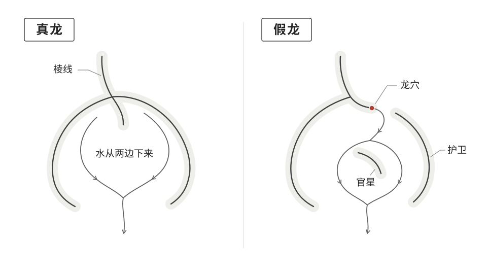 〔口述〕他举一个山势，让人看水从哪边下来，又从哪边出去。地师要跑到几处察看，见到这些水「都是由山聚集下来的水」，他才说「这叫做真龙」。（[00:35:11–00:35:34](https://www.bilibili.com/video/BV1KJsLekEfA/?p=33&t=2111)，第 63330–64037 帧） 〔指代〕讲水从哪边下来、出去，几次说「这边」，接着又说「这个」让人看水，手指的都是整幅画面中排右侧的黑板。（[00:35:17–00:35:25](https://www.bilibili.com/video/BV1KJsLekEfA/?p=33&t=2117)，第 63512–63755 帧） 〔板书〕黑板上可辨上行的「真龙」和下方的「假」。字的右边画了两道长弧，中间套着几道较短的回弯，另有一条曲线伸向右上方。（[00:35:32](https://www.bilibili.com/video/BV1KJsLekEfA/?p=33&t=2132)，第 63960 帧） |
| **前面多出官星时，为什么容易认错龙穴？** | 〔口述〕讲假龙时，倪师先交代水从这个地方出来，前面有个官星。他说「这是多出来一个山势」，又说这边也有官星过来。（[00:35:34–00:35:54](https://www.bilibili.com/video/BV1KJsLekEfA/?p=33&t=2134)，第 64038–64643 帧） 〔指代〕说「这个」地方水出来了、官星在「这里」，后来又说人站在「这里」，手指的都是整幅画面正中的黑板。具体落在哪一笔上看不清。（[00:35:37–00:35:55](https://www.bilibili.com/video/BV1KJsLekEfA/?p=33&t=2137)，第 64135–64669 帧） 〔口述〕人站在这里看，觉得两边都有水下来，容易把眼前这处认作龙穴。倪师说，看到的其实是从那个龙穴流出来的水。（[00:35:54–00:36:05](https://www.bilibili.com/video/BV1KJsLekEfA/?p=33&t=2154)，第 64644–64979 帧） 〔板书〕粉笔图上端有几道靠得很近的小弯线，倪师的手和粉笔遮住了其中一段。往下仍看得见外侧的长弧和中央的回弯。（[00:35:55](https://www.bilibili.com/video/BV1KJsLekEfA/?p=33&t=2155)，第 64661 帧） 〔口述〕他又让人看这一山势的右边。判断两边的山势是否相接时，他点明「这两个没有连在一起」。（[00:36:09–00:36:13](https://www.bilibili.com/video/BV1KJsLekEfA/?p=33&t=2169)，第 65094–65213 帧） |
| **真龙的两支山脉从哪里伸出，断开又怎么称？** | 〔口述〕倪师说，要从龙本身的棱线上伸出两条山脉，才算真龙。有的山势是断开的，他说「断的这个不是真龙」。（[00:36:13–00:36:20](https://www.bilibili.com/video/BV1KJsLekEfA/?p=33&t=2173)，第 65214–65429 帧） 〔板书〕大弧左侧可见两笔斜线伸向左下方，内侧另有一道长弧从左边绕到图的下方。图中央仍可见几道较小的回弯。（[00:36:17](https://www.bilibili.com/video/BV1KJsLekEfA/?p=33&t=2177)，第 65317 帧） 〔指代〕说「断的这个不是真龙」时，手指的是整幅画面正中的黑板，只能定位到这片板面。（[00:36:20](https://www.bilibili.com/video/BV1KJsLekEfA/?p=33&t=2180)，第 65404 帧） 〔口述〕在这个断开的例子里，对面那一边不能算作左龙右虎中的左龙。倪师给它的称呼是「只能叫做护卫而已」。（[00:36:21–00:36:32](https://www.bilibili.com/video/BV1KJsLekEfA/?p=33&t=2181)，第 65430–65789 帧） 〔口述〕他再用水来核对。真龙的水从两边下来，水没有把山脉隔断。一旦水把山脉隔断，他说「真龙就变假龙了」。（[00:36:33–00:36:48](https://www.bilibili.com/video/BV1KJsLekEfA/?p=33&t=2193)，第 65790–66257 帧） |
| **讲到人为截断山势时，倪师提醒了什么？** | 〔口述〕倪师假设有人想破坏人家的风水，先说「把这里干掉就好了也可以」，接着又举了把过峡那地方砍掉的例子。（[00:36:48–00:37:03](https://www.bilibili.com/video/BV1KJsLekEfA/?p=33&t=2208)，第 66258–66695 帧） 〔口述〕讲过这个例子，他提醒「所以讲话要小心一点」，又说风水师厉害，还提到以前的皇帝也专门做这种事。（[00:37:11–00:37:18](https://www.bilibili.com/video/BV1KJsLekEfA/?p=33&t=2231)，第 66954–67169 帧） |
| **盖房挖出绿水，倪师怎样判断挖到了哪里？** | 〔口述〕倪师提起前一阵子的新闻报道，有人动土盖房子，开挖之后，从挖到的地方喷出了绿水。（[00:37:19–00:37:25](https://www.bilibili.com/video/BV1KJsLekEfA/?p=33&t=2239)，第 67170–67367 帧） 〔口述〕按倪师的说法，这次开挖只挖到龙的侧边，并不会把龙脉切断到什么程度。（[00:37:25–00:37:34](https://www.bilibili.com/video/BV1KJsLekEfA/?p=33&t=2245)，第 67368–67649 帧） |

**总结区**

- 通用规则：按倪师的说法，宅中要听不见水声，门前看不见水来水去，水本身还得是流动的活水（[00:31:22–00:32:28](https://www.bilibili.com/video/BV1KJsLekEfA/?p=33&t=1882)，第 56460–58457 帧）；倪师引「家有死水主人丁败绝」讲宅中忌死水，又强调水性一定要聚（[00:32:47–00:33:33](https://www.bilibili.com/video/BV1KJsLekEfA/?p=33&t=1967)，第 59022–60413 帧）；倪师说，有嘉泉的地方能出大文豪，住家旁边有嘉泉也对后代子孙好（[00:34:23–00:34:38](https://www.bilibili.com/video/BV1KJsLekEfA/?p=33&t=2063)，第 61896–62351 帧）；真龙的两条山脉从本身的棱线伸出，水从两边下来而山脉相连，水把山脉隔断时就判为假龙（[00:36:13–00:36:48](https://www.bilibili.com/video/BV1KJsLekEfA/?p=33&t=2173)，第 65214–66257 帧）
- 只在本例：讲上海豫园和中式四合院时，倪师用通向外面的水道说明池里为何是活水（[00:32:37–00:32:47](https://www.bilibili.com/video/BV1KJsLekEfA/?p=33&t=1957)，第 58710–59021 帧）；倪师说，台北市的基隆河、淡水河要变得像矿泉水一样清，很难（[00:34:43–00:34:52](https://www.bilibili.com/video/BV1KJsLekEfA/?p=33&t=2083)，第 62508–62789 帧）；在前面有官星的例子里，看似两边来水的地方容易被错认作穴，实际看到的是龙穴流出来的水（[00:35:40–00:36:05](https://www.bilibili.com/video/BV1KJsLekEfA/?p=33&t=2140)，第 64200–64979 帧）；对于新闻中盖房挖出绿水这件事，倪师的判断是挖到了龙的侧边（[00:37:20–00:37:28](https://www.bilibili.com/video/BV1KJsLekEfA/?p=33&t=2240)，第 67200–67457 帧）
- 不是风水规则，是处世方法：读古人留下的简短断语，倪师提醒要体谅古人刻竹简的辛苦，留意中间省去的缘由（[00:32:53–00:33:29](https://www.bilibili.com/video/BV1KJsLekEfA/?p=33&t=1973)，第 59202–60287 帧）；讲过人为破坏风水的例子，倪师提醒学生说话要小心（[00:36:48–00:37:15](https://www.bilibili.com/video/BV1KJsLekEfA/?p=33&t=2208)，第 66258–67073 帧）

**待核**

1. 开头黑板中央的字被倪师挡住，圈号旁的竖排字也认不全（[00:31:22](https://www.bilibili.com/video/BV1KJsLekEfA/?p=33&t=1882)，第 56460 帧）
2. 「悲吟水主绝后」前面，字幕作「所以想要」，与语音转写接不上，起头几个字待核（[00:31:33](https://www.bilibili.com/video/BV1KJsLekEfA/?p=33&t=1893)，第 56802 帧）
3. 「不见水来不见水去但是要加」停在「加」字，这半句是否还有缺字待核（[00:32:13](https://www.bilibili.com/video/BV1KJsLekEfA/?p=33&t=1933)，第 58002 帧）
4. 上海的园名依字幕写作「豫园」，语音转写作「御园」（[00:32:37](https://www.bilibili.com/video/BV1KJsLekEfA/?p=33&t=1957)，第 58710 帧）
5. 黑板贴纸下方的第二字有部分笔画被字幕遮住，单凭这张板书图认不全（[00:33:41](https://www.bilibili.com/video/BV1KJsLekEfA/?p=33&t=2021)，第 60648 帧）
6. 字幕「四做汤泉」中的「四做」按语音「叫做」理解（[00:33:55](https://www.bilibili.com/video/BV1KJsLekEfA/?p=33&t=2035)，第 61074 帧）
7. 「都能够说笔墨文人呐」中，「笔墨文人」前的动词两路对不上（[00:34:35](https://www.bilibili.com/video/BV1KJsLekEfA/?p=33&t=2075)，第 62262 帧）。下一句字幕有「嘉泉是最好的龙穴」，语音只对得上嘉泉最好，末尾「龙穴」二字待核（[00:34:38](https://www.bilibili.com/video/BV1KJsLekEfA/?p=33&t=2078)，第 62352 帧）
8. 说官星在「这里」时，只能确定手指在画面正中的黑板，具体指哪一道粉笔线看不出（[00:35:41](https://www.bilibili.com/video/BV1KJsLekEfA/?p=33&t=2141)，第 64244 帧）
9. 字幕「以沩说」按语音作「以为说」（[00:35:56](https://www.bilibili.com/video/BV1KJsLekEfA/?p=33&t=2156)，第 64686 帧）。紧接一句字幕是「这个山不会流水嘛」，语音作「山都会流水吗」，肯否待核（[00:35:58](https://www.bilibili.com/video/BV1KJsLekEfA/?p=33&t=2158)，第 64746 帧）
10. 「右边根根本没有」未说清右边具体缺什么，下句只确认两者没有相连（[00:36:09–00:36:13](https://www.bilibili.com/video/BV1KJsLekEfA/?p=33&t=2169)，第 65094–65213 帧）
11. 「这里没有抵到」的具体位置不清（[00:36:36](https://www.bilibili.com/video/BV1KJsLekEfA/?p=33&t=2196)，第 65904 帧），下句字幕作「两边挺到」，语音作「两边停到」，动词待核（[00:36:38](https://www.bilibili.com/video/BV1KJsLekEfA/?p=33&t=2198)，第 65958 帧）
12. 「二之乡」「一之乡」是字幕用字，语音转写作「二支箱」「一支箱」，所指地点待核（[00:36:51](https://www.bilibili.com/video/BV1KJsLekEfA/?p=33&t=2211)，第 66330 帧）。随后「把这里干掉」的「这里」没有确定的指向（[00:36:54](https://www.bilibili.com/video/BV1KJsLekEfA/?p=33&t=2214)，第 66438 帧）
13. 「过峡」在本块没有解释。字幕「坎掉」依语音转写作「砍掉」（[00:36:58](https://www.bilibili.com/video/BV1KJsLekEfA/?p=33&t=2218)，第 66540 帧）
14. 字幕在「并不会把」后接「说」，语音转写在「不会把」后接「所有」，此处衔接的字词待核（[00:37:28–00:37:30](https://www.bilibili.com/video/BV1KJsLekEfA/?p=33&t=2248)，第 67458–67500 帧）。

## 城局骑龙葬、土色泄补与葬忌

### 7　城局骑龙葬、面相与拨砂（[00:37:35–00:43:34](https://www.bilibili.com/video/BV1KJsLekEfA/?p=33&t=2255)，第 67650–78425 帧）

| 提示区 | 笔记区 |
|---|---|
| **找坟时为什么还要讲骑龙葬？** | 〔口述〕倪师把刚讲过的寻龙称为标准情形。替客户或自家祖先找坟，很难每次都碰到刚刚好的地方，所以他接着讲城局。（[00:37:35–00:37:52](https://www.bilibili.com/video/BV1KJsLekEfA/?p=33&t=2255)，第 67650–68165 帧） 〔口述〕他说城局平常就用得上。「有的时候不一定要真的葬到龙穴」，这里讲的另一种葬法叫骑龙葬。（[00:37:55–00:38:11](https://www.bilibili.com/video/BV1KJsLekEfA/?p=33&t=2275)，第 68256–68759 帧） 〔板书〕黑板左上写着「城局」，两字下面有一道横线。右边另起几个字，可辨开头的「骑」，后面只露出几笔。（[00:38:07](https://www.bilibili.com/video/BV1KJsLekEfA/?p=33&t=2287)，第 68616 帧） |
| **龙穴已被人占了，还能到哪里找？** | 〔口述〕他拿偷换祖坟打比方。龙穴已有别人的坟，若趁夜换成自家的，人家来祭祀，祭的就成了你家的祖先。他说自己不知道有没有人真这么做。（[00:38:16–00:38:30](https://www.bilibili.com/video/BV1KJsLekEfA/?p=33&t=2296)，第 68886–69323 帧） 〔口述〕倪师说，没经过人家同意就挖人家的坟是犯法的。碰到穴位已被占的情形，他给的办法是「那你在龙脉上面找也可以」。（[00:38:32–00:38:38](https://www.bilibili.com/video/BV1KJsLekEfA/?p=33&t=2312)，第 69384–69545 帧） |
| **北京城的高墙怎样说明城局？** | 〔指代〕说「这个」时，倪师的手指落在黑板上，指的是板上写着「城局」两个字的地方。（[00:38:39](https://www.bilibili.com/video/BV1KJsLekEfA/?p=33&t=2319)，第 69594 帧） 〔口述〕说起城局的来历，他提到「衍生出两个地方」。先讲的是过去中国大陆盖房子的情形，举的例子是北京城。（[00:38:41–00:38:50](https://www.bilibili.com/video/BV1KJsLekEfA/?p=33&t=2321)，第 69636–69905 帧） 〔板书〕黑板左上，「城局」两字外围的粉笔线呈不规则的圈形，上方和两侧呈弧形，字下方可见一道向右延伸的线。（[00:38:46](https://www.bilibili.com/video/BV1KJsLekEfA/?p=33&t=2326)，第 69780 帧） 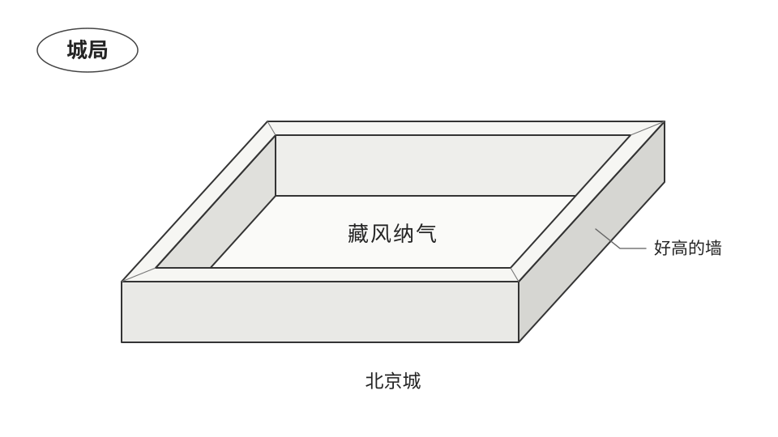 〔板书〕「城局」下方画出了一个框的三边。左边一道近乎竖直的线，上下两端各接一道向右伸的横线。（[00:38:51](https://www.bilibili.com/video/BV1KJsLekEfA/?p=33&t=2331)，第 69936 帧） 〔口述〕他让学生想北京城的墙有多高，说这就是城局。说到这样的城局有什么用，他答「藏风纳气」。（[00:38:51–00:38:59](https://www.bilibili.com/video/BV1KJsLekEfA/?p=33&t=2331)，第 69936–70181 帧） |
| **好地用不上时，倪师举了哪些例子？** | 〔口述〕看龙时，想选的龙穴可能正好落在国家预定地。他举国家公园为例，反问若扛着祖先的尸体往里摆，岂不是要把人吓坏。（[00:39:01–00:39:17](https://www.bilibili.com/video/BV1KJsLekEfA/?p=33&t=2341)，第 70254–70715 帧） 〔口述〕有人嫌自家风水不好，问能不能「吃他一点风水」。倪师说有特殊的办法，等没有录影时再教，怕给某人听到。（[00:39:17–00:39:32](https://www.bilibili.com/video/BV1KJsLekEfA/?p=33&t=2357)，第 70716–71183 帧） |
| **密闭的城局有路进来，中间的地势怎么看？** | 〔口述〕倪师说「那所谓的城局就是密闭式的」。他举的情形里，有一条马路从一边进来，这地方仍能藏风纳气。（[00:39:32–00:39:38](https://www.bilibili.com/video/BV1KJsLekEfA/?p=33&t=2372)，第 71184–71363 帧） 〔口述〕他让人站在中间看。若有地脉、龙脉，地气又旺，中间整块地便会鼓起，他形容为「地势这样子膨起来很饱满」。（[00:39:38–00:39:50](https://www.bilibili.com/video/BV1KJsLekEfA/?p=33&t=2378)，第 71364–71705 帧） |
| **选葬地时，土石和草各看什么？** | 〔口述〕他接着讲整块地势凹下去的情形。把草掀起来看，底下石头很多，连泥土都找不到。（[00:39:52–00:40:00](https://www.bilibili.com/video/BV1KJsLekEfA/?p=33&t=2392)，第 71766–72011 帧） 〔口述〕他把石头比作龙的骨头，把泥土比作龙的肌肉。讲到泥土时，他接着说「就是所谓的气」。（[00:40:00–00:40:07](https://www.bilibili.com/video/BV1KJsLekEfA/?p=33&t=2400)，第 72012–72233 帧） 〔口述〕倪师讲到连泥土都没有的情形。字幕写「这种是干龙是石龙」，这句的用字与语音转写不合。下一句他重复说「石龙啊这叫石龙」。（[00:40:07–00:40:14](https://www.bilibili.com/video/BV1KJsLekEfA/?p=33&t=2407)，第 72234–72425 帧） 〔口述〕看地上的草，他要草长得密而秀丽。若是一片乱七八糟的杂草，草又枯萎了，他断「这个地方也不能葬」，并把这当作基本原则。（[00:40:15–00:40:24](https://www.bilibili.com/video/BV1KJsLekEfA/?p=33&t=2415)，第 72474–72743 帧） |
| **中间、两侧和后面的山势各怎样？** | 〔口述〕找到城局，先看山势怎么走。他举的地形是中间较高，两边低下去，而旁边的山又长得很高。（[00:40:24–00:40:40](https://www.bilibili.com/video/BV1KJsLekEfA/?p=33&t=2424)，第 72744–73223 帧） 〔指代〕说「这个」时，手指的是黑板，落点在整幅画面正中的第五格，具体指到哪根线看不清。（[00:40:42](https://www.bilibili.com/video/BV1KJsLekEfA/?p=33&t=2442)，第 73265 帧） 〔口述〕他接着形容山脉这样下来，旁边又见高山，有「很多高山这样连在一起」，后面也是山。（[00:40:43–00:40:54](https://www.bilibili.com/video/BV1KJsLekEfA/?p=33&t=2443)，第 73308–73643 帧） 〔指代〕说「这边」时，手指的仍是黑板，这回落在整幅画面中排靠右的第六格。（[00:40:45](https://www.bilibili.com/video/BV1KJsLekEfA/?p=33&t=2445)，第 73355 帧） |
| **城局里的水怎么走，脉上哪一段能葬？** | 〔口述〕他举开车来看城局的例子，说山势造成水，水又会出去，所以看见这样的城局，他说「一定有水」。（[00:40:57–00:41:05](https://www.bilibili.com/video/BV1KJsLekEfA/?p=33&t=2457)，第 73710–73973 帧） 〔板书〕上方可辨「骑龙葬」。下方左边的方框内有一道斜竖线和几道短横。右边另有不规则的长圆形轮廓，沿左边和下边伸出许多短线。（[00:41:04](https://www.bilibili.com/video/BV1KJsLekEfA/?p=33&t=2464)，第 73932 帧） 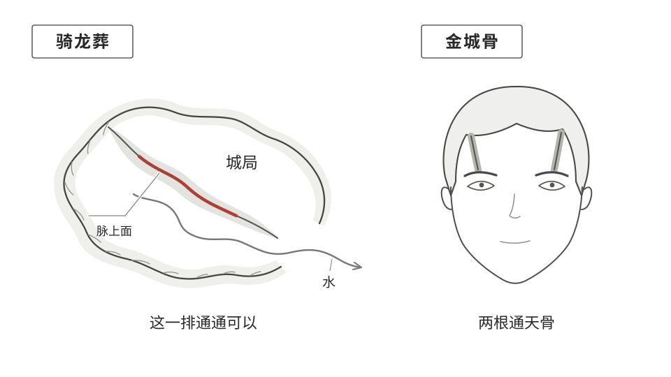 〔口述〕讲到在脉上葬，他说「这一排通通可以」，因为这一排「都可以吃到这个城局」。他还说，现在很多人就葬在城局上面。（[00:41:05–00:41:13](https://www.bilibili.com/video/BV1KJsLekEfA/?p=33&t=2465)，第 73974–74219 帧） 〔板书〕「城局」外圈的右下方有一个小星形记号。字下的方框还能看见，右边的图大半被倪师挡住。（[00:41:14](https://www.bilibili.com/video/BV1KJsLekEfA/?p=33&t=2474)，第 74232 帧） |
| **两根通天骨叫什么，倪师据此怎样断？** | 〔口述〕倪师要学生从人的相去看。画到耳朵时，他提到耳朵小，从正面不容易看清，头发也会挡到。（[00:41:16–00:41:31](https://www.bilibili.com/video/BV1KJsLekEfA/?p=33&t=2476)，第 74298–74753 帧） 〔口述〕他先提眼睛、眉毛，再说上面有两根通天骨。这两根骨头，他称为「金城骨」。（[00:41:31–00:41:46](https://www.bilibili.com/video/BV1KJsLekEfA/?p=33&t=2491)，第 74754–75185 帧） 〔板书〕左边不规则轮廓里有一道从左上往右下的宽斜痕。右边大弧线内露出一道粗斜笔，上端连着弧线，下端有短横，其余部分被遮住。（[00:41:39](https://www.bilibili.com/video/BV1KJsLekEfA/?p=33&t=2499)，第 74982 帧） 〔口述〕讲到有金城骨的人，倪师的断语在字幕里记作「一定是三九卿能位列九卿」。语音转写两处都记作九星，原话待核。（[00:41:46–00:41:55](https://www.bilibili.com/video/BV1KJsLekEfA/?p=33&t=2506)，第 75186–75479 帧） 〔口述〕他举电视上能看到的人为例，说许多人都有金城骨。从这种相，他判断这个人的祖先葬在群山环绕的中间。（[00:41:56–00:42:04](https://www.bilibili.com/video/BV1KJsLekEfA/?p=33&t=2516)，第 75480–75743 帧） |
| **从鼻形怎样看祖坟，又怎样分到哪一房？** | 〔口述〕倪师形容鼻子像一条龙下来，举了字幕写作「玄胆」的鼻形和狮鼻。他说，从一个人的脸上也能「看他祖坟的风水」。（[00:42:10–00:42:20](https://www.bilibili.com/video/BV1KJsLekEfA/?p=33&t=2530)，第 75900–76223 帧） 〔口述〕说到一家三房，他先用孟、仲、季来称呼，再换个说法，依次就是大房、二房、三房。（[00:42:20–00:42:31](https://www.bilibili.com/video/BV1KJsLekEfA/?p=33&t=2540)，第 76224–76547 帧） 〔口述〕假设一家葬在他所说的狮鼻之地，二房生了一个儿子，鼻子也像狮鼻。倪师就说是二房吃到了，「大房三房没有吃到」。（[00:42:31–00:42:45](https://www.bilibili.com/video/BV1KJsLekEfA/?p=33&t=2551)，第 76548–76955 帧） 〔口述〕要判断做的风水到底验在谁身上，他叫学生看相应的特征出在哪个人身上，用他的话说就是「哪一个人看到哪一个人吃到」。（[00:42:46–00:42:56](https://www.bilibili.com/video/BV1KJsLekEfA/?p=33&t=2566)，第 76998–77291 帧） |
| **拨砂时要选什么，为什么在现场来回跑？** | 〔口述〕倪师预告后面会讲拨砂。人站在中间，看坟要对着哪一边葬，或选哪一块来葬，他把这里讲的做法叫作拨砂。（[00:42:58–00:43:10](https://www.bilibili.com/video/BV1KJsLekEfA/?p=33&t=2578)，第 77352–77711 帧） 〔指代〕说坟要对着「这边」葬时，手指的是黑板，落点在整幅画面正中的第五格。（[00:43:05](https://www.bilibili.com/video/BV1KJsLekEfA/?p=33&t=2585)，第 77569 帧） 〔指代〕接着说「从这边从这边朝这边」时，三次手指都指向黑板，落点都在画面正中的第五格。（[00:43:06–00:43:07](https://www.bilibili.com/video/BV1KJsLekEfA/?p=33&t=2586)，第 77599–77629 帧） 〔口述〕他说风水师在现场这边跑跑、那边跑跑，来回跑动的缘故，是手里拿着罗盘在测砂。（[00:43:10–00:43:17](https://www.bilibili.com/video/BV1KJsLekEfA/?p=33&t=2590)，第 77712–77915 帧） 〔板书〕黑板右侧的大椭圆里，左右两道粗斜线的上端有弧线相连，下端各有短横。椭圆下方一行字可辨「位列九」，末字只露出一部分。（[00:43:15](https://www.bilibili.com/video/BV1KJsLekEfA/?p=33&t=2595)，第 77868 帧） 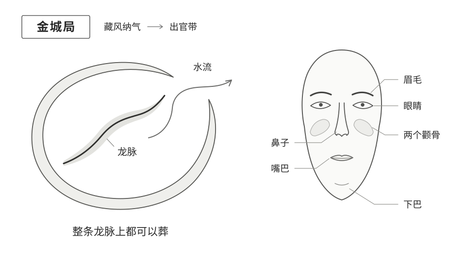 |
| **测不到正好的位置，四贵到一贵怎样取舍？** | 〔口述〕讲到换位置测砂，他举的是「这三贵有那一贵没有」的情形，难处在于总找不到一个正好的位置。（[00:43:20–00:43:23](https://www.bilibili.com/video/BV1KJsLekEfA/?p=33&t=2600)，第 78006–78113 帧） 〔口述〕他举例说，四贵没有，三贵也勉强可以。三贵没有就取二贵，再往下，一贵也好。（[00:43:23–00:43:34](https://www.bilibili.com/video/BV1KJsLekEfA/?p=33&t=2603)，第 78114–78425 帧） |

**总结区**

- 通用规则：倪师说，找葬地不必一定葬到龙穴，也可以在龙脉上找（[00:37:59–00:38:38](https://www.bilibili.com/video/BV1KJsLekEfA/?p=33&t=2279)，第 68394–69545 帧）；按倪师的说法，密闭式的城局可以藏风纳气，若有地脉、有龙脉，而且地气很旺，中间的地势就会膨起来，显得很饱满（[00:39:32–00:39:50](https://www.bilibili.com/video/BV1KJsLekEfA/?p=33&t=2372)，第 71184–71705 帧）；草宜密而秀丽，一片杂草凌乱又枯萎的地方，倪师说不能葬（[00:40:15–00:40:22](https://www.bilibili.com/video/BV1KJsLekEfA/?p=33&t=2415)，第 72474–72689 帧）；倪师根据哪一房的人显出相应的相貌，判断祖坟的风水应在哪一房（[00:42:31–00:42:56](https://www.bilibili.com/video/BV1KJsLekEfA/?p=33&t=2551)，第 76548–77291 帧）
- 只在本例：倪师拿北京城的高墙说明城局，并以此讲藏风纳气（[00:38:48–00:38:59](https://www.bilibili.com/video/BV1KJsLekEfA/?p=33&t=2328)，第 69846–70181 帧）；国家预定地和国家公园，是他举的找到龙穴也不方便安葬的例子（[00:39:02–00:39:17](https://www.bilibili.com/video/BV1KJsLekEfA/?p=33&t=2342)，第 70284–70715 帧）；就所举的那一段脉，倪师说这一排都可以葬，都能吃到这个城局（[00:41:05–00:41:10](https://www.bilibili.com/video/BV1KJsLekEfA/?p=33&t=2465)，第 73974–74129 帧）；在狮鼻的设例里，二房儿子的鼻形与葬地相应，倪师断二房吃到，大房、三房没有吃到（[00:42:31–00:42:45](https://www.bilibili.com/video/BV1KJsLekEfA/?p=33&t=2551)，第 76548–76955 帧）
- 不是风水规则，是处世方法：碰到别人已经安葬的地方，倪师告诫不能未经人家同意就去挖人家的坟（[00:38:16–00:38:35](https://www.bilibili.com/video/BV1KJsLekEfA/?p=33&t=2296)，第 68886–69455 帧）

**待核**

1. 开头倪师手持粉笔，手边辨不出完整的字（[00:37:35](https://www.bilibili.com/video/BV1KJsLekEfA/?p=33&t=2255)，第 67650 帧）
2. 倪师头旁只露出一部分粉笔字，这张还看不全后来写明的「城局」（[00:37:46](https://www.bilibili.com/video/BV1KJsLekEfA/?p=33&t=2266)，第 67980 帧）
3. 字幕写「龙穴」，语音多处记成「龙脚」，笔记沿用字幕用字（[00:37:59](https://www.bilibili.com/video/BV1KJsLekEfA/?p=33&t=2279)，第 68394 帧）
4. 「城局」右边新写的字只看清开头的「骑」，其余笔画被遮住（[00:38:07](https://www.bilibili.com/video/BV1KJsLekEfA/?p=33&t=2287)，第 68616 帧）
5. 字幕作「没有经过人家同意犯法了」，语音只在末尾的犯法一意上清楚（[00:38:33](https://www.bilibili.com/video/BV1KJsLekEfA/?p=33&t=2313)，第 69408 帧）
6. 提到「衍生出两个地方」，本块没有逐一说清这两个地方各指什么（[00:38:42](https://www.bilibili.com/video/BV1KJsLekEfA/?p=33&t=2322)，第 69684 帧）
7. 讲地势凹陷这句，字幕开头作「那就会」，语音作「如果」，它和前句怎样衔接待核（[00:39:52](https://www.bilibili.com/video/BV1KJsLekEfA/?p=33&t=2392)，第 71766 帧）
8. 掀草后一句，字幕是「下面都答答」，语音是「大大」，无法确定在形容什么（[00:39:56](https://www.bilibili.com/video/BV1KJsLekEfA/?p=33&t=2396)，第 71904 帧）
9. 字幕作「这种是干龙是石龙」，语音近似肝龙、死龙，后一句才清楚地重复了石龙（[00:40:10](https://www.bilibili.com/video/BV1KJsLekEfA/?p=33&t=2410)，第 72318 帧）
10. 说到龙气和地面的过渡句两路不齐，接下来讲草密而秀丽较清楚（[00:40:14](https://www.bilibili.com/video/BV1KJsLekEfA/?p=33&t=2414)，第 72426 帧）
11. 讲金城骨的断语，字幕是「一定是三九卿能位列九卿」，语音将两处九卿都记作九星，尤其前半句待核（[00:41:48](https://www.bilibili.com/video/BV1KJsLekEfA/?p=33&t=2508)，第 75264 帧）
12. 讲完祖先葬在环山中间，字幕还提到从头上看能否「吃到风水」，这里的语音转写不齐，原句待核（[00:42:04](https://www.bilibili.com/video/BV1KJsLekEfA/?p=33&t=2524)，第 75744 帧）
13. 狮鼻前的鼻形名，字幕作「玄胆」，语音作「旋胆」，首字待核（[00:42:12](https://www.bilibili.com/video/BV1KJsLekEfA/?p=33&t=2532)，第 75960 帧）
14. 讲坟的朝向时，连续几次「这边」都只能定到黑板所在的画面中格，辨不出具体线条或方位（[00:43:05](https://www.bilibili.com/video/BV1KJsLekEfA/?p=33&t=2585)，第 77569 帧）
15. 两幅图之间的竖排粉笔字不能逐字认全，椭圆下方「位列九」后面的字也没有完整入画（[00:43:15](https://www.bilibili.com/video/BV1KJsLekEfA/?p=33&t=2595)，第 77868 帧）
16. 测砂时有一句字幕作「啊天星扫三三贵一贵没有」，语音也不清楚，各贵具体指什么，本块没有解释（[00:43:18](https://www.bilibili.com/video/BV1KJsLekEfA/?p=33&t=2598)，第 77940 帧）
17. 最后一句开头字幕作「依次啊四二贵也没」，语音对不上，末尾仍可辨出说到一贵（[00:43:30](https://www.bilibili.com/video/BV1KJsLekEfA/?p=33&t=2610)，第 78318 帧）
18. 字幕写「他祖先来龙很强」，语音转写对应处作「他祖先来的一种墙」，这句断语的原话待核（[00:42:15](https://www.bilibili.com/video/BV1KJsLekEfA/?p=33&t=2535)，第 76050 帧）

### 8　金城骑龙葬的选位、辨土与泄补（[00:43:34–00:49:23](https://www.bilibili.com/video/BV1KJsLekEfA/?p=33&t=2614)，第 78426–88913 帧）

| 提示区 | 笔记区 |
|---|---|
| **金城局为什么能出官带，龙脉上哪里可葬？** | 〔口述〕开头承接前话，说到「出一房嘛出一房」。倪师说，究竟怎样，要等到现场看过才定。（[00:43:34–00:43:42](https://www.bilibili.com/video/BV1KJsLekEfA/?p=33&t=2614)，第 78426–78677 帧） 〔板书〕黑板右侧有一个近椭圆的轮廓。上方一条细线在中间下弯，两侧各有一道粗斜线，斜线下端各有一小段横线。（[00:43:34](https://www.bilibili.com/video/BV1KJsLekEfA/?p=33&t=2614)，第 78426 帧） 〔口述〕倪师说眼下这种格局比较多。金城局也能藏风纳气，所以能出官带，他还强调「官带非常大」。（[00:43:42–00:43:57](https://www.bilibili.com/video/BV1KJsLekEfA/?p=33&t=2622)，第 78678–79133 帧） 〔口述〕他把讲到的这一条称为龙脉。就眼前这个局，他说「整条龙脉上都可以葬」。（[00:43:57–00:44:02](https://www.bilibili.com/video/BV1KJsLekEfA/?p=33&t=2637)，第 79134–79271 帧） |
| **倪师怎样在图上讲水流和五官？** | 〔口述〕从龙脉上看，他先讲金城围起来的情形，再交代水的去路，说「水流从这边出去」。（[00:44:03–00:44:13](https://www.bilibili.com/video/BV1KJsLekEfA/?p=33&t=2643)，第 79308–79619 帧） 〔板书〕黑板左边圆框的下沿有个朝右的箭头，下面的方框里露出一段弧线。右侧大轮廓下方有一行带底线的字，可辨「位列九」，末字认不全。（[00:44:09](https://www.bilibili.com/video/BV1KJsLekEfA/?p=33&t=2649)，第 79476 帧） 〔指代〕说水从「这边」出去时，手指黑板，落在整幅画面的左中格。随后说「这个」和「这边」时，也指黑板，手在中央格。（[00:44:09–00:44:20](https://www.bilibili.com/video/BV1KJsLekEfA/?p=33&t=2649)，第 79484–79823 帧） 〔口述〕讲到图上的部位，他先说「这是口嘛嘴巴」，再说中间是鼻子、两边是眼睛，还提到眉毛和两个颧骨。（[00:44:16–00:44:27](https://www.bilibili.com/video/BV1KJsLekEfA/?p=33&t=2656)，第 79698–80039 帧） 〔板书〕黑板左下的方框内，中间有一道竖长的窄形，两旁画着大小不同的圈和短线。方框上方另圈着字，末字可辨为「局」。（[00:44:29](https://www.bilibili.com/video/BV1KJsLekEfA/?p=33&t=2669)，第 80071 帧） |
| **葬位挑在颧上，倪师怎样对照后代的长相？** | 〔口述〕他举葬位没挑好、又「摆在颧上面」的例子，接着比较下一代的两边颧骨，字幕写作「这个颧很大这个颧很小」。（[00:44:35–00:44:42](https://www.bilibili.com/video/BV1KJsLekEfA/?p=33&t=2675)，第 80250–80477 帧） 〔指代〕说「这边」时，手指自己身上，手在画面右中格。接着说「这个」时仍指自己，手在画面中央格。（[00:44:40–00:44:41](https://www.bilibili.com/video/BV1KJsLekEfA/?p=33&t=2680)，第 80425–80432 帧） 〔口述〕照倪师的说法，摆葬位的人能预想后代会长成什么样，也会见到他所说的「奇形怪象」。他自述有十几年经验，看过这样的情形。（[00:44:44–00:44:58](https://www.bilibili.com/video/BV1KJsLekEfA/?p=33&t=2684)，第 80520–80963 帧） |
| **看出是哪一房后，怎样核对小孩的相？** | 〔口述〕倪师说，他看风水时先想到下一代会应在谁身上。按他的说法，「吃到风水的」那个人当时还没出生，要等孩子生下来再看是哪一房。（[00:44:58–00:45:08](https://www.bilibili.com/video/BV1KJsLekEfA/?p=33&t=2698)，第 80964–81257 帧） 〔口述〕先从风水看是哪一房，「然后我们先不要讲」。再到那一房去看小孩的相，倪师说，孩子的长相跟坟地那里的山川河流一样。（[00:45:08–00:45:19](https://www.bilibili.com/video/BV1KJsLekEfA/?p=33&t=2708)，第 81258–81581 帧） |
| **水口较直，他用小孩的什么表现来对照？** | 〔指代〕举水口的例子时，说「这个」「这边」，再说「这个」「这里」，手都指向黑板，落在整幅画面的中央格。（[00:45:20–00:45:24](https://www.bilibili.com/video/BV1KJsLekEfA/?p=33&t=2720)，第 81605–81741 帧） 〔口述〕他先说「这个水口这边比较直」，水从这里出去比较快，流出去时还有一点声音。（[00:45:21–00:45:25](https://www.bilibili.com/video/BV1KJsLekEfA/?p=33&t=2721)，第 81642–81761 帧） 〔口述〕再看那个小孩，他说小孩一直流口水，挡也挡不住，还特别指出口水是往一边流的。（[00:45:25–00:45:29](https://www.bilibili.com/video/BV1KJsLekEfA/?p=33&t=2725)，第 81762–81893 帧） |
| **金城局说出官，为什么又拿八字来看？** | 〔口述〕他又拿八字来对照。譬如从风水看到金城局出官，接下来便是「八字拿起来看官」。（[00:45:29–00:45:36](https://www.bilibili.com/video/BV1KJsLekEfA/?p=33&t=2729)，第 81894–82091 帧） 〔口述〕倪师的说法是「在八字之前还有风水」。把风水和八字连起来讲，是想把天、地、人合在一起看。（[00:45:37–00:45:46](https://www.bilibili.com/video/BV1KJsLekEfA/?p=33&t=2737)，第 82116–82397 帧） |
| **入地见到龙脉，怎样比较土色？** | 〔口述〕倪师把前面讲的葬法叫作「骑龙葬」。说到龙脉大时怎么测，他让学生留意，入地见到龙脉时，土是什么颜色。（[00:45:49–00:46:07](https://www.bilibili.com/video/BV1KJsLekEfA/?p=33&t=2749)，第 82482–83027 帧） 〔板书〕黑板左侧贴着一张白纸，纸的下方能辨出两个横写的大字「土色」。（[00:46:05](https://www.bilibili.com/video/BV1KJsLekEfA/?p=33&t=2765)，第 82969 帧） 〔口述〕他说土一般是黄土。论好坏，他把颜色润黄的、或稍微带一点白的土列为最好。（[00:46:07–00:46:19](https://www.bilibili.com/video/BV1KJsLekEfA/?p=33&t=2767)，第 83028–83387 帧） 〔口述〕黑的、干的、青色的土，他都拿来和前面两种比，说这些都比不上润黄或白的。（[00:46:19–00:46:30](https://www.bilibili.com/video/BV1KJsLekEfA/?p=33&t=2779)，第 83388–83723 帧） |
| **为什么关渡的红土要泄热气？** | 〔口述〕倪师举关渡平原和关渡上面的山脉为例，点明当地土的颜色，说「关渡的土呢是红土」。（[00:46:30–00:46:36](https://www.bilibili.com/video/BV1KJsLekEfA/?p=33&t=2790)，第 83724–83909 帧） 〔板书〕黑板中部有个圈，圈里几笔分开，认不出完整的字。圈的右下方另有一个清楚的「土」字。（[00:46:37](https://www.bilibili.com/video/BV1KJsLekEfA/?p=33&t=2797)，第 83936 帧） 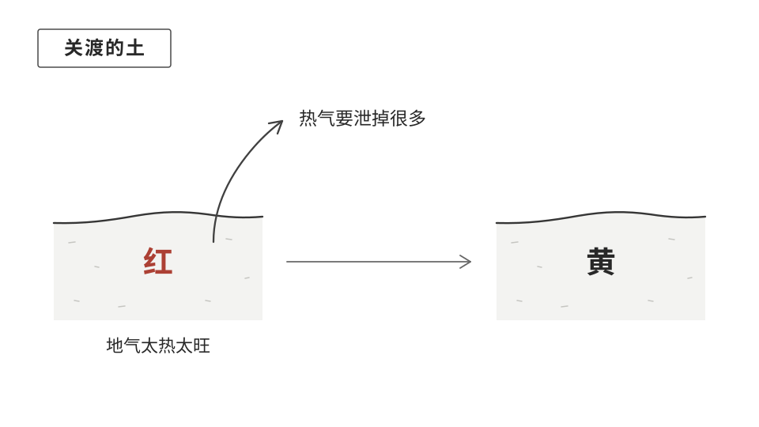 〔口述〕他连着念「木火土金水青赤黄白黑」，接下来一句字幕写作「青的主木火的主红」。在关渡这个例子里，他把红土解释为地气太热太旺，说要从红土变成黄土，就得泄掉许多热气。（[00:46:38–00:46:55](https://www.bilibili.com/video/BV1KJsLekEfA/?p=33&t=2798)，第 83964–84455 帧） 〔指代〕讲到热气要泄掉时，他说「这个」，手指向黑板，位置在整幅画面的中央格。（[00:46:52](https://www.bilibili.com/video/BV1KJsLekEfA/?p=33&t=2812)，第 84382 帧） 〔板书〕一条线从圈内靠右处向右上方伸出，顶端有箭头。圈的右侧还写着字，笔画连在一起，认不全。（[00:46:54](https://www.bilibili.com/video/BV1KJsLekEfA/?p=33&t=2814)，第 84420 帧） |
| **地气太热时，泄葬法怎样做？** | 〔口述〕倪师说，过去风水师遇到地气过热、过旺，会用泄气法，称为「泄葬法」。先丈量找出穴位，挖开，再把棺材放下去。（[00:46:55–00:47:13](https://www.bilibili.com/video/BV1KJsLekEfA/?p=33&t=2815)，第 84456–85013 帧） 〔口述〕丈量时，测来龙说的是「穿山龙」。到了穴口再测，倪师说那里是「透地六十个龙」。（[00:47:13–00:47:20](https://www.bilibili.com/video/BV1KJsLekEfA/?p=33&t=2833)，第 85014–85229 帧） 〔口述〕棺材放好，隔一年打开坟墓。他特别交代「不要把棺材打开来」，把整具棺材取出来透气，然后放回去。（[00:47:21–00:47:31](https://www.bilibili.com/video/BV1KJsLekEfA/?p=33&t=2841)，第 85230–85541 帧） 〔口述〕他用地气太热说明什么时候该泄，又把泄和补放在一起讲，「太过我们要放掉」，不及就要设法补足。（[00:47:31–00:47:35](https://www.bilibili.com/video/BV1KJsLekEfA/?p=33&t=2851)，第 85542–85667 帧） |
| **穴位全是石头，为什么还葬，葬后怎么补？** | 〔口述〕倪师举例，水好、砂好、龙也好，环抱也好，偏偏到了龙穴所在的地方，见到的全是石头。（[00:47:35–00:47:48](https://www.bilibili.com/video/BV1KJsLekEfA/?p=33&t=2855)，第 85668–86045 帧） 〔口述〕他又点出这地方的水、砂和官星、鬼星都好，实在找不到比它更好的地方，所以觉得弃之可惜。（[00:47:48–00:47:56](https://www.bilibili.com/video/BV1KJsLekEfA/?p=33&t=2868)，第 86046–86285 帧） 〔口述〕这个地方仍然可以葬。倪师说，葬完「给它大量的土堆在旁边」，把这种做法称为补气法。（[00:47:56–00:48:04](https://www.bilibili.com/video/BV1KJsLekEfA/?p=33&t=2876)，第 86286–86537 帧） 〔口述〕要泄还是要补，得看当时当地的情形。他说「你说我立个公式也没有办法」，要临场看、懂得变通，实在看不懂再来问。（[00:48:04–00:48:20](https://www.bilibili.com/video/BV1KJsLekEfA/?p=33&t=2884)，第 86538–87029 帧） |
| **为什么山棱最高的龙背不能葬？** | 〔口述〕倪师说骑龙葬可以，也有一种他称为「最凶的」葬法。顺着山的棱线看，最高处叫龙背，直接把人葬在上面，他说不行。（[00:48:21–00:48:41](https://www.bilibili.com/video/BV1KJsLekEfA/?p=33&t=2901)，第 87030–87641 帧） 〔指代〕讲山势、棱线和龙背时，几次说「这个」，手都指向黑板，落在整幅画面的中央格。（[00:48:34–00:48:39](https://www.bilibili.com/video/BV1KJsLekEfA/?p=33&t=2914)，第 87448–87590 帧） 〔口述〕他说人上到这个龙背会被风吹倒。金城能围起来藏风纳气，这处龙背却做不到，所以不能葬。（[00:48:41–00:48:49](https://www.bilibili.com/video/BV1KJsLekEfA/?p=33&t=2921)，第 87642–87893 帧） 〔口述〕他点名大雪山、奇莱山，提醒学生别跑上山葬祖先，免得葬完下山迷路，还得让人上山去救。（[00:48:49–00:49:00](https://www.bilibili.com/video/BV1KJsLekEfA/?p=33&t=2929)，第 87894–88211 帧） 〔口述〕他最后说明，骑龙葬是「骑在龙脉上面」，选位要能藏风纳气。下堂课再讲穿山龙和透地龙，因为这两样要看现场，空讲是「鸡同鸭讲」。（[00:49:04–00:49:23](https://www.bilibili.com/video/BV1KJsLekEfA/?p=33&t=2944)，第 88332–88913 帧） |

**总结区**

- 通用规则：倪师说金城局能藏风纳气，所以也能出很大的官带（[00:43:47–00:43:57](https://www.bilibili.com/video/BV1KJsLekEfA/?p=33&t=2627)，第 78828–79133 帧）；入地看土色，倪师以润黄或带一点白的为好，黑、干或青色的土都比不上（[00:45:56–00:46:30](https://www.bilibili.com/video/BV1KJsLekEfA/?p=33&t=2756)，第 82692–83723 帧）；地气太过要泄掉，不及要设法补足（[00:47:31–00:47:35](https://www.bilibili.com/video/BV1KJsLekEfA/?p=33&t=2851)，第 85542–85667 帧）；骑龙葬虽是骑在龙脉上，所选之处一定要能藏风纳气（[00:49:04–00:49:12](https://www.bilibili.com/video/BV1KJsLekEfA/?p=33&t=2944)，第 88332–88589 帧）
- 只在本例：在水口较直、出水较快而有声的例子里，倪师说见到的小孩一直流口水，口水往一边流（[00:45:21–00:45:29](https://www.bilibili.com/video/BV1KJsLekEfA/?p=33&t=2721)，第 81642–81893 帧）；倪师把关渡红土解作当地地气太热太旺，说要从红土变黄土，得先泄热气（[00:46:30–00:46:55](https://www.bilibili.com/video/BV1KJsLekEfA/?p=33&t=2790)，第 83724–84455 帧）；石地一例的水、砂、龙、环抱及官星、鬼星都好，倪师说仍可下葬，葬后在旁边堆大量的土补气（[00:47:35–00:48:04](https://www.bilibili.com/video/BV1KJsLekEfA/?p=33&t=2855)，第 85668–86537 帧）
- 不是风水规则，是处世方法：先看出是哪一房，暂且不说，再亲自到那一房看小孩的相，和自己的判断核对（[00:45:08–00:45:19](https://www.bilibili.com/video/BV1KJsLekEfA/?p=33&t=2708)，第 81258–81581 帧）；倪师让学生先临场看，懂得变通，实在看不懂再来问他（[00:48:10–00:48:20](https://www.bilibili.com/video/BV1KJsLekEfA/?p=33&t=2890)，第 86700–87029 帧）

**待核**

1. 字幕的「金城局」在语音中近「君臣」，[00:43:51](https://www.bilibili.com/video/BV1KJsLekEfA/?p=33&t=2631)，第 78936 帧的「官带」也转成「关带」，两词沿用字幕写法，官带的含义本块未细讲（[00:43:47](https://www.bilibili.com/video/BV1KJsLekEfA/?p=33&t=2627)，第 78828 帧）
2. 黑板右侧带底线的一行字，末字笔画认不全（[00:44:09](https://www.bilibili.com/video/BV1KJsLekEfA/?p=33&t=2649)，第 79476 帧）
3. 说水从「这边」出去，只能确定手指黑板左中格，具体是哪一条线待核（[00:44:09](https://www.bilibili.com/video/BV1KJsLekEfA/?p=33&t=2649)，第 79484 帧）
4. 下巴一句在材料字幕栏识作「须」，语音近「该」，[00:44:29](https://www.bilibili.com/video/BV1KJsLekEfA/?p=33&t=2669)，第 80071 帧画面底部字幕可辨为「颏」，口述用字待核（[00:44:28](https://www.bilibili.com/video/BV1KJsLekEfA/?p=33&t=2668)，第 80040 帧）
5. 字幕是「这个颧很大这个颧很小」，语音两处都转成很大，第二处的大小待核（[00:44:41](https://www.bilibili.com/video/BV1KJsLekEfA/?p=33&t=2681)，第 80436 帧）
6. 说到孙子时，字幕停在「他的孙子在还」，语音近「他那个孙子在喊」，这半句的意思不清（[00:45:01](https://www.bilibili.com/video/BV1KJsLekEfA/?p=33&t=2701)，第 81030 帧）
7. 说风水在八字之前，字幕作「还在选你呢」，语音作「还在决定」，具体动词待核（[00:45:37](https://www.bilibili.com/video/BV1KJsLekEfA/?p=33&t=2737)，第 82116 帧）
8. 字幕把白识成「自」，到[00:46:27](https://www.bilibili.com/video/BV1KJsLekEfA/?p=33&t=2787)，第 83610 帧比较土色时又出现一次，两处均依语音记作白（[00:46:14](https://www.bilibili.com/video/BV1KJsLekEfA/?p=33&t=2774)，第 83232 帧）
9. 圈内的粉笔字难辨，稍后[00:46:54](https://www.bilibili.com/video/BV1KJsLekEfA/?p=33&t=2814)，第 84420 帧箭头右侧的字也认不全（[00:46:37](https://www.bilibili.com/video/BV1KJsLekEfA/?p=33&t=2797)，第 83936 帧）
10. 口诀末尾识作「青的竹木」，下一句字幕作「青的主木」，据后一句记为青主木（[00:46:38](https://www.bilibili.com/video/BV1KJsLekEfA/?p=33&t=2798)，第 83964 帧）
11. 「黄士」依语音记为黄土，下一句[00:46:52](https://www.bilibili.com/video/BV1KJsLekEfA/?p=33&t=2812)，第 84372 帧的「二定」与前一句末尾的语音连起来应为一定（[00:46:50](https://www.bilibili.com/video/BV1KJsLekEfA/?p=33&t=2810)，第 84306 帧）
12. 穿山龙怎么测、穴口的「透地六十个龙」怎么分，本块没有展开（[00:47:19](https://www.bilibili.com/video/BV1KJsLekEfA/?p=33&t=2839)，第 85188 帧）
13. 字幕的「龙叉好」依语音记为龙又好（[00:47:38](https://www.bilibili.com/video/BV1KJsLekEfA/?p=33&t=2858)，第 85764 帧）
14. 倪师说这地方官星、鬼星都好，具体怎样辨认这两样，本块没有解释（[00:47:51](https://www.bilibili.com/video/BV1KJsLekEfA/?p=33&t=2871)，第 86130 帧）
15. 字幕作「看因时医地制宜」，语音也不完整，据前后句转述为随当时当地的情形变通（[00:48:06](https://www.bilibili.com/video/BV1KJsLekEfA/?p=33&t=2886)，第 86592 帧）
16. 字幕「最高的鸟那龙背嘛」中间的字不清，语音近「最高的那个龙背」（[00:48:36](https://www.bilibili.com/video/BV1KJsLekEfA/?p=33&t=2916)，第 87498 帧）
17. 字幕写「火的主红」，语音识别作「火的时候红」，火与红之间的用字待核（[00:46:41](https://www.bilibili.com/video/BV1KJsLekEfA/?p=33&t=2801)，第 84048 帧）

## 杖法定穴、阳宅案例与现场认穴

### 9　杖法定穴与圆山饭店选址（[00:49:23–00:55:44](https://www.bilibili.com/video/BV1KJsLekEfA/?p=33&t=2963)，第 88914–100331 帧）

| 提示区 | 笔记区 |
|---|---|
| **杖法中的「杖」是什么意思？** | 〔口述〕到现场以前，要先知道怎样度量。学生问怎样知道龙穴在哪里，倪师回答「这就是杖法」。（[00:49:23–00:49:33](https://www.bilibili.com/video/BV1KJsLekEfA/?p=33&t=2963)，第 88914–89219 帧） 〔板书〕黑板中央偏左用白粉笔竖写了两个字，上面是「杖」，下面是「法」。（[00:49:29](https://www.bilibili.com/video/BV1KJsLekEfA/?p=33&t=2969)，第 89095 帧） 〔口述〕他提醒学生别把这个字想成一根拐杖，接连用两次「丈量」来解释杖法的「杖」。（[00:49:34–00:49:41](https://www.bilibili.com/video/BV1KJsLekEfA/?p=33&t=2974)，第 89220–89453 帧） |
| **定穴的第一条线顺着什么画？** | 〔口述〕倪师说「我现在反着画」，先交代来龙在哪一边，再画山棱线怎样从那边过来。（[00:49:41–00:49:50](https://www.bilibili.com/video/BV1KJsLekEfA/?p=33&t=2981)，第 89454–89723 帧） 〔指代〕反着画时说「这个」，讲来龙时又说「这边」「这个」，三次手指的都是画面右上方的黑板。（[00:49:42–00:49:47](https://www.bilibili.com/video/BV1KJsLekEfA/?p=33&t=2982)，第 89476–89617 帧） 〔口述〕图中有来水，水往下走，结在中间，再往外流。画第一条线时要看的是「来龙的走向」。（[00:49:50–00:50:07](https://www.bilibili.com/video/BV1KJsLekEfA/?p=33&t=2990)，第 89724–90233 帧） 〔板书〕「杖法」右上方可辨「丈量」两字。黑板右侧露出内外几道白色弧线，图的中部被倪师挡住。（[00:49:52](https://www.bilibili.com/video/BV1KJsLekEfA/?p=33&t=2992)，第 89784 帧） 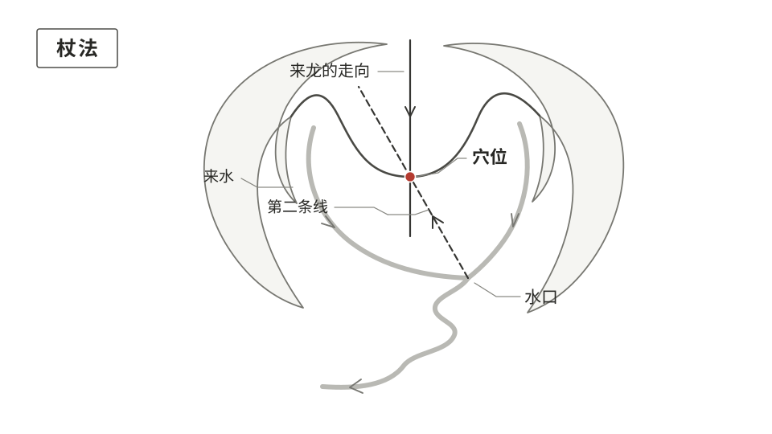 〔板书〕图中上方的白线两头高、中间下凹，下面还有一道较宽的弧。图形下方伸出一条曲折的白线，末端转向左边。（[00:50:00](https://www.bilibili.com/video/BV1KJsLekEfA/?p=33&t=3000)，第 90017 帧） |
| **第二条线从哪里画，穴位取在哪里？** | 〔口述〕画第二条线，人要站在水口。倪师说「这两个水来龙交接会合以后」，水往外出去的地方就是所说的水口，从那里再画一条线过来。（[00:50:07–00:50:20](https://www.bilibili.com/video/BV1KJsLekEfA/?p=33&t=3007)，第 90234–90605 帧） 〔指代〕讲站在水口时，说「这边」手指的是画面正中的黑板。接着讲画线，说「这个」时手指的是画面上方正中的黑板。（[00:50:16–00:50:20](https://www.bilibili.com/video/BV1KJsLekEfA/?p=33&t=3016)，第 90506–90603 帧） 〔口述〕从水口画过来，要看这条线切到来龙的地方。倪师把两线相交处定为穴位，说「这个交点就是所谓的穴位」。（[00:50:20–00:50:30](https://www.bilibili.com/video/BV1KJsLekEfA/?p=33&t=3020)，第 90606–90917 帧） 〔板书〕一条近乎竖直的粉红线从上方穿过白色凹弧，另一条粉红线从左上向右下斜过来，斜线下段被遮住。（[00:50:21](https://www.bilibili.com/video/BV1KJsLekEfA/?p=33&t=3021)，第 90636 帧） 〔板书〕两条粉红线在上层白色凹弧的底部相交。斜线继续向右下延伸，靠近下层较粗的白弧处另有一处粉红色圈记。（[00:50:24](https://www.bilibili.com/video/BV1KJsLekEfA/?p=33&t=3024)，第 90743 帧） |
| **找到平面交点后，怎样定穴位的高低？** | 〔口述〕倪师说明画的是平面鸟瞰图。穴位还要上下移动，人要到现场的中心点去看。（[00:50:30–00:50:42](https://www.bilibili.com/video/BV1KJsLekEfA/?p=33&t=3030)，第 90918–91289 帧） 〔指代〕讲平面、现场中心点和鸟瞰时，三次说「这个」，手都指向画面中央的黑板。讲在哪里葬、站在哪里量时，两次说「这边」也都指向这个区域。（[00:50:32–00:50:46](https://www.bilibili.com/video/BV1KJsLekEfA/?p=33&t=3032)，第 90973–91394 帧） 〔口述〕人站到准备下葬的地方测量，「看前面的朝山看前面的案山」，依据前方所见来决定穴位取高些还是低些。（[00:50:44–00:51:00](https://www.bilibili.com/video/BV1KJsLekEfA/?p=33&t=3044)，第 91338–91811 帧） 〔口述〕他重说现场的次序，先找来龙，把两条线打好，「两个线一定会有个交点嘛」。交点找到穴位以后，再定下葬的位置怎样移动。（[00:51:00–00:51:13](https://www.bilibili.com/video/BV1KJsLekEfA/?p=33&t=3060)，第 91812–92201 帧） |
| **为什么讲到分金时要提醒风水师的心态？** | 〔口述〕倪师举例说，替人定穴时，心术不好的人会有意把位置「改到分金上面」。他由此提醒「风水师心态很重要」。（[00:51:13–00:51:26](https://www.bilibili.com/video/BV1KJsLekEfA/?p=33&t=3073)，第 92202–92585 帧） 〔口述〕他提到「二十四个分金呐」，又拿地震举例，说把坟摆在分金上，遇到地震，坟会裂开，连祖先都翻出来。（[00:51:27–00:51:35](https://www.bilibili.com/video/BV1KJsLekEfA/?p=33&t=3087)，第 92628–92855 帧） |
| **美国三户房子遇到龙卷风，各是什么结果？** | 〔口述〕倪师重提美国A、B、C三户房子的例子。他说龙卷风把A、C两户打掉，并把两家受损归因于房子都在分金上。（[00:51:38–00:51:47](https://www.bilibili.com/video/BV1KJsLekEfA/?p=33&t=3098)，第 92952–93215 帧） 〔口述〕他说B家「连瓦都没掉一块」，A、C两家的房子却整个被吹走了。（[00:51:47–00:51:53](https://www.bilibili.com/video/BV1KJsLekEfA/?p=33&t=3107)，第 93216–93395 帧） 〔口述〕倪师用这个例子讲落在分金上会受「天灾人祸」，随后以「这是杖法丈量」收住这一段。（[00:51:53–00:52:05](https://www.bilibili.com/video/BV1KJsLekEfA/?p=33&t=3113)，第 93396–93779 帧） |
| **同一座山上，阴宅和阳宅各盖在哪里？** | 〔口述〕倪师举自己看过的大山为例。山龙下来，两边的龙脉伸出，他先量这座山的中线，再在图上指出一处龙穴。（[00:52:06–00:52:37](https://www.bilibili.com/video/BV1KJsLekEfA/?p=33&t=3126)，第 93780–94727 帧） 〔指代〕说量「这个」山的中线，又说「这个」地方是龙穴时，手指的都是画面正中的黑板。（[00:52:28–00:52:30](https://www.bilibili.com/video/BV1KJsLekEfA/?p=33&t=3148)，第 94453–94510 帧） 〔口述〕倪师说「阴宅呢是盖穴位」。讲到阳宅，他设想有钱、有一大片地可以盖房，用「你说」引出盖在穴位上不好的说法，接着谈到把房子盖在龙脉上的情形。（[00:52:37–00:52:56](https://www.bilibili.com/video/BV1KJsLekEfA/?p=33&t=3157)，第 94728–95297 帧） 〔板书〕一道近乎竖直的白线旁，有一条细曲线从下方向右上弯去。右侧竖写的粉笔字可辨「宅」，上字认不清。（[00:52:46](https://www.bilibili.com/video/BV1KJsLekEfA/?p=33&t=3166)，第 94980 帧） 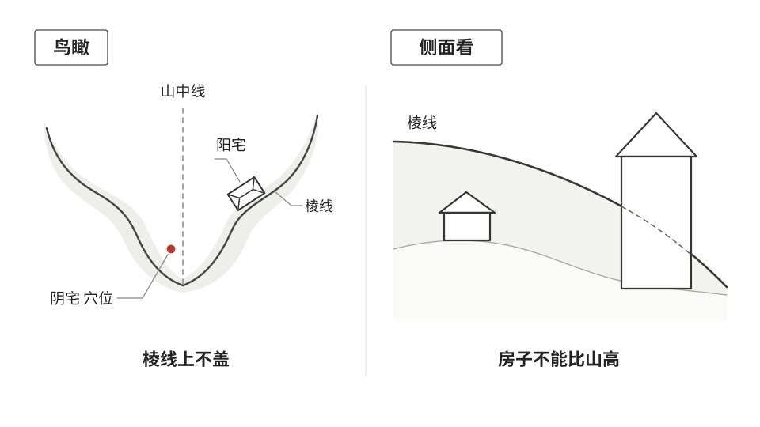 〔口述〕倪师特指山龙下来、气很大的情形，说「千万不能盖在这个棱线上」，房子要选在棱线的侧边。（[00:52:56–00:53:08](https://www.bilibili.com/video/BV1KJsLekEfA/?p=33&t=3176)，第 95298–95663 帧） |
| **从侧面看，阳宅和后山应有怎样的高低？** | 〔口述〕倪师先交代前一幅是鸟瞰，再换到侧面，画山的棱线是什么样子，给学生看房子怎样盖。（[00:53:12–00:53:23](https://www.bilibili.com/video/BV1KJsLekEfA/?p=33&t=3192)，第 95772–96095 帧） 〔板书〕黑板右上方有一条从左向右逐渐下斜的白色长弧。弧线下方画着一间小屋，可见斜屋顶和屋身。（[00:53:21](https://www.bilibili.com/video/BV1KJsLekEfA/?p=33&t=3201)，第 96035 帧） 〔指代〕举高大房子的例子，说房子盖在「这边」时，手指的是画面右上方的黑板。（[00:53:27](https://www.bilibili.com/video/BV1KJsLekEfA/?p=33&t=3207)，第 96214 帧） 〔口述〕他拿圆山饭店比图中的高房子，归纳阳宅的两条原则，棱线上不盖，「房子绝对不要盖的比后面山高」。（[00:53:29–00:53:47](https://www.bilibili.com/video/BV1KJsLekEfA/?p=33&t=3209)，第 96270–96827 帧） 〔板书〕小屋右边多了一栋尖顶高屋。高屋的屋顶越过白色长弧，弧线斜穿屋身，左边小屋的屋顶在弧线下方。（[00:53:30](https://www.bilibili.com/video/BV1KJsLekEfA/?p=33&t=3210)，第 96312 帧） |
| **从剑潭回头看，圆山饭店的问题在哪里？** | 〔口述〕倪师让学生走到剑潭那条路时回过头，看一看「这个圆山饭店摆的位置」。（[00:53:47–00:53:56](https://www.bilibili.com/video/BV1KJsLekEfA/?p=33&t=3227)，第 96828–97103 帧） 〔口述〕说到谁来管理这座饭店，他把断语落到管饭店的人家，前一句停在「谁家就后」，下一句接「后面就没有了」。（[00:53:56–00:54:01](https://www.bilibili.com/video/BV1KJsLekEfA/?p=33&t=3236)，第 97104–97259 帧） 〔口述〕倪师认为饭店盖得太高，「把后面山给挡到了」。说到当初为什么挑这块地，他对选地的评价是「地找的很好」。（[00:54:02–00:54:11](https://www.bilibili.com/video/BV1KJsLekEfA/?p=33&t=3242)，第 97260–97559 帧） |
| **台北盆地的「平地一凸」和「富星砂」各指什么？** | 〔口述〕倪师形容台北市的盆地是「整个平的一个圆圈」。平地上突然多出一个山头，他称为「平地一凸」，又形容这里的山头圆圆肥肥。（[00:54:19–00:54:35](https://www.bilibili.com/video/BV1KJsLekEfA/?p=33&t=3259)，第 97776–98261 帧） 〔口述〕说到让圆山饭店面对这个山头，他把圆肥的山形叫作「富星砂」。按他在课上的说法，阳宅、阴宅对着它，都主「大富」。（[00:54:35–00:54:51](https://www.bilibili.com/video/BV1KJsLekEfA/?p=33&t=3275)，第 98262–98753 帧） 〔板书〕黑板中部偏右，几道短弧叠成近圆的一团。右下方有个斜放的小方框，一支箭从方框朝左上方的圆团指去。（[00:54:48](https://www.bilibili.com/video/BV1KJsLekEfA/?p=33&t=3288)，第 98644 帧） 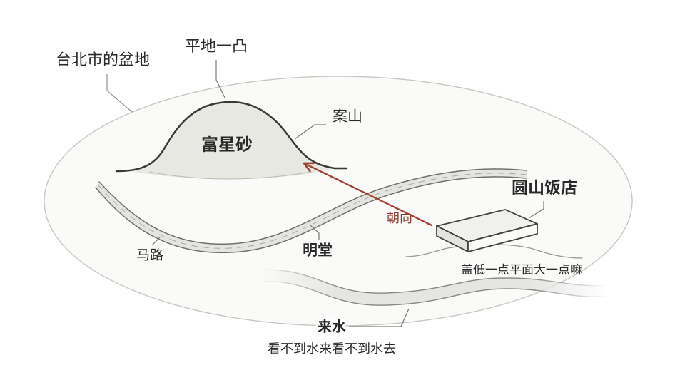 〔口述〕他指明说的是「以前的老动物园」那个山头，让学生想一想，在台北市附近找的是哪座山。（[00:54:51–00:55:01](https://www.bilibili.com/video/BV1KJsLekEfA/?p=33&t=3291)，第 98754–99053 帧） 〔指代〕说当时想盖到「这边」，又说想取「这个」风水时，两次手指的都是画面中央的黑板。（[00:55:02–00:55:10](https://www.bilibili.com/video/BV1KJsLekEfA/?p=33&t=3302)，第 99082–99304 帧） |
| **圆山饭店为什么被说成「强龙压主」？** | 〔口述〕倪师让学生再看那个圆肥的山头，说「他在想取这个的风水」，随即指出饭店盖得比后面的山势高。（[00:55:03–00:55:14](https://www.bilibili.com/video/BV1KJsLekEfA/?p=33&t=3303)，第 99114–99425 帧） 〔口述〕房子太高，压了后面的龙，他把这情形叫作「强龙压主」。其中的「主」，他解释为「后面的龙后面的地」。（[00:55:15–00:55:29](https://www.bilibili.com/video/BV1KJsLekEfA/?p=33&t=3315)，第 99462–99881 帧） 〔口述〕接着讲地龙被压到、圆山饭店盖在这上面，倪师在这个例子里下的断语是「改朝换代」。（[00:55:29–00:55:36](https://www.bilibili.com/video/BV1KJsLekEfA/?p=33&t=3329)，第 99882–100091 帧） 〔口述〕讲到当初盖饭店时有没有开口请教，倪师用一句话收尾，「你不问我们当然不会告诉你啊」。（[00:55:36–00:55:44](https://www.bilibili.com/video/BV1KJsLekEfA/?p=33&t=3336)，第 100092–100331 帧） |

**总结区**

- 通用规则：顺来龙走向画第一条线，自水口画第二条线，两线交点定出平面穴位，再到现场看前方朝山、案山定上下（[00:49:58–00:51:00](https://www.bilibili.com/video/BV1KJsLekEfA/?p=33&t=2998)，第 89964–91811 帧）；倪师告诫定位置要避开分金，他把落在分金上与遭受天灾人祸相联系（[00:51:16–00:51:59](https://www.bilibili.com/video/BV1KJsLekEfA/?p=33&t=3076)，第 92304–93575 帧）；倪师说「阴宅呢是盖穴位」，山龙下来、气很大时，阳宅不能盖在棱线上，要盖在棱线侧边（[00:52:37–00:53:08](https://www.bilibili.com/video/BV1KJsLekEfA/?p=33&t=3157)，第 94728–95663 帧）；房子不能盖得比后山高，是倪师明说的阳宅原则（[00:53:35–00:53:47](https://www.bilibili.com/video/BV1KJsLekEfA/?p=33&t=3215)，第 96462–96827 帧）
- 只在本例：美国三户遇龙卷风，倪师说在分金上的A、C两户房子整个被吹走，B家连一块瓦都没掉（[00:51:38–00:51:53](https://www.bilibili.com/video/BV1KJsLekEfA/?p=33&t=3098)，第 92952–93395 帧）；倪师让人从剑潭的路上回看圆山饭店，认为选地很好，房子却盖得太高，挡住了后山（[00:53:47–00:54:11](https://www.bilibili.com/video/BV1KJsLekEfA/?p=33&t=3227)，第 96828–97559 帧）；台北市老动物园那个山头圆肥，倪师称为富星砂，说阴宅或阳宅面对它都主大富（[00:54:39–00:55:01](https://www.bilibili.com/video/BV1KJsLekEfA/?p=33&t=3279)，第 98388–99053 帧）；圆山饭店高过后山，倪师称为强龙压主，并在本例断为改朝换代（[00:55:12–00:55:36](https://www.bilibili.com/video/BV1KJsLekEfA/?p=33&t=3312)，第 99360–100091 帧）
- 不是风水规则，是处世方法：替人定下葬的位置，风水师心态要正，不能存心把穴位移到分金上（[00:51:13–00:51:26](https://www.bilibili.com/video/BV1KJsLekEfA/?p=33&t=3073)，第 92202–92585 帧）；谈到盖饭店前的请教，倪师提醒要先开口问，「你不问我们当然不会告诉你啊」（[00:55:36–00:55:44](https://www.bilibili.com/video/BV1KJsLekEfA/?p=33&t=3336)，第 100092–100331 帧）

**待核**

1. 解释水口时，两路都把「这两个水来龙」连在一起，其中怎样断句待核（[00:50:10](https://www.bilibili.com/video/BV1KJsLekEfA/?p=33&t=3010)，第 90324 帧）
2. 下层白弧右侧有很淡的粉笔小字，字形认不全（[00:50:24](https://www.bilibili.com/video/BV1KJsLekEfA/?p=33&t=3024)，第 90743 帧）
3. 字幕写「在上下两个位置上」，语音作「上下哪个位置上」。本块只说看朝山、案山来定高低，具体怎样判别待核（[00:50:56](https://www.bilibili.com/video/BV1KJsLekEfA/?p=33&t=3056)，第 91686 帧）
4. 倪师提到二十四个分金，本块没有解释分金怎样划分、到现场怎样辨认（[00:51:27](https://www.bilibili.com/video/BV1KJsLekEfA/?p=33&t=3087)，第 92628 帧）
5. 龙卷风一句，字幕写「B跑了」，语音作「B好了」。下句两路都说B没事，这里的动词待核（[00:51:42](https://www.bilibili.com/video/BV1KJsLekEfA/?p=33&t=3102)，第 93060 帧）
6. 字幕把被吹走的房屋标号连写为「AAC」，笔记据前面点名受损的A、C两户转述（[00:51:49](https://www.bilibili.com/video/BV1KJsLekEfA/?p=33&t=3109)，第 93276 帧）
7. 黑板上竖写的两个字，下字可辨「宅」，上字的笔画认不全（[00:52:46](https://www.bilibili.com/video/BV1KJsLekEfA/?p=33&t=3166)，第 94980 帧）
8. 字幕写「你们要陷下来」，语音在这里已接到盖在侧边的说法，这几个字待核（[00:53:02](https://www.bilibili.com/video/BV1KJsLekEfA/?p=33&t=3182)，第 95478 帧）
9. 字幕写「正朝外」，语音作「正朝来」，朝向用词待核（[00:53:08](https://www.bilibili.com/video/BV1KJsLekEfA/?p=33&t=3188)，第 95664 帧）
10. 圆山饭店一句，字幕写「盖好以后就退出联合国」，语音把机构名转成「零红光」，名称待核（[00:53:31](https://www.bilibili.com/video/BV1KJsLekEfA/?p=33&t=3211)，第 96342 帧）
11. 复述高度原则时，字幕写「不能比山高」，语音作「可能比山高」，笔记取前面两路一致的「房子绝对不要盖的比后面山高」（[00:53:42](https://www.bilibili.com/video/BV1KJsLekEfA/?p=33&t=3222)，第 96660 帧）
12. 讲管饭店的人家时，前一句停在「谁家就后」，下句接「后面就没有了」，这里的「后面」具体指什么待核（[00:53:56](https://www.bilibili.com/video/BV1KJsLekEfA/?p=33&t=3236)，第 97104 帧）
13. 字幕列出「淡水河基隆河」，语音只转出衔接下一句的「突然」，两条河名待核（[00:54:22](https://www.bilibili.com/video/BV1KJsLekEfA/?p=33&t=3262)，第 97878 帧）
14. 圆团左下方还有几笔连写的粉笔字，字形认不全（[00:54:48](https://www.bilibili.com/video/BV1KJsLekEfA/?p=33&t=3288)，第 98644 帧）
15. 讲当初为什么想盖到这里，字幕末尾写「对着大片」，语音作「这种大富」，此句末尾待核（[00:55:01](https://www.bilibili.com/video/BV1KJsLekEfA/?p=33&t=3301)，第 99054 帧）
16. 字幕写「中央山脉地龙被压到」，语音作「中山的地龙被压到」，地名待核（[00:55:29](https://www.bilibili.com/video/BV1KJsLekEfA/?p=33&t=3329)，第 99882 帧）
17. 字幕写「老师我盖在龙脉上面也不好」，语音转写为「龙外上我们」，是否有学生接话、句末是否说了「也不好」待核（[00:52:54–00:52:56](https://www.bilibili.com/video/BV1KJsLekEfA/?p=33&t=3174)，第 95220–95297 帧）

### 10　圆山饭店、文化学院与现场认穴（[00:55:44–01:02:03](https://www.bilibili.com/video/BV1KJsLekEfA/?p=33&t=3344)，第 100332–111692 帧）

| 提示区 | 笔记区 |
|---|---|
| **圆山饭店的层数和平面可以怎么改？** | 〔口述〕倪师先留下「问的哲学在哪里」这一问，说等到介绍《易经》时再讲。（[00:55:44–00:55:49](https://www.bilibili.com/video/BV1KJsLekEfA/?p=33&t=3344)，第 100332–100481 帧） 〔板书〕开头的黑板上，涂过的圆团在一个斜方框的左上方。一条线从圆团伸向右上，方框旁有短箭头指向圆团。（[00:55:44](https://www.bilibili.com/video/BV1KJsLekEfA/?p=33&t=3344)，第 100332 帧） 〔口述〕他认为当初的想法很好，盖法的差别只在「一念之间」。他建议少盖几层，「盖低一点平面大一点嘛」。（[00:55:49–00:55:59](https://www.bilibili.com/video/BV1KJsLekEfA/?p=33&t=3349)，第 100482–100793 帧） 〔推断〕推断，开头少盖几层的建议承接圆山饭店一例，后面讲到圆山桥时，倪师又点出了饭店的名字。（[00:55:55–00:56:40](https://www.bilibili.com/video/BV1KJsLekEfA/?p=33&t=3355)，第 100656–102017 帧） |
| **这里的马路怎样作明堂，新桥又怎么评？** | 〔口述〕讲朝向时，他把这条马路当作本例的明堂，取的是朝明堂的方向。顺着高速路再过去，有一条路往下接，他又提到「现在又开一条新路下去」。（[00:55:59–00:56:09](https://www.bilibili.com/video/BV1KJsLekEfA/?p=33&t=3359)，第 100794–101093 帧） 〔指代〕刚开始讲朝向时，倪师说「这个」，手指的是黑板，位置在整幅画面中央。（[00:56:00](https://www.bilibili.com/video/BV1KJsLekEfA/?p=33&t=3360)，第 100828 帧） 〔板书〕黑板中间有几道靠得很近的曲线，从左侧弯下去，再向右抬起。曲线上方有个涂过的圆团，右下方有个斜放的小方框。（[00:56:09](https://www.bilibili.com/video/BV1KJsLekEfA/?p=33&t=3369)，第 101083 帧） 〔口述〕说到蒋家，他怀疑有人想尽办法破坏。按他的风水看法，在那里盖新桥是「更坏」。至于对方懂不懂、有没有人刻意这样做，他说「就不晓得了」。（[00:56:09–00:56:35](https://www.bilibili.com/video/BV1KJsLekEfA/?p=33&t=3369)，第 101094–101867 帧） |
| **为什么说圆山饭店的地点找得好？** | 〔口述〕倪师先说原来的圆山桥，再说圆山饭店下面是河，称这河水为来水。从饭店这边看，却是「看不到水来看不到水去」。（[00:56:35–00:56:45](https://www.bilibili.com/video/BV1KJsLekEfA/?p=33&t=3395)，第 101868–102161 帧） 〔指代〕提到圆山饭店，说「这个」时，手指画面正中的黑板。同一句接着说「这边」时，手指移到画面上方中央。（[00:56:38–00:56:39](https://www.bilibili.com/video/BV1KJsLekEfA/?p=33&t=3398)，第 101951–101994 帧） 〔板书〕黑板中部偏左有个大圆，里面一笔往内卷。圆的右侧露出两道挨着的弯线，黑板右上另有近似屋顶的折线，下接方框。（[00:56:41](https://www.bilibili.com/video/BV1KJsLekEfA/?p=33&t=3401)，第 102053 帧） 〔口述〕明堂对面有一座山，他称作案山。对面有山，这里又有水来去，所以他评圆山饭店的「地点是找的很好」。（[00:56:45–00:56:56](https://www.bilibili.com/video/BV1KJsLekEfA/?p=33&t=3405)，第 102162–102485 帧） 〔板书〕黑板中部偏左的大圈内，可见一道朝下的短笔。几条并排的曲线从圈的右上方经过，斜方框画在曲线下方。（[00:56:52](https://www.bilibili.com/video/BV1KJsLekEfA/?p=33&t=3412)，第 102385 帧） |
| **文化学院盖在这条山龙的什么位置？** | 〔口述〕讲文化学院时，倪师先让人看整个山势，说「后面的龙很长」，接着指出学院盖在这条山势的哪一处。（[00:57:00–00:57:12](https://www.bilibili.com/video/BV1KJsLekEfA/?p=33&t=3420)，第 102612–102983 帧） 〔板书〕黑板左上可辨「文化」。下方有个圆，圆底挨着一小段弯线，圆的右侧接出一条近乎水平的长线，中段被倪师挡住。（[00:57:11](https://www.bilibili.com/video/BV1KJsLekEfA/?p=33&t=3431)，第 102936 帧） 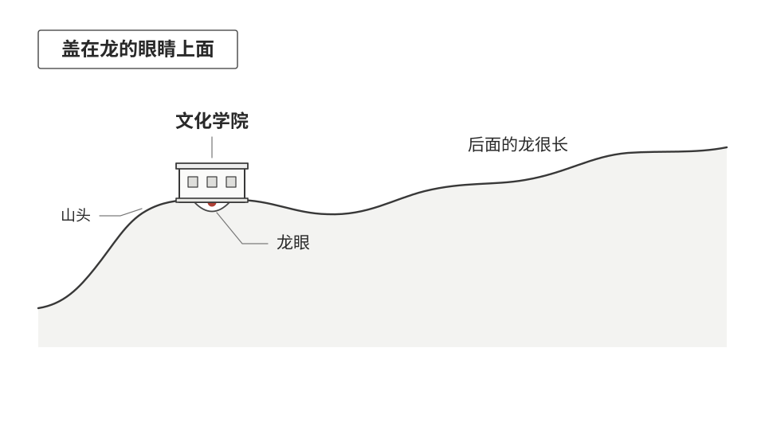 〔口述〕照倪师所说的龙形，文化学院在山头这一边，校舍正好落在龙眼的位置，他说是「盖在龙的眼睛上面」。（[00:57:16–00:57:31](https://www.bilibili.com/video/BV1KJsLekEfA/?p=33&t=3436)，第 103104–103541 帧） 〔板书〕长线下方、原来那个圆的右下侧，又能看到一个圈。圈内有几笔连在一起的粉笔字，字形认不全。（[00:57:22](https://www.bilibili.com/video/BV1KJsLekEfA/?p=33&t=3442)，第 103266 帧） 〔板书〕长横线上方另有一条较短的细线，先平着向右伸，再往上抬，接到一小段圆弧。再往右的部分被挡住。（[00:57:28](https://www.bilibili.com/video/BV1KJsLekEfA/?p=33&t=3448)，第 103440 帧） |
| **盖在龙眼上会怎样，盖好了又怎么办？** | 〔口述〕倪师拿眼睛被遮来比这处盖法，说眼睛一遮就看不清，又用「看不清楚就像浆糊一样迷糊了」来形容。（[00:57:31–00:57:40](https://www.bilibili.com/video/BV1KJsLekEfA/?p=33&t=3451)，第 103542–103811 帧） 〔板书〕上方的轮廓从低处升起后向右转平。升高处左侧密画了几道斜线，下方另有一条从左下向右上伸的直线。（[00:57:40](https://www.bilibili.com/video/BV1KJsLekEfA/?p=33&t=3460)，第 103800 帧） 〔口述〕他说当初是高手去找的龙，这个地点「是龙穴没错」。问题在于房子盖到了眼睛上，已经盖好，他提出「把眼睛做开光」。（[00:57:48–00:58:05](https://www.bilibili.com/video/BV1KJsLekEfA/?p=33&t=3468)，第 104064–104579 帧） 〔口述〕他说自己去过，校方有人来找他，他也想过怎么办。他用「我拿人钱财与人消灾啊」说明自己的责任，至于有没有照做，由对方决定。（[00:58:09–00:58:22](https://www.bilibili.com/video/BV1KJsLekEfA/?p=33&t=3489)，第 104682–105071 帧） |
| **龙眼未开，倪师怎样说到学生和老师？** | 〔口述〕倪师给这个判断加了条件。若龙眼一直没有打开，这样持续下去，他说「文化学院学生一天到晚就去闹啊」。（[00:58:22–00:58:31](https://www.bilibili.com/video/BV1KJsLekEfA/?p=33&t=3502)，第 105072–105353 帧） 〔口述〕他用眼睛看不清来比校内的办事员、院长等人，说他们不知道学生要什么，所以感叹「学生最可怜」。（[00:58:31–00:58:43](https://www.bilibili.com/video/BV1KJsLekEfA/?p=33&t=3511)，第 105354–105695 帧） 〔口述〕倪师说「学道的心是至高无上的」。若把老师当成至高无上，就会惹得学生去闹，他用「天地否」形容这种情形。（[00:58:43–00:58:55](https://www.bilibili.com/video/BV1KJsLekEfA/?p=33&t=3523)，第 105696–106073 帧） |
| **两股水交会以后，怎样对回龙脉？** | 〔口述〕先看两股水各从哪边来，在哪里交会，交会后又从哪里出去。倪师指着这个汇流后流出的位置说「这个就是位置」。（[00:59:05–00:59:11](https://www.bilibili.com/video/BV1KJsLekEfA/?p=33&t=3545)，第 106350–106541 帧） 〔指代〕说一股水从「这边」来时，手指画面上方中央的黑板。接着说龙脉在「这里」时，手指的是画面正中的黑板。（[00:59:05–00:59:13](https://www.bilibili.com/video/BV1KJsLekEfA/?p=33&t=3545)，第 106362–106618 帧） 〔口述〕认出水的位置以后，还要「对回去龙脉的地方」。他比出山势怎样走，再从水那边往回对，看在哪里交接。（[00:59:11–00:59:21](https://www.bilibili.com/video/BV1KJsLekEfA/?p=33&t=3551)，第 106542–106841 帧） 〔板书〕黑板上方有一道开口向上的小弧，下方是一道更宽的粗弧。一根细直线从左下向右上斜穿两道弧，粗弧右侧有一段被遮住。（[00:59:18](https://www.bilibili.com/video/BV1KJsLekEfA/?p=33&t=3558)，第 106752 帧） 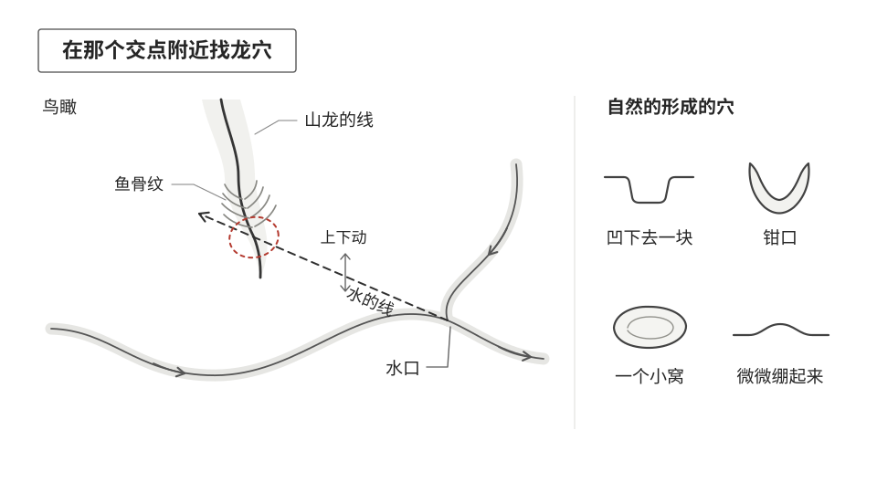 |
| **鸟瞰图上的线怎样移，穴到哪里找？** | 〔口述〕倪师说「我现在画的是鸟瞰」。山势往下走，拉线时还要上下移动。他举出图上的一个位置，又说「比如在这里不一定的」。（[00:59:21–00:59:42](https://www.bilibili.com/video/BV1KJsLekEfA/?p=33&t=3561)，第 106842–107471 帧） 〔板书〕上方小弧与斜直线相交的地方添了几笔短线，这几笔向同一处聚拢。下方的粗弧还露着左半边。（[00:59:26](https://www.bilibili.com/video/BV1KJsLekEfA/?p=33&t=3566)，第 106984 帧） 〔板书〕一条近乎竖直的线从上方几笔聚拢处向下，穿过大弧，又与下方近水平的线相交。右侧还露出一段向右上扬的长线。（[00:59:33](https://www.bilibili.com/video/BV1KJsLekEfA/?p=33&t=3573)，第 107202 帧） 〔指代〕提到「这个」穴时，手指画面上方中央的黑板。演示移动、说到「刚好在这个地方」时，手指已移到画面正中的黑板。（[00:59:36–00:59:39](https://www.bilibili.com/video/BV1KJsLekEfA/?p=33&t=3576)，第 107282–107380 帧） 〔口述〕从水口往回拉一条线，看水的线与山龙的线在哪里相交。接下来找穴，倪师把范围说成「在那个交点附近」。（[00:59:42–00:59:50](https://www.bilibili.com/video/BV1KJsLekEfA/?p=33&t=3582)，第 107472–107717 帧） |
| **天然形成的穴有哪些看得见的形状？** | 〔口述〕倪师举了地面自然凹下去一块的样子，也有两边「像老虎钳一样张开来的」。他把这种张开的形状叫作「钳口」。（[00:59:52–01:00:06](https://www.bilibili.com/video/BV1KJsLekEfA/?p=33&t=3592)，第 107772–108209 帧） 〔板书〕黑板右上露出一个方折的轮廓，上边正中向下凹进一块。它左侧有一道开口朝上的宽弧，一条细长的线穿过弧底。（[01:00:04](https://www.bilibili.com/video/BV1KJsLekEfA/?p=33&t=3604)，第 108120 帧） 〔口述〕他接着又举了两种样子，一种是窝成一个小窝，另一种是地面略略隆起，他形容为「微微绷起来」。（[01:00:07–01:00:15](https://www.bilibili.com/video/BV1KJsLekEfA/?p=33&t=3607)，第 108210–108479 帧） |
| **怎样从结穴旁的纹路看地脉？** | 〔口述〕他把地脉比作手上的脉，「脉在下面跳你在上面看」。按他的说法，有地脉、地气又旺，表示这里是天然形成的，没有被人动过。（[01:00:16–01:00:33](https://www.bilibili.com/video/BV1KJsLekEfA/?p=33&t=3616)，第 108480–109019 帧） 〔口述〕讲到旁边的明堂往下、龙落地结穴时，他让人留意结穴旁的地面，说那里可以看到纹路，样子像水纹。（[01:00:34–01:00:46](https://www.bilibili.com/video/BV1KJsLekEfA/?p=33&t=3634)，第 109020–109403 帧） 〔指代〕讲到旁边的明堂时，倪师说「这个」，手指的是黑板，位置在整幅画面上方中央。（[01:00:35](https://www.bilibili.com/video/BV1KJsLekEfA/?p=33&t=3635)，第 109079 帧） 〔口述〕把石头丢进水里，纹路就向外散开。倪师用这个比方说明地面的纹，见到这样的形状，他认为地脉和地气都很旺。（[01:00:46–01:00:55](https://www.bilibili.com/video/BV1KJsLekEfA/?p=33&t=3646)，第 109404–109673 帧） 〔板书〕黑板上方几条线汇拢的地方，两边各排着一串短弧，一笔挨着一笔。右侧可辨「凹」「钳」，其余草写的字认不全。（[01:00:49](https://www.bilibili.com/video/BV1KJsLekEfA/?p=33&t=3649)，第 109488 帧） |
| **怎样辨履带印，草遮住地面又看什么？** | 〔口述〕他提醒人先看清地上的纹是不是推土车履带经过留下的。照他的说法，真龙处可以看到前面讲的那种天然纹路。（[01:00:55–01:01:08](https://www.bilibili.com/video/BV1KJsLekEfA/?p=33&t=3655)，第 109674–110069 帧） 〔口述〕地上看不到纹时，就把草拔起来，「看看里面的土什么颜色」，再用手摸一摸水分有多少，土是不是黏黏的。（[01:01:09–01:01:16](https://www.bilibili.com/video/BV1KJsLekEfA/?p=33&t=3669)，第 110070–110303 帧） 〔口述〕如果拔起草来，底下的土也干干的，他拿人的口渴来打比方，说这土更渴，对这种情形连说「不好不好」。（[01:01:16–01:01:25](https://www.bilibili.com/video/BV1KJsLekEfA/?p=33&t=3676)，第 110304–110573 帧） |
| **山形像大象，为什么说有两个穴？** | 〔口述〕倪师说到了现场再教怎样认定找到了龙穴。他说真穴会有能看得见的形状，辨形时「以动物象为主」。（[01:01:26–01:01:37](https://www.bilibili.com/video/BV1KJsLekEfA/?p=33&t=3686)，第 110604–110939 帧） 〔指代〕举山龙往下走的例子，说「这个」时，倪师手指的是黑板，位置在整幅画面上方中央。（[01:01:39](https://www.bilibili.com/video/BV1KJsLekEfA/?p=33&t=3699)，第 110972 帧） 〔口述〕山龙下来，整片形状看起来像一只大象，他就断「一定有两个穴」，还特意说「就不是一个穴」。取两个的理由是「鼻子两个孔啊」。（[01:01:41–01:01:55](https://www.bilibili.com/video/BV1KJsLekEfA/?p=33&t=3701)，第 111042–111473 帧） 〔口述〕讲完大象的例子，他把判断落在「地物地势」上。现场怎么辨形，要以当地实际呈现的形势为主。（[01:01:55–01:02:03](https://www.bilibili.com/video/BV1KJsLekEfA/?p=33&t=3715)，第 111474–111692 帧） |

**总结区**

- 通用规则：看两股水交会后从哪里出去，再从水口拉线对回山龙的线，在两线交点附近找穴。（[00:59:05–00:59:50](https://www.bilibili.com/video/BV1KJsLekEfA/?p=33&t=3545)，第 106350–107717 帧）；天然形成的穴可以凹下一块、张如钳口、窝成小窝，也可以微微绷起。（[00:59:52–01:00:15](https://www.bilibili.com/video/BV1KJsLekEfA/?p=33&t=3592)，第 107772–108479 帧）；倪师以结穴旁天然形成的水纹状地纹判断地气旺，辨纹时要看清是否有推土车履带经过。（[01:00:36–01:01:08](https://www.bilibili.com/video/BV1KJsLekEfA/?p=33&t=3636)，第 109080–110069 帧）；现场认穴以动物象为主，辨作什么形状，要依当地的地物、地势来定。（[01:01:26–01:02:03](https://www.bilibili.com/video/BV1KJsLekEfA/?p=33&t=3686)，第 110604–111692 帧）
- 只在本例：倪师认为在圆山饭店一带盖新桥更坏，至于是否有人存心破坏蒋家的风水，他说自己不晓得。（[00:56:09–00:56:35](https://www.bilibili.com/video/BV1KJsLekEfA/?p=33&t=3369)，第 101094–101867 帧）；圆山饭店下有河，在此看不见水来水去，明堂对面又有案山，倪师评它的地点找得好。（[00:56:35–00:56:56](https://www.bilibili.com/video/BV1KJsLekEfA/?p=33&t=3395)，第 101868–102485 帧）；倪师称文化学院所在处是龙穴，校舍盖到山头这边的龙眼上，因而提出给眼睛开光。（[00:57:16–00:58:05](https://www.bilibili.com/video/BV1KJsLekEfA/?p=33&t=3436)，第 103104–104579 帧）；针对文化学院，他断若龙眼一直不开，学生会常去闹，校内办事员、院长等人也看不清学生所求。（[00:58:22–00:58:43](https://www.bilibili.com/video/BV1KJsLekEfA/?p=33&t=3502)，第 105072–105695 帧）
- 不是风水规则，是处世方法：收了人家的钱就替人想办法消灾，至于有没有照做，由来问的人自己决定。（[00:58:09–00:58:22](https://www.bilibili.com/video/BV1KJsLekEfA/?p=33&t=3489)，第 104682–105071 帧）；谈师生相处，倪师把学道的心看得至高无上，提醒人别把老师放在这个位置。（[00:58:43–00:58:55](https://www.bilibili.com/video/BV1KJsLekEfA/?p=33&t=3523)，第 105696–106073 帧）

**待核**

1. 饭店一例用马路来讲「明堂」，用对面的山来讲「案山」，本块没有细讲两个词的定义。（[00:56:01](https://www.bilibili.com/video/BV1KJsLekEfA/?p=33&t=3361)，第 100836 帧、[00:56:45](https://www.bilibili.com/video/BV1KJsLekEfA/?p=33&t=3405)，第 102162 帧）
2. 提到蒋家时，字幕作「破坏我们蒋家的风水」，语音把末词记成「工作」。（[00:56:14](https://www.bilibili.com/video/BV1KJsLekEfA/?p=33&t=3374)，第 101220 帧）
3. 文化学院示意图中，长线下方圈内的粉笔字连在一起，认不全。（[00:57:22](https://www.bilibili.com/video/BV1KJsLekEfA/?p=33&t=3442)，第 103266 帧）
4. 两路都记成「你只要找得到的戏」，后面接「在文化都有」，这个「戏」是否指院系，待核。（[00:57:40](https://www.bilibili.com/video/BV1KJsLekEfA/?p=33&t=3460)，第 103812 帧）
5. 问如何给龙眼开光，字幕接「就要在要求下啊对不对」，语音也含混，具体做法无法从这句确定。（[00:58:06](https://www.bilibili.com/video/BV1KJsLekEfA/?p=33&t=3486)，第 104580 帧）
6. 来找倪师的人，字幕作「董事」，语音作「董事长」，职称待核。（[00:58:09](https://www.bilibili.com/video/BV1KJsLekEfA/?p=33&t=3489)，第 104682 帧）
7. 列举校内人员时，字幕作「系主任」，语音作「组员」，这个职称待核。（[00:58:35](https://www.bilibili.com/video/BV1KJsLekEfA/?p=33&t=3515)，第 105456 帧）
8. 字幕「不是否子嘛」与语音「不是痞子吗」不合，稍后虽说「天地否」，本块没有展开解释。（[00:58:48](https://www.bilibili.com/video/BV1KJsLekEfA/?p=33&t=3528)，第 105858 帧、[00:58:52](https://www.bilibili.com/video/BV1KJsLekEfA/?p=33&t=3532)，第 105966 帧）
9. 字幕句首的「万里因力」在语音一路找不到对应字句，后半句说线还要上下动，两路能对上。（[00:59:24](https://www.bilibili.com/video/BV1KJsLekEfA/?p=33&t=3564)，第 106920 帧）
10. 交点附近所找的对象，字幕连续两句作「龙穴」，语音两处作「龙脉」，原词待核。（[00:59:47](https://www.bilibili.com/video/BV1KJsLekEfA/?p=33&t=3587)，第 107616 帧、[00:59:50](https://www.bilibili.com/video/BV1KJsLekEfA/?p=33&t=3590)，第 107718 帧）
11. 石头入水后纹路向外散，字幕用「鱼骨纹」一词，语音一路辨不清这个名称。（[01:00:48](https://www.bilibili.com/video/BV1KJsLekEfA/?p=33&t=3648)，第 109458 帧）
12. 短弧两侧及黑板右方还有草写的粉笔字，未能逐字辨清。（[01:00:49](https://www.bilibili.com/video/BV1KJsLekEfA/?p=33&t=3649)，第 109488 帧）
13. 山龙下来后，字幕作「然后后面两个大大土龙我不是」，语音也含混，后面两个具体指什么，待核。（[01:01:43](https://www.bilibili.com/video/BV1KJsLekEfA/?p=33&t=3703)，第 111096 帧）
14. 字幕末句作「以当地的形势沩主」，语音末尾是「为主」，笔记据此把「沩」改作「为」。（[01:01:58](https://www.bilibili.com/video/BV1KJsLekEfA/?p=33&t=3718)，第 111546 帧）
15. 轮廓上扬处左侧的粉笔笔画是否写作「浆糊」，字形待核。（[00:57:40](https://www.bilibili.com/video/BV1KJsLekEfA/?p=33&t=3460)，第 103800 帧）

